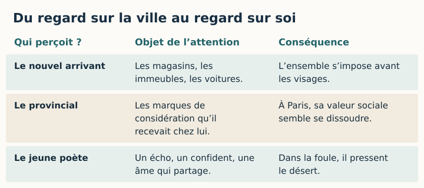

# BEL A/L — Arabe, thème Lyon 2026 · Corrigé brut

*Corrigé rédigé par IA, non officiel. Signalez toute erreur.*

**Rédaction** · GPT-6.2 Astra Ultra · vitesse non renseignée

## Thème

Honoré de Balzac, *Illusions perdues* (millésime indiqué dans le livret, 1874).

في أول جولة له على غير هدى في شوارع البولفار وشارع السلام، شغلت الأشياء بال لوسيان أكثر بكثير مما شغله الناس، شأنه في ذلك شأن كل وافد جديد. ففي باريس أول ما يستأثر بالانتباه هو المشاهد في جملتها. يجذب المرء قبل كل شيء ما في المتاجر من ترف، وعلو المباني، وتزاحم العربات، وذلك التقابل الدائم بين أقصى البذخ وأقصى البؤس. وأمام هذا الحشد الذي كان غريبا عنه، أخذت الدهشة هذا الرجل الواسع الخيال وأحس كأن قدره في عين نفسه قد تضاءل إلى حد هائل. فالذين يحظون في الأقاليم بشيء من التقدير، ويلقون فيها عند كل خطوة ما يدلهم على أهميتهم، لا يألفون أن يفقدوا دفعة واحدة كل ما كان لهم من قدر. أن يكون المرء ذا شأن في بلده ثم لا يكون له أي شأن في باريس، تلك حالان لا بد للانتقال بينهما من مراحل، ومن ينتقل من إحداهما إلى الأخرى انتقالا مباغتا يسقط في ضرب من العدم. أما ذلك الشاعر الشاب الذي كان يجد لكل عاطفة من عواطفه صدى، ولكل فكرة من أفكاره من يأتمنه عليها، ولكل إحساس مهما دق نفسا تشاركه فيه، فقد كانت باريس ستغدو في عينيه صحراء موحشة.

[Sujet officiel, page 12](https://www.ens-lyon.fr/sites/default/files/2026-04/Epreuve%20de%20sp%C3%A9cialit%C3%A9%202026.pdf#page=12)

