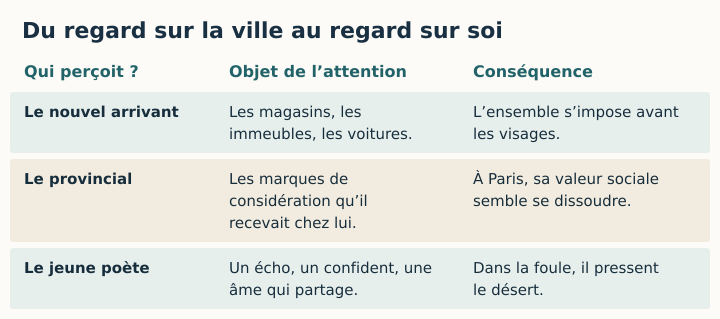

# BEL A/L — Arabe, thème Lyon 2026 · Corrigé guidé

*Corrigé rédigé par IA, non officiel. Signalez toute erreur.*

**Rédaction** · GPT-6.2 Astra Ultra · vitesse non renseignée

## Présentation du sujet

L’épreuve de spécialité de Lyon dure quatre heures et autorise un dictionnaire bilingue. Le passage d’Honoré de Balzac est à traduire en entier, depuis la première promenade de Lucien jusqu’à l’image du désert. Le livret porte la date de 1874.

[Sujet officiel, page 12](https://www.ens-lyon.fr/sites/default/files/2026-04/Epreuve%20de%20sp%C3%A9cialit%C3%A9%202026.pdf#page=12)

## Lire le mouvement de la promenade

> [!INDICATION]
> Qui est le sujet des premières perceptions ? À quel moment l’observation faite par Lucien devient-elle une remarque générale sur les provinciaux ?

#### Solution

Lucien est le premier point de vue. Il se promène et s’intéresse aux choses. Dans la phrase qui suit, la ville agit sur tout observateur. La vue d’ensemble des boutiques, des maisons et des voitures expose la cause de sa surprise. La phrase sur les provinciaux donne ensuite une portée collective au sentiment personnel qui vient d’être décrit. La dernière phrase reprend le cas de Lucien en le désignant par sa qualité de jeune poète.

**Donner un sens concret aux « masses ».** La série qui suit ce mot comprend aussi bien la hauteur des immeubles que la distance entre la richesse et la misère. Traduire par une formule qui évoque la vue d’ensemble permet de garder tout le développement. La foule humaine vient seulement dans la phrase suivante. Les voitures de ce Paris sont des véhicules hippomobiles, d’où le choix du nom général des voitures et attelages en arabe.

**Traduire « être quelque chose ».** La « valeur » que le provincial perd est le rang que lui reconnaissaient ceux de son pays. La locution arabe exprimant le fait d’avoir de l’importance maintient le lien avec ce qui précède. Répéter le même nom puis le nier donne au contraste entre la province et Paris son tranchant.

**Laisser se développer la dernière période.** Trois réalités intérieures du poète trouvent en province trois réponses, un écho, un confident et une âme. Elles se déploient avant l’apparition du désert. En arabe, une construction introduisant le poète en tête de phrase permet de retarder le verbe principal. L’imminence envisagée depuis le passé appelle une forme de futur dans le passé. La foule reste présente dans l’esprit du lecteur quand arrive le dernier nom.

## Traduction rédigée

#### Solution

في أول جولة له على غير هدى في شوارع البولفار وشارع السلام، شغلت الأشياء بال لوسيان أكثر بكثير مما شغله الناس، شأنه في ذلك شأن كل وافد جديد. ففي باريس أول ما يستأثر بالانتباه هو المشاهد في جملتها. يجذب المرء قبل كل شيء ما في المتاجر من ترف، وعلو المباني، وتزاحم العربات، وذلك التقابل الدائم بين أقصى البذخ وأقصى البؤس. وأمام هذا الحشد الذي كان غريبا عنه، أخذت الدهشة هذا الرجل الواسع الخيال وأحس كأن قدره في عين نفسه قد تضاءل إلى حد هائل. فالذين يحظون في الأقاليم بشيء من التقدير، ويلقون فيها عند كل خطوة ما يدلهم على أهميتهم، لا يألفون أن يفقدوا دفعة واحدة كل ما كان لهم من قدر. أن يكون المرء ذا شأن في بلده ثم لا يكون له أي شأن في باريس، تلك حالان لا بد للانتقال بينهما من مراحل، ومن ينتقل من إحداهما إلى الأخرى انتقالا مباغتا يسقط في ضرب من العدم. أما ذلك الشاعر الشاب الذي كان يجد لكل عاطفة من عواطفه صدى، ولكل فكرة من أفكاره من يأتمنه عليها، ولكل إحساس مهما دق نفسا تشاركه فيه، فقد كانت باريس ستغدو في عينيه صحراء موحشة.

## Bilan

À la relecture, suivre les changements d’échelle entre Lucien, tous les nouveaux venus, les gens de province et le jeune poète. Puis vérifier la place et le temps de la dernière proposition, qui annonce une expérience parisienne encore à venir.
