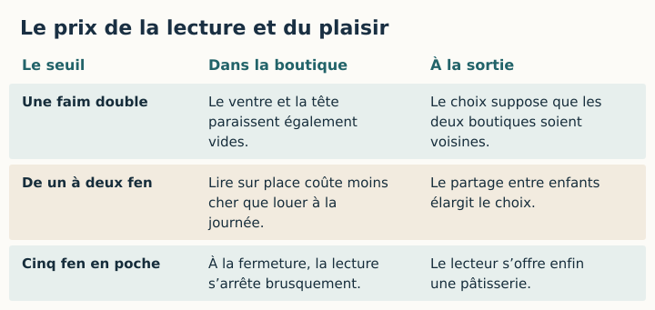

# BEL A/L — Chinois, commentaire et traduction 2026 · Corrigé guidé

*Corrigé rédigé par IA, non officiel. Signalez toute erreur.*

**Rédaction** · GPT-6.2 Astra Ultra · vitesse non renseignée

## Présentation du sujet

L’écrit de six heures autorise le dictionnaire unilingue. Le commentaire en chinois porte sur tout le texte de Bei Dao, des réflexions sur la lecture jusqu’à la plaisanterie sur le traître, ligne 28. La version française se limite aux lignes 9 à 15.

[Sujet officiel, pages 8 et 9](https://www.ens.psl.eu/sites/default/files/al_lve_commun_commentaire_traduction_2026.pdf#page=8) · [Rapport du jury, pages 2 à 4](https://www.ens-lyon.fr/sites/default/files/2026-10/Chinois%202026.pdf#page=2)

## Préparer le commentaire

> [!INDICATION]
> Quel détail oblige le lecteur à reconsidérer le choix initial entre les deux boutiques ? Retrouver la somme que l’enfant découvre dans sa poche en sortant.

#### Solution

Au début, les deux faims paraissent s’exclure parce que la monnaie manque. La dernière visite à la boutique de pâtisseries montre que le choix a été vécu à un moment particulier. Cela éclaire l’humour du dernier mot de l’essai. On peut adopter en jouant l’attitude d’un héros inflexible et se régaler juste après. Les termes empruntés aux intrigues politiques des petits livres donnent son langage à cet héroïsme d’enfant.

**Changer d’échelle.** Relever d’abord les lieux sur la carte, puis la disposition des couvertures et des bancs, enfin le mouvement de la main qui tourne les pages et celui de la main qui fouille la poche. La mémoire passe d’un quartier entier à un geste caractéristique. Dans le commentaire, cette progression fournit une ligne d’analyse plus précise qu’un inventaire des souvenirs du narrateur.

**Rapprocher les lumières.** La bougie de l’ouverture désigne le point de départ d’un itinéraire dans la lecture. Sur les images qu’aiment les garçons, ombre et lumière distinguent immédiatement les bons des méchants. Comparer les deux passages aide à séparer l’éclairage dont se souvient l’adulte et les signes simples qui enchantent encore l’enfant.

> [!JURY]
> Le rapport situe la « période difficile » dans les suites du Grand Bond en avant au début des années 1960, avant la Révolution culturelle. Les études ne durent qu’une demi-journée et l’enfant dispose de peu de monnaie. La demi-journée de liberté et la nécessité de choisir entre manger et lire prennent leur sens ensemble.

## Commentaire en chinois

在《城门开》的《读书》一文里，北岛要找的不是自己读过的第一本书的书名，而是读书这件事从哪里开始。文章开头留下的印象是一点烛火，接下来出现的却是一张旧北京地图、一家小吃店和一家小人书店。从这点烛火走到一个孩子的下午，叙述者如何使读者既感到阅读的吸引力，又听出成年后的他对这种吸引力所含的局限的回味？

开头几句几乎像在给“读书”重新下定义。作者把原本连在一起的两个字拆开来写，把“读”移到校园以外，把“书”移到课本以外。可是，刚断定动力不在现实利益，叙述就转到几枚零钱能买什么。那么，书店与小吃店为什么必须紧挨着？如果眼前只有一家小人书店，孩子走进去还算不上选择。小吃的名字一个接一个，玻璃上有雾，锅里有声，窗外的人闻得到香味，却只能模模糊糊地看见人影。隔着玻璃的这个位置让读者也站到孩子站的地方，明白所谓选择得先经受怎样的诱惑。“饥肠辘辘，头脑空空”让两种饿各占四个字，节奏上一样重。说起自己的决定，叙述者却用了“当然”。这两个字今天说来轻松，当时的口袋可不给孩子多少余地。

进书店以后，叙述的眼光发生变化。在小吃店前引人注目的是吃不到的东西，在书店里首先看见的却是从书上取下来、挂在墙上的封面。孩子从封面的图画认出想看的故事，老板则可凭编号找到包了牛皮纸的那本书。纸套上手写的名字和柜台上写明的价钱，让人看出这点精神自由是靠许多实际安排才得到的。借走一本书要花两分并另交押金，坐在店里只要一分。孩子们还想出另一个办法，几个人各借几本，轮流着看。店里的明文禁止与老板默认交换的做法相邻，成人的世界在这里并没有把规则执行到底。开头说读书自有一股动力，这股动力在回忆里有了很朴素的样子，就是一个孩子读完还想再读一本，而另一个孩子肯把手里的书递给他。

文章把做功课和读小人书分别安置在两种时间里。孩子们上午上课，下午先在家分组完成作业，然后才各自散去；他们并没有逃学。进了店又会聚到一处。翻页的“刷刷”声一下子把静物描写变成了孩子们活动的场面。起初，挂钟的滴答声融在翻书声和窃窃私语中。等天暗了又响起报时声，老板催他们走，他们恨不得一下子冲到结尾，偏偏越赶越没看明白。作者写他们迈出店门如同重回人间，却又问哪一个世界更真。就在这种犹疑之后，孩子摸摸口袋，发现还有五分钱，兴奋地去买了个糖耳朵。读者此刻尝到的甜味，正是前面那段二选一的议论留给结尾的意外。胃口并没有因为读书而消失，另一个世界也没有因为出门而消失。

最后一段再回到孩子爱看的具体故事。图画能帮识字不全的孩子往下读，也用一种简单而醒目的方法给他指明谁好谁坏。好人牺牲时有青松，坏人则总在阴影里。文章开篇也用过明暗，却用得很不一样。人生那条暗路通到一点微弱的火光，需要回过头来寻找；小人书里的光线却把是非一下子照得清清楚楚。“中等智商以下”这句评语，后面马上接上“我们这帮男孩”。成年作者可以点出那种读物对读者做的预设，仍然把自己算在为它着迷的人当中。这段回忆的亲切感就在这个“我们”里，笑意也在里面。

到了末尾，读者才完全明白作者为何用那么多笔墨来写小吃店。一场用几分钱买书还是买点心的小小挣扎，现在竟能用地下斗争故事里的口吻说出来：“绝不做叛徒”。把决定说得这么重，固然可笑；但吃过糖耳朵的孩子与向英雄看齐的孩子偏偏就是一个人。小人书并未交给他一个可以原样照搬的人生道理，却给过他一种讲述自己生活的语言。若要在那张旧地图上指出烛火在哪里，能指出的便是这样一个路口：从一边听得见油锅的声响，往另一边走，孩子就能把自己也写进故事里去。

## Traduire les lignes 9 à 15

**Le circuit matériel des livres.** Les couvertures originales numérotées sont exposées au mur. Les volumes eux-mêmes, une fois privés de couverture, sont recouverts de papier kraft. Titre et numéro sont écrits sur ce papier. Les deux enveloppes jouent donc des rôles distincts.

**Deux prix et une caution.** Un *fen* vaut le centième d’un yuan. Deux fen par livre et par jour permettent de l’emporter, avec une caution calculée à part. Un fen suffit pour la lecture sur place, sans dépôt. Le règlement interdit ensuite d’échanger les livres entre lecteurs et le patron laisse faire. « Fermer les yeux » restitue son indulgence.

**Deux temps dans l’après-midi.** Les écoliers commencent par faire leurs devoirs chez eux en petits groupes. C’est seulement après qu’ils sont lâchés en liberté. La note du livret éclaire l’image familière empruntée aux troupeaux. Traduire une garde de moutons réelle introduirait dans leur vie urbaine un épisode imaginaire.

#### Solution

La petite boutique de bandes dessinées n’avait guère de place. Les enfants formaient le gros de sa clientèle et elle jouait un peu le rôle que jouent aujourd’hui les cybercafés. Une fois entré, on voyait les murs entièrement garnis de couvertures numérotées. À la vue de toutes ces merveilles, le cœur vous battait. Quant aux livres, un à un, une fois « déshabillés », on leur collait une couverture de papier kraft où figuraient, écrits à la main, le titre et le numéro. Au comptoir, les prix étaient affichés bien en vue. Pour emporter un livre, la location coûtait deux fen par jour, caution en plus. Pour le lire sur place, un seul fen suffisait, sans caution.

Pendant les années de disette, à l’école primaire, nous n’avions classe qu’une demi-journée. L’après-midi, une fois les devoirs faits à la maison en petits groupes, on nous lâchait dans la nature. Chacun allait de son côté et la boutique de bandes dessinées était l’une de nos destinations. On y allait par trois ou quatre, chacun louait quelques volumes et tout le monde en profitait. Le règlement de la boutique interdisait expressément de se les échanger, mais le patron fermait les yeux.
