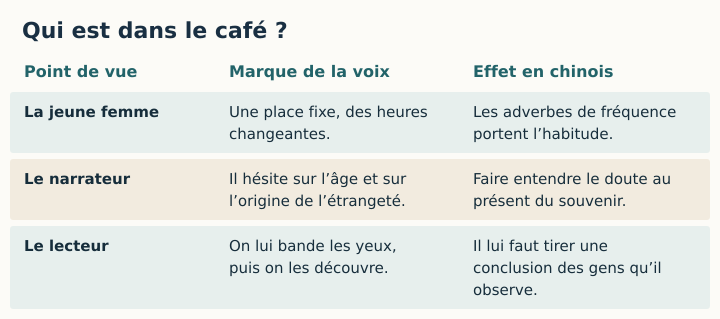

# BEL A/L — Chinois, thème Lyon 2026 · Corrigé brut

*Corrigé rédigé par IA, non officiel. Signalez toute erreur.*

**Rédaction** · GPT-6.2 Astra Ultra · vitesse non renseignée

## Thème

Patrick Modiano, *Dans le café de la jeunesse perdue* (2007).

咖啡馆有两个入口，她每次都从较窄的那个进去，大家管它叫“暗门”。进了小厅，她总挑最里头的那张桌子。起先她跟谁都不说话，后来才渐渐认识了孔代咖啡馆的常客。他们大多跟我们年纪相仿，我想，也就在十九到二十五岁之间吧。她偶尔也会到他们桌边坐坐，不过多数时候还是守着自己的老位子，在最里头。

她来的时间没个准。有时一大清早你就能看见她坐在那里，有时她却要等到将近午夜才露面，一直待到打烊。这一带关门最晚的咖啡馆，除了花束和凉亭，就数孔代了；论客人的古怪，又属孔代第一。如今回想起来，我倒想知道，是不是只因有她在，那个地方、那些人才显得这么异样，仿佛全都沾上了她身上的香气。

且设想一下，有人蒙上你的眼睛把你带到那里，让你在一张桌边坐定，再替你摘下眼罩，给你几分钟回答一个问题：你现在身处巴黎的哪个街区？你只消看看邻座的人，听听他们在说些什么，兴许就能猜到，是在奥德翁路口附近。那地方，我总想象它在雨里依旧那么阴沉。

[Sujet officiel, page 13](https://www.ens-lyon.fr/sites/default/files/2026-04/Epreuve%20de%20sp%C3%A9cialit%C3%A9%202026.pdf#page=13) · [Rapport du jury, pages 5 et 6](https://www.ens-lyon.fr/sites/default/files/2026-10/Chinois%202026.pdf#page=5)

