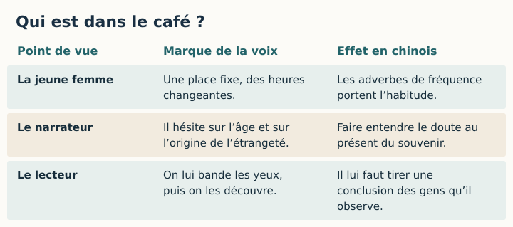

# BEL A/L — Chinois, thème Lyon 2026 · Corrigé guidé

*Corrigé rédigé par IA, non officiel. Signalez toute erreur.*

**Rédaction** · GPT-6.2 Astra Ultra · vitesse non renseignée

## Présentation du sujet

L’épreuve de quatre heures, avec dictionnaire bilingue autorisé, porte sur les trois paragraphes de Patrick Modiano. Une femme fréquente un café dont le narrateur retrouve l’atmosphère dans son souvenir.

[Sujet officiel, page 13](https://www.ens-lyon.fr/sites/default/files/2026-04/Epreuve%20de%20sp%C3%A9cialit%C3%A9%202026.pdf#page=13) · [Rapport du jury, pages 5 et 6](https://www.ens-lyon.fr/sites/default/files/2026-10/Chinois%202026.pdf#page=5)

## Préparer le thème

> [!INDICATION]
> Comparer le premier paragraphe et le dernier. Qui a réellement fréquenté le café et qui est invité à y entrer dans une expérience imaginaire ?

#### Solution

Le narrateur se compte parmi les jeunes habitués. Son « je dirais » indique qu’il évalue les âges de mémoire. Dans l’hypothèse finale, il imagine que l’on a conduit son interlocuteur à une table. Traduire la série des gestes en faisant avancer un même sujet indéfini évite d’obliger le lecteur à reconstruire lui-même qui tient le bandeau. Le destinataire devient sujet seulement quand il observe et écoute.

**Durée et habitude.** Pour rendre l’imparfait itératif, on peut annoncer très tôt la fréquence, puis la faire varier, *toujours*, *parfois*, *le plus souvent*. L’heure de l’arrivée est irrégulière mais le choix de la table reste fidèle. Dans le deuxième paragraphe, les deux heures possibles et la constance de l’atmosphère du lieu se croisent.

**Trois cafés, une clientèle.** Le Bouquet et La Pergola ferment eux aussi très tard. La remarque sur les clients les plus étranges porte sur le Condé. Une première proposition peut grouper les trois établissements et une seconde détacher le Condé. Un sinophone qui ne les connaît pas doit pouvoir reconstituer cette information.

**Une incertitude persistante.** Le narrateur se demande rétrospectivement si la femme communiquait à tout le café son parfum et son étrangeté. À la fin, le lecteur *aurait peut-être* deviné le carrefour. L’adverbe du doute et le tour hypothétique doivent rester audibles jusqu’à cette localisation.

> [!JURY]
> Le rapport de Lyon souligne le passage du récit à la troisième personne au souvenir personnel, puis au lecteur interpellé. Il invite à trouver un ordre syntaxique et un rythme propres au chinois lorsque le français multiplie les subordonnées.

## Thème

Patrick Modiano, *Dans le café de la jeunesse perdue* (2007).

咖啡馆有两个入口，她每次都从较窄的那个进去，大家管它叫“暗门”。进了小厅，她总挑最里头的那张桌子。起先她跟谁都不说话，后来才渐渐认识了孔代咖啡馆的常客。他们大多跟我们年纪相仿，我想，也就在十九到二十五岁之间吧。她偶尔也会到他们桌边坐坐，不过多数时候还是守着自己的老位子，在最里头。

她来的时间没个准。有时一大清早你就能看见她坐在那里，有时她却要等到将近午夜才露面，一直待到打烊。这一带关门最晚的咖啡馆，除了花束和凉亭，就数孔代了；论客人的古怪，又属孔代第一。如今回想起来，我倒想知道，是不是只因有她在，那个地方、那些人才显得这么异样，仿佛全都沾上了她身上的香气。

且设想一下，有人蒙上你的眼睛把你带到那里，让你在一张桌边坐定，再替你摘下眼罩，给你几分钟回答一个问题：你现在身处巴黎的哪个街区？你只消看看邻座的人，听听他们在说些什么，兴许就能猜到，是在奥德翁路口附近。那地方，我总想象它在雨里依旧那么阴沉。
