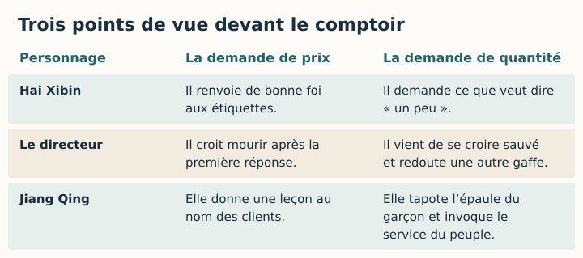

# BEL A/L — Chinois, version et thème Ulm 2026 · Corrigé brut

*Corrigé rédigé par IA, non officiel. Signalez toute erreur.*

**Rédaction** · GPT-6.2 Astra Ultra · vitesse non renseignée

## I. Version

Liu Xinwu, *钟鼓楼* (1984).

Il faisait bon ce jour-là. En passant devant la petite boutique, Jiang Qing entra soudain d’un pas guilleret et alla droit jusqu’au comptoir. Dans la vitrine étaient disposées toutes sortes de pâtisseries. Jiang Qing baissa la tête pour les regarder et, allez savoir pourquoi, mais la chose est certaine, elle s’écria tout à coup, ravie :

— Qu’ils sont mignons, ces gâteaux ! Combien le demi-kilo ?

Hai Xibin n’avait pas encore dix-sept ans. Il était loin d’avoir aussi peur des supérieurs que le directeur du parc. S’il se tenait là, c’était uniquement pour la forme. Des gâteaux, il n’en avait jamais vendu de sa vie. Alors, à la question de Jiang Qing, il répondit en toute franchise :

— Le prix au demi-kilo, c’est marqué sur l’étiquette.

À peine Hai Xibin eut-il lâché ces mots que le directeur du parc crut mourir sur place. Et de fait, cette réponse fâcha Jiang Qing, qui réprimanda le garçon :

— C’est comme ça que vous traitez les clients ? Heureusement que c’est moi qui suis venue aujourd’hui, je sais encore lire. Et si c’étaient des paysans pauvres ou des paysans moyens-pauvres venus de la campagne ? Vous leur diriez de lire l’étiquette ? Vous trouvez que ça se fait ?

Hai Xibin rougit. Comme s’il avait eu son professeur devant lui, il baissa la tête en signe d’assentiment, tout honteux. En le voyant si jeune et si embarrassé, Jiang Qing se remit brusquement à sourire. Ceux qui lui emboîtaient le pas l’entendirent alors dire au garçon :

— Mon petit, il suffit de te corriger. De ces gâteaux, tu vas m’en peser un peu de chaque !

Le directeur du parc, qui se tenait à côté d’eux, eut le sentiment de revenir d’entre les morts. Il fit intérieurement cette prière : « Ah, Hai Xibin, pourvu que tu n’ailles pas encore nous attirer des ennuis… »

Hai Xibin prit le plateau de la balance, se saisit de la pince et allait se pencher pour attraper les gâteaux quand il demanda soudain avec une candeur désarmante :

— Un peu… mais c’est combien, un peu ?

Ce jour-là, à cet instant-là, Jiang Qing était vraiment d’une humeur exceptionnelle. Elle tapota l’épaule de Hai Xibin. Le seul mot qui convînt à l’expression de son visage était désormais « bienveillante ». Et quelle sollicitude touchante dans sa voix lorsqu’elle lui dit :

— Mon petit, ta façon de servir les clients laisse à désirer et tu ne connais pas non plus ton métier. Comment veux-tu, dans ces conditions, servir le peuple ? Il va falloir faire de sérieux progrès…

## II. Thème

Chateaubriand, *Voyage en Amérique* (1827).

从前，谁要是像奥德修斯那样离开家园，就会成为众人好奇的对象。到了今天，除了那么五六位凭个人才具而卓然出众的人，还有谁能让人对他叙说的行程感兴趣呢？我也来厕身于无数默默无闻的旅人之中。他们所见的，无非是人人都见过的；他们并未使人类的学问有所进步，也没有给人类的知识宝库增添什么。不过，我是以哥伦布所到的那片土地上各民族最后一位史家的身份出现的，那些民族的族群不久就要消亡。我想说几句有关美洲未来命运的话，说说那些继不幸的印第安人之后承受其遗产的其他民族。除此之外，我别无所求，只愿道出自己的惋惜与期望。

[Sujet officiel, pages 6 et 7](https://www.ens.psl.eu/sites/default/files/al_opt_lve_vers-theme_261109.pdf#page=6)

