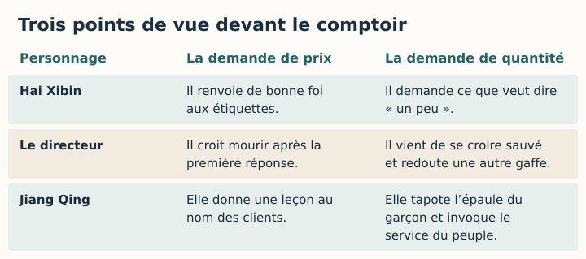

# BEL A/L — Chinois, version et thème Ulm 2026 · Corrigé guidé

*Corrigé rédigé par IA, non officiel. Signalez toute erreur.*

**Rédaction** · GPT-6.2 Astra Ultra · vitesse non renseignée

## Présentation du sujet

L’option comprend la version d’un extrait de Liu Xinwu, dont la fin précède un lexique sur la seconde page, puis le thème français tiré du Voyage en Amérique de Chateaubriand. Les deux textes se lisent sur le fac-similé des pages 6 et 7.

[Sujet officiel, pages 6 et 7](https://www.ens.psl.eu/sites/default/files/al_opt_lve_vers-theme_261109.pdf#page=6)

## I. Version

> [!INDICATION]
> La même phrase peut sauver un personnage et en mettre un autre dans l’embarras. À qui appartiennent la peur, la prière silencieuse et la deuxième question, celle qui porte sur la quantité ?

#### Solution

Hai Xibin n’a jamais vendu de gâteaux. Sa présence au comptoir est une mise en scène et ses deux réponses se tiennent au sens le plus littéral du prix et de la quantité. Le directeur, placé à côté de lui, connaît les risques du protocole. C’est lui qui manque de défaillir, puis reprend espoir et prie en son for intérieur. Jiang Qing transforme à son tour ces maladresses en occasions d’expliquer ce que signifie servir. Rendre des voix distinctes permet de conserver la comédie sans ajouter d’explication sur ses intentions.

**Choisir les unités et les termes politiques.** Le *jin* vaut ici un demi-kilo. Exprimer le prix au kilogramme sans conversion doublerait la quantité annoncée. La désignation des paysans pauvres et des paysans moyens-pauvres est une catégorie de l’époque maoïste. Elle permet à l’interlocutrice de parler au nom d’une clientèle hypothétique. La fin élargit l’activité très concrète de servir des clients à l’expression politique « servir le peuple ».

**Lire la transition entre les deux pages.** La demande sur la quantité termine la page 6. Le geste de l’épaule et toute la réplique finale figurent en haut de la page 7. La lexie de bienveillance et le ton édifiant s’entendent à travers la voix du récit, qui s’étonne plusieurs fois de l’humeur de Jiang Qing ce jour-là. La traduction de cette dernière réponse appartient bien à la version.

### Version rédigée

Liu Xinwu, *钟鼓楼* (1984).

Il faisait bon ce jour-là. En passant devant la petite boutique, Jiang Qing entra soudain d’un pas guilleret et alla droit jusqu’au comptoir. Dans la vitrine étaient disposées toutes sortes de pâtisseries. Jiang Qing baissa la tête pour les regarder et, allez savoir pourquoi, mais la chose est certaine, elle s’écria tout à coup, ravie :

— Qu’ils sont mignons, ces gâteaux ! Combien le demi-kilo ?

Hai Xibin n’avait pas encore dix-sept ans. Il était loin d’avoir aussi peur des supérieurs que le directeur du parc. S’il se tenait là, c’était uniquement pour la forme. Des gâteaux, il n’en avait jamais vendu de sa vie. Alors, à la question de Jiang Qing, il répondit en toute franchise :

— Le prix au demi-kilo, c’est marqué sur l’étiquette.

À peine Hai Xibin eut-il lâché ces mots que le directeur du parc crut mourir sur place. Et de fait, cette réponse fâcha Jiang Qing, qui réprimanda le garçon :

— C’est comme ça que vous traitez les clients ? Heureusement que c’est moi qui suis venue aujourd’hui, je sais encore lire. Et si c’étaient des paysans pauvres ou des paysans moyens-pauvres venus de la campagne ? Vous leur diriez de lire l’étiquette ? Vous trouvez que ça se fait ?

Hai Xibin rougit. Comme s’il avait eu son professeur devant lui, il baissa la tête en signe d’assentiment, tout honteux. En le voyant si jeune et si embarrassé, Jiang Qing se remit brusquement à sourire. Ceux qui lui emboîtaient le pas l’entendirent alors dire au garçon :

— Mon petit, il suffit de te corriger. De ces gâteaux, tu vas m’en peser un peu de chaque !

Le directeur du parc, qui se tenait à côté d’eux, eut le sentiment de revenir d’entre les morts. Il fit intérieurement cette prière : « Ah, Hai Xibin, pourvu que tu n’ailles pas encore nous attirer des ennuis… »

Hai Xibin prit le plateau de la balance, se saisit de la pince et allait se pencher pour attraper les gâteaux quand il demanda soudain avec une candeur désarmante :

— Un peu… mais c’est combien, un peu ?

Ce jour-là, à cet instant-là, Jiang Qing était vraiment d’une humeur exceptionnelle. Elle tapota l’épaule de Hai Xibin. Le seul mot qui convînt à l’expression de son visage était désormais « bienveillante ». Et quelle sollicitude touchante dans sa voix lorsqu’elle lui dit :

— Mon petit, ta façon de servir les clients laisse à désirer et tu ne connais pas non plus ton métier. Comment veux-tu, dans ces conditions, servir le peuple ? Il va falloir faire de sérieux progrès…

## II. Thème

**Identifier la partie à traduire.** Sous les notes chinoises de la page 7, la moitié inférieure du fac-similé porte « II : THÈME ». Le passage de Chateaubriand s’y lit sur l’image imprimée. Son dernier terme est « espérances ». Il vient après la version de Liu Xinwu et son lexique.

**Distinguer deux collectifs.** La première foule est celle des voyageurs obscurs. Les trois relatives sur leurs découvertes et leur contribution au savoir ont le même antécédent. Le passage se déplace ensuite vers les peuples d’Amérique. Parmi ceux-ci, le texte distingue les peuples que l’auteur dit menacés de disparition et ceux qui leur succèdent. L’expression de cette représentation historique appartient à la voix de l’auteur.

**Maintenir la double modestie.** L’orateur déclare suivre les autres voyageurs, puis se présente comme « dernier historien ». Il revendique une place singulière avant de ramener son ambition à deux sentiments. La question initiale vise l’intérêt qu’un récit peut susciter. Le passage final ne fait pas que souligner le petit nombre des commentateurs et ne prétend pas que ces six personnes seraient les seuls auditeurs possibles.

Chateaubriand, *Voyage en Amérique* (1827).

从前，谁要是像奥德修斯那样离开家园，就会成为众人好奇的对象。到了今天，除了那么五六位凭个人才具而卓然出众的人，还有谁能让人对他叙说的行程感兴趣呢？我也来厕身于无数默默无闻的旅人之中。他们所见的，无非是人人都见过的；他们并未使人类的学问有所进步，也没有给人类的知识宝库增添什么。不过，我是以哥伦布所到的那片土地上各民族最后一位史家的身份出现的，那些民族的族群不久就要消亡。我想说几句有关美洲未来命运的话，说说那些继不幸的印第安人之后承受其遗产的其他民族。除此之外，我别无所求，只愿道出自己的惋惜与期望。
