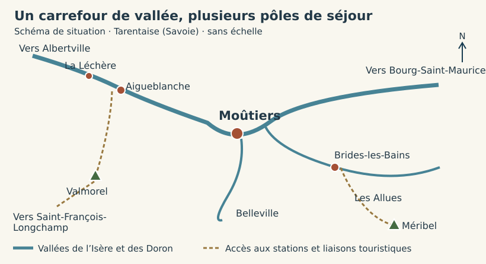

# BEL A/L — Commentaire de carte géographique (Lyon) 2026 · Corrigé brut

*Corrigé rédigé par IA, non officiel. Signalez toute erreur.*

**Lecture du rapport du jury** · GPT-6.2 Astra Ultra · vitesse non renseignée

**Rédaction** · GPT-6.2 Astra Ultra · vitesse non renseignée

**Autocontrôle** · GPT-6.2 Astra Ultra · vitesse non renseignée

**Révision (tour 1)** · GPT-6.2 Astra Ultra · vitesse non renseignée

## Moûtiers et les vallées de Tarentaise

Située en Savoie, en Tarentaise, Moûtiers occupe un carrefour entre la vallée de l’Isère et celles des Doron. La carte de situation au 1/250 000 invite à suivre la route depuis Albertville vers la haute Tarentaise, mais aussi les bifurcations vers les stations qui dominent la petite ville. À l’échelle du bassin de vie, le document statistique compte 18 548 habitants en 2022 sur 554,5 km². Moûtiers n’en rassemble que 3 482 dans ses étroites limites communales. Comment une ville de vallée peut-elle à la fois organiser les circulations d’un territoire montagnard et rester en marge d’une partie des richesses qui s’y forment ?

### I. Des fonds de vallée accessibles, des sites habités très inégaux

Le noyau de Moûtiers s’est développé en rive droite de l’Isère, dans un ombilic, élargissement de la vallée glaciaire bordé de sections plus resserrées. La proximité des débouchés des Doron ouvre plusieurs directions, tandis que la faible étendue du fond plat limite la surface constructible. Le cours rectifié de l’Isère et les voies de circulation se partagent ce fond. Le rapport relève la gare et le cimetière sur les marges du bâti, ainsi que des immeubles collectifs au sud. La cathédrale et le quartier des Cordeliers rappellent l’ancienneté de cette centralité. Les 1 102 habitants par km² de la commune doivent ainsi se lire avec ses 3,2 km² de superficie. Les 33,5 habitants par km² du bassin incluent de grands versants et des espaces d’altitude très peu peuplés. Les deux densités ne décrivent ni le même mode d’habiter ni la même surface disponible.

Vers l’aval, l’élargissement autour d’Aigueblanche a permis l’extension de l’habitat et l’installation de services. La route nationale 90 et la voie ferrée relient la Tarentaise à Albertville et, au-delà, à la cluse de Chambéry. Dans l’autre sens, elles donnent accès à la haute vallée vers Bourg-Saint-Maurice. Moûtiers peut accueillir ou redistribuer des voyageurs qui n’y séjournent pas. Sur les versants, le bâti répond à d’autres logiques. Saint-Jean-de-Belleville occupe au sud une clairière sur un replat. Ce village et les hameaux échelonnés permettent de reconnaître une occupation antérieure au ski. La pente concentre les possibilités d’installation, mais l’histoire des exploitations agricoles, des villages et des voies explique pourquoi certains replats sont densément occupés et d’autres boisés.

De Moûtiers à Brides-les-Bains, on quitte l’axe de l’Isère pour remonter le Doron de Bozel. C’est ce changement de vallée qui donne au carrefour son importance pour la desserte des stations. La carte de situation permet de suivre la liaison au-delà de l’extrait au 1/25 000.

### II. L’altitude et l’eau mettent en relation des lieux éloignés

Valmorel, au sud-ouest, illustre une centralité créée par la fréquentation. Cette station ouverte en 1976 a été construite en site neuf sur un ubac, entre 1 300 et 1 500 m. Les bâtiments groupés s’infléchissent selon les courbes de niveau. Leur allure de gros chalets produit l’image d’un village, mais le groupement des hébergements et leur liaison aux remontées relèvent d’un aménagement planifié. Les ouvertures de pistes interrompent le couvert boisé. Le domaine se prolonge vers Saint-François-Longchamp, de l’autre côté de la ligne de crête, vers la Maurienne. Le versant qui séparait les lieux de vie permanents devient, pour le skieur, un espace de connexion. Au sud-est, la liaison des Allues avec Méribel offre un autre exemple de réseau reliant des altitudes complémentaires.

À La Léchère, au nord-ouest, l’activité thermale valorise des eaux de vallée et attire des curistes selon une temporalité distincte de celle des sports d’hiver. Brides-les-Bains associe l’hébergement thermal et l’accès mécanique en direction du domaine de Méribel. Le tourisme ne se répartit donc pas simplement entre une vallée de transit et des hauteurs exclusivement récréatives. L’eau alimente aussi un système de production électrique. Le barrage des Échelles d’Hannibal utilise le resserrement de la vallée en amont d’Aigueblanche. À La Coche, un réservoir de versant et une centrale située environ 800 m plus bas mettent à profit la dénivellation. La distribution électrique relie cette production à un réseau qui dépasse les consommateurs de la station et les limites du bassin de vie. Ainsi un même territoire se trouve engagé, par ses pentes et ses eaux, dans trois géographies différentes, celle des curistes, celle des skieurs et celle du réseau électrique.

### III. Accueillir des visiteurs, héberger les habitants

Les chiffres du logement donnent sa mesure à cette opposition de fonctions. En 2022, sur 36 971 logements dans le bassin, 72,4 % sont des résidences secondaires ou des logements occasionnels, soit environ 26 770 unités. Les résidences principales représentent seulement 24,3 %. À Moûtiers, la proportion s’inverse, avec 72,6 % de résidences principales et 10,2 % de secondaires. La ville concentre aussi davantage de logements vacants, 17,2 % du parc communal contre 3,3 % dans le bassin. L’enjeu y est donc aussi la réutilisation de logements inoccupés. Une résidence secondaire et un logement vacant relèvent de catégories statistiques distinctes, même si, lors d’une visite hors saison, leurs volets peuvent être également fermés.

En 2023, l’administration, l’enseignement, la santé et l’action sociale constituent 13,6 % des établissements de la commune et 6,6 % de ceux du bassin. Le carrefour garde ainsi des fonctions pour les résidents permanents. Le tableau de 2021 indique néanmoins un revenu disponible médian de 19 280 euros par unité de consommation à Moûtiers, contre 22 790 dans le bassin. Le taux de pauvreté s’y élève à 24 %, contre 14,6 % pour l’ensemble qui inclut la ville. Ces moyennes et ces parts d’établissements ne localisent ni les revenus de chaque chantier ou remontée, ni les logements des saisonniers. Elles autorisent une conclusion plus circonscrite. La ville qui rend possibles les circulations et les services d’un territoire touristique enregistre des conditions sociales différentes de celles de l’ensemble qu’elle dessert.

La centralité de Moûtiers se comprend donc par les fonctions et les échelles. Pour la population permanente, les services de santé, les écoles et les administrations se concentrent dans la vallée. Pour les visiteurs, les séjours et les équipements d’altitude dessinent d’autres pôles, dont certains se relient au-delà des crêtes. Cette coexistence explique qu’une petite ville très accessible, un village sur replat, un site thermal et une station créée de toutes pièces participent du même territoire sans suivre la même trajectoire.

[Énoncé officiel](https://www.ens-lyon.fr/sites/default/files/2026-04/Sp%C3%A9cialit%C3%A9%20g%C3%A9ographie%202026.pdf) · [Rapport du jury](https://www.ens-lyon.fr/sites/default/files/2026-10/G%C3%A9ographie%202026.pdf#page=10)
