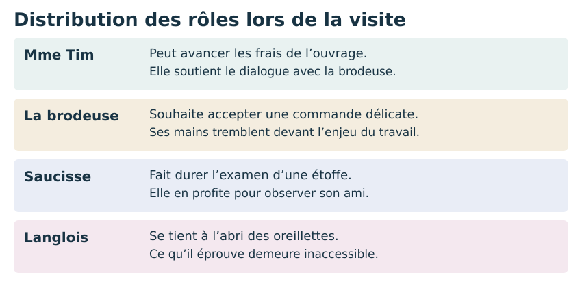
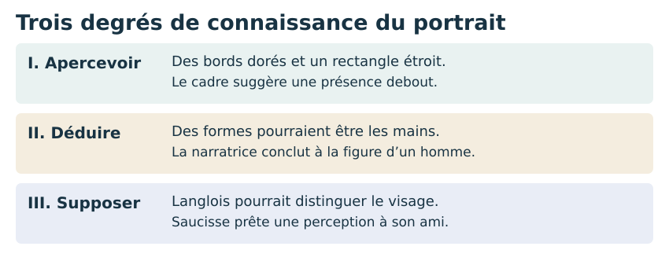
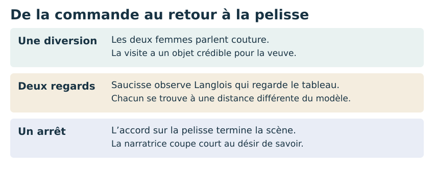

# BEL A/L — Commentaire littéraire (Ulm) 2026 · Corrigé guidé

*Corrigé rédigé par IA, non officiel. Signalez toute erreur.*

**Lecture du rapport du jury** · modèle exact non renseigné (famille GPT-6) · effort non renseigné · vitesse non renseignée

**Rédaction** · modèle exact non renseigné (famille GPT-6) · effort non renseigné · vitesse non renseignée

**Autocontrôle** · modèle exact non renseigné (famille GPT-6) · effort non renseigné · vitesse non renseignée

**Révision** · modèle exact non renseigné (famille GPT-6) · effort non renseigné · vitesse non renseignée

**Lecture du rapport du jury** · GPT-6.2 Astra Ultra · vitesse non renseignée

**Révision** · GPT-6.2 Astra Ultra · vitesse non renseignée

**Révision (tour 3)** · GPT-6.2 Astra Ultra · vitesse non renseignée

**Texte étudié** — Jean Giono, *Un roi sans divertissement*, visite chez la brodeuse.

[Sujet officiel, p. 2](https://www.ens.psl.eu/sites/default/files/options_francais_philosophie.pdf#page=2) · [Rapport du jury](https://www.ens.psl.eu/sites/default/files/2026_al_rapport_ecrit_francais_option.pdf)

## Préparer le commentaire

L’épreuve d’option dure quatre heures. Le commentaire porte sur la page 2 du livret, de la première apparition de l’épaule de Langlois à l’accord concernant la pelisse. Le texte permet de suivre la voix de Saucisse jusque dans ses hésitations. Le reste du roman permet d’identifier les deux figures que la visite rapproche, la veuve de M. V. et l’homme du portrait. Garder séparés au brouillon les indices internes et ce que le lecteur de l’œuvre sait déjà.

> [!INDICATION]
> En entrant dans la pièce, attribuer à chacun une tâche et une information. Qui décide du prix ? Qui tient le tissu ? Qui observe sans parler ? Qui croit recevoir une commande ? Puis demander pour chaque détail qui pourrait en prendre connaissance.

## Passer d’une remarque à une interprétation

Une notation de la première phrase peut déjà fournir une démonstration. Le nom de Langlois arrive au terme d’une phrase encombrée par l’ombre et les objets. Sa redingote livre un indice de sa présence. Plus loin, le linge éblouit la narratrice. Le rapprochement établit le pouvoir variable du vêtement selon sa position. On peut alors expliquer comment la même activité de couture offre un prétexte à l’enquête et en limite aussi le succès.

Pour commenter le portrait, suivre trois paliers successifs. La forme du cadre est donnée à voir, le sexe de la figure est déduit, le visage est imaginé par Saucisse comme une perception possible de Langlois. Conserver le conditionnement de chaque énoncé. Ainsi, dans le dernier grand paragraphe, l’hypothèse sur les yeux accoutumés à l’ombre appartient à la narratrice.

Séparer une phrase qui décrit un détail visible et une phrase qui en propose l’interprétation. Attribuer ensuite l’interprétation à celle ou celui qui regarde. Le doute devient un effet précis de narration.

## Construire les transitions

- **Première partie.** Partir du consentement à payer les fournitures. La commande fonctionne parce qu’elle correspond à une ambition professionnelle vraisemblable. Faire apparaître la différence entre le pouvoir d’achat de Mme Tim et l’habileté gestuelle de Saucisse. Cette habileté sert aussi un désir privé de voir son ami.
- **Deuxième partie.** Prendre ce souhait de voir pour point de départ. Le lecteur rencontre successivement une épaule, une tempe et un cadre avant de pouvoir reconnaître l’objet du regard de Langlois. Faire varier les degrés de certitude à mesure que la description avance.
- **Troisième partie.** Interpréter l’effort de Saucisse pour imaginer ce que son ami perçoit. La visite auprès de la veuve, la taille humaine du portrait et la comparaison possible entre les deux hommes donnent à la scène sa portée morale. La dernière phrase permet d’interroger aussi le désir du lecteur de connaître l’issue.

> [!PIEGE]
> Nommer M. V. dès l’introduction laisse entière la question du commentaire. C’est précisément parce que le lecteur peut l’identifier qu’il lui importe de comprendre pourquoi la narratrice décrit un regard et s’arrête au seuil d’un visage. De même, la peur de l’ouvrière trouve un objet explicite dans le risque professionnel d’une commande exceptionnelle.

## Proposition de commentaire

La chose la plus facile à obtenir, chez la brodeuse d’*Un roi sans divertissement*, est encore ce qui paraissait exiger toute une négociation. Une pelisse sera faite pour un enfant. Reste à comprendre ce que Langlois est venu faire chez la mère, ce qu’il a vu chez elle et ce que Saucisse, qui raconte la visite, a deviné de son ami. La « femme grise » est la veuve de M. V. Le portrait chez elle peut se lire comme celui de l’homme que Langlois a exécuté. Cette connaissance donne un poids singulier à chaque détail de la scène, jusqu’au tissu que les visiteuses tournent entre leurs mains. Elle laisse toutefois entière une difficulté de lecture. Comment raconter la reconnaissance possible d’un homme par un autre quand la personne qui parle a soin d’expliquer tout ce qui les dérobe à ses yeux ? Giono fait d’une commande bien réelle le moyen de deux enquêtes distinctes. À mesure que le lecteur s’approche du tableau à la suite de Saucisse, il découvre ce que peut lui faire éprouver une image qui ne se laisse pas décrire jusqu’au bout.

* * *

Si Mme Tim et Saucisse entendent donner le change à la brodeuse, elles ont trouvé chez elle la meilleure alliée de leur jeu, l’importance même du travail qu’elles lui proposent. Les mots du métier font entrer le lecteur dans un univers assez précis pour qu’il puisse y éprouver quelque intérêt de son chef. À la couleur prune d’un cachemire répondent le brillant du satin, son relief bouillonné, puis le dessin de la soutache et le volume des plumes. On pourrait rester dans cette pièce pour regarder les étoffes. La liste a ainsi un double destinataire. À la maîtresse de maison, l’exactitude des propos annonce des clientes sérieuses. Au lecteur déjà prévenu du jeu par la narratrice, elle donne la mesure de l’application avec laquelle cette comédie doit être jouée.

Les deux visiteuses s’y prennent différemment. Mme Tim parle avec l’aisance de celle qui peut avancer le prix des fournitures et assumer le risque d’un ouvrage inhabituel. Chaque propos rapporté en entraîne un autre, l’assurance sur le talent de l’ouvrière appelle une assurance sur la dépense. On comprend que celle dont les mains tremblent éprouve ensemble la perspective d’une occasion et la crainte de mal faire. Dans cette maison de campagne, les savoirs et les moyens financiers sont répartis entre les deux côtés de la table. La commande profite de cette dissymétrie. Elle pourrait d’ailleurs s’exécuter parfaitement tout en ayant servi d’alibi à la visite. Ce que la brodeuse attend de son métier donne à la diversion des conséquences que les visiteurs pourront quitter avec la pièce et qu’elle devra, elle, continuer à porter.

La voix même de Mme Tim contribue à cette diversion. « Mme Tim lui disait qu’elle en était capable. Et Mme Tim disait qu’elle était disposée pour sa part à payer les fournitures ». Les deux imparfaits prolongent la conversation pendant que Langlois reste immobile. La reprise du nom de la cliente fait presque entendre une seconde intervention, mais les subordonnées en « que » laissent à Saucisse la maîtrise du récit. Ce qu’elle peut rapporter de Mme Tim, ce sont des promesses prononcées devant elle. Pour faire entendre le silence de Langlois, elle devra inventer une tout autre manière de raconter.

À Saucisse échoit le travail du corps. Il faut tenir le tablier devant soi de la bonne manière, se déplacer, ménager la durée d’une marque d’admiration. Ce petit surcroît de temps est précisément ce qu’elle gagne pour jeter son coup d’œil. La première personne permet au lecteur de doubler chacun des gestes d’une intention que la veuve ignore. Mais de qui Saucisse est-elle ici la complice ? Elle aide Langlois à regarder à son aise tout en utilisant le même prétexte pour le surveiller. La réussite de la comédie rend ainsi possible une seconde indiscrétion. Le lecteur, admis par Saucisse dans les coulisses de la première, se découvre engagé à ses côtés dans la seconde.

* * *

Le dispositif promet une révélation progressive. Son premier résultat est pourtant une épaule. La phrase qui ouvre l’extrait impose de traverser l’ombre et un milieu d’objets confus avant d’atteindre ce mince fragment de Langlois. Une précision rétrospective vient aussitôt le lui retirer en pensée. Sans sa redingote claire, Saucisse aurait manqué cette épaule elle-même. Le tissu joue le rôle d’un signe d’identité pour un corps dont il cache la surface. Tout près de là, un autre tissu produira l’effet opposé. La blancheur du linge éblouit celle qui le regarde de trop près et l’empêche de bien voir ce qui l’intéresse au loin. La question du visible dépend moins d’une quantité absolue de lumière que de la place qu’occupe l’observatrice.

Giono fait travailler cette place. L’immobilité de Langlois est d’abord le seul fait assuré. Saucisse parvient ensuite à reconnaître sa tempe, une surface sombre contre l’ombre. La peau en est lisse. Ce détail minuscule lui suffit pour conclure à la contemplation. La proposition courte et affirmative qui tire cette conséquence a quelque chose de saisissant. Elle expose une interprétation intime comme si le relief d’une tempe la rendait immédiatement lisible. Or il manque encore à cette certitude son objet. La narration marque un délai, s’occupe de la pelisse, puis place enfin sur une ligne bien à lui le fait que Langlois regarde un portrait. L’assurance avec laquelle on croit connaître un visage familier et l’ignorance de ce qui l’attire peuvent tenir dans le même regard.

Que donne à voir ce portrait ? Son cadre fournit une première réponse étonnante. Les « berges d’or » suggèrent une matière arrêtée sur un bord et font pressentir une étendue dans laquelle le regard pourrait entrer. Avant que le personnage représenté ait un sexe certain, le rectangle lui-même paraît debout. La posture sort du cadre et gagne la figure encore indéterminée. Un reflet de fenêtre sur une table, des formes qui pourraient être des mains, une masse de couleur sombre permettent ensuite un raisonnement sur l’ensemble. Giono introduit ainsi une description de tableau dont l’objet varie avec le degré de confiance de celle qui la mène. Une reconnaissance n’en garantit pas une autre. Saucisse est certaine d’une présence humaine, beaucoup moins des traits qui permettraient de dire de quel homme il s’agit. Le lecteur peut nommer M. V. grâce à l’histoire qu’il connaît. Il serait fort en peine de dessiner ce visage.

* * *

La tentative la plus audacieuse de Saucisse consiste alors à changer de place sans quitter la sienne. Langlois a choisi l’ombre des oreillettes. Ses yeux ont eu le temps de s’y habituer. Elle imagine ce qu’il pourrait voir de son fauteuil. La phrase progresse par reprises, des mains au corps qui les porte, puis du corps au visage. Le point d’arrivée devrait garantir l’identité du modèle. Or les marques de supposition se pressent à mesure que la phrase monte. Le visage occupe le lieu où la narratrice rencontre sa propre cécité. Entre la scène qui lui est accessible et celle qu’elle prête à son ami subsiste tout l’écart entre une observation et une expérience supposée.

Ce déplacement éclaire le caractère troublant de la visite. Le portrait en pied met face à face deux hommes de taille comparable. L’un a pu faire disparaître l’autre en l’exécutant. Il vient retrouver une présence de cet homme dans sa maison. De l’un nous avons eu l’épaule, la tempe et l’immobilité. De l’autre nous avons les mains possibles et la station debout. Dans la construction même de la page, le vivant réduit à quelques traits et la figure peinte qui paraît prendre corps se rapprochent. Le portrait agit en miroir par la place qu’il rend possible pour Langlois. Lui aussi a donné la mort. Quelle part de l’attrait qu’exerçait le meurtre sur l’homme traqué peut-il découvrir en lui ? Giono laisse agir cette question sans prêter à Langlois un seul mot qui y réponde. L’intimité de la confrontation tient à la retenue de celle qui l’a surprise et qui consent jusqu’au bout à en demeurer le témoin extérieur.

Ce consentement est lui-même inquiet. Quand Saucisse évoque son « instinct », la difficulté change de nature. La même place dans la pièce explique qu’elle distingue mal les choses et qu’elle veuille savoir davantage. D’où lui vient alors le sentiment qu’« il ne fallait pas regarder » ? L’interdit surgit après toute la peine qu’elle a prise pour s’approcher. Il atteint aussi le lecteur, qui attendait d’elle une révélation et a partagé ses ruses. Une phrase ramène alors la pelisse d’enfant. L’accord dont elle prend acte est la seule chose qu’on puisse raconter ici sans rien supposer du cœur d’un autre. Mais on y entend aussi la tranquillité un peu forcée de gens qui disposent d’un sujet de conversation tout prêt. La diversion, après avoir protégé l’enquête au commencement de la visite, offre à la narratrice elle-même un moyen d’y mettre fin.

* * *

La commande enferme donc en elle un événement dont personne, dans la pièce, ne pourra faire le récit entier. Les mains de l’ouvrière tremblent pour un travail à venir ; celles du tableau émergent à peine d’un passé meurtrier. Saucisse a pu voir les premières et seulement deviner les secondes. Le roman tient ces deux expériences ensemble au lieu d’abandonner la première une fois compris le secret de la visite. Le prix de la pelisse, la blancheur du linge, le temps nécessaire aux yeux pour s’habituer à l’obscurité ont construit la scène où Langlois a pu se découvrir un semblable. La dernière phrase laisse au lecteur le temps de mesurer à son tour ce qu’il a désiré voir.
