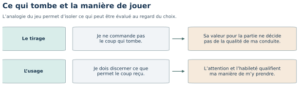

# BEL A/L — Commentaire philosophique (Ulm) 2026 · Corrigé brut

*Corrigé rédigé par IA, non officiel.*

**Rédaction** · modèle exact non renseigné (famille GPT-6) · effort non renseigné · vitesse non renseignée

**Révision** · modèle exact non renseigné (famille GPT-6) · effort non renseigné · vitesse non renseignée

**Révision** · GPT-6.2 Astra Ultra · vitesse non renseignée

**Révision (tour 3)** · GPT-6.2 Astra Ultra · vitesse non renseignée

**Sujet** — Épictète, Entretiens, II, 5

## Introduction

Le passager d’un navire vérifie à qui il confiera la barre. Une fois la traversée commencée, cette attention ne le protège pas nécessairement du naufrage. Était-elle donc vaine ? L’extrait des *Entretiens* d’Épictète part de la difficulté inverse de celle qu’on attribue quelquefois aux stoïciens. Si le résultat de l’action est soustrait à la distinction morale du bien et du mal, comment expliquer l’exigence de s’en occuper avec soin ? Le maître craint autant la négligence au nom de la tranquillité que la perte de toute fermeté au nom de ce dont nous nous occupons. Son propos vise à établir comment un être exposé aux vicissitudes du monde peut agir avec une attention entière sans faire dépendre sa vie bonne d’un succès hors de sa portée. La distinction des matières et de leur usage fournit la règle. Le jeu en dégage le sens, l’objection de négligence en éprouve la cohérence et la traversée l’étend jusqu’à la mort, en situant la vie humaine dans un tout.

## I. La distinction des matières et de l’usage ouvre une difficulté pratique

La première phrase oppose deux appréciations qui portent sur les mêmes choses envisagées différemment. Une « matière » est ici ce sur quoi mon activité a à s’exercer. Elle peut être un objet, comme un dé, une circonstance, comme un vent défavorable, ou l’événement que je ne puis plus changer. La dire « indifférente » ne signifie ni qu’elle me laisse insensible ni qu’elle soit sans conséquence. Une mer calme et une tempête n’offrent pas à un navire des chances égales. Ce qui leur est refusé, c’est le pouvoir de rendre par elles-mêmes bon ou mauvais celui à qui elles arrivent. La qualité de l’usage en revanche peut m’être imputée. La première phrase ne me recommande donc pas d’attendre que plus rien ne me touche. Elle situe la différence morale dans mon rapport actif à ce qui me touche.

Si cette première distinction était seulement verbale, elle laisserait intact un dilemme. D’un côté, ma fermeté paraît devoir grandir à mesure que je tiens l’issue pour insignifiante. Mais si elle n’importe absolument pas, à quoi bon s’appliquer ? De l’autre côté, si une action doit être soignée, c’est apparemment parce que quelque chose d’important se gagnera ou se perdra avec elle. Mon inquiétude semble alors le prix de mon attention. D’où la question initiale. Les deux vertus doivent être sauvegardées « simultanément ». Une période de zèle suivie de résignation quand les efforts échouent ne résoudrait rien. Il faut trouver un même principe qui rende l’attention requise et la fermeté possible dans l’action elle-même.

Le joueur en fournit un premier modèle. Il ne peut savoir quel coup tombera. Le coup n’est pourtant pas un simple bruit du hasard, puisque, une fois tombé, il définit ce qu’un joueur habile peut tenter. On ne ferait pas preuve de talent en demandant un autre tirage ou en répondant à tous les coups par le même mouvement. L’habileté consiste à discerner les différences entre des situations que le joueur n’a pas choisies. Paradoxalement, tenir le dé pour indifférent n’autorise pas à jouer indifféremment. La matière échappe au pouvoir de fixer le résultat, mais un bon usage exige d’en considérer attentivement les propriétés. L’image permet de séparer la valeur de la manière de jouer et celle du résultat obtenu. Elle ne suppose pas que la vie entière ressemble à un divertissement où l’on pourrait toujours recommencer.

Un même coup peut être joué avec attention ou avec négligence. Si sa valeur numérique suffisait à évaluer la conduite, cette différence disparaîtrait. L’exemple du jeu donne ainsi à Épictète une épreuve de sa distinction entre la matière reçue et l’usage qu’on en fait.

De là le passage du jeu à la tâche prioritaire dans la vie. Avant de déterminer quoi faire, il faut distinguer à quelle sorte de chose on a affaire. Épictète met cette distinction dans la bouche de celui qui l’apprend. À la question de savoir où il cherchera le bien et le mal, il doit répondre en première personne. « En moi » n’est pas une simple indication de lieu. Mon corps est le mien, mais je peux être emporté avec un navire sans que ma décision suffise à le retenir. La précision qui précède donne son sens à cette intériorité. Ce qui dépend de moi est ma faculté de choix, c’est-à-dire ma façon de juger ce qui se présente et de m’y déterminer. La répétition à la première personne est déjà un exercice : devant un embarras, je dois cesser de demander seulement ce qui m’arrivera pour examiner le jugement par lequel je m’apprête à l’accueillir.

## II. Une négligence est un mal précisément lorsque la matière n’en est pas un

Épictète demande ensuite de surveiller les mots employés pour les choses qui dépendent d’autrui. Les appeler un bien ou un dommage, sans autre précision, c’est déjà attribuer à quelqu’un d’autre le pouvoir de faire mon malheur ou de garantir ma vie bonne. On comprend pourtant qu’une telle injonction puisse inquiéter. La chose qui ne mérite même plus d’être dite utile réclame-t-elle encore mes soins ? La question impersonnelle, « Faut-il en user avec négligence ? », porte sur l’inférence décisive. Si elle était légitime, la doctrine recommanderait une imprudence que chacun pourrait ensuite excuser en invoquant la fortune.

La réponse déplace le prédicat à son véritable sujet. La négligence est une manière pour ma faculté de choix d’user de ce qui est donné ; elle est donc susceptible d’être mauvaise précisément là où le résultat extérieur ne l’est pas. Supposons que je doive choisir le pilote. Je puis m’informer de son expérience, ou négliger de le faire alors que les renseignements me sont accessibles. Que nous arrivions au port dans les deux cas n’abolit pas la différence de conduite. Inversement, si après un choix soigneux le navire périt, cela ne transforme pas rétrospectivement cette conduite en faute. De ce qui ne dépend pas de moi je dois prendre en considération tout ce qui éclaire mon action. Je m’abstiens de lui attribuer le pouvoir de décider ce qu’elle vaut.

Pourquoi cette négligence est-elle dite « contraire à la nature » ? Le texte ne demande pas de copier les événements naturels, telle la tempête : ils fournissent la matière et n’offrent aucune intention à imiter. Un être qui peut examiner et choisir manque à sa façon propre d’agir lorsqu’il renonce à cette capacité dans les occasions qui la réclament. La fermeté devient alors le corrélat de l’attention. La première porte sur l’impossibilité de me garantir l’issue. La seconde porte sur la qualité du jugement que je suis en train de former. Comme leurs objets diffèrent, leur coexistence cesse d’être contradictoire. Comme une même action les requiert, les séparer ferait perdre le sens de chacune.

La formule sur l’empêchement avance une épreuve supplémentaire. Un autre homme peut interdire un voyage ou retirer les moyens de le poursuivre. Cet obstacle me renseigne sur la nature de ce que j’espérais obtenir. Si je pouvais en être empêché par autrui, la possession de cette chose ne dépendait pas de ma seule faculté de choix. Cela ne signifie pas qu’il suffise de se déclarer libre pour triompher d’une contrainte physique. C’est lorsqu’une telle contrainte réussit pleinement sur mon corps qu’il faut encore distinguer son résultat du jugement qui ferait de cet échec un mal moral. Une partie de ma tâche peut désormais consister à reconnaître que l’action antérieure est devenue impossible. La situation nouvelle fournit une nouvelle matière, et l’exigence de bon usage recommence.

## III. La traversée soumet la règle à l’épreuve d’une perte irréparable

Épictète concède la difficulté de « tenir ensemble » l’attention de celui que les choses affectent et la fermeté de celui qui les tient pour indifférentes. La concession n’efface pas ce que la distinction précédente a établi. On a montré que ces attitudes sont compatibles. Il reste à rendre pensable leur exercice quand je ne peux traiter ce qui arrive comme une partie de dés sans lendemain. Leur réunion engage le bonheur lui-même, car un bonheur dépendant de la permanence de ce que d’autres peuvent m’ôter ne serait jamais assuré, tandis qu’une tranquillité achetée au prix d’un mauvais usage ne serait pas une vie bonne.

« Si l’on n’y arrive pas, c’est le bonheur qui est impossible. » Ce conditionnel donne la mesure de l’enjeu. Il serait circulaire d’en déduire que l’accord des deux attitudes est possible en supposant le bonheur déjà acquis. Le voyage fait le travail qui manque encore. À chaque instant, il fait voir à quoi s’applique l’attention et pourquoi, dans le même instant, celui qui agit peut rester ferme. L’épreuve décisive survient quand un changement de circonstances paraît retirer à l’action tout objet.

L’exemple distribue la responsabilité à mesure que la traversée avance. Il m’appartient de choisir le pilote, l’équipage et le moment de prendre la mer. En me souciant du départ, j’ai donc traité comme pratiquement pertinentes des différences entre plusieurs possibilités. Je n’ai pas choisi la tempête par le même acte que j’ai choisi le jour ; c’est justement ce qu’elle est venue démentir dans l’espoir de tout prévoir. Quand elle survient, la manœuvre incombe au pilote. La formule « ma tâche à moi est accomplie » concerne ce rôle déterminé du passager. Elle ne ferait pas une maxime pour le pilote, dont la responsabilité actuelle est de manœuvrer. La même mer et le même danger sont la matière commune de conduites appropriées différentes.

Enfin le navire coule. Même la distinction des compétences ne laisse plus espérer de bonne manœuvre. Le verbe « me noyer » énonce quelque chose qui m’arrive ; les déterminations qui le suivent précisent comment je puis encore m’y rapporter. Le passage ne prétend pas que la faculté de choix commande les réflexes d’un corps qui manque d’air. Il figure l’attitude d’un homme qui ne conclut ni de sa fin prochaine que la nature l’a lésé, ni de son impuissance à changer le résultat que toute tâche a disparu. La possibilité du bon usage se réduit ici jusqu’à sa limite : ne pas ajouter à la nécessité de mourir le jugement que le dieu m’aurait dû l’immortalité.

La comparaison finale de l’heure et du jour explique pourquoi cette absence de reproche peut être raisonnable. Si une heure prétendait être tout le jour, sa disparition lui apparaîtrait comme la destruction de ce qui aurait dû durer toujours. Être une heure, c’est pourtant avoir sa place dans une durée dont d’autres heures font aussi partie. De même, me savoir homme et partie du tout change le point d’où je juge ma fin. L’image ne démontre pas que ma mort particulière est souhaitable, ni que la noyade et la fièvre sont médicalement équivalentes. Elle me retire la prétention à juger la nature comme si ma permanence individuelle était la fin à laquelle l’ordre entier était tenu. Ainsi le texte atteint une raison de la fermeté que le seul exemple du jeu laissait encore en suspens : ce n’est plus seulement parce que le résultat m’échappe que je cesse d’en faire un mal, c’est parce que l’être dont j’ai le bon usage à assurer est dès l’origine celui d’une partie mortelle.

## Conclusion

Le sujet moral construit par l’extrait est d’autant mieux en mesure d’agir qu’il ne demande plus à l’issue de l’action de le rendre bon. Le coup tombé appelle de l’habileté, le départ requiert une préparation, la tempête une juste appréciation des rôles et le naufrage un dernier jugement sur la condition humaine. À chaque étape l’indifférence de la matière rend possible un sérieux de l’usage. La tranquillité stoïcienne peut alors être comprise comme la conséquence d’une attention exactement située, jusque dans le moment où l’action ne peut plus modifier ce qui arrive.
