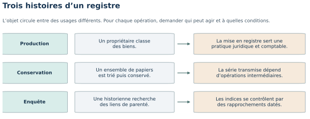

# BEL A/L — Deuxième composition de philosophie (Lyon) 2026 · Corrigé brut

*Corrigé rédigé par IA, non officiel.*

**Rédaction** · modèle exact non renseigné (famille GPT-6) · effort non renseigné · vitesse non renseignée

**Révision** · modèle exact non renseigné (famille GPT-6) · effort non renseigné · vitesse non renseignée

**Lecture du rapport du jury** · GPT-6.2 Astra Ultra · vitesse non renseignée

**Révision** · GPT-6.2 Astra Ultra · vitesse non renseignée

**Révision (tour 3)** · GPT-6.2 Astra Ultra · vitesse non renseignée

**Sujet** — La matière de l’histoire

## Introduction

Un registre de plantation où l’on a inscrit des noms, des âges et des prix est conservé dans un dépôt d’archives. Il est en papier. Mais est-ce en ce sens que nous tenons entre nos mains de la matière historique ? Le papier aurait pu servir à tout autre chose. Les prix inscrits nous instruisent sur une société où des êtres humains ont été achetés et vendus ; ils ne nous disent pas tout ce que ceux-ci ont fait de leur vie. À quel titre ces lignes font-elles alors partie de la matière de l’histoire ? Elles ont servi à accomplir et à reproduire certains actes, avant de devenir pour nous le moyen de les connaître. Le registre lui-même doit sa forme et sa survie aux rapports de pouvoir auxquels il permet aujourd’hui de poser des questions.

La matière, en un premier sens, est ce dont une chose est faite. En un autre, elle est ce sur quoi porte une opération et qui peut recevoir plusieurs formes. Ces deux sens semblent distribuer d’avance les tâches. Aux acteurs, les conditions dans lesquelles il leur faut agir ; aux historiens, les matériaux dont ils tireront une connaissance du passé. Pourtant, les conditions que rencontre une action sont déjà le résultat d’autres actions, et un document n’a pas attendu son historien pour être mis en forme. **Comment l’histoire peut-elle avoir une matière qui résiste à ce qu’on en fait, si cette matière est déjà travaillée par l’histoire elle-même ?**

## I. L’histoire se fait de conditions que ceux qui agissent n’ont pas choisies

Supposons qu’un artisan veuille fabriquer une table. Le bois disponible rend certaines dimensions possibles, en interdit d’autres et oblige à choisir des assemblages. Il peut contrarier le projet, mais sans sa résistance même il serait impossible d’obtenir un objet qui se tienne. Ce modèle instruit sur l’histoire par un de ses côtés. Entre la volonté de changer un ordre et l’ordre qui en résulte s’interposent des ressources, des durées, des gestes déjà appris, des personnes capables de répondre ou de se dérober. Dire qu’ils composent la matière de l’action historique, c’est rappeler qu’un projet n’est pas à lui seul une force susceptible de s’accomplir.

Le début du *Dix-huit Brumaire de Louis Bonaparte* donne un sens précis à cette contrainte. Les hommes font leur histoire, écrit Marx, dans des conditions qu’ils trouvent déjà là et que le passé leur a transmises. La transmission concerne jusqu’aux noms et aux représentations dont on se sert pour se rendre intelligible un acte encore sans précédent. Lorsqu’une révolution emprunte des mots et des costumes à une révolution passée, cet emprunt peut rendre possible la reconnaissance d’une cause commune ; il peut aussi prêter à une entreprise nouvelle l’image trompeuse d’un retour à l’ancienne. Une devise ou un titre appartiennent alors à la matière d’une action aussi réellement qu’une route ou un stock de vivres. Ils ont des effets parce que des hommes les reconnaissent et agissent à leur appel. Leur efficacité ne se mesure pas à leur poids.

Le modèle de l’artisan rencontre pourtant ici sa limite. Si une personne mise en esclavage fuit, elle n’oppose pas à son propriétaire la résistance d’un bois trop dur. Elle a ses propres fins et peut chercher des alliés. Ce qui, du point de vue du propriétaire, fait obstacle à l’exploitation, est, du point de vue du fugitif, une action dotée de son propre commencement. La terre et les outils eux-mêmes changent de fonction quand on se dispute le pouvoir de les utiliser. La matière d’une histoire commune ne peut donc se définir par le projet d’un seul auteur qui lui donnerait forme. Elle est faite de conditions héritées dont le sens pratique change avec les gens qui s’en saisissent. Une difficulté nouvelle s’ensuit. Cette pluralité a eu lieu, mais elle ne nous a pas transmis un témoignage de même force pour chacun de ceux qui y ont agi.

## II. Le passé fournit des traces déjà formées qui peuvent démentir leur interprétation

Une décision d’affranchissement et un registre de vente peuvent être deux pièces du même fonds. Considérés comme objets, ils sont faits d’encre, de papier, de ratures parfois. Comme matériaux d’une enquête, ils ne sont pas interchangeables. Une signature sur l’affranchissement est susceptible d’avoir contribué à changer une condition juridique. Sur le registre, elle peut servir à certifier un paiement. Avant de tirer d’une inscription une proposition sur le monde, il faut retrouver ce qu’elle permettait de faire à ceux qui l’ont établie, puis ce qui en a assuré la conservation. C’est donc en reconstituant des formes anciennes d’activité que l’on découvre en quel sens quelque chose peut devenir matériau.

Le registre règle pour ses premiers usagers des opérations dont ils veulent assurer la trace. L’historien qui recherche des liens familiaux y prélève d’autres indices. Que deux noms figurent sur des lignes voisines établit une proximité dans le classement de l’acte. Pour en tirer une parenté, il faut confronter cet ordre à d’autres documents.

Marc Bloch, dans l’*Apologie pour l’histoire*, souligne l’importance des témoignages que leurs auteurs ne destinaient nullement aux questions que nous leur posons. Le registre tenu pour connaître la valeur d’un bien enregistre une distinction d’âge, un changement de lieu, parfois une parenté. Aucune de ces indications n’a besoin d’avoir été transcrite pour instruire un historien des liens familiaux. C’est une question nouvelle qui en fait des indices. Cela ne permet pourtant pas de leur faire dire ce que l’on veut. Deux noms voisins sur une page ne prouvent pas une parenté. Une récurrence sur des années ne suffit pas à distinguer une personne d’un homonyme. Un acte daté auquel on peut rapporter des lieux, des signatures et des noms rend une hypothèse plus précise ; il peut aussi la réfuter. La résistance de ces matériaux n’est donc pas un silence inerte. Elle se manifeste dans les différences que des hypothèses rivales devraient permettre de constater.

Cette opération de connaissance comporte une dissymétrie. Quand une pièce administrative atteste un déplacement de propriété, elle peut établir l’existence d’un acte sans permettre de reconstruire ce qu’en pensaient tous ceux qui en subissaient les effets. De l’absence de mots sur le consentement d’une personne, on ne peut conclure ni qu’elle consentait, ni même avec certitude ce qu’elle éprouvait à ce moment précis. Cependant, les conditions mêmes dans lesquelles son opinion ne comptait pas parmi les renseignements à enregistrer peuvent être étudiées. L’enquête découvre alors dans la forme de l’archive une trace supplémentaire de l’histoire qu’elle interroge. Une lacune particulière impose de suspendre une affirmation. Le mécanisme qui rend certaines lacunes systématiques est lui-même un objet possible de savoir.

Reste à savoir comment faire tenir ensemble ces deux acquis. L’histoire écrite peut interroger les instruments d’un pouvoir pour y retrouver des actions que ce pouvoir n’avait guère intérêt à consigner. Mais si rien n’avait changé dans les pratiques qui ont produit ces instruments, la seule ingéniosité d’une lecture pourrait-elle suffire à retrouver tout ce qui leur a échappé ?

## III. Un même passé laisse des prises différentes à l’action et à la connaissance

La révolution de Saint-Domingue rend ce problème sensible. Les insurgés qui se soulèvent en 1791 n’attendent pas que le législateur de la métropole fasse d’eux un sujet historique. Leurs actions modifient les conditions militaires, économiques et politiques auxquelles les autorités doivent répondre. Le 29 août 1793, la proclamation de Sonthonax concerne la province du Nord. À l’Ouest et au Sud, les mesures de Polverel suivent leur propre calendrier. En lisant ces actes à côté du décret de la Convention du 16 pluviôse an II (4 février 1794), on tient une différence de portée territoriale qui change aussi le sens du mot « fait ». Le vote atteste que le droit a été modifié à l’échelle des colonies françaises. Pour savoir quand une personne a pu exercer sa liberté dans une plantation donnée, il faut encore une autre enquête. Si l’on commençait cette histoire avec la première abolition votée par la Convention en 1794, on risquerait de traiter les insurgés comme les destinataires d’un changement dont ils ont contribué à ouvrir la possibilité. Cependant, la décision de 1794 ne se réduit pas à une inscription postérieure de quelque chose qui aurait été entièrement acquis. Elle modifie le droit auquel on peut faire appel, oblige ses partisans à lui donner effet et rencontre des résistances. La proclamation d’indépendance d’Haïti en 1804 donne encore une autre forme institutionnelle à l’histoire commencée avant elle. Aucun de ces actes ne se déduit simplement de celui qui le précède.

Michel-Rolph Trouillot analyse dans *Silencing the Past* la difficulté de faire entrer la révolution haïtienne dans des catégories qui permettaient de concevoir des esclaves insurgés comme un trouble à réprimer, beaucoup moins aisément comme les agents d’une révolution. Cette difficulté n’apparaît pas seulement au moment où un historien rédige un livre. Elle commande déjà ce qu’un observateur peut juger vraisemblable, ce qu’un agent consigne et ce qu’une administration rassemble. La matière documentaire qui nous parvient est donc elle-même le produit inégal de capacités à laisser des traces et à les faire durer. Mais les actions qui contrarient ces anticipations pénètrent aussi les écrits qui cherchent à les réduire à leur mesure. Une demande de renforts peut trahir l’ampleur d’une résistance que le rédacteur souhaite présenter comme négligeable. À condition de contrôler sa date, son destinataire et sa relation à d’autres pièces, elle permettra de mettre à l’épreuve le récit de la soumission.

Il faut alors distinguer deux sens possibles de « donner forme ». Agir transforme ce qui peut arriver ensuite. Enquêter transforme ce que nous sommes fondés à affirmer sur ce qui a déjà eu lieu. Une découverte n’ajoute pas après coup une insurrection aux événements de 1791. Elle peut en revanche déplacer l’initiative qu’un récit accordait sans examen aux seules assemblées. Cette différence éclaire leur rapport. L’action des insurgés a produit des effets assez réels pour faire échouer certaines attentes et laisser des traces jusque dans les institutions qui les combattaient. La connaissance de cette action dépend de critères publics qui permettent de discuter le récit et de le corriger. La matière commune à ces opérations est ainsi moins un stock de choses identiques pour tous qu’un ensemble de réalités héritées qui continuent de limiter les usages qu’on peut en faire. Le passé ne dicte ni ce que nous en saurons ni ce qui adviendra. Il permet de distinguer ce qui pouvait être fait d’un pur souhait et ce qui peut être soutenu d’une simple invention.

## Conclusion

L’histoire a une matière parce qu’agir suppose d’hériter d’un monde que l’on n’a pas fait et que connaître suppose de rencontrer des traces que l’on n’a pas choisies. Elle n’a pas pour autant la passivité d’une substance à laquelle une volonté ou un récit viendraient seuls donner forme. Un registre, un jugement, un mot d’ordre, un acte de fuite comptent parmi ses éléments par la manière dont ils ont déjà servi à d’autres actions et en ont contrarié certaines. Identifier la matière de l’histoire oblige donc chaque fois à déterminer qui a pu faire quoi avec ce qui lui était donné, et ce qui nous permet encore de le savoir. C’est cette double exigence qui maintient ensemble la réalité d’un passé et l’ouverture de son enquête.
