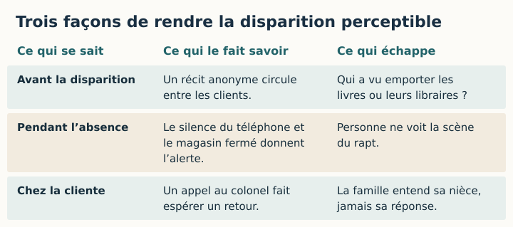

# BEL A/L — Espagnol, commentaire et traduction 2026 · Corrigé guidé

*Corrigé rédigé par IA, non officiel. Signalez toute erreur.*

**Rédaction** · GPT-6.2 Astra Ultra · vitesse non renseignée

**Révision (tour 1)** · GPT-6.2 Astra Ultra · vitesse non renseignée

Garde commune de l’ENS de Lyon et de l’ENS (Paris).

## Présentation du sujet

L’épreuve commune dure six heures. Le dictionnaire unilingue est autorisé. Le commentaire en espagnol couvre tout l’extrait d’Andrés Neuman, lignes 1 à 72 des pages 10 et 11. La version française se limite aux lignes 19 à 35 de la page 10.

La coupe imprimée au milieu de la ligne 30 demeure dans la version. La visite à l’ancienne députée et la dernière phrase se lisent jusqu’à la ligne 72 et interviennent uniquement dans le commentaire.

[Sujet officiel](https://www.ens.psl.eu/sites/default/files/al_lve_commun_commentaire_traduction_2026.pdf#page=10) · [Rapport du jury](https://www.ens-lyon.fr/sites/default/files/2026-10/Espagnol%202026.pdf#page=2)

## Préparer le commentaire

**Partir d’une absence.** Raconter en une phrase les lignes 19 à 25. Qu’a-t-on effectivement vu ? Une voiture s’est arrêtée. Personne dans le récit n’a assisté à l’enlèvement. La sonnerie sans réponse, le rideau fermé et la maison vide renseignent après coup sur ce qui vient de se passer. Ce décalage permet de formuler une question littéraire précise sur l’accès du lecteur aux faits.

**Suivre deux reprises.** Le café de la première page appartient à la sociabilité ordinaire des libraires. Le café que les visiteurs reconnaissent excellent à leur tour à la ligne 67, alors qu’ils ont l’estomac noué, introduit une distance ironique. De même, le mot *tío* est d’abord celui par lequel le narrateur désigne Peter. Prononcé au téléphone par la cliente, il révèle que la parenté peut ouvrir un accès direct à un officier. Ces reprises relient des détails situés aux deux extrémités de l’extrait.

**Éprouver une hypothèse.** La fréquence de *se* dans le récit de la rumeur ne suffit pas à caractériser tout le passage. Aux lignes 60 à 65, des répliques au discours direct prennent le relais. On entend distinctement la cliente changer de ton. La réponse du colonel, elle, reste inaudible. Une bonne transition entre les parties du commentaire montre ce qui change dans notre accès aux voix et ce qui reste hors de portée.

> [!JURY]
> Le rapport situe l’épisode dans la dictature argentine et rappelle que le narrateur était nouveau-né. Ces repères permettent de comprendre les limites de son témoignage. Dans le devoir, on peut les établir à partir du nom de Videla et du pronom *me* associé à la naissance. Le rapport admet des commentaires composés et linéaires.

## Rédiger le commentaire en espagnol

#### Solution

En la primera página de este episodio de *Una vez Argentina* (2003), quienes tienen miedo de que entre alguien a llevarse sus libros son también quienes los echan al fuego. Andrés Neuman instala así una paradoja en una escena que bien podría abrir una estampa familiar. En la librería de sus tíos se conversa y se toma café. Al final se servirá otro café, esta vez en casa de una mujer de quien depende tal vez la vida de ambos. Entre las dos escenas, un narrador que acababa de nacer cuando ocurrieron los hechos reconstruye el secuestro de Silvia y Peter durante la dictadura argentina. ¿Cómo llega a conocer el lector un crimen cuya ejecución queda fuera de su vista?

Al principio, los dos espacios de la librería son contiguos. En el local abierto al público se habla, en la trastienda se queman libros (ll. 1-5). No se ha presentado ningún censor y ya se calcula lo que podría saber un portero por lo que encontrara en la basura. El presente de «acaba» (l. 6) le da a esa precaución el aire de una máxima de sentido común. A continuación, el discurso atribuido a Videla extiende la categoría de terrorista a quien difunde determinadas ideas. La lista que va de Freud a Robin Hood muestra cuánto cabe en esa definición. El lector tropieza luego con dos comentarios entre paréntesis (ll. 13-15). Para hacer de un estudio del cubismo una prueba de castrismo basta con oír Cuba en el nombre de una corriente pictórica. Bajo esa lógica cualquiera puede producir una prueba de culpabilidad. La última confiscación se expresa en los mismos términos que las anteriores aunque su objeto ya sea una persona. En «los propios libreros» (l. 15) culmina una serie cómica y se anuncia la desaparición de dos personas a las que ya conocemos por sus nombres.

De la incursión de los hombres del Falcon solo se sabe, en un principio, lo que «se contaba» (l. 10). El singular indefinido de «uno» (l. 17) permite oír cómo cada cual pretende ponerse a salvo de una historia que admite haber oído. Cuando el coche para ante la casa de los tíos ya nadie cuenta cómo se los llevaron. A cambio, dos frases empiezan con las mismas tres palabras, «Horas más tarde» (l. 23). Cada una señala una cita cotidiana a la que falta alguien. Un teléfono sigue sonando, una librería permanece cerrada. El único personaje que entra en la casa llega una vez vacía. Al incluirse entre los recién nacidos de quienes otros esperaban un mundo mejor, el narrador ha situado su propia mirada fuera de la escena. Su vacilación acerca de la hora del secuestro respeta el límite de ese saber transmitido. En cambio, el tiempo que pasaron Mario en el sofá y Dorita con su crisis tiene una duración que el relato sí puede dar a sentir.

Ni siquiera en el seno de la familia se puede decir todo. Para que los abuelos vuelvan del sur, el padre inventa una complicación del embarazo. Mario aparenta dar crédito a la explicación en su condición de padre. El médico que también es advierte que no resulta convincente. Cuando comprende, tampoco se rescata una escena del secuestro. Se suceden una noche de búsqueda y una mañana en la que hasta los pasos de los bailarines suenan en el teatro. La frase que sitúa a los sanos y a los enfermos a las puertas del hospital parece enunciar otro hecho habitual. Basta trasladarse debajo de las comisarías para que la palabra «contrario» (l. 35) descubra otro recorrido de los cuerpos. El lector tiene que invertir él mismo el sentido de la frase anterior. La sobriedad de ese último término puede decir más del daño sufrido que una descripción de lo que nadie ha visto.

El cónsul promete hacer gestiones. La comparación «como todo el mundo» (l. 38) corta en seco la esperanza que podía suscitar su cargo. Mientras tanto, los padres del narrador se saben expuestos porque los libreros habían dado su dirección como domicilio legal. El auxilio que se busca ya compromete a quienes lo piden. La conversación con la exdiputada da por fin a la interrogación una voz, un gesto y unos oyentes. La señora compra libros ilustrados para sus hijas y comprende al punto lo extraño de la acusación. Un instante después, parece darle crédito. La sospecha que Jacinto y Blanca ya habían formulado vuelve en boca de otra persona (ll. 41, 52 y 64). La mujer sopesa el apellido, el origen judío de Silvia y la nacionalidad de su marido como si instruyera una causa en el salón de su casa. El narrador reproduce incluso su pausa de cálculo. Entonces una palabra familiar, «Tío» (l. 60), abre una línea telefónica que las visitas a hospitales y comisarías no podían abrir. El tío al otro lado del hilo es coronel. La dulzura del voseo «Sos un divino» (l. 61) hace audible el privilegio que entraña ese parentesco. Mientras el lector solo oye la mitad de la conversación, la mano que tapa el auricular le permite a la señora cambiar de voz y exigir garantías a quienes vienen a pedirle ayuda.

Queda el café. El padre y Delia salen con un nudo en el estómago y aún parece obligado elogiar la bebida (ll. 66-67). La cortesía persiste hasta en la manera de contar la escena. Cuando reaparecen los libreros, sus cuerpos doloridos acreditan el daño, pero «o más que eso» (l. 69) deja abierto lo que no se alcanza a decir. El vínculo familiar de una desconocida de convicciones ajenas a las suyas les ha devuelto la vida. Las tres palabras de la última línea, «Así de fácil», suenan a explicación después de un relato en el que nadie ha conseguido siquiera fijar la hora de los hechos. Queda al descubierto la facilidad con que el poder dispone de una vida. Al contar quién llamó a quién, qué dijeron los que esperaban y hasta cómo sabía el café, el recién nacido de entonces le devuelve a esa vida la historia concreta que su desaparición habría borrado.

## Traduire les lignes 19 à 35

**Qui vient de naître ?** Rétablir le fil principal de la deuxième phrase après avoir mis la relative entre parenthèses. Le sujet de *acababa* est la mère du narrateur. Le pronom *me* désigne le nouveau-né. Au contraire, Silvia, mentionnée dans la phrase précédente, attend encore son enfant. L’imparfait *llegábamos* fait entrer le narrateur dans le groupe des « hommes nouveaux ». Le conditionnel français rattache l’amélioration espérée à l’horizon d’attente de cette époque.

**Comment compter les heures ?** L’incertitude concerne le moment de l’enlèvement. Les trois termes de l’alternative se conservent. Le récit mesure ensuite la durée à partir de l’absence par une anaphore. Le même groupe temporel ouvre donc les deux phrases françaises. Dans le nom de la librairie, le français « échec » traduit la menace faite au roi dans le jeu tout en gardant le livre pour cible.

**Qui sait quoi ?** La mention du père et du médecin concerne un seul homme, Mario. La même explication, donnée par le père du narrateur, permet à Mario de jouer le père rassuré sans emporter sa conviction professionnelle. Puis le tour impersonnel *seguía sin haber* exprime un état qui se prolonge. « À leur arrivée » conserve les grands-parents comme voyageurs dans une phrase dont le verbe principal porte sur les nouvelles.

**Où se répondent les fins de phrase ?** Au théâtre, la musique et les pas commandent ensemble l’accord de « résonnaient ». À l’hôpital, l’entrée des uns et la sortie des autres dessinent deux trajets en sens inverse. *Mientras* relie à ce même moment ce qui se passe sous les commissariats. Conserver la brièveté du dernier mot évite de détailler à la place du narrateur ce que le lecteur vient de comprendre.

#### Solution

Ma tante Silvia était enceinte. Ma mère, qui, elle aussi, avait brûlé avec mon père plusieurs livres, des brochures et des journaux, venait de me mettre au monde. Nous arrivions, nous autres, les hommes nouveaux, et bientôt tout irait mieux. C’était ce qu’ils croyaient. Il fallait bien le croire. Mais un après-midi, ou un matin, ou à un moment quelconque, une Ford Falcon se gara devant chez mon oncle et ma tante. Des heures plus tard, personne ne répondait au téléphone. Des heures plus tard, la librairie Échec au Livre n’avait toujours pas ouvert. La femme de ménage trouva la maison en désordre et vide. Mes grands-parents Dorita et Mario étaient en voyage à Bariloche. Pour les faire revenir, mon père leur dit que Silvia avait des ennuis avec sa grossesse. En père qu’il était, Mario fit mine d’y croire, mais ces explications ne convainquirent pas le médecin en lui. Ils revinrent du sud à toute la vitesse que donne la peur. À leur arrivée à Buenos Aires, on n’avait toujours aucune nouvelle de Silvia et Peter. Cette nuit-là, tout se comprit dans une terreur qui vint, docile. Dorita fit une crise de nerfs qui dura longtemps. Mario passa toute une journée prostré sur le canapé. Mon père donna des coups de téléphone. […] À eux tous, ils firent la tournée des hôpitaux et des commissariats, le circuit habituel. Les heures du petit matin s’étirèrent sans répit. Ils n’y croyaient pas. Ils ne pouvaient pas y croire. Le lendemain matin, tout continuait à fonctionner à merveille. Au théâtre Colón résonnaient la musique majestueuse des répétitions et les pas furtifs des danseurs. À l’hôpital où travaillait Mario, les malades entraient et les bien-portants sortaient. Sous les commissariats, dans les casernes et en certains lieux reculés, pendant ce temps, c’était plutôt l’inverse qui se produisait.

## Bilan

À la relecture, revenir aux trois moments où le téléphone intervient. Un appel sans réponse donne l’alerte, les appels du père accompagnent les recherches et l’appel de la cliente atteint un colonel. Le commentaire peut suivre les trois moments. Seuls les deux premiers entrent dans le passage à traduire.
