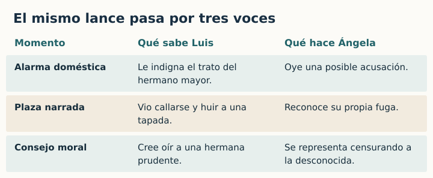

# BEL A/L · Espagnol, option orale · Calderón, vers 445 à 542 — Corrigé brut

*Corrigé rédigé par IA, non officiel. Signalez toute erreur.*

**Rédaction** · GPT-6.2 Astra Ultra · vitesse non renseignée

Le jury donne les bornes de cet extrait de la première journée de *La dama duende* et demande une explication en espagnol. La préparation dure 1 h 30. L’exposé dure au plus vingt minutes, puis viennent dix minutes d’entretien. La numérotation retenue dans le titre est celle du jury. Les deux éditions de travail ont un décompte légèrement différent : le début et la fin ont été repérés par les répliques. L’explication suit la première journée, de l’appel de Luis à Ángela jusqu’à sa promesse de galanterie.

[Rapport et bornes officielles](https://www.ens.psl.eu/sites/default/files/2026_al-rapport_oral_option_espagnol.pdf#page=1) · [Texte d’après l’impression de 1640](https://www.cervantesvirtual.com/portales/calderon_de_la_barca/obra-visor/la-dama-duende--0/html/ff22be1e-82b1-11df-acc7-002185ce6064_3.html) · [Édition de Luis Iglesias Feijoo](https://www.cervantesvirtual.com/obra-visor/la-dama-duende-comedia-famosa/html/5cb23465-bca9-4315-a4a2-fd8ae4294f6a_2.html)

## Explicación en español

### Oír una confesión donde todavía no se ha formulado una acusación

Al oír que su hermano la llama por su nombre, doña Ángela le contesta «Hermano y señor». En la primera jornada de *La dama duende*, doña Ángela, viuda joven que vive retirada en casa de sus hermanos, ha salido tapada. Ha pedido ayuda para escapar de un hombre que resulta ser su propio hermano don Luis. Don Manuel, recién llegado, ha intervenido y ha quedado herido. Ahora va a alojarse en la misma casa. Al comienzo del pasaje, Ángela quiere saber si Luis la ha reconocido. El público conoce la identidad de la tapada y ha presenciado una parte del lance que el hermano va a contar. Sin embargo, ignora hasta dónde llegaron las sospechas de Luis. Este reparto desigual, pero cambiante, del saber permite seguir el movimiento de la escena. La mujer que empieza por temer lo que dirá su hermano acaba dictándole la interpretación de lo que ha visto.

El llamamiento inicial reduce por un instante a la protagonista a su nombre de pila. Ella responde con dos títulos. «Hermano» invoca la proximidad de la casa; «señor» reconoce una autoridad que conviene no desafiar abiertamente. Su primera iniciativa consiste en describir el aspecto de Luis y en preguntarle qué le ha pasado. Él recoge el verbo de «¿qué tienes?» para contestar «tengo honor». Ángela había preguntado por un suceso o una dolencia. Luis responde como si tener honor fuera de por sí una razón para estar alterado. Queda abierta precisamente la casilla que más interesa a su hermana: quién habría ofendido ese honor. La actriz puede hacer oír al público el sobresalto que el hermano no oye. El aparte hace actuar dos interlocuciones en el mismo espacio y en el mismo instante.

La frase que anuncia que ella es «la causa» parece precipitar el desenlace. Sin embargo, Luis deshace la apariencia a medida que completa su razonamiento. Le duele que el hermano mayor tenga tan poca consideración con ella. La sintaxis interrumpida, los vocativos, las preguntas de Ángela y la breve participación de Isabel permiten a los espectadores ensayar y abandonar una explicación antes de escuchar el final de la frase. Los versos de arte menor y las redondillas sostienen esa rapidez sin que cada réplica tenga que ocupar un verso entero. La protagonista no se ha salvado porque el hermano haya cambiado de opinión. Se ha equivocado sobre el objeto de una indignación auténtica.

### Escuchar de labios del perseguidor el relato de la propia fuga

La pregunta por cómo ocurrió el incidente cede a Luis un largo turno de palabra. El ritmo cambia. Su narración reconstruye la plaza de Palacio, el espacio despejado para la fiesta, el grupo de amigos y la mujer tapada que los entretenía. La figura que surge del relato contrasta con la conducta esperada de una viuda retirada: los hombres alaban su ingenio y disfrutan al oírla. La llegada de Luis produce un corte inmediatamente visible y audible. La mujer que hablaba con soltura se calla. Para Luis, ese silencio es un indicio que debe descifrar. Para el público, demuestra hasta qué punto la libertad de Ángela depende de quién esté mirando. En la plaza, callarse era proteger su identidad; en casa, ese mismo silencio vuelve en forma de historia contada por el hombre al que se quería evitar.

La secuencia de verbos relativos a ver, taparse, seguir y volver la vista representa dos movimientos simultáneos. Si ella se vuelve, no es para invitarlo a seguir; necesita comprobar si puede escapar. Él interpreta esa vigilancia como un motivo adicional para continuar. La expresión que hace del «cuidado» de ella la «espuela» del suyo concentra la equivocación. Los dos cuidan algo distinto y cada nuevo gesto que parece confirmar la lectura de uno tiene otro sentido para la otra. Luis cuenta la historia a la única mujer que podría corregírsela punto por punto sin consultar a otro testigo. Este es el efecto teatral que no produciría un narrador que se limitara a informar al espectador de un hecho anterior.

La intervención del criado con una carta introduce un segundo problema de lectura. En el nivel más material se pide al perseguidor que lea un escrito. Luis interpreta acertadamente que alguien quiere detenerlo. Su perspicacia local no le permite resolver el enigma mayor de la identidad de la tapada. La llegada de don Manuel desemboca en el duelo. El hermano resume la pelea y da por terminado el relato con una restricción: las consecuencias pudieron ser más graves. Sus palabras dan a Ángela una oportunidad que él mismo no sospecha. Puede expresar lo escandaloso de la situación sin nombrarse, a condición de tratar a la desconocida como si fuera una tercera persona.

### La sospechosa se convierte en consejera

Ángela exclama contra la «mala mujer» y las «mujeres tramoyeras». El sustantivo *tramoya* evoca una máquina o artificio teatral; el adjetivo califica aquí la capacidad de intrigar. La mujer que enreda le ofrece a Luis una pequeña representación de severidad moral. El diminutivo despectivo «mujercillas» distancia todavía más a quien habla de la mujer de la plaza. Para Luis, oye a su hermana censurar a las mujeres que ponen en peligro a los hombres. El público ve a la misma persona producir una explicación útil de su conducta y asumir uno de los tonos con que se vigila la conducta femenina. Esa segunda audición hace de la tirada una maniobra cómica, pero no elimina lo costoso que sería para ella un fallo de la maniobra.

El tránsito al interrogatorio cotidiano, sobre qué hizo Ángela aquella tarde y si la vio el hermano mayor, resulta más inquietante que una acusación solemne. Ella lo resuelve con el retrato convencional de la viuda que se queda en casa llorando. «Entretenida» presenta el llanto casi como una ocupación a la que se habría dedicado durante toda la tarde. El espectador dispone de otra versión del empleo de esas horas. Hay después un dato que no tiene por qué ser mentira: la hermana y el hermano menor dependen del mayor para sus «alimentos», es decir, su mantenimiento. La jerarquía doméstica que Ángela invoca para calmar a Luis es también la que hace necesario el fingimiento. Una buena explicación no convertirá por ello a la protagonista en dueña absoluta de la situación.

El último futuro, «haré una galantería», cambia la disposición de Luis. En vez de exigir cuentas, sale anunciando una cortesía. La salida constituye la prueba escénica del éxito inmediato de Ángela. Su interlocutor conserva la idea que tiene de su honor y cree haberla tranquilizado. Ella ha conservado algo mucho más concreto, el secreto de la salida. Desde la primera llamada hasta esta despedida, la comedia no ha hecho desaparecer la autoridad del hermano. Le ha dado a Ángela tiempo para escuchar cómo esa autoridad interpreta los indicios y para servirse de su interpretación como de un papel que puede representar mejor que él.

## Preguntas posibles

**¿Es don Luis simplemente incapaz de observar?** Observa muy bien que la tapada se calla y que el criado intenta detenerlo. Lo que falla es la relación que establece entre esos indicios y los motivos de la mujer. Su relato es lo bastante exacto para que el público reconozca la escena y lo bastante parcial para que Ángela pueda torcer su sentido.

**¿Qué gana el teatro al repetir un episodio?** El primer lance permitió ver varios cuerpos en movimiento. Al contarlo Luis ante la protagonista, un acontecimiento conocido se convierte en prueba de otra cosa: de lo que él llegó a comprender y de lo que ella debe impedir que comprenda. El suspense afecta ahora a la escucha y a la respuesta.

**¿Por qué importa el verso compartido al principio?** Las voces pueden relevarse dentro de una unidad métrica. El espectador oye la vacilación y el sobresalto sin que se detenga el movimiento de conjunto. Construir largas pausas después de cada nombre del diálogo borraría parte de esa vivacidad.

