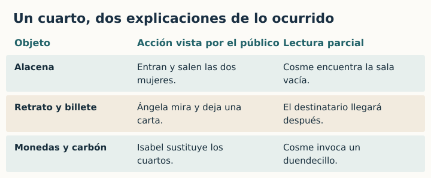

# BEL A/L · Espagnol, option orale · Calderón, vers 782 à 921 — Corrigé guidé

*Corrigé rédigé par IA, non officiel. Signalez toute erreur.*

**Rédaction** · GPT-6.2 Astra Ultra · vitesse non renseignée

Le jury donne les bornes de cet extrait de la première journée de *La dama duende* et demande une explication en espagnol. La préparation dure 1 h 30. L’exposé dure au plus vingt minutes, puis viennent dix minutes d’entretien. La numérotation retenue dans le titre est celle du jury. Les deux éditions de travail ont un décompte légèrement différent : le début et la fin ont été repérés par les répliques. L’explication va de l’annonce par Isabel d’une chambre vide à l’interrogation de Cosme sur son propre larcin. La transcription de 1640 donne « lo que yo hurto », comme le jury, et Iglesias Feijoo « el que yo hurto ».

[Rapport et bornes officielles](https://www.ens.psl.eu/sites/default/files/2026_al-rapport_oral_option_espagnol.pdf#page=1) · [Texte d’après l’impression de 1640](https://www.cervantesvirtual.com/portales/calderon_de_la_barca/obra-visor/la-dama-duende--0/html/ff22be1e-82b1-11df-acc7-002185ce6064_3.html) · [Édition de Luis Iglesias Feijoo](https://www.cervantesvirtual.com/obra-visor/la-dama-duende-comedia-famosa/html/5cb23465-bca9-4315-a4a2-fd8ae4294f6a_2.html)

### Préparer une lecture qui se voie autant qu’elle s’entende

Dessiner deux accès différents sur un brouillon. L’une est l’accès ordinaire, dont on entend tourner la clé ; l’autre est l’armoire mobile qui a l’aspect d’un meuble. Entre les deux, placer la table, les deux valises, la lettre, les monnaies et le charbon. Reconstituer les actions une fois avec les informations du public et une autre avec celles du seul Cosme. À aucun moment Cosme ne surprend les visiteuses. La disjonction des parcours explique l’apparition verbale du « duendecillo ».

Repérer la logique matérielle des trois plaisanteries : les papiers cousus pèsent réellement, la forme de cordonnier se cache derrière une expression figurée, les pièces de peu de valeur deviennent la plèbe d’une république monétaire. Choisir deux jeux et jouer le temps nécessaire pour que l’accessoire fasse reconnaître leur double sens. À la sortie des femmes, changer de voix. Cosme remplit par ses propres réponses le silence de la chambre. Pour l’entretien, distinguer ce que commande une didascalie et la position exacte des acteurs qu’un metteur en scène doit choisir.

## Explicación en español

### Abrir un mueble y entrar en una hipótesis

En la primera jornada, don Manuel ha sido acogido en una casa cuya distribución oculta la presencia de doña Ángela. Una alacena disimula un paso hacia el cuarto del huésped. Al comienzo del fragmento, Isabel anuncia que el cuarto está vacío. El público ha visto la salida de Cosme y ve llegar a las mujeres por un lugar que parece un mueble. Al final, en el mismo cuarto, el criado se dirige a un duendecillo que nunca ha aparecido ante sus ojos. La escena hace nacer lo sobrenatural delante de un público que ha visto producirse cada uno de sus supuestos prodigios. El interés reside en seguir el paso de una experiencia autorizada por la mecánica teatral a una explicación a la que solo puede llegar alguien que entra tarde.

La primera frase de Isabel transmite una información de Rodrigo. No responde a una omnisciencia de la criada. Para atreverse, Ángela depende de una noticia dada por otro y de un cierre que debe poder abrirse y volver a dejarse como estaba. Habla de hacer una «experiencia». La comprobación parece terminar nada más empezar, pues ambas han pasado y no han encontrado resistencia. Cuando Isabel pregunta para qué han venido, la respuesta «A volvernos solamente» propone una salida que la escena va a desmentir durante varios minutos. La negación de la curiosidad acompaña su ejercicio. Ángela se justifica por la gratitud que debe a don Manuel, el caballero que se comprometió por ella en público. Para el espectador, el deseo de saber cómo es el hombre a solas con sus cosas va a adquirir un volumen mucho mayor que esa explicación prudente.

El lugar contiene huellas de la propia dueña de casa. La escribanía que Ángela reconoce se encuentra junto a los objetos colocados para comodidad del huésped. La espada, la mesa y los pertrechos de escritura asocian a don Manuel con papeles sociales distintos. El mismo instrumento dispuesto por un hermano para que escriba el invitado va a permitir a la mujer que se oculta dirigirle un billete. Antes de que cambie de manos ningún objeto, cambia ya la finalidad de una cortesía doméstica.

### Registrar las maletas, repartir el espacio y los deseos

Las maletas abiertas en el suelo marcan otro grado de la intromisión. La pregunta de Isabel suscita el consentimiento de Ángela; ambas se reconocen agentes de la inspección. Una acotación exige que saquen y esparzan cuanto nombran. En el romance octosilábico, la asonancia de los versos pares sostiene la continuidad mientras las preguntas y respuestas se hacen muy cortas y pueden repartirse un verso. El público dispone así de dos inventarios simultáneos: oye los nombres y ve cómo cada respuesta triplica, por decirlo así, el desorden que luego encontrará Cosme. El gesto acompaña al diálogo, pero también prepara una consecuencia que aún no preocupa a las dos mujeres.

Los papeles pesados y cosidos resultan ser procesos. Ángela había preguntado si eran de mujer. Saber que pesan permite pasar de un dato material a una pulla sobre la supuesta ligereza de otras cartas. El olfato examina después la ropa blanca, y la limpieza se convierte en el mejor perfume. La sucesión de herramientas da cuerpo a una pregunta sin respuesta directa hasta entonces: ¿qué aspecto desea ofrecer a los demás su propietario ausente? Lo que por un momento podría parecer equipo de sacamuelas se revela instrumental de arreglo del pelo y del bigote. Isabel remata el inventario jugando con «la horma de su zapato». La expresión que puede anunciar una correspondencia o una persona capaz de plantar cara a otra recobra su sentido literal porque allí está la horma. Para que la broma se vea, alguien tiene que mostrar un objeto después de que otra haya preparado una expectativa verbal.

El retrato cambia el ritmo. Un segundo conjunto de papeles sí parece proceder de una mujer y guarda una imagen. Ángela se detiene ante la hermosura pintada; Isabel interpreta el cambio de expresión como el pesar de haber sacado el retrato. Ahora la pesquisa sobre un ausente se vuelve una pesquisa de Isabel sobre el rostro de su ama. El texto no obliga a dar un nombre a la retratada ni a declarar una pasión consumada. Basta con atender al contraste entre las preguntas insistentes del registro y la orden tajante de no mirar más. Ángela decide escribir. La letra propia va a ocupar el lugar que el papel de otra parecía amenazar.

A partir de la acotación que la pone a escribir, la acción se divide a la vista del público. Mientras el ama compone su billete, la criada abre la maleta de su semejante. Las monedas pequeñas de Cosme forman, frente a doblones y reales, la «común plebe» de una república de metales. La comparación hace corresponder la jerarquía del dinero a la de los dueños de las dos maletas. Isabel cambia esas piezas por carbones. Incluso anticipa la objeción de quien pudiera preguntar de dónde los ha sacado e invoca el mes de noviembre y el brasero del cuarto. La explicación inserta un espectador imaginario en su parlamento y reivindica, en medio de la burla, una causalidad perfectamente doméstica. Nada obliga a suponer que el texto haya hecho entrar al teatro a un verdadero ser sobrenatural.

### Salir sin haber sido vistas, hacer hablar a un cuarto vacío

El billete debe estar a salvo de una visita del hermano y llegar en cambio a manos del huésped. Isabel propone esconderlo bajo la toalla que cubre las almohadas. Su razonamiento no opone simplemente ver a no ver: calcula quién verá, cuándo y durante qué gesto rutinario. La llave que se oye girar interrumpe la tarea de recoger. Las dos mujeres desaparecen por la alacena y esta recobra el aspecto habitual. La broma pseudolatina «Alacena me fecit» da al mueble casi la condición de artífice de su desaparición. Queda sobre las tablas un resultado muy visible de una operación cuya vía de acceso ha dejado de ser visible.

Cosme entra y hace primero una lectura profana del espectáculo. Parece que se venden las pertenencias de la casa en una almoneda; hasta compara la sala con la plazuela de la Cebada. Un pequeño espacio privado cobra imaginariamente el volumen de un mercado madrileño. Grita una pregunta, comprueba que nadie responde y termina felicitándose de que el intruso no sea respondón. Le hemos oído fabricar la réplica que la sala vacía no le da. Su manera de mostrarse desenvuelto acaba en una admisión física del miedo. El criado toleraría el trastorno de las cosas de su amo si el que las ha revuelto hubiese respetado su dinero. El carbón derrumba esa última posición de seguridad.

«Duendecillo» es al fin un vocativo. Donde antes había una maleta y un brasero aparece verbalmente un destinatario con voluntad propia. El diminutivo repetido trata al supuesto poder con una familiaridad casi suplicante. Aun en el miedo, Cosme intenta limitar el derecho del ser que imagina: que cambie lo que él mismo ha dado si quiere, pero ¿por qué cambiar lo que Cosme ha hurtado? La defensa de una propiedad que se funda en el hurto remata el equívoco con una confesión cómica. Isabel había sustraído las monedas de un criado que se presenta como ladrón; la intervención de la criada desaparece de su explicación. El público puede reírse de la invención del duende porque conoce la causa material que Cosme desconoce. También puede reconocer algo de su propia situación de espectador: un mueble y unas monedas han bastado para que unas personas actúen como si una ficción tuviera existencia fuera de las palabras que la sostienen.

## Preguntas posibles

**¿Son intercambiables Ángela e Isabel?** Comparten la pesquisa, pero el retrato lleva a Ángela a escribir al huésped, mientras Isabel registra las cosas de Cosme y prepara la sustitución. Durante un mismo tiempo escénico nacen dos intrigas que serán interpretadas de manera distinta.

**¿Por qué no se limita Isabel a quitar las monedas?** El carbón materializa una transformación aparente. Un dinero ausente podría atribuirse sin más a un robo. Cosme cree descubrir una voluntad capaz de convertir una materia en otra, aunque los espectadores han visto la sustitución.

**¿Se necesita una escenografía moderna para que el público comprenda?** La acotación describe el funcionamiento de la alacena; el ruido de la llave y la sucesión de salidas y entradas establecen las dos vías de acceso. Los gestos que exigen las maletas hacen el resto. La obra distribuye información teatral sin depender de una reconstrucción naturalista de toda la casa.

