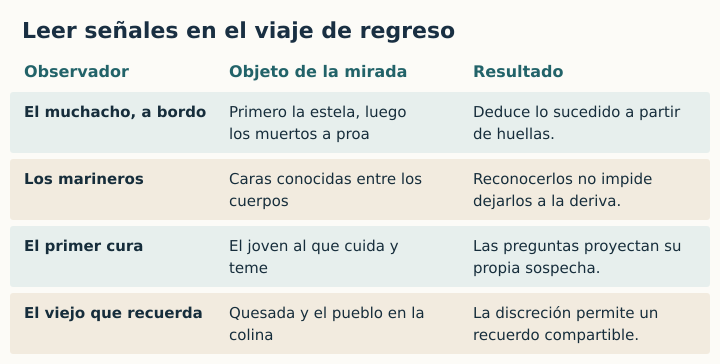

# BEL A/L · Espagnol, option orale · Saer, pages 156 à 159 — Corrigé brut

*Corrigé rédigé par IA, non officiel. Signalez toute erreur.*

**Rédaction** · GPT-6.2 Astra Ultra · vitesse non renseignée

Le jury situe ce passage d’*El entenado* aux pages 156 à 159 de l’édition du concours et donne ses deux bornes. La préparation dure 1 h 30, avec vingt minutes au plus d’exposé en espagnol et dix minutes d’entretien. Le passage s’ouvre sur les interrogatoires à bord et finit sur le village blanc aperçu depuis le couvent du père Quesada.

[Bornes du tirage et rapport du jury](https://www.ens.psl.eu/sites/default/files/2026_al-rapport_oral_option_espagnol.pdf#page=1) · [Transcription de l’édition Seix Barral, Buenos Aires, 2002](https://studylib.es/doc/5092388/seix-barral-biblioteca-breve)

## Explicación del pasaje

### Regresar como extranjero

Tras haber vivido diez años entre los indígenas, el narrador de *El entenado* se encuentra otra vez entre españoles. Se podría esperar que la vuelta a la lengua de la infancia le devolviera también un lugar entre los suyos. Saer abre el fragmento con un hombre al que las preguntas han dejado vacío y lo cierra con un pueblo diminuto que se ve desde lejos. Entre ambas imágenes pasa mucho tiempo. Embarcado, interpelado, interrogado a su llegada, el personaje descubre que quienes quieren saberlo todo de él saben de antemano qué clase de respuesta podrían aceptar. ¿Qué hace posible, entonces, el recuerdo que estamos leyendo? Sigamos el viaje río abajo, el aprendizaje de la sospecha europea y la discreta excepción que acaba por cambiar el destino del muchacho.

### Vestir a un hombre, leer un río

Los interrogadores no reciben nombre al principio. Al cambiar de barco, cambian los oficiales y siguen las preguntas. La compañía del cura aparece casi como un bulto suplementario en la operación de traslado. La construcción de las frases deja al muchacho en la posición de quien recibe una orden, una prenda o una mirada. Tras haberlo exhibido ante la curiosidad común, se lo puede relegar a cualquier rincón. En la expresión «vaciado con preguntas», un procedimiento que promete sacar un contenido del testigo parece haber producido su agotamiento. El participio plantea ya una dificultad para la narración entera. ¿De dónde le saldrán al viejo las palabras que no lograron obtener los oficiales?

La ropa es una primera respuesta, porque permite contar algo a lo que sus interrogadores apenas habrían dado importancia. Los españoles quieren cubrir el cuerpo. Él registra los zapatos en los que el pie no entra y la tela que le raspa la piel. Vestirse lo hace sentirse lejos del cuerpo que la ropa tendría que proteger. Poco a poco acaba por olvidarse de que la lleva. El olvido cuenta aquí como forma de aprendizaje, y prepara la manera casi física en que más adelante se irá apropiando de una lengua que había sido suya desde niño. El sacerdote, que le corta el pelo y le da de comer, le comunica también la partida de otra expedición. Advertimos que los cuidados materiales son reales. No hay por qué negarlos para entender más tarde lo que los hace tan inquietantes.

El muchacho se asoma a mirar. El adjetivo «salvaje» puede aplicarse ahora a un río inmenso sobre cuyas orillas no distingue ni indígenas ni soldados. La repetición del silencio transforma una impresión acústica en una espera que ocupa un día entero y persiste al siguiente. De noche mira a través de aparejos y mástiles las estrellas. La cubierta está llena de mosquitos. El pequeño acoso visible, la cercanía de los hombres dormidos y el silencio que viene de río arriba caben en una misma escena. La incertidumbre está localizada con mucha precisión. Mientras los otros navegantes parecen haber olvidado la nave que quedó atrás, él vigila la estela desde la suya.

Al amanecer del tercer día recibe por fin unos signos, pero llegan por delante. Esperaba noticias de lo que ha quedado río arriba y debe buscar sus rastros en dirección a la proa. La explicación material de esa inversión es escalofriantemente simple. El barco se detuvo a pasar la noche y los muertos siguieron flotando. Antes de que se formule un juicio sobre lo sucedido, la disposición de dos velocidades en el agua permite comprender el alcance de una matanza que el narrador no vio. Las víctimas incluyen a soldados e indígenas, con una mayoría de indígenas. La enumeración alcanza a viejos, mujeres y niños. Estos precisos datos impiden leer la escena como un combate entre dos grupos de hombres armados y equiparables.

### El séquito de muertos y el regreso de una lengua

El muchacho corre a la popa, mira a babor y a estribor. El vocabulario de navegación sirve esta vez para comprobar que los muertos rodean la nave por sus cuatro costados. Incluso llegan a acompañarla durante días. Los marineros que reconocen caras muestran satisfacción. Es un sentimiento de reconocimiento, que no conviene convertir sin pruebas en alegría por las muertes. Pero la orden de los oficiales descarta una acción que parecería seguirse de ese reconocimiento. Han de dejar que también sus compañeros sigan flotando. La imagen de la procesión callada reúne en un mismo cortejo a quienes los vivos todavía distinguen por su pertenencia. La prosa mantiene a la vez el efecto de comunidad de la imagen y la diferencia entre las víctimas que la enumeración acaba de precisar.

Cuando se ensancha el río, el cortejo pierde su forma. La dispersión devuelve los cuerpos al mar abierto, llamado con inesperada hospitalidad. El agua que los acoge recibe así una cualidad humana que la orden de los oficiales les rehusaba. La desembocadura hace volver al recuerdo el descubrimiento del capitán, diez años antes. Puede trazarse un círculo en la geografía de la expedición. En la experiencia del superviviente, el camino de vuelta ha producido un vínculo nuevo con esos muertos. De ahí el interés del posesivo que emplean los marineros al hablar de la patria. Ese «nuestra» le llega junto con la entonación, a su juicio torpemente solemne, de quienes lo pronuncian. El narrador puede oír lo que oye un extranjero en una expresión que en principio debería incluirlo.

La lengua infantil, que al comienzo le sonaba a pedazos inconexos, le vuelve entera. El movimiento tiene dos etapas. Primero reconoce en la memoria lo que oye. Luego la lengua llega hasta la sangre, como si llegar a hablarla fuera adquirir de nuevo una costumbre corporal. Esa intimidad recuperada coincide con una forma particularmente cruel de extrañeza. El sacerdote que contribuye a devolvérsela lo examina como posible pecador. La progresión de las preguntas revela mejor las convicciones del cura que las experiencias del muchacho. El sacerdote nada sabe de los indígenas, pero cree estar en condiciones de imaginar todos los pecados a los que su compañía habría conducido. La caridad es para él un deber que cumple con puntualidad. Esa puntualidad hace aún más perceptible el miedo que el viejo reconoce en quien lo cuida.

### De la sospecha sin contenido al padre Quesada

El narrador imagina que aun con un leproso aquel hombre habría tenido un contacto más natural. La comparación lleva la sospecha al cuerpo, como antes lo había hecho el roce de la ropa. Ya no hace falta formular una acusación para que el interrogado empiece a desconfiar de su propia inocencia. ¿Habrá algo culpable en haber sobrevivido? ¿Le habrán comunicado los indígenas una cualidad que todos ven en él salvo él mismo? Esas preguntas no avalan ninguna teoría sobre la naturaleza indígena. Muestran la potencia de un prejuicio, capaz de proporcionar a la víctima hasta la lengua en que duda de sí. La enumeración de oficiales, funcionarios, marineros y sacerdotes extiende esa experiencia desde una persona hasta instituciones enteras. Ni los que sospechan ni aquel de quien se sospecha consiguen determinar la justificación. Se ha producido una certeza social que carece de objeto claro.

El giro decisivo llega con un singular, «Un solo hombre». El padre Quesada se distingue por su discreción. El viejo precisa incluso que ésta contó más que su piedad. Rehusar una mirada escrutadora es un acto intelectual y moral muy distinto de sentir compasión por un hombre al que ya se cree conocer. La precisión de que Quesada murió hace más de cuarenta años abre de repente la distancia entre el muchacho observado y quien hoy escribe. Y la frase sobre el cura que lo trajo, larga y demorada, vuelve a distinguir a los dos religiosos. Uno parece haber llevado al muchacho como una brasa en la mano. Su deseo de librarse de él, unido a la preocupación por su propia salvación, conduce por caminos irónicos al encuentro con el otro.

Los últimos datos son extraordinariamente sencillos en comparación. Un nombre, siete años en un convento y un pequeño pueblo blanco que se ve en lo alto de una colina. La prosa que fluctuaba entre lo que los otros creían adivinar y lo que el muchacho llegaba a temer se concede una imagen estable a distancia. No hay que inventar las enseñanzas de aquellos siete años para percibir el cambio. Un religioso ha renunciado a hacer hablar a la fuerza y, en el recuerdo del anciano, queda por fin algo que se puede mirar junto a él. Al comenzar, los interrogadores querían extraer una verdad. Al terminar, comprendemos que una verdad digna de ser contada necesitaba también tiempo y alguien capaz de guardar discreción.

### Conversación con el tribunal

**¿Vio el narrador la matanza?** Ve sus rastros en los cuerpos que lo alcanzan. Puede precisar qué clases de víctimas reconoce y cómo los muertos rodean la nave. No puede reconstruir desde esa cubierta una escena de combate a la que no asistió.

**¿En qué sentido la palabra patria es ambigua?** El destino geográfico es común a los de la nave. Pero el viejo recuerda el posesivo y la solemnidad como palabras y tono de otros. Aprender otra vez la lengua no le obliga a compartir esa misma entonación.

**¿Qué permite distinguir a los dos sacerdotes?** El primero alimenta, viste y acompaña al muchacho, pero su conducta está gobernada por el temor. El segundo se singulariza porque no adopta la sospecha de todos. Es la distinción expresa que el narrador formula al introducir su nombre.

**¿Cómo se prolonga la primera escena en la última?** Al comienzo lo transfiere un grupo anónimo. Al final dice con quién pasó siete años. Entre ambos momentos el lector ha aprendido qué diferencia hay entre ser objeto de una investigación y poder vivir en compañía de alguien.

