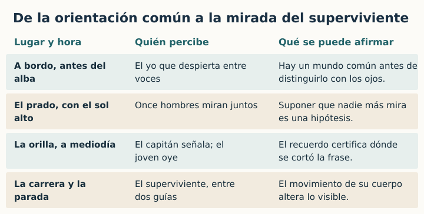

# BEL A/L · Espagnol, option orale · Saer, pages 64 à 69 — Corrigé brut

*Corrigé rédigé par IA, non officiel. Signalez toute erreur.*

**Rédaction** · GPT-6.2 Astra Ultra · vitesse non renseignée

Le jury situe ce passage d’*El entenado* aux pages 64 à 69 de l’édition du concours et donne ses deux bornes. La préparation dure 1 h 30, avec vingt minutes au plus d’exposé en espagnol et dix minutes d’entretien. Le passage suit le réveil avant l’aube, le débarquement, la mort du capitaine et la course du survivant jusqu’à l’étrangeté du paysage au repos. Les deux transcriptions consultées ajoutent le pronom « me » au début de la phrase que cite le jury.

[Bornes du tirage et rapport du jury](https://www.ens.psl.eu/sites/default/files/2026_al-rapport_oral_option_espagnol.pdf#page=1) · [Transcription de l’édition Seix Barral, Buenos Aires, 2002](https://studylib.es/doc/5092388/seix-barral-biblioteca-breve) · [Témoin du début du roman chez Kalais](https://analfa.wordpress.com/2020/11/17/juan-jose-saer-la-rotunda-y-bella-prosa-de-el-entenado/)

## Explicación del pasaje

### ¿Qué queda de un acontecimiento cuando sólo uno puede contarlo?

El viejo que cuenta su vida en *El entenado* estuvo de muchacho en una expedición española. Del reconocimiento de una orilla vuelve a su memoria algo que difícilmente recogería una crónica de la conquista, el sabor de haberse despertado esa mañana. Y sin embargo, lo que va a suceder en esa orilla merecerá, según él, los comentarios de medio mundo. ¿Cómo puede el superviviente dar fe de algo que, en el momento de vivirlo, casi se le escapa? Primero veremos cómo once hombres se hacen presentes en el mundo que recorren. Después, al volver sobre sus pasos, pierden la seguridad de estar viendo lo mismo. Por fin, cuando el grupo desaparece, el muchacho tendrá que aprender hasta qué punto el paisaje dependía de su manera de moverse y de quién lo acompañaba.

### Del despertar a la primera detención en el prado

En las primeras palabras se cruzan dos tiempos. «De ese día» señala una fecha singular, mientras que el presente «vuelve» y el adverbio «siempre» designan una experiencia repetida a lo largo de años. El viejo no dice que se haya propuesto reconstruir la jornada. Más bien la jornada le llega, a través de una impresión gustativa que desemboca enseguida en voces roncas, ruidos y una sacudida. Antes de divisar un objeto, los hombres tienen ya un espacio hecho de sonidos. Hasta el que despierta parece venir de muy lejos para instalarse en su propio cuerpo. Una mano despierta puede despertar a otro. Leída desde la conclusión, esa humilde posibilidad de constituir un mundo entre varios adquiere un valor inmenso.

La expresión que individualiza aquella vez permite identificar al hombre de la mano, un marinero viejo. Vienen luego instrumentos de medida que una crónica habría podido conservar. Se puede contar a los hombres, seguir el rumbo que lleva hacia poniente y mirar hacia atrás, donde el rojo del amanecer sigue visible en la orilla opuesta. Pero el movimiento de los remos tiene algo curioso. Alejarse de los barcos es alejarse también de una mancha de color. La segunda distancia no serviría para navegar, aunque sea la que el viejo sigue viendo. Al pisar el barro oyen el ruido de los pájaros crecer por efecto de su presencia. Por un instante son habitantes de una mañana lo bastante clara para que hasta sus propias figuras se recorten en ella.

También cambia la figura del capitán. Sigue siendo capitán, pero la maleza no entiende de jerarquías. La atención animal que el narrador le atribuye supone desprenderse de cierta rigidez profesional. Ese aparente aumento de sus posibilidades lleva ya consigo una vulnerabilidad. La sucesión de alturas de la vegetación, marcada por la repetición de «por momentos», deja los cuerpos tapados, medio descubiertos o al nivel de árboles pequeños. Mirar es también quedar expuesto en grados que los expedicionarios no controlan. Al llegar al prado, el sol lo ilumina todo y sin embargo ya cuesta creer en los barcos que dejaron hace apenas unas horas. Los hombres se detienen a mirar juntos. El plural y la inmovilidad tendrían que dar firmeza a la escena. El pensamiento que entonces comparten es qué ocurriría con ese paisaje en cuanto ellos se dieran la vuelta.

### El regreso y la palabra suspendida del capitán

Regresar por donde han venido debería darles la seguridad de reconocer el camino. Ocurre algo más inquietante. Si la conciencia se llena por entero de aquella tierra, ¿cómo asegurar que seguiría siendo esa misma tierra sin nadie capaz de verla? La frase que supone a los europeos primeros seres humanos en atravesar el lugar tiene forma condicional. Conviene detenerse en ese «si». Registrar esa hipótesis como un dato repetiría el error de quienes están a punto de descubrir que otros hombres conocen el terreno mucho mejor. Los dos problemas, el filosófico y el histórico, se tocan en la limitación de esa mirada que por un momento ha podido tomarse por la única posible.

En el rostro del capitán, el testigo encuentra indicios difíciles de leer. La voz parece cercana al llanto. Las huellas en las mejillas son de sudor, aunque se parezcan a lágrimas. Y el pavor que parece visible tal vez pudiera darse sin miedo. Cada aproximación obliga a retocar el nombre que se acaba de dar a lo observado. Cuando el narrador se identifica expresamente como viejo, ofrece una explicación tardía. Quizá el capitán hubiese comprendido que toda la vida se había hecho una idea errónea de su propia condición. La liebre ante la trampa presta su figura a esa revelación. El hombre que desembarcó con la libertad de un animal alerta se parece ahora al animal al que de golpe se le revela su exposición. La comparación pertenece al viejo. Nadie ha obtenido la confidencia del capitán.

A mediodía, los tripulantes que quedaron en los barcos pueden a su vez ver surgir de la vegetación a los exploradores. Cambiar un instante de punto de vista hace imaginable que los hombres hayan sido vistos también desde otra parte. En la orilla, el capitán retrocede, sacude la cabeza y acompaña con la mano la afirmación que quiere dejar sentada. El demostrativo de «Tierra es ésta sin…» parece ofrecer una sólida prueba por señalamiento. Pero la preposición queda sin el término que le daría sentido. La narración deja oír dos veces el comienzo, al presentarlo primero y al certificar luego las palabras precisas que alcanzó a decir. La flecha atraviesa la garganta que iba a formular la conclusión. La postura que prolonga un instante el cuerpo ya herido conserva el gesto de demostrar cuando su demostración se ha vuelto imposible.

### De la noticia pública al mundo que tiembla ante un solo testigo

A partir de ese instante, el texto acerca dos escalas incompatibles. En el reino y quizás en Europa se hablará de lo sucedido. El hombre que estaba presente apenas consigue establecer si aquello sucede o acaba de suceder. El desplazamiento de los tiempos verbales hace sensible una demora de la conciencia tan pequeña como decisiva. Cuando alcanza a mirar a sus compañeros, ya yacen en el suelo. Con ellos pierde la posibilidad de volver a preguntar a alguien si vio lo que él vio. El singular del testigo lleva así dentro un plural desaparecido. Algo puede volverse famoso a medida que se hace más difícil contrastar la experiencia que está en su origen.

La soledad absoluta dura muy poco. Otros hombres surgen, lo rodean, le tocan y le dirigen repetidamente un sonido que distingue sin poder entenderlo. Frente a los compañeros inmóviles, este cuerpo singular atrae manos, dedos que señalan y risas. La ternura de algunos gestos coexiste con el hecho de que el muchacho se ve obligado a marchar. Todavía llama a los recién aparecidos con una voz colectiva que hereda de su mundo, pero la narración concede a dos de ellos gestos diferenciados de cuidado al guiarlo. Los barcos a los que querría volver la cabeza permanecen ya inciertos. En cambio, sus acompañantes se mueven como si conocieran cada árbol por separado. El contraste da un alcance histórico concreto a la pregunta del prado sobre si aquellos parajes habían tenido otros espectadores.

El último período nos obliga a recorrer un paisaje visto al paso de una carrera. Si los contornos parecen láminas mal superpuestas, la causa está en los saltos del que mira. Al detenerse junto al arroyo, su cuerpo recupera la quietud. Sería lógico que con ella recuperase la confianza en las cosas. La última comparación deja a igual nivel la extrañeza del reposo y la del temblor. Volver a ver el mundo quieto es también una experiencia nueva. Así responde la novela a la pregunta inicial. El viejo puede dar testimonio incluso de la falta de coincidencia entre cuanto llegó a ocurrir y lo que un cuerpo alcanzó a sentir. Esa distancia es precisamente lo que la mera noticia de la muerte del capitán no podría conservar.

### Conversación con el tribunal

**¿Hasta dónde se puede fiar uno de la interpretación del rostro?** Se puede reconocer un rastro de humedad y compararlo con lágrimas. La frase que introduce la vejez marca el salto que lleva de ese detalle a una hipótesis sobre toda la vida del capitán.

**¿Es una expedición sin descubrimientos?** El capitán parece momentáneamente decepcionado. Para el lector hay un descubrimiento decisivo en el desenlace. Los hombres que han quedado ocultos dominan aquel espacio donde los europeos creían encontrarse solos.

**¿Qué aporta el humor de las risas tras una escena tan violenta?** Yo hablaría de un cambio de tono antes que de humor. La risa expresa un interés en el muchacho cuyo sentido aún se le escapa. En el mismo lugar se están produciendo dos experiencias diferentes del acontecimiento.

**¿Por qué no completar la frase del capitán?** Podríamos imaginar lo que creía que faltaba en aquella tierra. Al hacerlo perderíamos la única certeza que el viejo reivindica con énfasis, el punto exacto en que se acabó la voz que hubiese podido decírnoslo.

