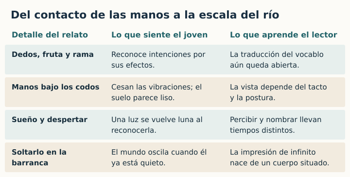

# BEL A/L · Espagnol, option orale · Saer, pages 71 à 74 — Corrigé brut

*Corrigé rédigé par IA, non officiel. Signalez toute erreur.*

**Rédaction** · GPT-6.2 Astra Ultra · vitesse non renseignée

Le jury situe ce passage d’*El entenado* aux pages 71 à 74 de l’édition du concours et donne ses deux bornes. La préparation dure 1 h 30, avec vingt minutes au plus d’exposé en espagnol et dix minutes d’entretien. Le passage s’ouvre sur la courtoisie dont le garçon cherche à comprendre les signes et s’achève sur l’immensité qu’il prête aux fleuves en retrouvant le sol.

[Bornes du tirage et rapport du jury](https://www.ens.psl.eu/sites/default/files/2026_al-rapport_oral_option_espagnol.pdf#page=1) · [Transcription de l’édition Seix Barral, Buenos Aires, 2002](https://studylib.es/doc/5092388/seix-barral-biblioteca-breve) · [Témoin du début du roman chez Kalais](https://analfa.wordpress.com/2020/11/17/juan-jose-saer-la-rotunda-y-bella-prosa-de-el-entenado/)

## Explicación del pasaje

### ¿Cómo llega a sentirse en reposo un cautivo al que llevan corriendo?

En *El entenado*, un viejo vuelve sobre el tiempo en que, todavía muchacho, llegó entre los hombres que acababan de matar a sus compañeros de expedición. Las primeras palabras podrían sorprendernos en boca de un cautivo. El narrador recuerda su propia tranquilidad y anuncia que va a darnos otra razón de ella. «Otra» supone que venía tratando ya de explicársela. «Inusitada» conserva, en la explicación, la sorpresa de haber sentido algo tan poco previsible. ¿Qué tiene que ocurrir entre esos hombres y su cuerpo para que el muchacho pueda pasar de la desconfianza a una impresión casi eufórica del mundo? Seguiré primero los gestos que hacen posible cierta convivencia sin una lengua compartida, después la transformación de la carrera en reposo aparente y, finalmente, la recuperación del suelo ante un río cuya anchura escapa a toda medida.

### La cortesía se aprende mirando

La expresión con la que el narrador llama al grupo, los «salvajes», procede del mundo del que él viene. En cambio, la primera cualidad que les atribuye es la cortesía. El roce de unas puntas de dedos precisa en qué consiste esa cualidad. Pueden tocarlo con una delicadeza que no borra su singular situación de hombre señalado. Se le dirige la palabra y se habla de él. Quien acaba de llegar distingue una palabra compuesta de dos sonidos y advierte en qué situaciones la pronuncian. Todavía le falta saber exactamente qué quiere decir. La serie de repeticiones de «Def-ghi» ofrece al lector la experiencia bastante precisa de reconocer algo por el oído sin poder traducirlo.

La frase se alarga siguiendo todo lo que acompaña al sonido. Hay risas de más de una clase, dedos que señalan distintas partes del cuerpo, un hombre que se pone en cuclillas para mirarlo. Al interpretar conversaciones de las que parece ser objeto, el narrador introduce una condición. Si los dedos que apuntan hacia él son un indicio fiable, entonces están hablando de él. Hasta en un detalle tan pequeño queda visible el trabajo de inferir. Entre tanto le traen agua y frutas. Lo que al principio mira recelosamente acaba por devorarlo. En lugar de atribuirle una repentina opinión favorable sobre todos sus captores, la prosa nos hace pasar por la distancia que separa esos dos verbos. La necesidad del cuerpo participa en la interpretación.

Algo parecido sucede cuando lo invitan a sentarse. Dos acompañantes lo dejaron al sol, otros le indican la sombra y uno barre el suelo con una rama. La misma comunidad que pronto cargará cadáveres puede ocuparse minuciosamente del asiento de un extranjero. Conviene conservar la individualidad de ese último gesto. Nos resulta inteligible porque la tarea se completa delante del muchacho. La deliberación cercana, en cambio, se le escapa en buena medida. Puede describir los intervalos que separan las intervenciones, pero no resumir un argumento de la discusión. Los oradores parecen adormecerse en mitad de una intervención. Para un hombre educado en otro ritmo de conversación, el público tendría que impacientarse. La quietud de quienes escuchan y el renovado ardor de quien vuelve a hablar lo obligan a corregir esa expectativa. El silencio resulta ser una de las formas que puede tomar la atención.

La tarde llega mediante una corrección análoga. El sol todavía no se hunde en el horizonte. Lo que delata la hora es la luz, ya más fina, entre amarilla y verde. Esa precisión cromática será importante cuando vuelva el mismo tinte un día después. Por ahora, mientras unos reúnen a los dispersos y otros cargan a los muertos, los dos escoltas recuperan su lugar a los costados del muchacho. Las acciones simultáneas hacen que la atención al vivo y el transporte de los cuerpos pertenezcan a una sola partida.

### Lo que ven los ojos depende de lo que transmiten los codos

Al reanudarse la carrera se produce un pequeño suceso que altera toda la percepción posterior. Los escoltas levantan al muchacho sujetándolo por los codos. Para ellos el gesto parece tener un fin práctico. Él comienza a patalear. El gesto cortés exige, también aquí, un tiempo de aprendizaje. La frase que describe la postura adoptada después de entenderlo parece inmovilizar al corredor miembro por miembro. Los antebrazos se levantan, los dedos se encogen, las piernas quedan juntas y ya no sirven para correr. El cuerpo que más lejos se está desplazando sin gastar fuerzas adquiere la forma casi inmóvil de quien posa. El recurso de volver despacio sobre cada articulación permite sentir qué proporción de su independencia acaba de ceder en esa postura que le resulta cómoda.

El relato establece a continuación una relación entre dos sentidos. Si las manos consiguen amortiguar el golpeteo de los pies, los codos del muchacho dejan de transmitir la vibración y el paisaje deja de temblar ante sus ojos. Son entonces las cosas, a ambos lados, las que parecen deslizarse hacia atrás. El suelo quizá tenga accidentes. Lo que se ha alisado es el recorrido que sigue la mirada. Cuando vuelve la sacudida, siente cómo las manos se reajustan para atenuarla. El adjetivo que compara esas manos con el hierro hace perceptible la firmeza necesaria para la delicadeza del resultado. La impresión de placidez tiene autores concretos. Depende del esfuerzo extremadamente diestro de otros cuerpos.

La voz del viejo interviene para precisar que aquella carrera de un día entero era, en rigor, un trote bastante apacible. La corrección «a decir verdad» no afecta sólo a la velocidad. Lo que en un primer momento nombró desde la experiencia extraordinaria de ser llevado se vuelve un ritmo común, capaz de sostenerse durante horas. Es tan uniforme que el joven se queda dormido. El sueño en una carrera ininterrumpida lleva a su extremo la paradoja del pasaje. La confianza se manifiesta en un cuerpo que puede por fin dejar de vigilar cuanto le ocurre.

### Ver la luna, tocar tierra, imaginar lo infinito

Al despertar no ve de inmediato la luna. Primero se le presenta una superficie blanca y luminosa, extrañamente ondulante para algo que parece fijo. Sólo después la reconoce. Al demorar el sustantivo familiar, el relato devuelve a un astro conocido la novedad de una sensación. En la oscuridad apenas oye respirar a quienes lo llevan. Y los pasos simultáneos de noventa y cuatro hombres producen un chasquido que se disipa casi en el acto. El número determinado y el ruido mínimo hacen sensible el desacuerdo entre la magnitud de la marcha y lo poco que de ella registran sus sentidos.

Hacia el amanecer se acelera el paso de las palabras. Se suceden varios nombres de la luz naciente, el sol sube a espaldas del grupo, lo domina un instante y acaba descendiendo delante. Bastan esas posiciones para dibujar un día sin reloj. Al volver el amarillo verdoso que había acompañado la salida, el grupo se detiene sobre una barranca. Aparecen las islas bajas, la oscilación entre pardo y dorado y los brillos del agua. Es un espacio de varias distancias a la vez. El río tiene anchura suficiente para que entre sus orillas quepan islas.

Tocar tierra devuelve al joven el uso de las piernas, pero también el riesgo de caer. El balanceo, que durante la marcha sus acompañantes corregían desde fuera, persiste ahora dentro de la cabeza. Parece que todo lo exterior lo acompañe. Debe sentarse, esta vez por su cuenta. El pasaje había comenzado con la invitación de unos anfitriones a sentarse a la sombra. Vuelve a terminar con un cuerpo sentado, por una razón que sólo la experiencia intermedia permite comprender.

La última frase ensaya una proporción. Si la tierra guarda una relación de escala con ríos como ése, tendrá que ser infinita. La conclusión tiene la forma de un razonamiento y la base de una impresión. Hasta la euforia queda graduada por un «casi». Al llamar desdeñosos a los ríos, el muchacho les atribuye la independencia de aquello que sigue su curso sin prestar atención a su necesidad de medirlo. No se trata de una conclusión geográfica. Así encuentra voz alguien que, después de haber dependido por completo de unos brazos ajenos, puede sentir que delante de él se extiende un mundo inconmensurable. La aventura consiste aquí en reaprender qué es una superficie lisa, un astro familiar o un suelo firme desde un cuerpo que ha cambiado de relación con los demás.

### Conversación con el tribunal

**¿En qué consiste el límite de la comunicación inicial?** El joven aprende a reconocer a quién designa el sonido y en qué ocasiones se usa. Para el lector, deducir un uso a partir de gestos ya es entender algo, aunque no permita establecer una traducción definitiva.

**¿Qué función cumplen los muertos en una escena de cortesía?** Siguen presentes cuando la gente se reúne para emprender la marcha. Basta esa acción, casi simultánea a la reaparición de los escoltas, para que no confundamos la confianza corporal del muchacho con una reconciliación general.

**¿Qué importancia tiene el color vespertino?** Volvemos a reconocer una cualidad concreta de la luz al cabo de la jornada. El texto hace medir una duración mediante una sensación que vuelve, al igual que hace medir el trayecto por la aparición y desaparición de las vibraciones.

**¿En qué sentido se trata de una escena de iniciación?** El joven adquiere un saber práctico sobre sus escoltas y sobre sí mismo. Su certeza más llamativa es también la más modesta. Dos manos pueden modificar la apariencia visual de todo un territorio.

