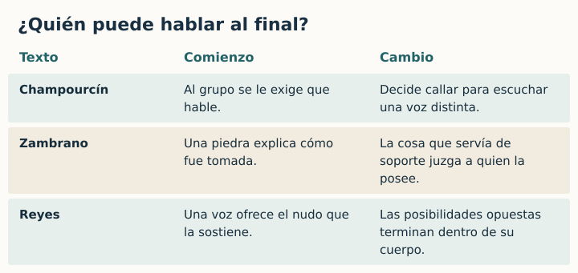
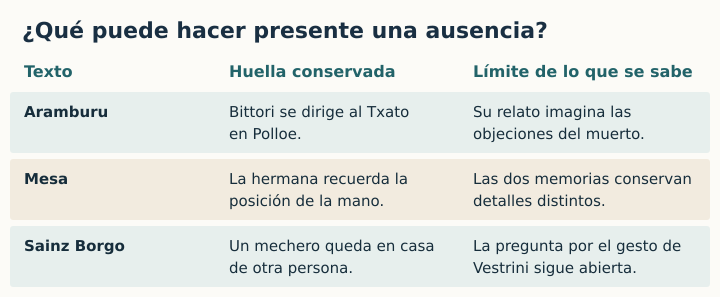
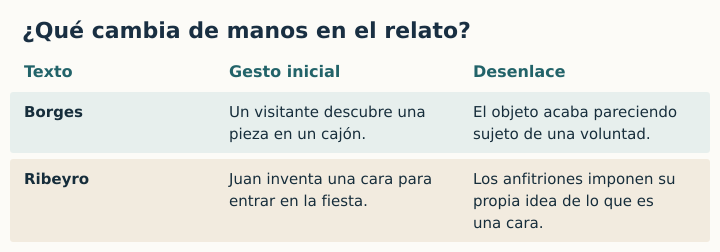

# BEL A/L · Espagnol oral tronc commun 2026 — Corrigé guidé partiel

*Corrigé rédigé par IA, non officiel. Signalez toute erreur.*

**Rédaction** · GPT-6.2 Astra Ultra · vitesse non renseignée

Le rapport recense 27 textes. Douze poèmes identifiables sont expliqués sur toute leur étendue publiée. Neuf entrées donnent lieu à une préparation partielle, dont les trois identifications possibles du « Nocturno » de Darío. Pour six œuvres, le passage distribué reste à identifier. Le rapport fournit les références, sans reproduire les feuillets.

[Références des billets, pages 1 et 2](https://www.ens.psl.eu/sites/default/files/2025_al_rapport_espagnol_oral_tronc_commun.pdf#page=1) · [Rapport du jury](https://www.ens.psl.eu/sites/default/files/2025_al_rapport_espagnol_oral_tronc_commun.pdf)

## Préparer l’explication avec le feuillet du jour

Le jury offre trois billets. On en tire deux et on choisit entre les indications de genre, de siècle et d’aire géographique avant de recevoir le texte. On dispose de 1 h 30 avec le dictionnaire *Clave*. Les vingt minutes d’exposé sont suivies de dix minutes d’entretien. Le rapport recommande une explication linéaire. La lecture à voix haute peut intervenir au moment où elle sert le mieux l’interprétation.

### Du premier relevé à une proposition de lecture

Réservez une première lecture à ce que l’on peut vérifier immédiatement. Entourez la personne du premier verbe, cherchez à qui renvoient les possessifs et marquez au crayon le premier changement de temps, de voix ou de lieu. Chez **Varela**, colorier d’un même trait les personnes de *me*, *tu* et *nos* ferait perdre la découverte essentielle. Il y a d’abord la personne que les choses dépassent en durée, puis une autre dont un arbre occupera la place, et enfin le souvenir d’une perception commune. Une introduction en espagnol peut donc engager une véritable recherche. *¿Cómo se pasa del futuro de unas cosas sin memoria al latido de una ausencia compartida?* Le dernier mot de la question oblige à revenir à la dernière strophe.

Chez **Aramburu**, dessinez deux colonnes, « oímos » et « sabemos ». Bittori parle et organise matériellement sa visite. Le lecteur apprend à connaître le mort par ce qu’elle anticipe de ses réactions, puis par ce que le récit nous laisse entrevoir de sa vie à elle. Une phrase adressée au Txato n’est ni une réponse de celui-ci ni une déclaration de l’auteur. Reprenez la même opération sur le dialogue final de **Mesa**. Que sait la sœur avec certitude ? Un détail de la main. Que prétend raconter la narratrice après sa mise au point ? Sa propre perception de l’époque. Cette restriction fournit une meilleure conclusion que la remarque générale selon laquelle les souvenirs seraient subjectifs.

### Faire entendre le mouvement du texte

Avec **Champourcín**, lisez successivement l’injonction du début, une question au milieu et l’impératif transformé de la fin. Faites entendre si l’assemblée reçoit un ordre, se découvre une possibilité ou devient capable d’agir. Si vous annoncez le silence comme thème, demandez encore qui pourrait le produire et comment la parole du poème permet de l’entendre. Avec **Reyes**, ménagez un bref arrêt aux endroits où la première personne corrige l’identité de celle qui avait parlé ou de la personne qui l’écoutait. Vous pourrez expliquer en espagnol pourquoi la mémoire de la voix est plus précise que celle des circonstances.

Dans « La loba », notez qui observe qui au début et à qui la locutrice propose à la fin d’aller manger. La reprise musicale d’une strophe ne replace pas la locutrice dans la même situation. Pour **Neruda**, gardez en mémoire l’interlocuteur qui s’interroge sur le changement d’écriture. Lisez les énumérations du marché avant de commenter la répétition de l’invitation finale à regarder. Une question d’entretien pourrait être *¿Qué saber compartido hace que la repetición final ya no sea una simple insistencia?* Répondez en revenant à un lieu ou à un être nommé avant la rupture.

### Expliquer la prose ou la scène au fil de ses changements

Chez **Borges**, faites varier le sujet du verbe dans votre prise de notes. Un propriétaire transmet un objet, un visiteur croit reconnaître quelque chose, puis un objet paraît vouloir quelque chose. Peut-on alors dire que la pièce est seule responsable de cette volonté ? Le texte évoque sa fabrication par des hommes. Cette précision résiste à une interprétation qui prendrait toute la personnification au pied de la lettre. Chez **Sainz Borgo**, cherchez la place laissée au silence de Vestrini par la question initiale. L’élargissement à une génération et à un pays devient plus intelligible une fois reconnue la difficulté de parler pour une seule personne absente.

Pour préparer *Yerma*, différenciez quatre événements observables. La protagoniste vient chercher de l’aide, Juan interprète sa conduite, la fête produit un spectacle, puis les deux époux se parlent en des termes qui rendent leur divergence irréversible. Sur un feuillet limité à une scène, gardez uniquement les événements qui s’y produisent. Une chanson fait intervenir des corps et des voix devant d’autres personnages. Indiquez qui peut entendre cette parole et ce que son auditoire peut en faire. Le sens de la dernière réplique tient à la relation entre la personne qui vient de tomber et l’enfant dont parle Yerma.

### Ajuster l’exposé et répondre au jury

En entraînement, essayez deux minutes pour situer le feuillet et annoncer la question, deux à trois minutes de lecture si sa longueur s’y prête, environ treize minutes d’explication et le temps restant pour une conclusion. Ce partage est un exercice personnel. Lors de la préparation, chronométrez la lecture du texte précis, puis répartissez l’analyse selon les difficultés réelles. À chaque transition, prononcez une phrase qui fasse entendre ce qui a changé. Pour **Ribeyro**, *hasta aquí Juan elegía el gesto que querían ver los invitados; ahora otros deciden cuándo debe abandonarlo* indique le basculement de l’initiative qui justifie le second mouvement.

Une difficulté d’identification peut elle-même devenir un exercice de précision. Devant un « Nocturno » de **Darío**, vérifiez le premier vers et le recueil avant de commenter un bruit ou une image. Pendant l’entretien, appuyez toute rectification sur les mots que vous retrouvez sur le feuillet. *Me corrijo: antes hablaba del mar que los dos miraban, pero el verbo le atribuye al mar la mirada* donne chez Varela un exemple de correction qui fait avancer l’explication.

## 1. Miguel Hernández, «Vida solar»

El poema empieza por un cuerpo del que todavía no sabemos ni el nombre ni la relación que mantiene con quien habla. ¿Cómo puede iluminarlo todo alguien cuya presencia acaba por hacer visible un duelo? En los primeros cuartetos las partes más densas del organismo se vuelven las más luminosas. Hasta el hueso resulta más transparente cuanto más adentro está. El sol acompaña al cuerpo y a la vez lo mueve desde dentro. Se pierde así la distinción habitual entre lo que recibe luz y lo que la produce.

La serie de construcciones nominales ensancha luego el cuerpo hasta darle la dimensión de un día y una bóveda. Las palabras de la fecundidad enlazan una pareja cósmica, el verano y el firmamento, con la carne singular de la persona invocada. El agua puede ser sólida y ágil al mismo tiempo. Importa leer las incompatibilidades como los medios de imaginar una presencia que cambia cuanto toca. Cuando la mirada del ser amado se convierte en cenit, son los demás cuerpos los que adquieren otro color.

Al hacerse explícita la primera persona, cambia la calidad de la luz. La cercanía entre lo tuyo y lo mío se enuncia a la vez que el luto. Al final dos imperativos piden iluminación y fusión. La sombra que guarda la voz tiene valor propio y el deseo de transparencia corre el riesgo de consumir al ser que se invoca. Así cobra otro sentido el cristal inicial, capaz de dejar pasar la luz hasta hacerse imperceptible. **Para el diálogo.** ¿Dónde se vuelve decisivo el pronombre *me*? En el paso del cuerpo contemplado a lo que ese cuerpo ha hecho de la vida de quien lo contempla.

[Texte publié et documenté](https://ciudadseva.com/texto/vida-solar/)

## 2. Ernestina de Champourcín, «Cuando estalle el silencio...»

Se suele pedir a alguien que rompa a hablar cuando queremos que salga de su reserva. El poema toma esa expresión común y examina qué mundo produce tal exigencia. Las palabras acumuladas forman primero una reserva, un silo, e inmediatamente después un vendaval. Algo puede abundar tanto que impida percibir los signos que verdaderamente importan. Desde el comienzo la voz dice *nos*, de modo que ella también está implicada en el desorden que describe.

Las preguntas ensayan otra dirección. Si las personas guardaran silencio a un mismo tiempo, el movimiento arrancaría de lo hondo y llegaría hasta fuera. El efecto se formula en términos de iluminación. La boca cerrada guarda un don y la mayúscula de Amor orienta la lectura hacia el vínculo con Dios. La reserva pasa a entenderse como un trabajo colectivo que requiere fidelidad. Cuando vuelve la frase del título, la hipótesis se ha convertido en una profecía. El silencio adquiere la fuerza de un alud, precisamente la fuerza que al principio parecía pertenecer exclusivamente al estrépito.

El imperativo plural del final transforma la locución de partida. Ahora se trata de romper a callar. Los surcos cargados de simiente explican por qué callarse puede constituir una acción fértil. El último periodo imagina un silencio que habla mientras la claridad divina deja de encontrar obstáculos. La poeta conduce al lector hasta esa posibilidad mediante palabras. **Para el diálogo.** ¿Cómo leer el verso breve que anuncia el habla del silencio? Dejar tras él un pequeño espacio permite oír en la propia lectura el principio activo de la pausa.

[Texte publié et documenté](https://www.cervantesvirtual.com/descargaPdf/antologia-poetica-1219584/#page=29)

## 3. Jaime Gil de Biedma, «A una dama muy joven, separada»

El informe del concurso abrevia el título y omite *muy*. La edición del poema conserva el intensificador, que prepara la cuestión de quién tiene derecho a tratar a Isabel como a una niña. Alguien le cuenta su propia historia a una mujer que ya la conoce. En el primer movimiento, el desencanto se cifra en el gusto amargo que han adquirido unas flores tradicionalmente asociadas a la unión. La separación parece tan inmediata como la salida de clase para un escolar. La soltura de los versos cortos presta ligereza a un acto que en su contexto social la tiene bien escasa.

En los bares, una pequeña escena marítima sustituye al decorado conyugal. La figura del corsario, los amantes a ambos costados y el viento que sólo sopla para ella hacen de un taburete el puente de mando de una nave. La alusión a la canción del pirata amplía, cómicamente, la autoridad de quien apenas puede reclamar libertad sobre su propia persona. Ya aquí una mirada ajena se introduce en el retrato. Mediante el impersonal que refiere lo que se ve, la mujer pasa a ser espectáculo. La confidencia sobre quienes le han contado todo al locutor descubre la circulación de una historia que Isabel ya no controla.

La advertencia final hace de la persona gramatical una cuestión política. Un sentimiento en primera persona se vuelve peligroso al circular contado en tercera persona. La mención de España concentra esa violencia social en un lugar. Los amantes, pese a multiplicarse, participan de los juicios del marido. El hablante parece comprender el daño, pero su apelación cariñosa y paternal permite preguntarse hasta dónde se libra él mismo de la condescendencia. **Para el diálogo.** La canción invita al público a corear el nombre de Isabel. ¿Qué posición nos hace ocupar cuando descubrimos de dónde procede la información?

[Texte publié et documenté](https://d2eb79appvasri.cloudfront.net/erp-colex/openaccess/libros/7808.pdf#page=473)

## 4. Carmen Jodra Davó, «Amor y Psique»

La genealogía de Amor le da a su deseo dos rasgos que parecen excluirse. Hereda la pobreza de su madre y dispone, sin embargo, de una inventiva infatigable para perseguir lo que quiere. Lo obtenido se le escapa en cuanto lo alcanza. En esta primera presentación, la acumulación de instrumentos de caza acaba en una expresión de lástima casi coloquial. El dios necesita una historia que modifique esa economía de la pérdida.

La composición interrumpe la persecución para mostrar una escena de tocador. Los objetos preciosos, las acciones repetidas y la cadencia de canción hacen del peinado de la diosa un espectáculo autosuficiente. Pero quien lo posee todo está envidiando a alguien que ni siquiera entiende lo que le ocurre. El retorno insistente de la juventud de la ninfa hace oír su desconcierto. Una pregunta conversacional precipita después la historia. Amor termina por quemarse con su propia antorcha. Las sucesivas explicaciones causales retrasan el desenlace y, al escuchar la larga serie de *porque* se va haciendo visible que la perplejidad de la muchacha es justamente lo que puede atraer al experto cazador.

Lo que ella echa en falta y lo que le falta a él quedan relacionados sin confundirse. Incluso la hermosura perfectamente segura de Afrodita pierde parte de su brillo. Al final, las palabras vulgares acerca de un mundo incomprensible impiden que la pareja forme una estampa decorosa. La pobreza heredada por el dios permanece, y el recuento de los desdichados asciende a dos. En la frase entrecortada de la clausura, el número que podría duplicar una desgracia se convierte en la experiencia de tener compañía. **Para el diálogo.** ¿Qué gana el final al repetir el dos después de un punto? Deja un instante para que su valor pase de aritmético a afectivo.

[Texte publié et documenté](https://musipoemas2.blogspot.com/2021/03/amor-y-psique.html)

## 5. Luis Cernuda, «He venido para ver»

Un presente perfecto y una finalidad reaparecen con tal regularidad que parece haber una respuesta segura a la pregunta por el motivo de la venida. Son los objetos de la mirada los que dificultan esa respuesta. Los semblantes se comparan con utensilios gastados, mientras que las sombras son capaces de sonreír. Incluso los muros permanecen en el catálogo tanto erguidos como caídos. La sintaxis que enumera es estable, pero ya no se puede prever el criterio que ordenaría las cosas.

Mirar llega a incluir la muerte, provista de una delicada red para cazar mariposas. La imagen junta ligereza y captura. Antes de cerrar esa serie, aparece una finalidad distinta, la de esperar a alguien. Ahora los brazos quedan en el aire, postura ofrecida a una persona que todavía no los ocupa. Una primera confesión de ignorancia suspende la explicación de la llegada. La apertura de los ojos se presenta como un hecho anterior a cualquier proyecto. La existencia parece haber llegado antes que sus razones.

Tras los saludos, los colores que compartían amigos, días y cualidades personales desplazan las jerarquías habituales. La despedida acaba revelando a los destinatarios invisibles que faltaban cuando se describieron los brazos. El cambio al pretérito permite reunir la existencia dispersa en una finalidad singular, la de unos besos. Sin embargo, el contacto no ha tenido lugar. El imperativo final pide a los otros que guarden los labios por si la voz vuelve. La finalidad más importante se conoce precisamente cuando el encuentro se aplaza. **Para el diálogo.** Relacionar el plural de la despedida con el singular de la espera permite preguntar cómo se crea un destinatario a lo largo del poema.

[Texte publié et documenté](https://archivo.editanet.org/17/01d5379ab9028a92a/01d5379ab9145b263/index.html)

## 6. María Zambrano, «Habla una piedra»

El título concede voz a aquello que la mirada ajena ha reducido a materia. La piedra empieza explicando su pérdida de vida mediante pasivas. Alguien la ha mirado y tomado. En el presente, sirve de soporte sin tener a su vez dónde apoyarse. El juego con los dos sentidos de sostener establece una asimetría que el diálogo imaginario va a someter a examen.

Las preguntas buscan a quien miró. La poseedora aparece gradualmente como el ser más frágil, obligada a encantar lo que la rodea para conseguir mantenerse en pie. Cuando la piedra le pregunta por el amor que ella dice sentir, la palabra se mide por sus consecuencias para el otro. La oposición entre luz y sombra cambia entretanto de signo. La que se creía destinada a servir de sombra recuerda haber sido luz y reflejo, y pide a la otra que se revele a su vez. La respuesta llega de la propia piedra. Si es el apoyo del que el otro depende, también guarda algo de su ser.

En los movimientos finales, las frases que empiezan por *yo* le permiten asumir funciones en apariencia incompatibles. Es memoria que acusa y resiste, peso de la historia y lugar de descanso. La dureza material se vuelve la forma de un rechazo que una palabra impuesta no consigue suprimir. La persona que dice saber llama materia a lo que tiene delante, pero vuelve a ello vencida. Al cabo de tantos predicados, el nombre clasificatorio parece extrañamente pobre. **Para el diálogo.** La voz que afirma saber dice a continuación que sabe nada. Se puede leer el giro como un rechazo de la seguridad con que la interlocutora creía conocerla de una vez por todas.

[Texte publié et documenté](https://rodin.uca.es/bitstream/handle/10498/21625/TFG-Noelia%20Avecilla-RODIN.pdf?sequence=1#page=66)

## 7. Miriam Reyes, «Desnuda como una cinta te ofrezco»

La cinta del principio permite imaginar al mismo tiempo una desnudez y algo con lo que se ata. La primera persona ofrece la oscuridad de un nudo que le sirve para sujetarse. El mástil es también ella misma. ¿Qué se da a otra persona cuando se le ofrece el vínculo que mantiene unida a la que habla?

Al mirar hacia atrás, la voz recupera una frase que pronunció con la boca llena de agua. Dice que ha olvidado mucho antes de citarse. Lo que sobrevive del pasado es, por tanto, una manera de hablar en condiciones difíciles. El presente de la ofrenda y la existencia anterior no coinciden exactamente. Tampoco se dejan repartir entre dos identidades distintas. Una corrección parecida multiplica a los posibles oyentes de la antigua frase, hasta admitir que quizá se la dijera a sí misma. La repetición del nudo se carga así de tiempo y de destinatarios.

El golpe de mar que llenaba la boca puede también soltar las palabras de su anclaje. El mismo elemento que estorba el habla se vuelve condición de su movimiento. En la última parte el eje de la inmersión atraviesa la piel, la carne y la conciencia. El ardor de la fiebre devuelve una resistencia física a la imagen marina. Las dos posibilidades finales, flotar y hundirse, pasan de un lado a otro de la boca hasta ser tragadas. El ofrecimiento que abría el texto termina en un gesto de incorporación. La incertidumbre se puede alojar en el cuerpo antes de ser resuelta. **Para el diálogo.** ¿Cómo pronunciar la vacilación sobre la identidad pasada y presente? Una pausa breve antes de la segunda rectificación deja espacio para su coexistencia.

[Texte publié et documenté](https://www.marpoetica.es/autor/miriam-reyes)

## 8. David Uclés, *La península de las casas vacías*, íncipit

Le jury écrit « íncipit ». L’édition comporte un prologue narratif en 1944, puis un premier chapitre en 1936. Faute de feuillet reproduit, on prépare les deux ouvertures en distinguant leurs fonctions.

El prólogo da una fecha y un lugar franceses con la exactitud que se esperaría de un relato histórico. Lo primero que se mueve en ese espacio es, paradójicamente, una nube que se para. Un miliciano andaluz permanece tendido en la nieve. La narración pide al lector que distinga un cuerpo vivo de uno muerto. Al abrir y cerrar los ojos, el hombre parece pasar de un estado físico y un paisaje a otros. El lector que busca ajustar una cronología a esas transformaciones experimenta la desorientación que produce la historia en el cuerpo de quien la sufre. El desplazamiento de la nube enlaza cielo y tierra mediante una especie de solidaridad que la fecha por sí sola no revelaría.

En la escena ya despierta, el herido pide que, si muere, graben en su tumba el nombre de su padre, Odisto Ardolento, cuyo cuerpo nunca se encontró. Sus compañeros prometen cumplir el encargo, pero él se lleva el nombre a la tumba. Era el último capaz de transmitir el apellido. Una inscripción que no llega a hacerse prepara el acto de escritura que sí tiene lugar ante nosotros. Hacia el final, la voz que escribe relaciona el relato con un deber hacia los vencidos. La ampliación del campo de visión se hace también audible. La familia, el pueblo, el territorio y la península entran en una serie que los verbos de descomposición convierten en escalas de una pérdida. El título se carga del peso de tantos interiores vacíos. En la dedicatoria ya se señalaba el nombre real del pueblo que será Jándula en la ficción. El aviso sobre las modificaciones históricas hace de la invención una decisión declarada al lector.

El primer capítulo retrocede a 1936 y sitúa delante de nosotros a un futuro padre. La noticia del parto concierne también a los árboles. El viento y el polvo hacen que el paisaje participe en una operación que por costumbre llamaríamos íntima. Mientras la mujer está de parto, la aparición final del jabalí rojo llega a distraer a Odisto. Color, deseo de mirar y urgencia doméstica compiten por su atención. El recuerdo de la familia que se deshará empieza así por el asombro de que una vida esté a punto de abrirse paso entre las otras. **Para el diálogo.** El cambio de 1944 a 1936 hace de la primera parte una vuelta atrás. Conviene identificar el salto antes de atribuir al primer capítulo la acción del prólogo.

[Texte publié et documenté](https://cdn.vivlio.com/product/v1/746f4f48-39a3-4c8d-ab63-1e9fcf7c7b3c/sample?format=.epub)

## 9. Fernando Aramburu, *Patria*, «Con el Txato en Polloe»

Le rapport transcrit « Taxto ». Le sommaire et le chapitre 3 de l’édition de Tusquets donnent « Txato ». Le chapitre entier est accessible dans l’extrait commercial. La feuille distribuée à l’oral n’est pas reproduite.

¿Con quién puede conversar una viuda cuando lo que necesita decir no cabe en una lápida? La visita empieza con el autobús que ahora toma Bittori para subir al cementerio. Los argumentos sobre si podría seguir subiendo a pie y sobre lo distinto que resulta el camino de bajada tienen la viveza de una discusión consigo misma. La tercera persona acoge sus rectificaciones y su modo de quitar importancia a las cosas. Ese detalle hace reconocible una voluntad individual antes de que se nombre la gran cuestión política de la escena.

Los familiares han discutido lo que era prudente inscribir en la tumba. La propuesta de alterar incluso la fecha pone de manifiesto hasta qué punto un dato escueto puede convertirse en declaración pública. Bittori se opone. El nombre y las fechas que al fin se graban conservan una verdad a la vez que callan las condiciones de la muerte. Sentada en la lápida, con un trozo de plástico que le evita el frío o la suciedad, la viuda puede hablar con mucha menos solemnidad que la piedra. Regaña al marido, le atribuye objeciones y se corrige en voz alta al explicar cómo ha cambiado. El muerto recupera un papel de interlocutor gracias a la capacidad de Bittori para discutir incluso con la respuesta ausente.

La noticia del cese de la violencia de ETA acaba por entrar en la conversación. La decisión de volver al pueblo responde a una necesidad propia de saber y poder vivir consigo misma. Bittori se la anuncia a quien ya no puede detenerla y por ahora se la oculta a quienes sí podrían intentarlo. La pareja de gorriones que aparece y desaparece durante la charla introduce una medida discreta del tiempo transcurrido. El mundo prosigue a su alrededor mientras el diálogo reconstruye un presente compartido por la memoria. **Para el diálogo.** ¿Por qué tiene interés el diminutivo con que se dirige al marido? Llega en medio de una decisión firme y permite oír la continuidad del afecto sin convertir toda la visita en una elegía uniforme.

[Texte publié et documenté](https://cdn.vivlio.com/product/v1/5b85dad5-fb77-4edd-91f0-7eb1757366ca/sample?format=.epub)

## 10. Miguel de Unamuno, *Niebla*

Le jury donne le titre du roman. Il ne précise ni le chapitre ni les mots qui délimitent le passage.

## 11. Juan Benet, «Una línea incompleta» · fragment final documenté

L’étude sur les intertextes victoriens chez Benet cite la formule qui introduit le dernier paragraphe de la nouvelle et décrit le document incomplet. Ces éléments permettent un exercice sur le dénouement. L’extrait remis par l’ENS et le reste de la nouvelle ne sont pas établis par ce témoin.

El hallazgo de una nota atribuible a Holmes debería satisfacer una expectativa habitual del relato de investigación. Una vez reunidos los documentos, alguien reconstruiría los hechos y disiparía la duda. Aquí el supuesto último testimonio pierde autoridad en el acto mismo por el que se nos comunica. La traducción se declara incorrecta. Además el narrador introduce lo traducido con una expresión de semejanza o aproximación. El lector recibe, por tanto, algo que se parece al sentido de una versión cuyo error ya está anunciado. Lo llamativo es que el narrador conserve la entonación del que explica un hallazgo cuando está deshaciendo las condiciones necesarias para explicarlo.

La segunda página pudo perderse o quizá nunca se llegó a escribir. La diferencia entre ambas hipótesis es crucial. Si se destruyó, la verdad documentada estaría ausente. Si nunca se escribió, ni siquiera se puede afirmar que existiera la línea documental cuya restitución se desea. La autoridad de Holmes tienta al lector a cerrar el caso. El título le recuerda la forma concreta en que una línea puede detenerse antes de ofrecer una conclusión. **Para el diálogo.** Identificar por separado la laguna material y la mediación lingüística impide que la palabra *misterio* borre la precisión de la broma narrativa.

[Étude citant la fin de la nouvelle](https://publications.hse.ru/pubs/share/direct/383190354.pdf#page=9)

## 12. Leopoldo Alas, Clarín, *Su único hijo*

Le rapport n’indique pas la scène ni le chapitre du roman qui formait le billet.

## 13. Sara Mesa, «Mármol», *Mala letra*

La narradora adulta recuerda un episodio de su infancia y sabe que contarlo exige decir algo sobre la imprecisión de lo que conserva. De Mármol le queda el apellido, particularmente apto para darle al recuerdo la dureza de una inscripción. El nombre de pila ha desaparecido. El relato no construye una biografía del muchacho. Examina los procedimientos con que los adultos y los niños convertían unos hechos difíciles de nombrar en experiencia compartida o en silencio.

Antes de llegar a la noticia escolar se acumulan recuerdos de la calle y de la casa, contactos con palabras de adultos que la niña no dominaba y episodios de disciplina escolar. La enseñanza de cómo coger un lápiz hace visible una autoridad que quiere regular hasta la postura de los dedos. Con la hermana se puede reír de las manías de los profesores. Esa risa depende también de una memoria conjunta que aparecerá menos firme más adelante. La narración conserva la proximidad de impresiones separadas, que en la infancia pintaban un mundo reconocible antes de que existiera una explicación común para ellas.

Cuando la clase intenta formular lo que ha ocurrido con Mármol, el verbo empleado por un niño sorprende a la narradora retrospectiva. Reconoce que difícilmente habría pertenecido a su vocabulario de entonces. Así escuchamos a la vez una frase y la objeción a recordarla con total seguridad. Volver a una página determinada del manual puede restablecer un orden exterior, aunque nadie sepa explicar de qué se avergüenza. La incertidumbre no aparece como un vacío que el narrador omnisciente venga a llenar.

En la conversación final, la hermana advierte que la narradora puede equivocarse. Ésta restringe sucesivamente su pretensión, desde contar lo de Mármol hasta contar cómo veía ella su vida cuando aquello ocurrió. La otra recuerda con extraordinaria nitidez la postura de la mano. El lápiz torcido pasa de ser un motivo de corrección a figurar el instrumento imperfecto y singular con el que se ha escrito el cuento. **Para el diálogo.** La broma compartida al final no resuelve la diferencia de recuerdos. Hace posible convivir y hablar con esa diferencia.

[Texte publié et documenté](https://studylib.es/doc/4599560/-m%C3%A1rmol---del-libro-mala-letra)

## 14. Ignacio Martínez de Pisón, *Castillo de fuego*

Le rapport nomme le roman, sans préciser lequel de ses épisodes formait le feuillet.

## 15. Manuel Vicent, *No pongas tus sucias manos sobre Mozart*

Le titre figure au rapport. En l’absence du feuillet, le texte distribué et ses bornes restent à établir.

## 16. Federico García Lorca, *Yerma*, acto tercero

L’ENS précise l’acte et ne reproduit pas les bornes du passage. La lecture porte sur les deux tableaux du troisième acte.

El primer cuadro escenifica una búsqueda que debe mantenerse a cubierto de la mirada pública. En casa de Dolores, después de una práctica que suscita esperanza, las voces femeninas multiplican los relatos sobre embarazos y prodigios. Para Yerma, que escucha, esos relatos pueden tener la fuerza de una promesa. Juan los leerá de otro modo. Cuando llega, la salida nocturna pone en juego la honra que él cree deber vigilar. Las mujeres, el marido y Yerma comparten un vocabulario sobre el matrimonio, pero las razones que dan para conservarlo son irreconciliables. La oposición se hace más violenta cuando un mismo hogar debe ser a la vez garantía de respetabilidad y lugar de un nacimiento que no llega.

El segundo cuadro saca la cuestión del deseo al aire libre. La romería organiza el espacio mediante canciones, grupos y personajes enmascarados. La danza del Macho y la Hembra produce un espectáculo público de fecundidad. Los versos pueden asociar el deseo a una fiesta y repartir a la vez papeles muy estrictos entre hombres y mujeres. Ante esa exuberancia, el cansancio y los silencios de la protagonista llaman la atención. La Vieja le propone una salida concreta: otro hombre y la posibilidad de una descendencia. La negativa de Yerma asienta el deseo de un hijo en la idea de fidelidad que ella se ha hecho de sí misma. La propuesta no basta para convertir el dilema en una elección fácil.

Cuando Juan revela que lleva bien una vida sin hijos y desea, en cambio, la cercanía de su mujer, Yerma comprende de otro modo sus anteriores palabras. La acción final transforma brutalmente esa divergencia en una imposibilidad definitiva. Su última afirmación sobre el hijo que ha matado debe escucharse después de haber visto que Juan ha caído a sus pies. No ha aparecido de pronto un niño en escena. La muerte del marido vuelve irreversible, en el orden moral que ella acepta, la pérdida del hijo posible. **Para el diálogo.** La fiesta colectiva prepara un desenlace íntimo: permite ver en un cuerpo aislado el coste de los papeles que el coro ha cantado.

[Texte publié et documenté](https://es.wikisource.org/wiki/Yerma/Tercer_Acto)

## 17. Alfonsina Storni, «La loba»

La dedicatoria a una amiga explica que aquélla era su palabra. A continuación se oye un yo que se compara con una loba. El marco impide reducir sin más la voz a una confidencia autobiográfica de la autora. El breve movimiento inicial cuenta una ruptura con el rebaño y una subida a la montaña. Después la voz acerca el conflicto al orden social: ha tenido un hijo y puede trabajar para alimentarse. La expresión sobre el amor sin ley hace del estigma el vocabulario de una declaración de independencia.

El poema concede también un sonido a quienes la juzgan. Su risa se vuelve balido en un inciso, y el diminutivo de las ovejas convierte la mansedumbre que pretenden exhibir en una sumisión que la loba puede compadecer. La voz les asegura que no pretende quitarles al pastor. La imagen desactiva la sospecha de que toda mujer independiente esté disputando un mismo hombre a las demás. Se ve mejor entonces por qué importaba haber dicho que quiere apartar con sus propias manos lo que le estorba. En el reparto tradicional de los animales el rebaño encuentra apoyo a costa del yugo. La loba arriesga su seguridad y se presenta como capaz de sostener su casa.

Cerca del final toma la iniciativa de reírse. Su manutención, el trabajo y la protección de la cría dan concreción económica y afectiva a esa inversión. La vuelta de los versos iniciales ya no expresa solamente una partida. Después de responder a quienes la señalan, la voz puede sostener en público la comparación que eligió. **Para el diálogo.** El poema pone a varios animales en relación. La oposición decisiva pasa entre los vínculos elegidos y la obediencia exigida, más que entre la soledad absoluta y la compañía.

[Texte publié et documenté](https://es.wikisource.org/wiki/P%C3%A1gina:La_inquietud_del_rosal_(1916).pdf/93) · [Suite](https://es.wikisource.org/wiki/P%C3%A1gina:La_inquietud_del_rosal_(1916).pdf/94) · [Fin](https://es.wikisource.org/wiki/P%C3%A1gina:La_inquietud_del_rosal_(1916).pdf/95)

## 18. Pablo Neruda, «Explico algunas cosas»

El título promete razones y el poema empieza por poner una pregunta en boca de sus destinatarios. Quienes echan de menos determinada imaginería lírica querrían saber qué ha pasado con ella. La primera respuesta invita a recordar una casa, un barrio de Madrid, sus amigos y su mercado. Los nombres propios devuelven a los ausentes por unos instantes la posibilidad de contestar. Los productos se amontonan en una enumeración que combina el olor, el tacto, el peso y el color. Esa abundancia prepara una medida concreta de lo que se va a perder.

La irrupción de una mañana de violencia cambia la función de la repetición. La casa de antes podía proteger un mundo social. Ahora las palabras sobre el fuego, el humo y la sangre vuelven una y otra vez sobre aquello que destruye sus condiciones de existencia. Ante la muerte de los niños, una comparación aproxima la sangre a ella misma. Después del despliegue de imágenes del mercado, esta resistencia a embellecer lo visto tiene un valor formal preciso. El discurso pasa después a la acusación y a las imágenes de una España que responde desde sus ruinas. Este cambio de persona y destinatario inscribe la toma de partido en la arquitectura misma del poema.

Al volver la pregunta por la poesía, la respuesta final adopta la forma de un imperativo plural. Ya no basta con escuchar al poeta explicar qué ha cambiado en sus versos. Pide a los oyentes que se acerquen a ver. La repetición conserva las palabras, pero reparte de otro modo las pausas entre la invitación, lo que se verá y el espacio de la calle. Cada retorno exige de nuevo la presencia del interlocutor. **Para el diálogo.** La primera enumeración de cosas no es un prólogo prescindible. Antes de convertirse en lugar de testimonio, la calle tuvo que existir para nosotros como lugar de relación y abastecimiento.

[Texte publié et documenté](https://www.neruda.uchile.cl/obra/obraresidencia3d.html)

## 19. Oliverio Girondo, «Exvoto»

El título sugiere una ofrenda y la dedicatoria la dirige a unas muchachas de Flores, barrio de Buenos Aires. Un elogio convencional podría presentarlas como bellezas ideales. Aquí los símiles van a buscarlas en una confitería de nombre reconocible. La mirada procede de la calle y del comercio. El poema está escrito en prosa. Los comienzos reiterados que sitúan al grupo en el barrio producen en ella el efecto de una letanía urbana.

En el paseo, las muchachas se enlazan del brazo y parecen transmitirse sus estremecimientos. Un observador que pretende conocer hasta el efecto de otra mirada en sus cuerpos hace visible la presión de ser observadas. Al atardecer, la barandilla de hierro presta al balcón un ramaje artificial. En la plaza nocturna aparecen las madres convertidas por comparación en grandes embarcaciones. El movimiento de estas figuras por el barrio organiza un pequeño espectáculo social. Las imágenes, cada vez más desmesuradas, convierten en objetos visibles ciertas convenciones que un paseante habitual apenas notaría.

En la última parte, el paso del tiempo y el miedo a que el cuerpo pierda el valor asignado por los demás deshacen el brillo inicial de la comparación con un dulce. El deseo impuesto por la mirada de los hombres se siente como una prenda que aprieta. Se comprende entonces la incomodidad de este exvoto. El observador ha hecho de la exposición pública una serie de imágenes extraordinariamente vistosas, al tiempo que muestra el peso de esa exposición sobre sus destinatarias. **Para el diálogo.** ¿Dónde introducir una reserva ante lo que afirma conocer el hablante? Allí donde pasa de describir un recorrido colectivo a pronunciarse sobre la angustia íntima de las muchachas.

[Texte publié et documenté](https://www.gutenberg.org/files/58103/58103-h/58103-h.htm)

## 20. Blanca Varela, «me sobrevivirán aguja vaso piedra…»

El futuro verbal coloca a la primera persona como término de una comparación temporal antes de indicar cuáles son sus contrincantes. La lista reúne tres cosas minúsculas cuya materia y funciones difieren. No hay un objeto noble o duradero que merezca convertirse en monumento de quien habla. Las hormigas introducen una forma de vida que prosigue su trabajo sin pedir permiso ni guardar necesariamente memoria. Cuando se repite el verbo, los objetos aparentemente más insignificantes han adquirido la sorprendente dignidad gramatical de sujetos.

La segunda estrofa sitúa esa diferencia de duración en un lugar concreto. Allí donde alguien deje de estar, pasará la sombra del sol. Esa sombra que avanza sin reconocer la ausencia es una medida más implacable que una evocación solemne del paisaje. Entran luego las palabras transmitidas de boca en boca. Podría esperarse de ellas lo contrario de las cosas, una conservación consciente de la voz personal. Sin embargo, el aliento del yo también faltará en ese trabajo. El verbo que presenta el tejido de las palabras da actividad al lenguaje, como la había dado a las hormigas. Lo que se produce puede carecer de sentido para la persona desaparecida.

El árbol de granos rojos introduce por primera vez a una segunda persona. El árbol ocupará *tu* lugar. El sujeto que ve puede anticipar la ausencia de alguien querido antes de desaparecer a su vez. Al lado de ese futuro firme, la hora propia queda en suspenso en un crepúsculo que el yo todavía exhala. El aliento que faltaba en la estrofa anterior vuelve como la actividad presente que hace perceptible su pérdida. El brevísimo movimiento siguiente reúne al yo y al tú en un plural. Ya hay cosas que los dos dejarán de ver. Al recordar el mar que los veía, la frase invierte la dirección habitual de la mirada, como si el paisaje hubiese sido testigo de la historia de ambos.

La ola que no acaba de caer, la estrella que pierde luz y el vino detenido en la mano del tú suspenden por un instante procesos que suponemos continuos. Luego el aire enfría y diluye el gesto. La imagen del témpano reúne la luminosidad y el frío en el corazón, precisamente allí donde aún se percibe un pulso. Al término de la página el latido abre un hueco en el aire. La pregunta sobre su causa queda sin respuesta, pero el espacio de la ausencia ha adquirido ritmo. **Para el diálogo.** ¿Qué añade el *nos* al futuro del primer verso? Que la supervivencia de las cosas implica también el fin de una mirada compartida y que, al escribirlo, esa mirada consigue aún dejarnos un latido.

[Texte publié et documenté](https://www.academiaecuatorianadelalengua.org/me-sobreviviran-blanca-varela/)

## 21. Rubén Darío, «Nocturno» · identification ouverte

Le rapport donne seulement le titre. *Cantos de vida y esperanza* contient deux « Nocturno », et *El canto errante* en contient un troisième. Une première ligne ou une référence au recueil permettrait d’identifier le texte tiré. Les repères suivants aident à les distinguer.

**Si empieza con el deseo de expresar una angustia en versos**, el sujeto pone a prueba la capacidad de su propia dicción. Nombra cosas que prometieron belleza o consuelo, desde el cisne y el instrumento musical hasta la esperanza que evoca la hierba fresca. Las determinaciones que añade a esos nombres van deshaciendo la promesa. El cisne se encuentra entre charcos. El instrumento nunca ha dado su sonata al sueño. La sintaxis acumula pérdidas hasta construir una conciencia del tránsito personal. El verbo inicial, referido a lo que el poeta quiere hacer, prepara el paso a la aterradora experiencia común de no saber adónde se va.

**Si empieza invocando a quienes escucharon el corazón de la noche**, el poema inventa primero a sus lectores. Una puerta, un vehículo lejano o un eco cobran una nitidez extraordinaria para quien no duerme. Esa competencia auditiva llega a ser la condición para saber leer los versos. La imagen de verter dolor en un vaso hace material su transmisión. En el movimiento final la intimidad de un solo corazón puede acoger un eco del mundo. Aquí no habla simplemente un individuo encerrado en su angustia. Postula una comunidad de quienes han pasado por esa escucha.

**Si empieza invocando el silencio doloroso de la noche**, el poema de 1907 presta atención a la habitación, las horas y los ruidos aislados. La escucha prepara una pregunta por la llegada de esa presencia a la que se refiere como *Ella*. El movimiento hacia un monólogo espiritual interrumpe la posibilidad de un reposo fácil. Conviene leer el final al decidir hasta qué punto la huida del yo y el deseo de dormir pueden coincidir. **Para el diálogo.** La palabra *nocturno* ofrece una atmósfera y una tradición musical, pero no autoriza a transferir un ruido, una imagen o una rima de un poema al otro.

[Texte publié et documenté](https://www.cervantesvirtual.com/obra-visor/cantos-de-vida-y-esperanza/html/) · [El canto errante](https://www.gutenberg.org/files/51711/51711-h/51711-h.htm)

## 22. Jorge Luis Borges, «El puñal»

El poema en prosa empieza con un objeto en un cajón. La genealogía de sus propietarios y sus trayectos podría figurar en una ficha de museo. Un origen en Toledo, una llegada desde el Uruguay y varios nombres particulares establecen la identidad de una pieza que pudo tocar Evaristo Carriego. ¿Cómo se convierte esa cosa localizable en el personaje más antiguo e inquietante de la página?

La relación aparentemente sencilla entre un objeto pasivo y alguien que lo contempla va a invertirse. El visitante cree reconocer algo que llevaba tiempo buscando. Poco después la frase atribuye al puñal un deseo propio. Del objeto único capaz de tener una procedencia se pasa a otro que, de algún modo, sería también el de distintas muertes de la historia. Tacuarembó y la Roma de César entran en una misma frase. El salto de escala confiere a la pieza una terrible continuidad. Pero el texto conserva el recuerdo de que fueron seres humanos quienes concibieron su finalidad. La personificación desplaza la responsabilidad hacia el metal y al mismo tiempo deja una vía para devolvérsela a sus autores.

El regreso al escritorio sitúa el sueño del puñal junto a papeles y borradores. El escritor puede imaginar una lógica que el objeto no ha llegado a cumplir en ese lugar. La aparición final de la lástima resulta incómoda. Las cualidades de voluntad y perseverancia que se suelen admirar terminan aplicadas a un fin que sería atroz ver realizado. Desde la inmovilidad de un cajón, la prosa ha hecho experimentar al lector esa contradicción. **Para el diálogo.** No hace falta atribuir al hablante un deseo de violencia para oír la ironía de que compadezca unos años sin uso. Basta medir la distancia entre la mirada afectiva sobre una reliquia y la historia que acaba de contar de ella.

[Texte publié et documenté](https://ciudadseva.com/texto/el-punal/)

## 23. Karina Sainz Borgo, «Diccionario sentimental. P de país»

Una entrada de diccionario debería empezar con la palabra que va a definir. Esta crónica empieza, en cambio, por un objeto dejado en casa ajena, el mechero de la poeta venezolana Miyó Vestrini. La primera persona pregunta qué pudo querer decir ese gesto. Ninguna explicación agota la distancia que separa a quien relee sus poemas de quien ya no puede contestarle. La pregunta hace de la memoria una relación pendiente. También evita suplantar con una certeza novelesca el silencio de la muerta.

El movimiento siguiente ensancha la semblanza individual a la historia de una generación literaria y política. El nombre de El Techo de la Ballena deja una huella en el juego verbal que termina mostrando a esa generación como animal herido. La imagen inicialmente lúdica se vuelve balance de una historia colectiva. Enumeraciones muy rápidas de nombres, lecturas y contradicciones comunican un conocimiento íntimo de esa cultura y permiten oír el daño que le ha producido el tiempo. No basta con explicar el referente de cada nombre propio. Hay que escuchar la velocidad con que vuelven y empiezan a perderse.

Releer a Vestrini cambia con los años y lleva al yo hasta una formulación paradójica del amor a su país. Las cosas confiscadas incluyen el lenguaje que permitiría dar cuenta de la confiscación. Por eso el desenlace, construido con un querer que se afirma y se niega, cumple la promesa del título sin ofrecer una definición neutral. Un país se reconoce en estas páginas por el afecto herido que subsiste incluso cuando quienes lo comparten ya no consiguen ponerse de acuerdo con él. **Para el diálogo.** El mechero y el papel que olía a tinta tienen en común su precariedad. Al pasar de un objeto a otro, los recuerdos privados llegan a formar un archivo colectivo que corre el riesgo de dispersarse.

[Texte publié et documenté](https://vomiteunconejito.wordpress.com/2022/08/18/diccionario-sentimental-p-de-pais-karina-sainz-borgo/)

## 24. Julio Ramón Ribeyro, «La careta»

El protagonista asiste desde la reja a una fiesta en la que todo el mundo lleva máscara. Desde el primer párrafo el lector sabe algo que los invitados no sabrán, que Juan puede lograr con su propio rostro el efecto de un disfraz. El espejo le permite preparar una expresión que los demás tomarán por un objeto. Una vez dentro, su triunfo prueba lo bien que ha entendido el código visible de la fiesta. En esa habilidad está ya el peligro.

La primera señal de que la broma cuesta algo llega como sensación física de cansancio. Juan quería entrar y divertirse. Ahora descubre que el dueño de la casa decide también la hora de salir y el instante en que todos han de ponerse serios. El relato desplaza así la cuestión. Ya no se trata de elegir si se usa o no un disfraz, sino de quién tiene la autoridad para declarar qué cara es auténtica. Cuando los demás se quitan las máscaras, sus verdaderos rostros difieren considerablemente entre sí. La variedad sólo se admite a condición de haber cumplido con el gesto exigido. El hombre que no puede hacerlo pasa por insubordinado.

La crueldad final nace del empeño colectivo en hacer coincidir la realidad con esa interpretación. Se llega al extremo de que Juan ríe de veras durante el supuesto juego, cuando el daño es ya real. La palabra de premio conserva el tono de una fiesta mucho después de que el lector haya comprendido el precio de semejante autenticación. Los perros que se apoderan de lo que el marqués juzgó un accesorio hermoso dan al final su literalidad más dura. **Para el diálogo.** ¿Dónde acaba la ficción voluntaria de Juan? Su temor y el intento de abandonar la casa llegan antes de la orden de desenmascararse. Desde ese momento las reglas de la farsa ya no están en sus manos.

[Texte publié et documenté](https://sites.google.com/view/maldito-julio-ramon-ribeyro/textos/cuentos-olvidados-1949-1956/la-careta)

## 25. César Aira, *La guerra de los gimnasios*, íncipit

La Escuela Metropolitana de Arte Dramático de Buenos Aires publica los primeros párrafos para una prueba distinta. Sirven de testigo del original del comienzo. El corte de ese ejercicio no prueba dónde terminaba el texto de la ENS.

La primera oración instala una guerra en Flores y enseguida hace entrar en el gimnasio a un muchacho con un proyecto que el narrador llama inocente. El cruce de escalas cuenta más que cualquier explicación sobre el conflicto. Para un joven que sólo viene a inscribirse, un episodio potencialmente épico va a empezar con el pago de una matrícula. El retrato de Ferdie se construye por exclusiones simétricas. Ni un extremo ni el otro lo caracterizan. Precisamente por eso llama la atención el doble efecto muy definido que quisiera provocar sobre los demás. La regularidad de las dos mitades de su frase da a su proyecto la eficacia de un eslogan.

El narrador reproduce esa declaración como algo que Ferdie dice primero en recepción y luego al instructor. Insiste en la sencillez del deseo justo cuando empezamos a sospechar sus complicaciones. La escena siguiente hace audible la vida del gimnasio por el ruido de las máquinas y los cuerpos aislados. Ferdie se cambia en el vestuario y, sin embargo, las miradas de los demás no producen de inmediato la transformación que esperaba. Un comentario sobre dónde dejar el bolso basta para mostrar la distancia entre su fantasía y las condiciones prácticas del lugar.

El instructor responde a la fórmula grandiosa con la rutina ordinaria de una primera sesión. Hasta el modo de contar registra la diferencia. El protagonista repite una misma ambición reconocible, mientras la narración puede abrir un mundo disparatado al añadir cada nuevo detalle con la mayor calma. **Para el diálogo.** El humor no requiere que el narrador se ría explícitamente. La cercanía entre una ambición desmedida y el trámite que la pone en marcha hace trabajar al lector.

[Texte publié et documenté](https://emad-caba.infd.edu.ar/sitio/textos-para-instancia-final-ingreso-2023/)

## 26. Daniel Veronese, *El líquido táctil*

Le programme du Teatro Nacional Cervantes documente une création collective dont Daniel Veronese a assuré l’adaptation et la mise en scène. Il donne des crédits de production, sans reproduire la scène du concours. [Programme du théâtre](https://www.teatrocervantes.gob.ar/obra/el-liquido-tactil/)

## 27. Tramaluna Teatro, *Antígonas tribunal de mujeres*

Le musée colombien de la Mémoire décrit une création où plusieurs groupes de femmes témoignent de violences distinctes, avec des objets personnels, des chants, des mouvements dansés et des images projetées. La notice documente ces choix scéniques. La séquence remise à l’oral reste inconnue. [Notice du musée](https://museodememoria.gov.co/arte-y-cultura/antigonas-tribunal-de-mujeres/)
