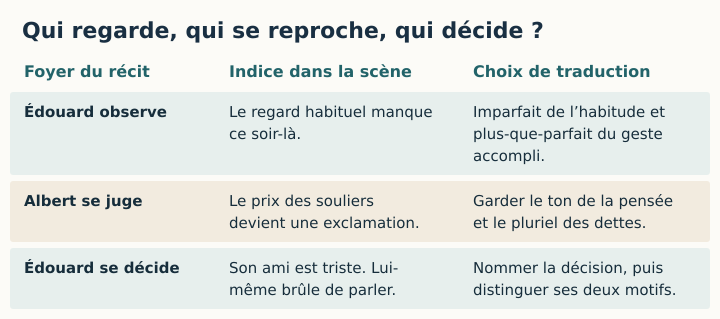

# BEL A/L — Espagnol, thème Lyon 2026 · Corrigé brut

*Corrigé rédigé par IA, non officiel. Signalez toute erreur.*

**Rédaction** · GPT-6.2 Astra Ultra · vitesse non renseignée

**Révision (tour 1)** · GPT-6.2 Astra Ultra · vitesse non renseignée

## Thème

Pierre Lemaitre, *Au revoir là-haut* (2013).

Édouard vio enseguida que Albert estaba decepcionado. Volvía de su cita de muy mal ánimo. Con su enamorada las cosas no habían salido como esperaba, a pesar de aquellos zapatos nuevos tan bonitos. O por culpa de ellos, pensó Édouard, que sabía lo que es la elegancia de verdad y que no le había augurado mucho éxito a Albert al ver lo que calzaba.

Al entrar, Albert había desviado la vista, como quien siente timidez. Era raro en él. Por lo común, en cambio, lo miraba fijamente, con intensidad. ¿Qué tal? Había algo casi excesivo en aquella mirada. Daba a entender que no temía mirar a su amigo a la cara cuando este no llevaba máscara, como aquella noche. Esta vez, en cambio, Albert guardó los zapatos en la caja, como un tesoro que uno esconde, pero sin alegría. Qué decepción de tesoro. Se reprochaba haber cedido a ese capricho. ¡Menudo gasto, con todo lo que tenían que pagar, y todo por pavonearse en casa de los Péricourt! Hasta la muchacha del servicio se había reído. Él seguía sin moverse. Édouard solo lo veía de espaldas, inmóvil, abatido.

Eso fue lo que lo animó a dar el paso. Y eso que se había prometido no decir nada hasta que el proyecto estuviera del todo ultimado, y aún le quedaba mucho para llegar a eso. Además, todavía no estaba enteramente satisfecho de lo que había hecho y Albert no tenía ánimos para tratar asuntos serios… Le sobraban motivos para mantener su decisión inicial de abrirse lo más tarde posible.

Si, pese a todo, se decidió a desembuchar, fue por la tristeza de su compañero. A decir verdad, con ese argumento solo encubría su verdadero motivo. Estaba impaciente. Desde aquella tarde en que había terminado el dibujo del niño de perfil, se moría de impaciencia.

[Sujet officiel](https://www.ens-lyon.fr/sites/default/files/2026-04/Epreuve%20de%20sp%C3%A9cialit%C3%A9%202026.pdf#page=14) · [Rapport du jury](https://www.ens-lyon.fr/sites/default/files/2026-10/Espagnol%202026.pdf#page=19)
