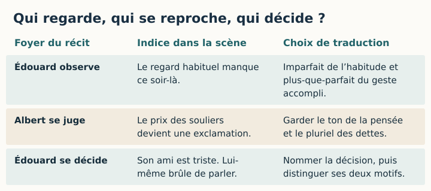

# BEL A/L — Espagnol, thème Lyon 2026 · Corrigé guidé

*Corrigé rédigé par IA, non officiel. Signalez toute erreur.*

**Rédaction** · GPT-6.2 Astra Ultra · vitesse non renseignée

**Révision (tour 1)** · GPT-6.2 Astra Ultra · vitesse non renseignée

Le sujet de spécialité de Lyon donne quatre heures, sans dictionnaire, pour traduire en espagnol les quatre paragraphes de Pierre Lemaitre à la page 14. Édouard observe Albert au retour d’un rendez-vous avant de décider de lui parler d’un projet encore inachevé.

[Sujet officiel](https://www.ens-lyon.fr/sites/default/files/2026-04/Epreuve%20de%20sp%C3%A9cialit%C3%A9%202026.pdf#page=14) · [Rapport du jury](https://www.ens-lyon.fr/sites/default/files/2026-10/Espagnol%202026.pdf#page=19)

## Lire la scène avant de traduire

Le paragraphe initial s’ouvre sur la certitude d’Édouard. Il a vu la déception de son ami. Sa remarque sur les chaussures vient ensuite rectifier avec malice une première explication de l’échec du rendez-vous. Au milieu du deuxième paragraphe, la voix change. L’exclamation sur le prix des souliers fait entendre les reproches qu’Albert s’adresse à lui-même. Puis son dos devient tout ce qu’Édouard peut encore voir de lui. La dernière phrase demande à nouveau de distinguer ce que croit ou dit un personnage et ce que le récit révèle de son impatience.

## Retrouver la valeur des verbes

**Ce qu’Édouard voit et ce qui le précède.** *Vio* marque l’instant de la constatation, *volvía* l’action en cours. L’issue du rendez-vous est antérieure à ce retour. Le plus-que-parfait *habían salido* donne naturellement cet ordre. Dans le deuxième paragraphe, *había desviado* renvoie au geste déjà accompli à l’arrivée, tandis que *miraba* installe l’habitude qui le rend surprenant.

**Deux sens de « porter ».** Les chaussures se portent aux pieds, d’où *calzar*. Le masque relève de *llevar*. Préciser *este* pour le camarade permet de comprendre que c’est Édouard qui a le visage découvert. Le sujet d’*había desviado* et celui de *guardó* sont tous les deux Albert. Le premier évite le regard, le second remet les souliers dans leur boîte. À la reprise après la mention de la bonne, *él* lève l’ambiguïté du sujet. *Lo veía de espaldas* donne ensuite Albert pour complément direct et lui rattache le masculin *abatido*. La tristesse ainsi perçue conduit Édouard à prendre la parole.

**Ce qui reste à faire, ce qui a vraiment été décidé.** Dans la promesse qu’Édouard s’était faite, le projet achevé est un état encore à venir à partir d’un repère passé. *Hasta que* appelle ici l’imparfait du subjonctif, *estuviera*, suivi d’un participe décrivant l’état final. La dernière conditionnelle, elle, revient sur une décision qu’il a effectivement prise. On écrit *si se decidió* à l’indicatif.

**Le mouvement d’une expression familière.** Pour « s’en vouloir », *reprocharse haber cedido* laisse à Albert la responsabilité de la dépense. Le pluriel *tenían* réintroduit ensuite les charges qu’ils partagent. *Pavonearse* rend le désir de se faire admirer. Au dernier paragraphe, *desembuchar* restitue le registre de « lâcher le morceau ». Tout se joue entre la tristesse invoquée d’Albert et l’impatience d’Édouard, dont le mot revient à la chute.

Relire chaque pronom en identifiant le personnage ou l’objet auquel il renvoie. Puis reprendre les trois étapes de la fin de la scène, de la promesse de se taire à la décision de parler, puis au rappel du dessin. Les temps espagnols doivent permettre de reconstruire cet ordre.

> [!JURY]
> Le jury distingue la « bonne amie », qui est la partenaire du rendez-vous, et la « petite bonne », employée de maison. Il demande de préserver les prénoms et attire l’attention sur le masculin de *zapatos*, repris par *ellos*. Il relève également la valeur temporelle de *en que* dans l’évocation du dessin.

## Traduction rédigée

#### Solution

Édouard vio enseguida que Albert estaba decepcionado. Volvía de su cita de muy mal ánimo. Con su enamorada las cosas no habían salido como esperaba, a pesar de aquellos zapatos nuevos tan bonitos. O por culpa de ellos, pensó Édouard, que sabía lo que es la elegancia de verdad y que no le había augurado mucho éxito a Albert al ver lo que calzaba.

Al entrar, Albert había desviado la vista, como quien siente timidez. Era raro en él. Por lo común, en cambio, lo miraba fijamente, con intensidad. ¿Qué tal? Había algo casi excesivo en aquella mirada. Daba a entender que no temía mirar a su amigo a la cara cuando este no llevaba máscara, como aquella noche. Esta vez, en cambio, Albert guardó los zapatos en la caja, como un tesoro que uno esconde, pero sin alegría. Qué decepción de tesoro. Se reprochaba haber cedido a ese capricho. ¡Menudo gasto, con todo lo que tenían que pagar, y todo por pavonearse en casa de los Péricourt! Hasta la muchacha del servicio se había reído. Él seguía sin moverse. Édouard solo lo veía de espaldas, inmóvil, abatido.

Eso fue lo que lo animó a dar el paso. Y eso que se había prometido no decir nada hasta que el proyecto estuviera del todo ultimado, y aún le quedaba mucho para llegar a eso. Además, todavía no estaba enteramente satisfecho de lo que había hecho y Albert no tenía ánimos para tratar asuntos serios… Le sobraban motivos para mantener su decisión inicial de abrirse lo más tarde posible.

Si, pese a todo, se decidió a desembuchar, fue por la tristeza de su compañero. A decir verdad, con ese argumento solo encubría su verdadero motivo. Estaba impaciente. Desde aquella tarde en que había terminado el dibujo del niño de perfil, se moría de impaciencia.
