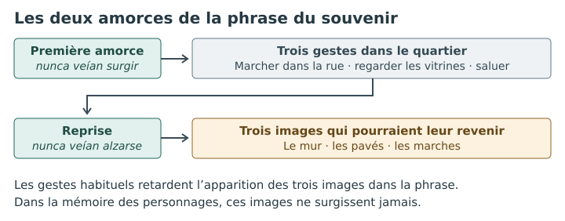

# BEL A/L — Espagnol, version et thème Ulm 2026 · Corrigé brut

*Corrigé rédigé par IA, non officiel. Signalez toute erreur.*

**Rédaction** · GPT-6.2 Astra Ultra · vitesse non renseignée

## I. Version

Rosa Montero, *La loca de la casa* (2003).

Il est assez naturel que les romanciers, portés comme ils le sont au dédoublement, aient tendance à faire une fixation sur leurs frères et sœurs, ces autres moi qui leur ressemblent par les gènes, surtout quand ce sont de faux jumeaux, plus encore quand ce sont de vrais jumeaux, infiniment plus encore quand ces frères et sœurs sont morts. […]

Ma sœur Martina, Dieu merci, est bien vivante, et nous ne sommes pas jumelles, et nous ne nous ressemblons pas le moins du monde. Elle a trois enfants (dont deux faux jumeaux), moi, je n’en ai aucun. Voilà vingt ans qu’elle vit heureuse avec le même homme, enfin on les voit toujours ensemble et elle ne se plaint jamais (il est vrai qu’elle parle très peu), alors que moi, j’ai eu je ne sais combien de partenaires et d’ordinaire je râle contre tous. Elle est d’une efficacité prodigieuse. Elle dirige avec compétence une entreprise d’informatique, s’occupe de ses enfants, mène sa maison comme un général de l’intendance mènerait une offensive, cuisine comme un chef couronné par le guide Michelin, règle tous les problèmes administratifs et juridiques avec une facilité inhumaine et reste en toutes circonstances calme et détendue, comme si elle avait des heures de reste dans sa journée. Moi, en revanche, je ne sais pas cuisiner, mon bureau est un vrai capharnaüm, ranger une armoire me paraît au-dessus de mes forces, je ne me rappelle jamais où j’ai posé mes lunettes (il m’est arrivé de les retrouver, après des heures de recherches laborieuses, au fond du réfrigérateur), je cours en tous sens, chez moi comme dans la vie, comme si on m’avait volé un jour de mon calendrier, et je crois bien qu’écrire est la seule chose que je sache faire. Martina est brave au point de friser l’inconscience, alors que moi, je suis plutôt froussarde (mais j’ai toujours pensé que le courage physique allait de pair avec une absence totale d’imagination, avec l’incapacité de se représenter le danger, et que, par conséquent, plus on a d’imagination, plus on a peur). Martina a le don de créer une atmosphère, de composer un cadre où l’on goûte la paix du foyer, de faire en sorte que les lampes de sa maison répandent une lumière dorée et heureuse, de faire de tout lieu où elle se trouve un foyer (« Là où était Ève, là était le paradis », écrivit Mark Twain, inconsolable, sur la tombe de sa regrettée épouse, qui devait ressembler à ma sœur), alors que moi, dans toutes les maisons que j’ai habitées, je n’ai jamais réussi à trouver le bon éclairage. Il y a toujours trop de lumière ou trop d’ombres, tout comme il y fait toujours trop chaud ou trop froid, il y a de bizarres courants d’air dans les couloirs, des coins rétifs ou inhospitaliers, et l’impression, partout, d’un lieu de passage, car chez moi, c’est dans ma tête. En somme, Martina, elle, fait des choses, et moi, je ne suis que paroles.

Mais c’est la parole qui fait de nous des êtres humains.

## II. Thème

Nathalie Sarraute, *Tropismes*, Les Éditions de Minuit (édition citée, 1957).

Aquí no se les exigía ninguna forma particular de vestir, ninguna actividad en común con otros, ningún sentimiento, ningún recuerdo. Se les ofrecía una vida a la vez despojada y protegida, una vida semejante a una sala de espera en una estación desierta de las afueras, una sala desnuda, gris y templada, con una estufa negra en el centro y bancos de madera a lo largo de las paredes.

Y estaban contentos, estaban a gusto aquí, se sentían casi como en casa, se llevaban bien con la señora portera, con la lechera, llevaban la ropa a limpiar a la tintorera más concienzuda y más barata del barrio.

Nunca intentaban recordar el campo donde habían jugado tiempo atrás, nunca intentaban recobrar el color y el olor de la pequeña ciudad donde habían crecido, nunca veían surgir en su interior, cuando andaban por las calles del barrio, cuando miraban los escaparates de las tiendas, cuando pasaban por delante de la portería y saludaban a la portera con toda cortesía, nunca veían alzarse en su memoria un lienzo de pared rebosante de vida, o los adoquines de un patio, intensos y acariciadores, o los suaves peldaños de una escalinata en la que se habían sentado de niños.

En la escalera de su edificio se cruzaban a veces con «el inquilino de abajo», profesor de instituto, que volvía de clase con sus dos hijos a las cuatro. Tenían los tres unas cabezas alargadas, de ojos pálidos, lustrosas y lisas como grandes huevos de marfil. La puerta de su piso se entreabría un instante para dejarlos pasar. Se los veía posar los pies sobre unos cuadraditos de fieltro dispuestos sobre el parqué del recibidor y alejarse en silencio, deslizándose hacia el fondo oscuro del pasillo.

