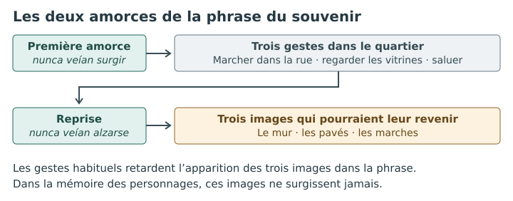

# BEL A/L — Espagnol, version et thème Ulm 2026 · Corrigé guidé

*Corrigé rédigé par IA, non officiel. Signalez toute erreur.*

**Rédaction** · GPT-6.2 Astra Ultra · vitesse non renseignée

## Présentation du sujet

L’option d’espagnol d’Ulm dure six heures. Le livret propose de traduire en français la page 8, extraite de *La loca de la casa* de Rosa Montero (2003), puis en espagnol la page 9, tirée des *Tropismes* de Nathalie Sarraute (édition de 1957). Chez Montero, la narratrice tient un inventaire qui paraît tout à l’avantage de sa sœur. Chez Sarraute, tout un groupe mène une vie réglée dont la phrase épouse les habitudes. [Sujet officiel, p. 8 et 9](https://www.ens.psl.eu/sites/default/files/al_opt_lve_vers-theme_261109.pdf#page=8)

## I. Version

### Entendre ce que la narratrice reprend à son compte

> [!INDICATION]
> Au moment où la narratrice décrit le couple de Martina, que sait-elle de leur bonheur ? Quels mots lui permettent de corriger sa première affirmation ?

#### Solution

La narratrice commence par affirmer que sa sœur est heureuse en ménage. Puis *por lo menos* ramène l’affirmation à deux observations, la présence du couple en public et l’absence de plaintes. La parenthèse sur le peu de mots que prononce Martina réduit encore la portée du témoignage. À la lecture à voix haute, on doit pouvoir entendre la narratrice se raviser. « Voilà vingt ans qu’elle vit heureuse avec le même homme, enfin on les voit toujours ensemble » garde cette mobilité.

Les degrés de la première phrase constituent un autre piège. Le premier *si* ouvre une gradation que poursuivent deux autres *si*. *Mellizos* désigne ici les faux jumeaux et *gemelos* les vrais. La troisième proposition, sur les frères et sœurs morts, pousse la gradation jusqu’au paradoxe. Plus loin, quand la narratrice revient sur les enfants de Martina, « dont deux faux jumeaux » rappelle la première distinction.

### Faire entendre deux voix dans le même portrait

| Repère | Ce qu’il faut faire entendre en français |
|---|---|
| *sobraran* et *hubieran robado* | Les deux comparaisons se répondent. Martina dispose d’un excédent d’heures, comme si sa journée était extensible. Sa sœur se croit privée d’une journée entière. L’imparfait puis le plus-que-parfait après « comme si » distinguent l’aisance présente du vol imaginé comme déjà accompli. |
| *general de intendencia* et *facilidad inhumana* | Des affaires domestiques prennent les dimensions d’une campagne militaire. Le dernier adjectif transforme l’admiration en une pointe comique. « Inhumaine » lui conserve son double tranchant. |
| *cobardica* | Un mot familier rompt avec la solennité du portrait. « Froussarde » prépare la justification ingénieuse par laquelle la narratrice fait de sa peur un signe d’imagination. |
| *debía de ser* | La narratrice imagine une ressemblance entre l’épouse de Twain et Martina. « Devait ressembler » exprime sa conjecture. |
| *palabras* puis *la palabra* | Le pluriel semble réduire la narratrice à une abondance de discours. Le singulier désigne une faculté de tous les humains. En passant de « paroles » à « la parole », le français fait entendre le retournement sur le même nom. |

> [!JURY]
> Le rapport apprécie l’autodérision des meilleures versions. Avant de rendre la copie, relire d’un seul tenant les énumérations et les parenthèses. L’une des plaisanteries tient à la place où la narratrice révèle qu’elle retrouve ses lunettes dans le réfrigérateur. [Rapport de l’ENS, p. 1 à 4](https://www.ens.psl.eu/sites/default/files/2026_al_rapport_espagnol_ecrit_version_theme_option.pdf)

### Version rédigée

#### Solution

Il est assez naturel que les romanciers, portés comme ils le sont au dédoublement, aient tendance à faire une fixation sur leurs frères et sœurs, ces autres moi qui leur ressemblent par les gènes, surtout quand ce sont de faux jumeaux, plus encore quand ce sont de vrais jumeaux, infiniment plus encore quand ces frères et sœurs sont morts. […]

Ma sœur Martina, Dieu merci, est bien vivante, et nous ne sommes pas jumelles, et nous ne nous ressemblons pas le moins du monde. Elle a trois enfants (dont deux faux jumeaux), moi, je n’en ai aucun. Voilà vingt ans qu’elle vit heureuse avec le même homme, enfin on les voit toujours ensemble et elle ne se plaint jamais (il est vrai qu’elle parle très peu), alors que moi, j’ai eu je ne sais combien de partenaires et d’ordinaire je râle contre tous. Elle est d’une efficacité prodigieuse. Elle dirige avec compétence une entreprise d’informatique, s’occupe de ses enfants, mène sa maison comme un général de l’intendance mènerait une offensive, cuisine comme un chef couronné par le guide Michelin, règle tous les problèmes administratifs et juridiques avec une facilité inhumaine et reste en toutes circonstances calme et détendue, comme si elle avait des heures de reste dans sa journée. Moi, en revanche, je ne sais pas cuisiner, mon bureau est un vrai capharnaüm, ranger une armoire me paraît au-dessus de mes forces, je ne me rappelle jamais où j’ai posé mes lunettes (il m’est arrivé de les retrouver, après des heures de recherches laborieuses, au fond du réfrigérateur), je cours en tous sens, chez moi comme dans la vie, comme si on m’avait volé un jour de mon calendrier, et je crois bien qu’écrire est la seule chose que je sache faire. Martina est brave au point de friser l’inconscience, alors que moi, je suis plutôt froussarde (mais j’ai toujours pensé que le courage physique allait de pair avec une absence totale d’imagination, avec l’incapacité de se représenter le danger, et que, par conséquent, plus on a d’imagination, plus on a peur). Martina a le don de créer une atmosphère, de composer un cadre où l’on goûte la paix du foyer, de faire en sorte que les lampes de sa maison répandent une lumière dorée et heureuse, de faire de tout lieu où elle se trouve un foyer (« Là où était Ève, là était le paradis », écrivit Mark Twain, inconsolable, sur la tombe de sa regrettée épouse, qui devait ressembler à ma sœur), alors que moi, dans toutes les maisons que j’ai habitées, je n’ai jamais réussi à trouver le bon éclairage. Il y a toujours trop de lumière ou trop d’ombres, tout comme il y fait toujours trop chaud ou trop froid, il y a de bizarres courants d’air dans les couloirs, des coins rétifs ou inhospitaliers, et l’impression, partout, d’un lieu de passage, car chez moi, c’est dans ma tête. En somme, Martina, elle, fait des choses, et moi, je ne suis que paroles.

Mais c’est la parole qui fait de nous des êtres humains.

## II. Thème

### Retrouver la principale après les trois subordonnées

> [!INDICATION]
> Dans le troisième paragraphe, souligner les propositions qui commencent par « quand ». Après ces trois propositions, quels groupes donnent enfin une forme concrète à ce qui pourrait surgir dans la mémoire ?

#### Solution

Le mur, les pavés et les marches n’arrivent qu’après les trois actions ordinaires du quartier. La première amorce sur ce qu’ils ne voient jamais surgir attend ses compléments. À la sortie des trois temporelles, Sarraute relance cette amorce avec un nouveau verbe. On peut reprendre en espagnol *nunca veían*, puis faire varier les infinitifs *surgir* et *alzarse*. Garder les trois *cuando* permet au lecteur de retrouver en espagnol le moment où la phrase, longtemps suspendue, reprend son cours.

### Choisir les temps et les accords

Dans les scènes du quartier, l’imparfait peint l’habitude (*andaban*, *miraban*, *pasaban*). Les jeux dans la campagne, l’enfance dans la petite ville et les haltes sur les marches appartiennent à une période antérieure. Les trois plus-que-parfaits (*habían jugado*, *habían crecido*, *se habían sentado*) restituent cette profondeur.

Au début, « aucune tenue » peut viser la façon de se tenir ou celle de s’habiller. Le jury accepte les deux lectures. Avec la seconde, *no se les exigía ninguna forma particular de vestir* indique que chacun pouvait s’habiller à sa guise. Dans la salle de la gare, le poêle se trouve au milieu de la pièce et les bancs longent les murs. Le sujet distingue deux compléments de lieu, que l’espagnol conserve.

La formule « on les voyait » de la dernière phrase laisse l’observateur anonyme. *Se los veía* reprend le professeur et ses enfants par un pronom pluriel. Les deux infinitifs *posar* et *alejarse* dépendent de *veía*. Le gérondif *deslizándose* prolonge le second mouvement. Quant aux « longues têtes », leur forme, leur éclat et leur surface lisse motivent la comparaison avec les œufs. En espagnol, *lustrosas y lisas* au féminin renvoie clairement à *cabezas*.

> [!JURY]
> Le jury indique avoir neutralisé dans la notation le problème d’accord de l’adjectif associé aux pavés. La proposition ci-dessous conserve l’image tactile et accorde *acariciadores* avec *adoquines*. [Rapport de l’ENS, p. 4 et 5](https://www.ens.psl.eu/sites/default/files/2026_al_rapport_espagnol_ecrit_version_theme_option.pdf#page=4)

### Thème rédigé

#### Solution

Aquí no se les exigía ninguna forma particular de vestir, ninguna actividad en común con otros, ningún sentimiento, ningún recuerdo. Se les ofrecía una vida a la vez despojada y protegida, una vida semejante a una sala de espera en una estación desierta de las afueras, una sala desnuda, gris y templada, con una estufa negra en el centro y bancos de madera a lo largo de las paredes.

Y estaban contentos, estaban a gusto aquí, se sentían casi como en casa, se llevaban bien con la señora portera, con la lechera, llevaban la ropa a limpiar a la tintorera más concienzuda y más barata del barrio.

Nunca intentaban recordar el campo donde habían jugado tiempo atrás, nunca intentaban recobrar el color y el olor de la pequeña ciudad donde habían crecido, nunca veían surgir en su interior, cuando andaban por las calles del barrio, cuando miraban los escaparates de las tiendas, cuando pasaban por delante de la portería y saludaban a la portera con toda cortesía, nunca veían alzarse en su memoria un lienzo de pared rebosante de vida, o los adoquines de un patio, intensos y acariciadores, o los suaves peldaños de una escalinata en la que se habían sentado de niños.

En la escalera de su edificio se cruzaban a veces con «el inquilino de abajo», profesor de instituto, que volvía de clase con sus dos hijos a las cuatro. Tenían los tres unas cabezas alargadas, de ojos pálidos, lustrosas y lisas como grandes huevos de marfil. La puerta de su piso se entreabría un instante para dejarlos pasar. Se los veía posar los pies sobre unos cuadraditos de fieltro dispuestos sobre el parqué del recibidor y alejarse en silencio, deslizándose hacia el fondo oscuro del pasillo.
