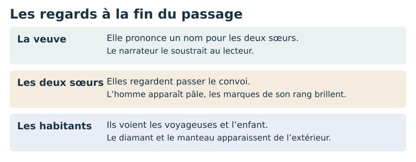

# BEL A/L — Étude de texte français (Lyon) 2026 · Corrigé brut

*Corrigé rédigé par IA, non officiel. Signalez toute erreur.*

**Lecture du rapport du jury** · modèle exact non renseigné (famille GPT-6) · effort non renseigné · vitesse non renseignée

**Rédaction** · modèle exact non renseigné (famille GPT-6) · effort non renseigné · vitesse non renseignée

**Autocontrôle** · modèle exact non renseigné (famille GPT-6) · effort non renseigné · vitesse non renseignée

**Révision** · modèle exact non renseigné (famille GPT-6) · effort non renseigné · vitesse non renseignée

**Lecture du rapport du jury** · GPT-6.2 Astra Ultra · vitesse non renseignée

**Révision** · GPT-6.2 Astra Ultra · vitesse non renseignée

**Révision (tour 3)** · GPT-6.2 Astra Ultra · vitesse non renseignée

**Texte étudié** — Claude Simon, *L’Acacia* (1989), la recherche de la tombe du père.

L’enfant est le dernier personnage de la page à recevoir un vêtement et presque le dernier à paraître, alors que c’est de son histoire qu’il s’agit. Dans *L’Acacia*, publié en 1989, Claude Simon reprend le voyage accompli après la Grande Guerre par une famille à la recherche de la tombe d’un père. Le chapitre situe cette quête en 1919. L’écart d’une vie sépare l’enfant qui l’a faite du romancier qui l’écrit. De ce fait biographique, rien ne passe dans la scène sous la forme d’un « je me souviens ». L’enfant lui-même finit par apparaître tel que d’autres le voient. À qui rapporter dès lors la vision minutieuse de la rivière ou l’image immense des morts sous les collines ? Comment un récit peut-il faire partager une mémoire d’enfance en retirant au témoin la première personne et jusqu’au privilège de son regard ? La pluie permet d’abord d’embrasser dans une même phrase des réalités dont aucun œil ne saurait prendre ensemble la mesure. Sur les routes, cette manière de décrire se transforme en manière de raconter. La rencontre d’un officier finit par rendre la famille elle-même visible du dehors et rejoint, par ce détour précis, l’expérience intime de la perte.

* * *

Le début a l’air d’une observation qu’il serait facile de vérifier. La saison est encore l’été et pourtant la pluie abonde. La concession initiale laisse entendre une attente déçue, même si personne ne s’avance pour la prendre à son compte. La phrase suivante s’étire sur presque tout le premier paragraphe. Le même verbe impersonnel y revient devant les murs, la rivière et les collines. Chacun de ces lieux pourrait avoir été successivement aperçu de la voiture. La répétition de la pluie les rend en outre contemporains. La même eau tombe à présent sur la surface de la rivière, sur les restes des maisons et sur le sol qui recouvre les soldats. Le temps de la traversée devient sensible sans qu’un point de vue stable soit assigné au lecteur.

Les papiers pastel qui pendent à des murs ouverts pourraient être des souvenirs singuliers. Ils font entrer dans la vue d’une route les anciennes couleurs d’un intérieur. À l’autre extrême, nul passant ne pourrait sous le même regard embrasser les corps enfouis et les compter par centaines de milliers. Le nombre fait affleurer un savoir collectif dans une série de perceptions. Sur la rivière, en revanche, la phrase s’attarde à l’anneau minuscule et argenté que dessine une goutte. À quelle échelle convient-il donc de regarder ? La syntaxe accueille le changement de dimension sans annoncer que l’on quitte le visible. Elle place ce qui se voit à peine devant soi et ce qui demeure enfoui sous les collines sur un même trajet de la pensée. Une guerre dont le père a été une des victimes impose d’écrire à ces deux échelles également inconciliables et nécessaires.

Regarder s’accomplit ici à plusieurs reprises, même lorsqu’on regarde la même chose. L’énumération a donné des noms ordinaires, champs et maisons. Une première rectification retire ce que ces noms ont d’excessivement assuré. Il s’agit de ce qu’il en reste. Puis, là où une terre a pu sembler défoncée, « écorché » fait apparaître une surface blessée. La herse imaginée par comparaison rassemble ces impressions. Un instrument normalement destiné à préparer la terre à une culture a laissé derrière lui une suite de trous dans lesquels l’eau croupit. Ses dents irrégulièrement espacées rendent intelligible un autre détail, ces maisons ou ces arbres épargnés au milieu des ruines. L’image fait travailler la contradiction entre violence presque universelle et intactes petites enclaves. Une maison debout finit ainsi par être l’objet le plus étrange du paysage. Le roman reconstitue la difficulté de se fier aux catégories de la vie ordinaire quand le mot même de maison peut désigner une apparence intégrale ou deux pans de mur.

* * *

Des pistes se dessinent dans le deuxième paragraphe. Là encore le premier mot, « routes », doit être repris. La correction s’inscrit aussitôt à l’intérieur de la phrase. Nous sortons d’un terrain où repoussent à peine les orties pour entrer dans un monde où l’on recommence à passer. Les véhicules se distinguent mal du milieu, dont ils ont la couleur. Le mouvement des convois a lui-même la lenteur d’une vie qui reprend sans aller bien loin. Pourtant des habitudes et des échanges existent déjà. À l’intérieur d’une cabine un garçon rallume son mégot, des bouteilles roulent à ses pieds. Une des deux sœurs va acheter le vin pour les conducteurs. Celle que le début du texte ne désignait même pas encore comme voyageuse apparaît pour la première fois au détour d’une relative, par un geste de ravitaillement.

Un briquet fait d’une douille offre ici une très petite mesure historique. La guerre demeure dans la matière de l’objet, que les jeunes soldats emploient pour un geste répétitif de temps de paix. À ces conducteurs presque imberbes répondra bientôt un vieillard en uniforme. Le violet du vin, le verre vert, les bulles et la salive font entrer dans les couleurs de terre une profusion sensible dont les proportions sont remarquables. Les pédales paraissent énormes. La précision de ces premiers plans pourrait être celle d’un enfant admis dans une cabine et attentif à ce qui l’entoure en bas, à des distances bien différentes de celles de l’adulte. Le texte nous autorise à faire l’essai de cette perspective. Il se garde de la certifier par une formule telle que « l’enfant vit ». Un détail d’enfance peut survivre avec une intensité particulière sans garantir à lui seul l’origine de toutes les impressions qui l’accompagnent.

C’est au milieu du paragraphe qu’un marqueur de récit, « Une fois », isole une rencontre. Les actions répétées à l’imparfait font alors place à l’obligation singulière pour une voiture de se ranger. Le passé simple donne un commencement et une issue à ce bref événement. Qu’est-ce qui s’est passé ? Des véhicules ont croisé d’autres véhicules. Aucune action de l’officier ne justifie la place qu’il occupe dans la page. Une succession de mots de couleur et de matière suffit pourtant à faire sentir une hiérarchie. Les mêmes teintes de boue recouvrent les trois automobiles, mais le cuivre entretenu et l’or du képi attirent l’œil. L’homme ainsi distingué demeure immobile. Ses orbites creuses et sa pâleur appellent l’image d’un malade que d’autres promènent sur une petite voiture. Le rapprochement fait basculer le prestige du convoi dans une image de dépendance physique. Il s’effectue dans le temps d’un croisement. Le savoir historique qui pourrait identifier l’officier n’interrompt jamais cette comparaison pour la remplacer par sa notice.

* * *

La veuve, pourtant, dit un nom. Il est communiqué aux deux femmes et retenu pour le lecteur. La différence est capitale dans un récit où l’on cherche, parmi tant de morts, un homme qui possède un nom singulier. Celui qui pourrait devenir ici une grande figure reconnue de l’histoire nous apparaît comme un visage presque défait ; celui qui justifie le voyage n’apparaît sous aucun trait. Simon donne à éprouver ce défaut de prise en distribuant avec rigueur les regards. Les deux femmes regardent passer les voitures. L’indifférence de leur regard est ensuite comparée à celle des habitants qui les voient passer à leur tour. La même construction verbale déplace les voyageurs de la position de ceux qui regardent à celle des silhouettes qu’on suit un instant des yeux. Le voyage de la famille a un sens puissamment déterminé pour elle, sans que chaque inconnu rencontré soit tenu de le partager.

Le nom circule donc effectivement dans la scène. Le lecteur voit la veuve le transmettre et les deux femmes le recevoir. Ce qui lui manque est le contenu de la confidence. Cette dissymétrie sépare la position du lecteur de celle des témoins, même lorsque le récit les rassemble dans un seul mouvement du regard.

Les réponses des habitants font entendre ce que cette différence de position a de social. Les uns se montrent pleins de bonne volonté et parlent de façon décousue, les autres éprouvent l’impatience de gens interrompus dans leur travail. Le récit cherche une expression plus dure encore et s’arrête sur leur hostilité. Est-ce l’impression qu’en ont gardée les voyageuses ? Est-ce un jugement porté sur elles par ceux à qui elles demandent leur chemin ? Le passage d’un regard à l’autre nous prive d’un poste depuis lequel il serait facile de départager les parties. Les démonstratifs qui introduisent l’ennui ou l’impatience font comme si le lecteur savait de quelle expérience commune il s’agit. Il peut reconnaître la gêne de l’interrogateur aussi bien que la lassitude de celui qui a autre chose à faire.

Enfin, les personnes interrogées regardent à leur tour. Elles découvrent des voiles noirs, une main et son diamant, puis un enfant enveloppé de laine chaude. Le deuil est public dans le vêtement, mais la parure et le confort de l’enfant sont aussi des signes de position sociale. Du même coup, celui à qui pourrait appartenir le souvenir devient un détail du tableau offert aux habitants. On ne nous dit pas ce qu’il pense de cette rencontre. Le simple fait de le placer là, à côté d’une main qui brille, donne à mesurer combien le sens vécu de son voyage excède ce que peuvent en recueillir les passants. À la ligne 37, « tournant le dos et retournant à leurs occupations » fait réentendre deux fois le même verbe sous deux constructions. Dans le premier mouvement, les habitants cessent de regarder la famille. Dans le second, le préfixe marque le retour vers une tâche momentanément laissée. Les participes prolongent le geste de ceux qui étaient déjà « regardant » à la ligne précédente. Le croisement des automobiles avait reçu les contours d’un événement au passé simple. La fin de la rencontre se fond dans la durée ordinaire du travail : pour les gens interrogés, la famille qui poursuit sa recherche est déjà passée.

* * *

Un souvenir raconté à la première personne aurait pu s’appuyer sur une promesse de reconnaissance, celle de l’adulte retrouvant partout le point de vue de l’enfant. Ici, une bulle dans une bouteille ou la taille d’une pédale rapprochent le lecteur d’une perception singulière, puis le nombre des morts ou le regard d’un habitant retirent aussitôt au petit voyageur la maîtrise de la scène. L’histoire familiale tire justement sa force de cette circulation. Le père manque à un enfant dans un pays entier de morts. Pour écrire ce manque, le roman donne à voir tout ce qu’il a fallu traverser pour chercher un homme, jusqu’aux étrangers qui virent un jour passer sa famille et qui, eux, pouvaient lui tourner le dos.
