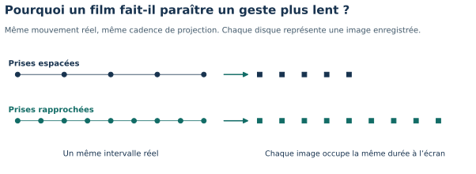
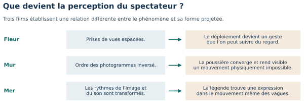

# BEL A/L — Études cinématographiques 2026 · Corrigé guidé

*Corrigé rédigé par IA, non officiel. Signalez toute erreur.*

**Rédaction** · modèle exact non renseigné (famille GPT-6) · effort non renseigné · vitesse non renseignée

**Révision** · modèle exact non renseigné (famille GPT-6) · effort non renseigné · vitesse non renseignée

**Retouches** · modèle exact non renseigné (famille GPT-6) · effort non renseigné · vitesse non renseignée

**Lecture du rapport du jury** · GPT-6.2 Astra Ultra · vitesse non renseignée

**Révision** · GPT-6.2 Astra Ultra · vitesse non renseignée

**Révision (tour 3)** · GPT-6.2 Astra Ultra · vitesse non renseignée

**Sujet** — Jean Epstein et la première vision d’un univers qui peut se mouvoir à rebours

[Citation et consigne officielles, p. 2](https://www.ens.psl.eu/sites/default/files/al_spe_arts.pdf#page=2) · [Rapport de la composition écrite](https://www.ens-lyon.fr/sites/default/files/2026-10/Arts%20-%20Cin%C3%A9ma%202026.pdf)

## Lire les opérations avant d’élargir à la théorie du cinéma

Le sujet demande ce que devient le mouvement lui-même. Isoler trois verbes de travail : accélérer, ralentir et inverser. Pour chacun, préciser ce qui a matériellement changé entre l’enregistrement et la projection et ce que le spectateur découvre. La durée d’un plan peut être longue avec un mouvement tout à fait ordinaire ; il n’y a alors aucun ralenti technique à expliquer.

## Décrire une séquence qui permet de trancher

Regardez ce qui arrive à la poussière lorsque le mur des Lumière se redresse. Un ouvrier peut marcher en arrière en prise directe. Le nuage qui retourne aux débris fournit un indice différent. Chez Vertov, la reconstitution du bœuf concerne la direction des gestes dans les images et le parcours du spectateur vers l’origine du produit. Distinguer ces deux niveaux permet d’expliquer comment un procédé participe à une idée de cinéma.

Regardez la flèche à l’intérieur de chaque plan. Dans le remontage, elle garde sa direction alors que les plans changent de place. Dans la bande inversée, elle change aussi de direction : c’est ce second indice qui rend perceptible une transformation du mouvement lui-même.

## Discuter l’ambition de la citation

Pourquoi Epstein parle-t-il de l’univers et de sa vie ? Étudiez ensemble un cas où le procédé rend connaissable une transformation physique et un autre où il fabrique un mouvement impossible. Revenez à la séance, qui se déroule dans un seul sens pour le spectateur. L’argument final peut alors porter sur ce que filmer nous apprend de notre mesure des durées.

> [!PIEGE]
> « Première vision » demande un repère historique. La fantasmagorie de Robertson proposait déjà l’apparition mouvante d’un spectre et Marey décomposait des mouvements. Identifier la spécificité de la projection cinématographique permet de prendre au sérieux la nouveauté affirmée sans supposer que tout imaginaire du temps commence avec le cinéma.

## Composition rédigée

### Introduction

Un mur s’effondre, de la poussière monte du sol, des hommes se dégagent. Repassez les mêmes images dans l’autre sens : le nuage rejoint les briques, les débris se rassemblent et le mur se redresse. Aucune maçonnerie n’a été entreprise entre les deux projections ; pourtant le spectateur de la vue Lumière *Démolition d’un mur* (1896) a vu quelque chose se construire. Lorsque Jean Epstein affirme en 1947 dans *Le Cinéma du diable* que le cinématographe donne à voir un monde qui peut changer de vitesse et aller à rebours, il ne parle donc pas seulement de la faculté qu’a un récit de commencer par sa fin. Le mouvement que l’œil reçoit change, image après image. Mais en quel sens cette opération nous montre-t-elle « le monde vivre » ? L’appareil enregistre bien des choses qui ont eu lieu, et c’est pourtant en dérangeant l’ordre dans lequel elles ont eu lieu qu’il prétend modifier notre vision de l’univers. **Comment une machine capable de fabriquer un mouvement impossible peut-elle nous faire connaître une réalité que notre perception ordinaire laissait échapper ?**

### I. Changer la vitesse de projection peut donner un mouvement à voir pour la première fois

Le mouvement paraît appartenir à la chose qui se déplace. Or un appareil qui prend des vues à intervalles espacés et les projette à une cadence régulière fait dépendre le mouvement apparent de deux durées distinctes. À une prise de vue par minute, vingt-quatre minutes peuvent tenir dans une seconde de projection à vingt-quatre images par seconde. L’accélération ne consiste pas ici à faire courir l’image déjà visible d’une plante en train de pousser. Elle fait apparaître comme un événement continu ce que l’observateur aurait comparé en deux ou trois états espacés. Selon qu’il a regardé la plante ou attendu puis regardé de nouveau, il n’a pas vu la même chose que le spectateur de la projection.

Dans *The Birth of a Flower* (F. Percy Smith, 1910), la fleur en train de s’ouvrir occupe l’attention dans un cadre où des déplacements infimes peuvent être rapportés les uns aux autres. Le calice se desserre, les pétales se séparent et se déploient. Sur une photographie successive, chaque état pourrait faire office de spécimen botanique. À la projection, l’un semble produire le suivant, et les pétales paraissent presque exécuter un geste. L’accélération ne modifie pas la succession des états. Elle franchit un seuil de perception à partir duquel cette succession acquiert, pour le spectateur, une qualité de mouvement. Le choix du cadre isole cependant la fleur de bien d’autres durées, celles de la lumière ou du jardinier, par exemple. Ce que nous appelons ici « vivre plus vite » dépend de ce qui a été choisi comme unité visible de la vie.

Cette comparaison des échelles peut porter sur des activités dont les participants connaissent pourtant chaque vitesse. Dans *Koyaanisqatsi* (Godfrey Reggio, 1982), les traînées de phares sur les voies urbaines font apparaître par accélération des flux qui semblent presque indépendants des conducteurs. Là où Smith isole une fleur, l’étendue du cadrage et le défilement rapide chez Reggio effacent les trajets individuels au bénéfice d’un courant collectif. La machine avance ici moins la connaissance d’un organisme qu’elle ne propose une manière de voir une ville comme un organisme. Le passage de l’une à l’autre demeure une opération du film, que l’on peut discuter.

Le ralenti effectue l’opération temporelle opposée, sans produire un effet esthétique simplement inverse. En enregistrant davantage d’images dans la durée d’un geste, puis en les projetant à une cadence plus faible que celle de la prise de vue, il rend perceptibles des phases que l’œil réunissait dans un seul élan. Dans *Le Tempestaire* (Jean Epstein, 1947), l’écume et le mouvement des vagues cessent par moments de donner simplement la mesure de la force du vent. Une crête prend le temps de se former, de se suspendre et de s’étirer. Bien que le spectateur sache ce qu’est une vague, il ne peut rapporter ce mouvement à une allure familière de la mer. L’expérience commence donc avant l’inversion. Une matière pourtant enregistrée dans le monde visible acquiert, du fait de la durée de sa présentation, des propriétés sensibles que nous n’avions pas prises pour siennes.

En ce sens, le terme « première » doit être examiné. Des récits de retour dans le passé et des spectacles d’apparitions ont précédé le cinématographe. À la fin du XVIIIe siècle, les fantasmagories de Robertson font grandir des figures spectrales en déplaçant la lanterne de projection. L’effroi collectif devant un mouvement qui paraît impossible est donc plus ancien que la pellicule. La chronophotographie de Marey avait déjà décomposé des mouvements trop rapides pour l’œil. La nouveauté engagée par le propos d’Epstein tient à une vision que l’on peut projeter et répéter : c’est le mouvement d’apparences photographiquement enregistrées qui se reforme devant nous à une autre allure. Cette différence devient décisive lorsque la machine ne se contente plus de faire varier la vitesse. Prenons quatre secondes de mouvement filmées à 48 images par seconde. Les 192 images projetées à 24 images par seconde occupent huit secondes, même si on les projette dans l’ordre inverse. La première opération détermine combien de temps nous regardons la vague ; la seconde, si nous la voyons se former ou se défaire. Aucune coupe entre deux plans n’est nécessaire pour les obtenir.

### II. La marche arrière donne une évidence sensible à ce qui contredit notre expérience des causes

L’accéléré de la fleur conserve l’antériorité de la fermeture sur l’épanouissement. Renverser la bande fait autre chose que comprimer davantage la durée. En projection inverse de *Démolition d’un mur*, ni le dessin des briques ni celui des ouvriers ne paraissent en eux-mêmes fantastiques. C’est leur mouvement conjoint qui le devient. La poussière surtout révèle ce que le retour à l’état initial a d’impossible : elle converge vers le lieu précis dont la chute l’avait dispersée. Les hommes pourraient à la rigueur marcher en arrière. Aucun ouvrier ne pourrait rassembler de cette façon un nuage de poussière. Le plan est d’autant plus étrange qu’il enregistre avec fidélité les détails qui démentent la possibilité physique de l’événement projeté.

L’étrangeté ne dépend donc pas d’une croyance naïve du public. On peut connaître le sens de rotation de la manivelle et éprouver tout de même une causalité nouvelle, comme si le nuage aspirait le mur hors des gravats. Le spectateur dispose à la fois du savoir que les constructions se défont et de l’évidence visuelle de leur reconstitution instantanée. La « fantasmagorie » évoquée par Epstein se distingue ainsi d’un récit merveilleux qu’il faudrait se borner à imaginer. Dans le cadre, la matière semble elle-même accepter de vivre selon une loi qui lui est étrangère. Hors du cadre, le monde de la prise de vue n’a perdu ni sa pesanteur ni sa direction temporelle. L’appareil obtient la coexistence des deux expériences.

Ce pouvoir reçoit une autre portée dans *Kino-Glaz* ou *Ciné-Œil* (Dziga Vertov, 1924). À partir du circuit de la viande, le film remonte jusqu’au bœuf vivant. Dans la séquence de l’abattoir, les transformations corporelles sont présentées à rebours ; la peau revient à l’animal et la carcasse semble reprendre vie. L’inversion locale des gestes se combine avec un trajet de montage qui conduit le spectateur de la marchandise vers les opérations dont elle provient. Ces deux actions du cinéma doivent être distinguées. Un montage documentaire pourrait passer d’un commerce à un élevage en remontant la filière sans qu’une seule image soit projetée à l’envers. Vertov choisit aussi la résurrection filmique, qui donne au raisonnement économique une forme sensible et choquante. Au lieu de fournir une illustration docile de la fabrication d’un produit, le retour rend problématique l’idée même qu’un animal puisse disparaître sans reste derrière la viande exposée.

Un récit de fiction peut à son tour faire jouer la différence entre renversement du mouvement et remontée de l’enquête. Dans l’ouverture de *Memento* (Christopher Nolan, 2000), une photographie instantanée déjà formée pâlit au lieu de se révéler. Le geste familier qui consiste à agiter le cliché perd sa raison d’être devant une image qui s’efface. Ce prologue inverse matériellement le mouvement. Ensuite, lorsque la narration nous présente certaines séquences dans un ordre chronologique décroissant, les personnages continuent généralement de s’y mouvoir dans le sens ordinaire. L’un des effets nous fait voir une transformation impossible ; l’autre redistribue ce que nous savons des actes au moment où nous les voyons.

L’inversion a donc des usages qui excèdent le plaisir de l’attraction. Chez Lumière, le même mur se prête à deux événements contradictoires ; chez Vertov, la remontée visible d’une chaîne de transformations fait rechercher les conditions de production de l’image première. Des formes distinctes peuvent être bâties avec une même propriété de l’appareil. Faut-il alors réserver le mot « univers » aux seuls mondes fabriqués par un cinéaste ?

### III. Le temps sensible du film met à l’épreuve la place que le spectateur se donne dans le monde

*Le Tempestaire* permet de revenir à cette formulation ambitieuse. Sur une île bretonne, une jeune femme s’inquiète d’un départ en mer. La légende prête à un vieil homme la faculté d’agir sur les vents ; une boule de verre entre dans la scène où il tente de calmer la tempête. Les images de la mer ne restent pas le simple décor d’une opération magique accomplie ailleurs. Leur ralentissement et leur inversion deviennent le lieu même où nous faisons l’expérience de ce changement. Une vague qui se retire vers le large avant le moment où son mouvement ordinaire l’y reconduirait n’est plus une preuve enregistrée que le vent mollit. Le façonnement des durées fait éprouver ce que serait une puissance capable d’infléchir la vie des éléments.

Epstein travaille aussi le son de la mer. Une masse sonore dont le timbre et la durée deviennent inhabituels cesse d’accompagner simplement l’écume comme la preuve qu’elle est « vraie ». Elle oblige à écouter le mouvement dont l’image avait imposé une nouvelle échelle. La séance conserve pourtant une durée et une direction bien déterminées. Le spectateur entend une transformation après l’autre et garde en mémoire la mer antérieure. Cette mémoire lui permet de discerner un renversement. Si tout, y compris l’attente et la mémoire du spectateur, se déroulait à rebours, sur quoi s’appuierait l’impression de voir un mouvement inversé ? Le pouvoir de l’appareil a pour condition l’irréversibilité du temps pendant lequel nous en faisons l’expérience.

Deux œuvres qui mettent en cause le temps disponible pour regarder dessinent les limites de ce pouvoir. Dans *La Jetée* (Chris Marker, 1962), le voyage temporel prend principalement la forme d’un récit monté avec des images fixes. Le bref mouvement des paupières de la femme étendue tire son intensité de la fixité qui le précède. Une allure quotidienne devient le « spectacle étrange » que l’on attendrait d’un trucage, parce que le film nous a appris à regarder autrement. Dans l’installation *24 Hour Psycho* (Douglas Gordon, 1993), le film d’Alfred Hitchcock *Psychose* (1960) est étiré sur vingt-quatre heures. Le spectateur qui croyait connaître la scène suivante peut quitter la salle avant qu’elle advienne. Le ralentissement ne rend donc pas toujours plus attentif à ce qu’une scène révèle. Il peut dissoudre le suspense du récit, faire affleurer le souvenir que nous avons du film et nous faire éprouver le peu de temps que nous lui accordons dans une galerie. Ici, la vitesse d’un monde projeté se mesure à la mobilité de ceux qui le regardent.

La citation associe en définitive la découverte et la fabrication. Le film botanique révèle un geste de la fleur en imposant un autre rythme aux mesures qu’il a prises. L’abattoir de Vertov se défait à l’écran pour faire connaître le travail accompli dans l’autre sens. Dans la légende d’Epstein, le spectateur éprouve dans un même événement sensible une force de la mer et un pouvoir de la projection. Aucun de ces films ne prouve que les fleurs s’épanouissent en une seconde, que les bêtes commercialisées revivent ou que le vent ait obéi au vieil homme pendant le tournage. Ils obligent en revanche à douter que l’apparence ordinaire d’un phénomène épuise les manières dont il peut se manifester. Ce doute-là porte effectivement sur notre vision de l’univers.

### Conclusion

Le cinématographe d’Epstein invente moins le rêve d’un temps réversible que les conditions matérielles dans lesquelles on peut le voir. Il prélève des états, règle leur espacement et peut en inverser la succession. En gardant au mouvement le détail d’une réalité enregistrée, il rend perceptible l’écart entre le cours d’un phénomène et l’expérience que nous en faisons. La fleur, le mur, l’animal et la mer ne servent donc pas d’ornements à une prouesse technique. Chacun permet de découvrir jusqu’où la manipulation d’une durée peut transformer ce qui apparaît devant nous, et à partir de quel point cette transformation nous oblige à reconsidérer les limites de notre propre perception.

## Repères documentaires

- [British Film Institute, le film de F. Percy Smith](https://www.bfi.org.uk/lists/10-great-natural-history-films)
- [MoMA, l’installation de Douglas Gordon](https://www.moma.org/calendar/exhibitions/76)
