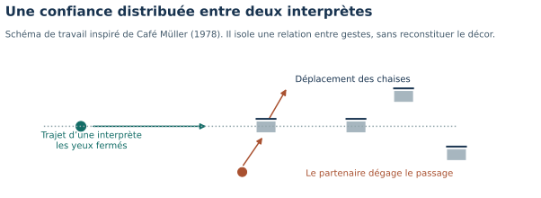

# BEL A/L — Études théâtrales 2026 · Corrigé brut

*Corrigé rédigé par IA, non officiel. Signalez toute erreur.*

**Rédaction** · modèle exact non renseigné (famille GPT-6) · effort non renseigné · vitesse non renseignée

**Révision** · modèle exact non renseigné (famille GPT-6) · effort non renseigné · vitesse non renseignée

**Lecture du rapport du jury** · GPT-6.2 Astra Ultra · vitesse non renseignée

**Révision** · GPT-6.2 Astra Ultra · vitesse non renseignée

**Révision (tour 3)** · GPT-6.2 Astra Ultra · vitesse non renseignée

**Sujet** — Jerzy Grotowski, le don de soi et la discipline formelle

## Introduction

Devant le corps de son fils, Mère Courage ne doit pas le reconnaître : un aveu la mettrait en danger avec ceux qui lui restent. Dans le jeu d’Helene Weigel, la douleur prend notamment la forme d’un cri muet. La bouche ouverte montre ce que la voix ne livre pas. Faut-il penser qu’une actrice se donne davantage lorsqu’elle crie effectivement, ou lorsqu’elle fait apparaître avec précision l’impossibilité de crier ? Ce choix éclaire la difficulté de la formule de Jerzy Grotowski. Dans *Vers un théâtre pauvre*, l’analogie avec l’amour associe le travail de l’acteur à une confiance et à une mise à découvert de soi. Or le même passage range parmi les conditions ou les manifestations de cet acte aussi bien « la transe » que « la discipline formelle ». Il fait aboutir l’excès au calme d’un apaisement. Se donner sur scène consiste-t-il à supprimer ce qui sépare le geste public de la vie intime ? Ou une forme maîtrisée peut-elle être la condition du risque qu’un acteur accepte de prendre devant d’autres personnes ? La réponse engage aussi le destinataire du don : le public qui assiste à cet acte n’acquiert pas pour autant un droit sur celui qui se produit devant lui.

## I. Donner de soi engage davantage que réussir à produire le signe convenu d’un affect

On peut frapper juste dans une convention de jeu et rester en réserve derrière sa réussite. La tête penchée, la voix brisée, un temps bien placé avant la dernière syllabe font reconnaître une scène de deuil. Le métier suffit parfois à reproduire l’effet dès que revient la même situation dramatique. Le « dépouillement » de Grotowski atteint d’abord les protections qu’offre ce savoir-faire. Il ne demande pas simplement moins de costumes ou moins de décors. L’acteur doit pouvoir se défaire d’un geste acquis lorsqu’il lui sert à ne plus rencontrer ce que la situation présente a d’incertain. La répétition visible d’un signe peut convenir à la lecture d’un personnage et laisser intacte la personne qui l’émet.

Le don change ainsi la relation entre ce qu’un interprète montre et ce qu’il risque. À la différence d’un produit livré contre rétribution, le geste se poursuit sous le regard d’un partenaire ou d’un public dont on ne possède pas la réponse. Le mot de « confiance » est ici décisif. L’acteur ne prend pas seulement le risque de déplaire. Il consent à agir avec quelqu’un sans pouvoir se réserver le dernier mot sur ce que cet acte fera aux deux personnes. En comparant cette initiative au don amoureux, Grotowski caractérise une manière de se tourner vers autrui. Cela ne commande pas de faire de chaque spectacle un récit de sa vie privée. Le don peut être une exposition de l’activité la plus personnelle quand la source intime de cette activité demeure inconnue de tous les spectateurs.

Le travail de Ryszard Cieślak pour *Le Prince constant*, créé à Wrocław en 1965 par le Théâtre Laboratoire, permet de préciser ce paradoxe. Le héros de Calderón, dans la réécriture polonaise de Słowacki travaillée par Grotowski, traverse une épreuve de captivité et de souffrance. L’acteur qui le joue construit sa grande séquence en mobilisant le souvenir personnel d’une expérience amoureuse, dont le sens diffère de celui du martyre représenté. Les spectateurs n’ont pas à deviner le souvenir pour voir l’offrande et la résistance du prince. L’écart entre celui qui agit et celui dont l’histoire se joue rend au contraire possible l’intensité de cette action. Cieślak peut investir une expérience précise qui lui appartient sans se charger de mimer à chaque instant l’idée générale de la douleur. Ce qu’il donne aux spectateurs est un acte accompli à partir de cette expérience. Ce qu’il garde pour lui en constitue une condition.

L’« intimité nue » ne se reconnaît donc pas au nombre d’aveux entendus, ni à la violence des signes extérieurs. Elle désigne la vulnérabilité de celui qui s’engage effectivement dans des actions dont aucune convention ne répondra à sa place. Mais si la valeur d’un jeu dépend d’un engagement que le public n’a ni la possibilité ni le droit de contrôler en remontant à la vie privée de l’acteur, comment cet engagement peut-il devenir une œuvre dont la forme soit partageable et répétable ?

## II. La discipline donne à cet engagement une forme que l’acteur peut reprendre et que d’autres peuvent éprouver

L’énumération de Grotowski se termine par une surprise grammaticale : la « discipline formelle elle-même » appartient à l’ordre du don. On s’attendrait plutôt à ce qu’il faille choisir entre laisser surgir un événement incontrôlé et exécuter une partition préparée. Or la concentration d’un interprète peut être d’autant plus entière qu’il dispose de repères sûrs. La reprise d’une impulsion corporelle, la durée d’une expiration, la direction d’une adresse et le moment où le partenaire pourra intervenir composent une suite d’actions déterminées. L’exactitude de cette suite permet de mesurer ce qui, dans la rencontre présente, lui donne soudain une qualité imprévue. Sans repère, on peut prendre la première émotion venue pour la vérité d’un soir. Sans disponibilité, l’exactitude se réduirait à la reproduction fidèle d’un exercice.

Le *Prince constant* montre pourquoi les deux exigences doivent tenir ensemble. La scène qu’interprète Cieślak peut être reprise devant d’autres témoins. Les impulsions ne sont pas jetées en désordre sur une trame littéraire qu’elles auraient vocation à faire oublier. Leur enchaînement précis, le travail de la voix et la relation spatiale entre le corps exposé et le groupe rendent lisible une progression. Le spectateur peut voir un corps pris dans des actions de contrainte, puis éprouver dans son maintien et son émission vocale une forme de liberté. D’un soir à l’autre, ce qui peut revenir est la possibilité d’accomplir cette progression, non l’identité d’un sentiment que l’acteur serait tenu de reproduire à heure fixe.

Le *Paradoxe sur le comédien* de Diderot permet de mesurer la difficulté autrement. La figure de Mlle Clairon lui sert à penser comment l’interprète compose un modèle, en règle les signes et en dispose assez librement pour retrouver, soir après soir, un effet maîtrisé. La sensibilité effectivement subie par l’acteur paraît à Diderot une garantie bien fragile de la sensibilité communiquée. Le rapprochement ne fait pas de Cieślak un interprète froid. Il révèle une exigence commune et un désaccord précis. Pour Diderot, la possibilité de répéter marque les limites qu’il faut imposer aux transports réellement éprouvés ; pour Grotowski, une partition est aussi ce qui permet à l’acteur de s’engager en personne au lieu de courir après le souvenir d’une émotion antérieure. Aucun des deux ne peut être réfuté en produisant un acteur qui pleure vraiment. Il faudrait savoir à quel moment de l’action, dans quelle forme et pour qui ces larmes prennent sens.

La « transe » demande dès lors une lecture prudente. Elle peut désigner le franchissement d’une retenue ordinaire par un travail du rythme, de la respiration et de l’attention. Dans le passage, elle voisine avec la discipline et avec l’humilité. Le sommet dont il est question n’est pas une compétition entre interprètes en quête de la dépense la plus spectaculaire. L’excès peut être celui d’une action qui va au-delà du point où l’acteur protégeait d’habitude son image. L’apaisement peut en être la conséquence parce qu’il n’y a plus à se regarder agir, à vérifier si l’on mérite l’admiration. Rien n’autorise pour autant à le promettre au public comme l’effet constant du spectacle. Ce que chacun en éprouve peut aller du calme au malaise.

## III. Un don théâtral suppose des partenaires libres et peut prendre la forme d’une réserve

Si cette lecture donne sa force à l’exigence de Grotowski, le vocabulaire de la totalité rencontre une limite. Une relation de travail lie aussi l’acteur au metteur en scène et à l’institution qui l’engage. Demander que disparaisse toute défense peut ouvrir une recherche consentie entre partenaires ; la même formule peut devenir une injonction à exposer ce que l’un d’eux souhaite garder. Un don exigible ne serait plus un don. Il importe donc de préciser ce qu’une direction d’acteurs peut légitimement demander : une action déterminée, une écoute, la reprise d’une partition convenue. Le degré de dévoilement intime ne saurait être un critère extérieur de réussite à mesurer à chaque répétition.

Les deux dernières phrases de Grotowski changent de sujet grammatical. Après les verbes qui engagent celui qui joue, c’est « cet acte » qui atteint un sommet et qui apporte l’apaisement. Le bénéficiaire de cet apaisement reste sans nom. En faire d’emblée la catharsis du spectateur importerait une théorie de la réception dans une proposition qui vient de décrire le travail de l’interprète. Une représentation peut ainsi mener l’acteur au terme exact de son action tout en laissant la salle dans l’inquiétude.

Un autre spectacle permet de saisir l’importance active des limites. Dans *Café Müller* (Pina Bausch, 1978), une interprète avance les yeux fermés au milieu des chaises. Un partenaire dégage précipitamment le passage. Le risque que perçoit le spectateur n’aurait pas la même qualité si l’espace était vide, ni si la personne pouvait contrôler du regard le déplacement de chaque obstacle. L’abandon apparent se compose de deux travaux au moins : confier le trajet à l’autre et dégager le trajet à temps. Le bruit des chaises heurtées ou déplacées rend audible la responsabilité de celui qui veille. La confiance annoncée par Grotowski trouve là une condition objective. Elle a lieu dans une relation réglée qui rend possible un risque partagé. Rechercher l’accident réel pour prouver que l’interprète s’est « donné totalement » détruirait la forme de coopération grâce à laquelle le danger devient perceptible sur scène.

Dans *Café Müller*, l’interprète qui ne voit pas les obstacles et le partenaire qui les déplace engagent leur attention de façon différente. Si le second intervenait après le passage de la première, la même dépense de mouvement perdrait toute sa portée. La confiance dont parle Grotowski prend ici une forme que le spectateur peut vérifier : elle se joue dans la coordination temporelle de deux actions.

Enfin le spectateur peut avoir à juger ce que l’interprète lui présente. Chez Brecht, dans *Mère Courage et ses enfants*, la réserve de Courage face au corps de Schweizerkas appartient à une conduite sociale déterminée. Reconnaître publiquement le mort exposerait les survivants. Quand Weigel donne à ce deuil la forme d’un cri sans son, le geste est à la fois un mouvement de douleur et une action située dans une économie de la guerre. La précision de sa forme ouvre une différence entre éprouver avec Courage et examiner les conditions dans lesquelles il lui faut agir. L’actrice offre au public la possibilité de ne pas se confondre avec elle. Ce qui se donne peut donc être aussi un intervalle laissé libre pour le jugement d’autrui.

Le don a dès lors deux limites qui le rendent théâtralement fécond. L’interprète reste libre de la source personnelle qu’il engage dans le travail, et le spectateur reste libre de la réponse qu’il apporte. Entre eux prend place une action réglée, refaite, transformée par d’autres actions et offerte à la perception. En un sens, l’acteur s’y engage tout entier : personne ne peut accomplir ce geste à sa place dans l’instant où il a lieu. En un autre sens, rien n’exige qu’il y livre son être entier comme une propriété que d’autres pourraient recevoir ou vérifier.

## Conclusion

L’exigence de Grotowski concerne la qualité de l’acte jusque dans les opérations les plus formelles. Cieślak montre comment une partition peut recevoir une impulsion intime sans en livrer le secret. Diderot permet de comprendre pourquoi le sentiment éprouvé n’atteste pas par lui-même la valeur du jeu ; Bausch et Weigel montrent ce qu’un partenaire et un spectateur doivent pouvoir faire d’une action qui leur est adressée. Le dépouillement prend alors un sens exigeant. Il débarrasse l’acteur des protections qui lui permettraient de simuler sa propre présence, tout en préservant les conditions de confiance, de précision et de liberté grâce auxquelles une personne peut se donner sur scène.
