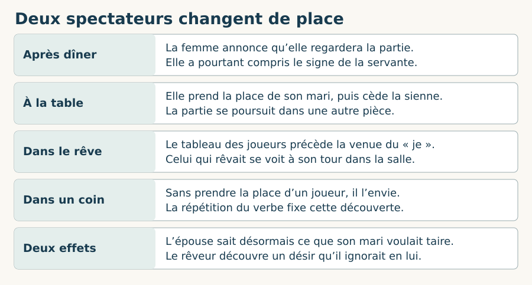
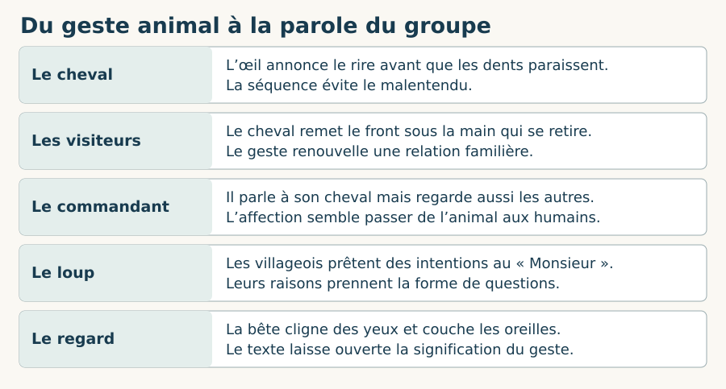

# BEL · AL — Français (oral option 16 juin) 2026 · Corrigé brut

*Corrigé rédigé par IA, non officiel. Signalez toute erreur.*

**Rédaction** · GPT-6.2 Astra Ultra · vitesse non renseignée

**Autocontrôle** · GPT-6.2 Astra Ultra · vitesse non renseignée

Les 12 billets réunissent chacun deux extraits à comparer sous un intitulé commun. Le jury demande de lire un bref passage à voix haute. Les pages indiquées sont celles de l’édition du concours.

## 1. Entrer dans le jeu

**Passages.** *L’Heptaméron*, nouvelle 59, p. 512-513, de l’après-dîner à la crainte du mari, et Baudelaire, « Le Jeu », p. 148-149.

Il y a au moins deux manières d’entrer dans un jeu. On peut prendre une place laissée libre à une table, mais aussi adopter les règles d’un autre, parfois à son insu. La nouvelle 59 exploite les deux sens. Le mari propose une partie de cent. Sa femme dit vouloir seulement regarder. Or elle sait déjà interpréter un signe de la servante auquel son mari ne comprend rien. Jouer à sa place quand il prétexte un mal de tête lui permet de sembler son alliée tout en lui laissant croire qu’il a du temps devant lui. Elle quitte ensuite la table à son tour sous un prétexte analogue. La partie véritable continue hors de la salle, dans une double scène d’observation. Derrière la porte, l’épouse entend son mari puis intervient. Sa peur finale est moins de perdre la partie que de perdre l’amitié de celle qui le connaît maintenant trop bien.

« Le Jeu » installe également son observateur à l’écart. Les trois premiers quatrains retardent l’apparition d’un verbe principal qui situerait ces corps dans un récit. Un luxe fané, des mains convulsées et des lumières sales composent tableau. L’apparition du rêveur change ensuite notre lecture. Celui qui se croyait clairvoyant se voit lui-même dans un coin de l’antre. Il n’engage pas d’argent, mais l’envie le fait entrer dans le jeu d’autrui. L’écho d’« enviant » entre deux strophes prolonge la surprise de reconnaître en soi une attirance pour une passion qui conduit à l’abîme. L’épouse, en figurant tour à tour comme spectatrice et joueuse, a acquis de la maîtrise. Le spectateur du rêve découvre au contraire ce qui manque à sa froideur jusque dans la passion infernale des autres.

**À lire à voix haute.** Chez Baudelaire, le quatrain où le rêveur se voit accoudé, puis le premier vers suivant. Suspendre la phrase sur « enviant » et écouter le mot reprendre.

## 2. Cécité

**Passages.** *L’Heptaméron*, nouvelle 6, p. 102-103, et Baudelaire, « Les Aveugles », p. 144-145.

Le valet de chambre de la nouvelle a perdu un œil avant que ne commence la ruse de sa femme. Cette distinction compte, car sa difficulté à croire une rumeur défavorable à celle qui lui témoigne de l’affection ne dérive pas naturellement de son infirmité. Il cherche même à savoir par une expérience. L’épouse lui raconte alors un rêve dans lequel il aurait recouvré la vue. Parce qu’elle couvre l’œil valide tout en l’invitant à vérifier l’état de l’autre, le rêve supposé transforme un manque ancien en aveuglement passager. La scène accorde toutefois au mari une capacité d’interprétation. Quoiqu’il n’ait pas vu l’amant sortir, il comprend la tromperie et le dit. Il reviendra vivre avec elle après ses excuses et les démarches de ses amis. Le dénouement déplace la question de la preuve vers la possibilité de continuer à vivre ensemble.

Le sonnet de Baudelaire commence par un ordre que le poète adresse à sa propre âme. Le lecteur est invité à regarder des êtres qui ne le regardent pas. Les analogies avec le mannequin et le somnambule, la brusquerie de l’adjectif initial, renseignent d’abord sur l’inquiétude de l’observateur. L’orientation des têtes se laisse décrire. Ce que les aveugles cherchent demeure inaccessible. Quand la cité prend la place du premier destinataire, ses cris de plaisir font entendre un autre défaut d’attention. Le poète finit lui-même par se traîner et se juge plus hébété que les passants aveugles. Le dernier vers va du geste visible à une question spirituelle qu’aucune voix ne résout. Le conte déjouait l’équivalence entre voir et comprendre en donnant la réplique au trompé. Le poème la déjoue en retirant à l’observateur voyant la dernière certitude sur les autres et sur lui-même.

**À lire à voix haute.** Les tercets du sonnet, en distinguant l’adresse à la cité, le retour du « je » et la question qui demeure ouverte.

## 3. Jeu de rôle

**Passages.** *L’Heptaméron*, nouvelle 26, p. 315-317, et Giono, *Un roi sans divertissement*, p. 165-167, du projet de Langlois à sa promesse d’une commande payée.

Le déguisement du seigneur d’Avannes doit résister à l’examen du mari. Le personnage achète des chevaux que celui-ci a toutes les raisons d’admirer et se montre assez compétent pour être engagé comme palefrenier. Son habileté réelle garantit une identité fausse. Une pression exercée en baisant la main de la dame suffit toutefois à lui faire reconnaître un geste de la danse. Elle entre à son tour dans le jeu, au point de paraître servante plutôt que maîtresse tant elle s’occupe des chevaux et des chiens. Le mari croit l’avoir mise à son service. Elle s’est servi de cette mission pour ménager la rencontre. À la fin, le retrait puis la reprise du masque rythment une occupation provisoire de la place d’autrui, que le narrateur qualifie d’usurpation.

Langlois distribue également des rôles en fonction d’aptitudes véritables. La femme à qui les trois visiteurs veulent rendre visite est effectivement une brodeuse très demandée. Mme Tim doit se présenter en mère qui prépare le mariage d’une fille, Saucisse en amie ou en tante. Langlois désire en apparence le rôle le moins important, celui de l’homme qu’une conversation sur les trousseaux ne saurait intéresser. C’est précisément la position dont il a besoin pour regarder la maison. Les conditionnels et les répliques proposées par avance signifient que l’extrait donne à lire une répétition, tandis que chez Marguerite on assistait à la représentation. Il faut enfin à cette feinte une commande réelle, payée et livrée. Langlois invoque la souffrance qu’éprouverait la femme en découvrant la supercherie. Les deux textes posent une question morale plus précise que celle du mensonge en général. Quelle dette contracte-t-on envers la personne dont on se sert comme partenaire d’un jeu auquel elle ignore participer ?

**À lire à voix haute.** Chez Giono, la distribution des trois rôles, y compris la phrase destinée à écarter poliment Langlois de la conversation.

## 4. Anéantissement

**Passages.** Baudelaire, « Le Goût du néant », p. 125-126, et Giono, p. 15-16, de l’arrivée de la neige à la question sur Chichiliane.

L’anéantissement a une durée. Le titre baudelairien suppose même qu’on en éprouve le goût, au moment où les anciennes saveurs disparaissent. Le locuteur se tourne vers un esprit qu’il traite d’abord comme un cheval épuisé et que l’Espoir refuse désormais de monter. Le passage de l’esprit au cœur, puis au « je », donne une voix à la conscience de sa propre extinction. Les apostrophes aux plaisirs privés de leur puissance et au printemps privé d’odeur font alterner les quatrains et les vers isolés qui en marquent l’arrêt. Quand le Temps engloutit le sujet minute par minute, la neige est d’abord un comparant. L’avalanche devient à la fin un interlocuteur auquel le poète peut encore adresser une question. Quelque chose en lui parle donc encore pour demander sa disparition.

Chez Giono la neige tombe réellement. Le narrateur compte les heures tandis que les négations éliminent tour à tour les bruits, les contours du monde, le village et jusqu’à la possibilité d’un refuge auprès de l’âtre. Cette soustraction se traduit pourtant par une extraordinaire fécondité d’images. Un geste aperçu à travers le givre ressemble à un métronome, les ombres font naître de fausses barbes et la lueur de la neige se colore d’un rose inquiétant. Une sorte de cosmologie de la poussière glacée remplace la distinction du ciel et de la terre. À la fin, les corps serrés dans un lit conservent un espace où imaginer d’autres couleurs. La question sur Chichiliane annonce aussi une limite du regard local. Le poème transforme une perte intérieure en paysage où l’on voudrait s’abolir. Le roman fait l’expérience inverse, il efface le paysage pour éprouver quelles images et quelles relations humaines peuvent encore donner lieu à un monde.

**À lire à voix haute.** Dans Giono, compter les heures jusqu’à l’allumage des lampes, puis faire entendre le changement de rythme lorsque disparaissent terre et ciel.

## 5. Animalité et humanité

**Passages.** Giono, p. 92-94, le cheval noir de Langlois, et p. 141-143, des interrogations sur le « Monsieur » au mouvement de ses oreilles.

Le premier portrait affirme une exception que la voix du village prend soin de prouver. Ce cheval sait rire. Il en avertit par son œil avant que ses dents ne risquent d’être prises pour l’annonce d’une morsure. Il choisit ses visiteurs, distribue ses signes d’affection et insiste lorsqu’une main se retire. Le comique du pas dansant et l’hennissement qui ressemble au roucoulement d’une colombe compliquent la simple attribution d’une faculté humaine à un autre vivant. Le cheval invente des moyens d’être compris. La petite parole de Langlois, exprimée au féminin alors qu’il s’agit bien d’un mâle, semble aussi s’adresser par-dessus son compagnon à tous ceux que regarde le commandant. Autour de cet animal, les villageois osent reconnaître chez Langlois un besoin d’aimer qu’il ne leur déclare jamais directement.

Le loup de l’autre passage reçoit le titre de « Monsieur ». Le groupe lui attribue tour à tour ruse, instruction supérieure, peut-être même acceptation anticipée de la mort. La suite des interrogations signale le caractère hypothétique de cette psychologie. Les humains en viennent à se demander s’ils sont eux-mêmes les dindons d’une farce. Lorsqu’ils aperçoivent enfin le loup, sa réponse visible se réduit à un regard, à un clignement sous les torches, au mouvement des oreilles. Le premier épisode interprétait avec confiance des gestes grâce à la répétition d’une vie commune. Dans le second, une rencontre unique oppose à la profusion des discours humains l’économie extrême d’une présence. Il serait arbitraire d’en décider le secret. Ces deux animaux dessinent ainsi deux limites du langage des villageois, capable de rendre sensible une affection partagée et tenté de reconnaître sa propre angoisse chez un être qui le regarde sans parler.

**À lire à voix haute.** Les dernières phrases sur le loup. Laisser au dénuement des gestes le temps de produire son effet après la cérémonie bruyante qui les précède.

## 6. Grandeur des exilés

**Passages.** Baudelaire, « Bohémiens en voyage », p. 63-64, et « Le Cygne », deuxième partie, p. 137-138, depuis « Paris change ! ».

Dans le premier sonnet, une tribu s’est déjà mise en marche. Les mères nourrissent les enfants, les hommes suivent à pied et tournent leurs regards vers le ciel. La grandeur de cet ensemble ne tient ni à l’aisance ni au prestige. La fatigue des yeux et le regret des chimères accompagnent un déplacement qu’aucune destination géographique ne vient conclure. Un changement de point de vue, dans les tercets, fait du grillon le spectateur des passants et de Cybèle leur protectrice. Le désert se couvre de fleurs, le rocher fait jaillir de l’eau. Le titre du billet invite à interroger l’ouverture finale des ténèbres futures à ceux pour qui elles seraient familières. L’imaginaire prophétique du poème confère une majesté à ceux que la ville ne voit pas en son centre. Il ne prétend pas décrire une communauté par une enquête.

Dans la seconde partie du « Cygne », le premier exil est éprouvé par un habitant qui demeure sur place. La transformation de Paris livre au promeneur l’image de ce qui a cessé d’exister. Sa mélancolie fait revenir le cygne à la fois ridicule et sublime, Andromaque captive puis remariée, la femme africaine malade que le brouillard parisien sépare de son pays. Leurs situations ne sont pas interchangeables. La reprise de « Je pense » les réunit par la puissance d’une mémoire capable de passer d’une image singulière à tous ceux qui ont perdu un être ou un lieu irremplaçable. L’appel du cor dans la forêt de l’esprit se prolonge en une liste que le dernier vers laisse ouverte. Le premier poème agrandissait la marche d’un groupe jusque dans la nature qui l’accueille. Le second donne une place dans l’élégie à ceux dont l’exil pourrait rester sans témoin.

**À lire à voix haute.** Le dernier quatrain du « Cygne ». Marquer la reprise de « Je pense » et l’ouverture produite par les mots qui suivent le dernier groupe nommé.

## 7. Traques

**Passages.** Giono, p. 70-72, de la marche de l’homme jusqu’à ceux qui bénéficient des conséquences des morts anciennes, et p. 133-134, des félicitations du groupe à son attente au fond de Chalamont.

Les deux poursuites ont une structure narrative opposée. Dans le premier extrait, le lecteur est placé auprès de celui qui voudrait rester invisible. Frédéric II éprouve une intensité nouvelle dans les bruits et les odeurs d’un pays familier, tandis que l’homme qu’il observe semble aller à un but connu sans même tourner la tête. La séparation entre les deux tient autant à la différence de leur expérience qu’à la distance qui les sépare. Le roman fait entendre par avance comment Frédéric racontera ce moment. L’image d’un « souvenir renard » traduit une transformation de ses perceptions, celle de Colomb suggère un pays à réinventer par le récit. Puis le narrateur désigne ce qu’il ne dira pas. L’intérêt de la poursuite a déjà relégué bien loin le visage de Dorothée. L’allusion à Jeanne d’Arc et à Louis XVI met en cause avec une ironie sombre la facilité avec laquelle les vivants s’accommodent d’une mort devenue de l’histoire.

Le second extrait s’ouvre sur une satisfaction collective et sur la parole assurée de Pierre. Mais la répétition du verbe marcher, qui finit par prendre le monde lui-même pour complément, donne une portée inquiétante à cette apparente réussite. Le mur de Chalamont est le terme connu du déplacement. Ce qui sera découvert devant lui reste à nommer. Les subordonnées hypothétiques soumettent successivement les informations d’autrui, l’interprétation des signes et le bon fonctionnement des yeux à plusieurs conditions. Dans le premier cas, l’homme qui croit gagner une connaissance du monde oublie une personne à qui cette connaissance importait. Dans l’autre, un groupe sûr de son organisation découvre combien son savoir dépend encore d’une réalité qu’il n’a pas vue.

**À lire à voix haute.** Les dernières phrases du second extrait, en marquant les trois hypothèses et le délai qu’elles font subir à l’annonce finale.

## 8. Parole collective

**Passages.** *L’Heptaméron*, nouvelle 5, p. 98-100, et Giono, p. 16-17, de la neige autour du 16 décembre à la discussion sur le mot « belle ».

La foule de la nouvelle se forme à l’appel d’une femme qui a échappé à deux religieux et qui s’adresse à son mari et aux gens de justice. Elle sait pourquoi elle refuse de leur faire à nouveau confiance. Au village, les uns dénoncent la contradiction entre les prêches et les actes, les autres reprennent des images évangéliques de l’hypocrisie. Une troisième voix invite à reconnaître les arbres à leurs fruits. Ces paroles distinctes jugent ensemble ceux qui enseignaient la vertu aux autres. Mais le rire et l’attrait du spectacle accompagnent aussi cette réappropriation du langage moral. La foule ne prononce pas de sentence. Le juge remet les religieux à leur gardien, et une chute comique transforme leurs futures traversées en occasions de prière.

Chez Giono, la voix du village se constitue autour d’une absence. Le décompte de la neige aboutit à un soir dont le jour exact demeure incertain. La disparition de Marie Chazottes est en revanche établie. Des répliques sans étiquette, l’évocation des dernières paroles entendues par sa mère et les informations sur les recherches font apparaître ce que la communauté peut savoir ensemble. Le récit fait aussi entendre les limites de ce savoir. L’âge de Marie oscille entre deux nombres, les histoires se multiplient et l’épithète « belle » nous en apprend bientôt davantage sur les critères locaux que sur le visage de la disparue. Les deux textes font donc place à une parole capable de secourir ou de défendre, sans en faire une autorité infaillible. Chez Marguerite, la foule reconnaît des fautes par des paroles qu’elle a en commun. Chez Giono, les mots les plus communs sont précisément ceux qui risquent de recouvrir la singularité d’une personne.

**À lire à voix haute.** Dans Giono, la courte série de répliques qui suit l’annonce de la disparition. Distinguer les inflexions sans inventer de nom pour ceux qui parlent.

## 9. Maladies d’amour

**Passages.** *L’Heptaméron*, nouvelle 9, p. 117-118, de la préférence accordée à un prétendant plus riche à la réponse du malade, et nouvelle 26, p. 323-325, du conflit entre Amour et Honneur à l’étreinte finale.

Dans la nouvelle 9, le mal du jeune gentilhomme a une histoire sociale. La préférence des parents pour le prétendant le plus riche lui retire la perspective d’épouser celle qu’il aime. Sa beauté semble disparaître sous un masque. Le dépérissement manifeste de l’extérieur une souffrance qu’il cherche à cacher, même à la jeune fille. Le récit nuance ensuite la responsabilité des parents. La mère se serait volontiers décidée autrement que la famille paternelle. Elle vient avec sa fille et promet le mariage si le malade guérit. La vue de la jeune femme lui a un instant rendu des forces, mais il juge cette promesse trop tardive pour être crédible. Le pouvoir prêté à la parole dépend ainsi du moment où elle arrive et de la confiance que l’on peut encore lui accorder.

La femme de la nouvelle 26 souffre aussi de ce qu’elle a tu. Ici, elle a refusé de manifester sa passion pour d’Avannes afin de protéger une conscience et un honneur auxquels elle tient. Le froid des extrémités et la fièvre intérieure traduisent dans le langage médical de l’époque le conflit que le récit personnifie. Les médecins reconnaissent les limites de leur savoir. Le mari lui-même écrit alors à d’Avannes. La malade peut enfin expliquer que l’affection était réciproque, en rappelant expressément que les exigences sociales d’honneur diffèrent pour les hommes et pour les femmes. Sa parole reste celle d’un personnage, notamment lorsqu’elle interprète sa souffrance à l’aide du vocabulaire du purgatoire. Un geste d’une grande force dans de faibles bras clôt le passage. Les deux extraits font apparaître, à travers les conventions du récit amoureux, le prix corporel et moral d’une parole empêchée.

**À lire à voix haute.** La réponse du jeune homme à la promesse maternelle dans la nouvelle 9. Mettre en relief le contraste entre le présent et les trois mois à jamais perdus.

## 10. Antithèses

**Passages.** Baudelaire, « Réversibilité », p. 92-93, et « Alchimie de la douleur », p. 126-127.

Pour faire entendre une antithèse, il faut parfois attendre l’effet que lui réserve la fin d’un poème. Dans « Réversibilité », chaque quintil s’ouvre par une adresse à un ange qualifié par sa joie, sa bonté, sa santé ou sa beauté. La question qui suit le confronte à la souffrance inverse, dont les vers intermédiaires donnent une image souvent brutale. La répétition du premier vers à la fin du quintil interdit d’oublier que celui qui parle et celle à qui il s’adresse n’occupent pas la même place. Au dernier quintil, le souvenir de David pourrait faire de l’être aimé la source d’une vigueur physique recouvrée. La demande réelle porte seulement sur ses prières. Le contraire n’a donc pas été choisi pour annuler le mal. Une possibilité de relation et d’intercession se dégage des antithèses sans supprimer la distance entre les êtres.

Le sonnet « Alchimie de la douleur » commence au contraire par partager une même nature entre deux manières de la percevoir. Ce qui annonce la sépulture à l’un promet à l’autre la vie et la lumière. La révélation du pouvoir du « je » aggrave l’écart. Assisté d’un Hermès aussi inquiétant qu’inconnu, il est l’égal de Midas, mais transforme l’or en fer et le paradis en enfer. Les correspondances des tercets convertissent les nuages en suaire et les rivages célestes en lieux où bâtir des tombeaux. La douleur produit des formes avec une implacable continuité. L’antithèse du premier texte permettait d’adresser une prière à quelqu’un qui diffère de soi. Celle du second sert à comprendre comment une seule voix transforme tout ce qu’elle voit dans le sens de sa propre douleur.

**À lire à voix haute.** Les deux quatrains d’« Alchimie de la douleur ». Distinguer le dialogue imaginaire des deux interprètes de la nature et l’adresse à Hermès qui concerne le seul locuteur.

## 11. Vengeur et vengeresse

**Passages.** *L’Heptaméron*, nouvelle 36, p. 379-380, et nouvelle 58, p. 506-508, jusqu’aux mots qui laissent l’affaire « en doubte ».

Le président et la dame de cour ont tous deux besoin de témoins. Mais le premier veut être vu aimant son épouse, tandis que la seconde veut être vue triomphant d’un homme qui fait profession de se moquer des femmes. Dans la nouvelle 36, le président règle l’apparence publique de son ménage après avoir découvert la trahison. Ses fêtes frappent les voisins, sa femme doit paraître au bal, Nicolas lui-même doit danser avec elle. Un ordre bref, prononcé à l’oreille, bannit ensuite l’homme que les invités viennent de voir favorisé. La mort de l’épouse, dont le président est responsable, sera interprétée à la lumière de ces manifestations de tendresse et de son deuil apparent. Le narrateur appelle cela sauver l’honneur de sa maison. Le décalage entre ce jugement et le sort des deux personnes expose une conception de l’honneur où sauver les apparences autorise une injustice radicale.

La vengeresse de la nouvelle 58 s’adjoint deux princesses qui comprennent sa plainte et souhaitent prendre part au renversement d’un rapport de force. Les allées et venues du gentilhomme donnent aux observatrices, placées à différents étages, un spectacle de comédie. L’appel au voleur se propage comme une réplique de théâtre. Sa signification précise n’est accessible qu’à celles qui connaissent le rendez-vous. Mais la victime de cette plaisanterie reprend ensuite l’initiative par le récit. Il soutient avoir deviné la ruse et joué pour le plaisir de la dame. Les témoins récusent cette version, sans que le texte autorise à trancher définitivement. Dans la première nouvelle, le lecteur en sait plus que le voisinage sur une mort irréversible. Dans la seconde, l’incertitude des intentions laisse au moqué une possibilité de réplique. Le féminin du titre ne suffit donc pas à rendre les deux pouvoirs symétriques.

**À lire à voix haute.** La fin de la nouvelle 58, de la prétention du gentilhomme à avoir deviné la ruse jusqu’au doute du narrateur.

## 12. Saines lectures

**Passages.** *L’Heptaméron*, prologue, p. 62-63, de la question adressée à Oisille à l’évocation des auteurs inspirés des psaumes, et Giono, p. 10-12, d’un itinéraire vers les V. aux vacances du jeune Amédée.

Qui peut attester les effets d’une lecture ? Dans le prologue, le groupe attend un remède à l’ennui de l’attente. La veuve Longarine y ajoute le risque de devenir insupportable aux autres, et la réponse enjouée d’Ennasuite fait déjà entendre plusieurs façons de supporter un deuil. Oisille prend la question au sérieux. Sa médication est la lecture des Écritures. Elle répond par le récit d’une pratique quotidienne, de la lecture de la bonne nouvelle à la contemplation puis au chant des psaumes. Le cœur et la bouche participent ensemble à une joie que l’âge n’annule pas. La santé de l’esprit et celle du corps sont liées dans son expérience. Son témoignage laisse entendre pourquoi les autres lui reconnaissent une autorité, même si leurs besoins et leurs manières de parler diffèrent.

Chez Giono, un narrateur nous conduit vers une maison dont un jeune habitant, Amédée V., a été aperçu lisant *Sylvie* de Nerval. L’itinéraire paraît précis. Les rectifications sur la saison de la visite, le temps du verbe ou la ville où étudie le jeune homme restreignent pourtant le témoignage à ce que le visiteur a réellement vu. Le contraste entre le livre, l’effroi que les murs de la ferme semblent éprouver et un paysage terrestre décrit comme une mer déchaînée devient une énigme. Le narrateur trouve ce livre singulier en pareil lieu. Il ne donne pas accès à l’expérience intérieure du lecteur. Le premier texte nous faisait entendre ce que la lecture produit chez celle qui la pratique et qui prend la parole. Le second ne peut déduire cette expérience de la place d’un livre dans un décor. Pour décider qu’une lecture est saine, il faudrait savoir pour qui elle l’est, de quelle manière et selon quel témoin.

**À lire à voix haute.** Chez Giono, la reprise du titre de Nerval près des roses trémières, suivie du retour à l’imparfait du témoin qui se souvient et précise ce qu’il ignore.

[Billets du jury](https://www.ens.psl.eu/sites/default/files/sujets_du_16.06.2026_-_option_lettres_modernes1.pdf) · [Rapport du jury](https://www.ens.psl.eu/sites/default/files/2026_al_rapport_oral_francais_option.pdf) · [Édition de 1559 de L’Heptaméron](https://fr.wikisource.org/wiki/L%E2%80%99Heptam%C3%A9ron_des_nouvelles_(1559)/Texte_entier) · [Édition Le Roux de Lincy et Montaiglon](https://fr.wikisource.org/wiki/L%E2%80%99Heptam%C3%A9ron_des_nouvelles) · [Les Fleurs du mal, 1861](https://fr.wikisource.org/wiki/Les_Fleurs_du_mal_(1861)/Texte_entier) · [Un roi sans divertissement](https://www.ebooksgratuits.com/details.php?book=3306)
