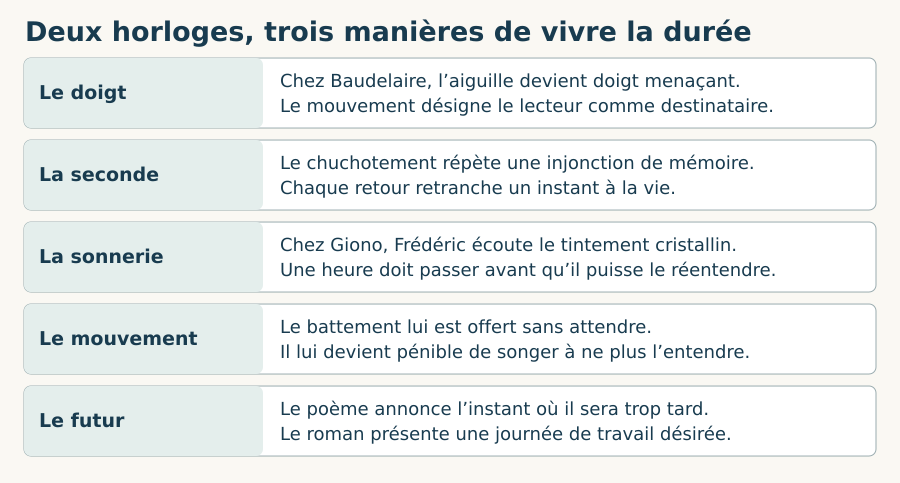
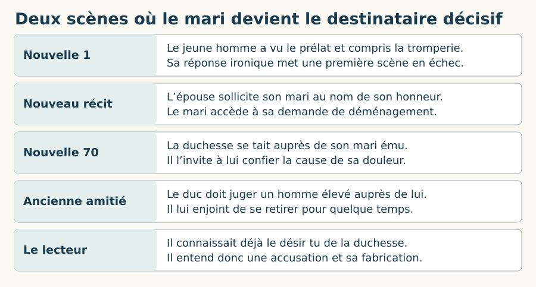

# BEL · AL — Français (oral option 18 juin) 2026 · Corrigé guidé

*Corrigé rédigé par IA, non officiel. Signalez toute erreur.*

**Rédaction** · GPT-6.2 Astra Ultra · vitesse non renseignée

**Autocontrôle** · GPT-6.2 Astra Ultra · vitesse non renseignée

Les 11 billets réunissent chacun deux extraits à comparer sous un intitulé commun. Le jury demande de lire un bref passage à voix haute. Les pages indiquées sont celles de l’édition du concours.

## Préparer les vingt minutes puis répondre au jury

Les onze couples ci-dessous appartiennent à onze billets distincts. Pour le billet reçu, relever d’abord le détail dont dépend la comparaison. Ainsi, au billet 5, l’endroit où s’arrête la nouvelle 56 change ce que le lecteur peut attribuer à la mère. Au billet 10, les incises rendent perceptible la distance entre Frédéric et celui qui raconte. Annoncer à l’auditoire le bref passage que l’on va lire, puis reprendre dans le commentaire un son, une interruption ou un mot que cette lecture a fait entendre.

| Billet | Question de relance | Réponse possible |
|---|---|---|
| 1 | Les sons décisifs sont-ils toujours les derniers ? | Les cloches de Baudelaire précèdent une défaite silencieuse et intérieure. Giono quitte les appels des cors pour une défense parlée du cérémonial. |
| 2 | Le rideau qui se lève satisfait-il la curiosité ? | Il livre bien une expérience, celle d’être mort, sans mettre fin à l’attente. Chez Giono, les effets de la conversation se voient aussi plus aisément que son contenu. |
| 3 | Pourquoi le lit des deux amis devient-il comique ? | L’idéal d’unité va jusqu’au lit partagé après le mariage. La précision sur la place du mari manifeste une séparation corporelle que les formules d’amitié masquaient. |
| 4 | À quoi doit servir la définition de l’épouse recherchée ? | La veuve cherche une garantie pour sa fille. Saucisse veut obliger Langlois à expliciter son désir. Une liste de qualités peut-elle attester une sincérité ou susciter un désir ? |
| 5 | La mère a-t-elle déjà vu la tonsure au dernier mot de l’extrait ? | Non. Elle réfute encore le soupçon de sa fille. L’arrêt à cet instant maintient l’écart entre certitude du lecteur et confiance d’un personnage. |
| 6 | Pourquoi « Recueillement » donne-t-il des balcons aux Années ? | Le poème rend le passé visible, presque spectateur. Dans « Le Balcon », l’espace du souvenir se recompose à l’adresse de la femme aimée. |
| 7 | Qu’offrent les deux clefs de l’horloge de Giono ? | L’une rend possible la sonnerie, rare et attendue, l’autre le battement toujours disponible. La même horloge donne deux expériences distinctes de la durée. |
| 8 | Pourquoi le texte poétique revient-il deux fois au même refus de comparer ? | La première reprise donne la préséance aux yeux de la personne aimée. La seconde passe du reflet encore visible à la salive qui entraîne le sujet et l’absorbe. |
| 9 | Pourquoi la duchesse laisse-t-elle son mari solliciter l’aveu ? | Sa réticence donne du crédit à la dénonciation et associe le mari au récit dont il va subir les effets. L’extrait s’arrête à une mesure provisoire. |
| 10 | Qui peut dire si Frédéric a été heureux ? | Le narrateur attribue au personnage un bonheur que celui-ci, selon lui, tairait même s’il pouvait le connaître. Les parenthèses distinguent le témoignage rétrospectif de son interprétation. |
| 11 | Qui parle au terme du sonnet sur la pluie ? | Un valet et une dame d’un jeu de cartes. Leurs amours défuntes prolongent dans cet espace infime la mortalité annoncée à l’échelle de la ville. |

## 1. Angoisse

**Passages.** Baudelaire, quatrième « Spleen », p. 124-125, et Giono, *Un roi sans divertissement*, p. 117-118, de l’éloge des cors au jugement sur le cérémonial de Langlois.

L’angoisse semble d’abord venir du dehors. Le ciel pèse sur l’esprit chez Baudelaire et les cors résonnent à travers les bois chez Giono. Or ces deux bruits ne franchissent pas de la même façon la limite entre espace et conscience. Les trois premiers quatrains de « Spleen » accumulent des subordonnées introduites par « Quand ». Le couvercle, les murs, le plafond et les barreaux de pluie enferment les lecteurs dans une phrase qui ne trouve pas son issue. La chauve-souris figure une Espérance dont les mouvements ne font qu’éprouver les limites du cachot. Après le silence des araignées, les cloches qui hurlent semblent enfin produire une décharge. Pourtant le dernier quatrain substitue un cortège silencieux dans l’âme à ce bruit extérieur. De la pluralité des cerveaux au crâne singulier, l’espace commun se referme sur un sujet vaincu. Le drapeau de l’Angoisse transforme l’expérience intérieure en scène d’occupation.

Les cors de Giono produisent un dialogue. À l’appel angoissé répond une voix plus angoissée encore. Les sons sont personnifiés et se communiquent à travers un espace ouvert, avant que la parole familière du narrateur ne rabatte cette grandeur sur la pompe militaire. L’ouverture admirative a également une justification pratique, dans la mesure où les sonneries suspendent momentanément un danger. C’est surtout la longue défense des rites du village qui en déplace le sens. Entre baptême, fête, moisson et partage du pain, chacun connaît des gestes dont l’absence serait immédiatement remarquée. Les questions finales proposent de reconnaître dans les travaux qui touchent à la mort un cérémonial plus indispensable encore. L’angoisse baudelairienne consacre une défaite dont le sujet demeure le théâtre. Dans les bois, l’angoisse fait entendre une communauté qui lui donne une forme et reconnaît Langlois pour maître de cérémonie, sans prétendre qu’il l’a définitivement dissipée.

**À lire à voix haute.** La fin du troisième quatrain et le quatrième de « Spleen ». Attendre l’arrivée des cloches après les subordonnées pour faire éprouver le brusque accès du son.

## 2. « La vérité, l’âpre vérité »

**Passages.** Baudelaire, « Le Rêve d’un curieux », p. 185, et Giono, p. 103-104, de la maxime sur la perception partielle aux effets d’une décision encore inconnue.

La formule, placée en épigraphe du *Rouge et le Noir*, semble promettre que la vérité sera désagréable mais utilisable. Les deux extraits interrogent précisément le désir d’obtenir une révélation entière. Le sonnet s’adresse à quelqu’un dont la curiosité pourrait ressembler à celle du locuteur. Celui-ci raconte sa mort comme une expérience faite de couples contradictoires, douleur et saveur, désir et horreur. L’épithète « âpre » se rapporte dans le poème à la torture d’attendre, aussitôt dite délicieuse. La comparaison de l’enfant devant un théâtre installe le rideau comme obstacle provisoire. Dans les tercets, le lexique de l’aube et du dévoilement annonce la fin du suspens. Or le dernier vers juxtapose la toile déjà levée et une attente qui dure encore. La « vérité froide » n’a pas la forme d’une réponse à la hauteur du désir qu’elle avait suscité.

Chez Giono, les villageois commencent par avouer qu’on n’aperçoit jamais l’ensemble d’une situation. Ils tentent tout de même de comprendre ce qui lie Langlois et le procureur. Les informations passent par Saucisse, par des paroles rapportées avec précaution, puis par des hypothèses sur des affaires de bois ou de peaux. La sentence du procureur, selon laquelle la vérité vaut pour tout le monde, semble à la fois une banalité et un avertissement sur ce qui pourrait arriver à chacun. L’humour du commentaire ne résout pas la portée de la formule pour Langlois, qu’elle déride. Une phrase entendue par Saucisse puis les effets perçus un mois plus tard établissent qu’une décision a vraisemblablement été prise, sans en offrir une transcription. Chez Baudelaire, la révélation la plus radicale laisse intacte l’attente de son sens. Chez Giono, le savoir collectif se constitue par indices et par retours, et demeure plus solide sur les effets que sur l’intention. Les deux lectures conduisent à distinguer la vérité d’un fait et l’histoire que l’on voudrait lui faire raconter.

**À lire à voix haute.** Les deux tercets du « Rêve d’un curieux », en donnant à la question finale son étonnement puis à l’imparfait sa durée.

## 3. De l’amitié

**Passages.** *L’Heptaméron*, nouvelle 47, p. 448-449, et Giono, p. 154-155, depuis l’évocation de Mme Tim jusqu’à la repartie de Saucisse sur sa tenue.

« De » annonce un objet à définir, presque le titre d’un traité. Les deux récits le mettent à l’épreuve des conduites et des commentaires. Près du Perche, deux gentilshommes donnent à voir l’idéal d’unité parfaite par une accumulation. Cœur, maison, lit, table et bourse semblent n’appartenir qu’à une personne. Le mariage ne devrait pas briser la communauté, mais une précision comique concernant la place du mari au milieu du lit donne une limite concrète à cette fusion. À l’épouse, il est demandé de traiter presque en tout l’ami comme le mari, à une exception près. Or le mari conçoit un soupçon sans cause et interdit désormais la parole privée entre les deux autres. À la borne du passage, l’ami lui demande de dire ce qu’il sait afin de protéger le lien qu’ils ont longtemps entretenu. La loyauté qui commandait de ne rien se cacher devient une obligation difficile dans une relation à trois.

Dans Giono, l’amitié est tout aussi affirmée et tout aussi difficile à prouver. Les villageois répètent qu’entre Mme Tim et Langlois il s’agit bien d’amitié. L’insistance, les adresses au public et les questions révèlent combien leur interprétation demeure incertaine. Deux êtres qualifiés par des images contrastées se promènent côte à côte, presque sans parole ni regard frontal. L’apparente simplicité des gestes laisse perplexes ceux qui les regardent. Le récit fait alors intervenir une autre voix. Saucisse, questionnée sur sa robe et sa place de troisième dans la promenade, défend une amitié fondée sur l’expérience du monde, antérieure à ces sorties. Sa repartie sur l’allure d’une tenancière récuse le jugement de classe et de convenance inséparable des observations du village. Dans la nouvelle, un contrat d’intimité placé sous le signe de l’unité se trouble de l’intérieur. Chez Giono, c’est d’abord l’entourage qui cherche une explication à une intimité dont le silence pourrait être l’expression la plus juste.

**À lire à voix haute.** Dans la nouvelle 47, la liste initiale des biens en commun puis la précision concernant la place du mari dans le lit. Les pauses rendent sensible la faille au cœur du modèle.

## 4. Le beau mariage

**Passages.** *L’Heptaméron*, nouvelle 56, p. 495-496, et Giono, p. 210-211, dans la suite de la discussion sur la future épouse de Langlois.

Une union est-elle belle par le rang, l’amour, le confort ou l’histoire qu’on en raconte avant même qu’elle existe ? La mère de la nouvelle 56 cherche d’abord pour sa fille un mari qui puisse vivre avec elles en paix et en conscience. Le lecteur apprend son goût pour des avis de docteurs censés légitimer toute décision. Le confesseur sait traduire l’argent et l’entretien proposés en avantage personnel et en bénéfice pour son jeune compagnon. La narration présente leur intérêt au lecteur avant le grand discours de recommandation. La référence à Raphaël conduisant Tobie donne à la rencontre fabriquée le prestige d’une providence biblique. Le récit d’un jeune noble fugitif explique commodément la discrétion et l’absence quotidienne du prétendu étudiant. L’accord de la mère puis la cérémonie de nuit font advenir socialement une union dont le lecteur connaît la fraude. Ce qui est beau aux yeux de la mère est précisément la cohérence trompeuse de l’arrangement.

Chez Giono, le dialogue entre Langlois et Saucisse part au contraire de l’objection à l’épouse convenable. Le portrait en pied condense la hantise d’une vie dont les meubles et les regards fixeraient définitivement l’homme au centre. Langlois demande une maison tenable sans se laisser entourer, et Saucisse repense à l’intérieur de la brodeuse. Leur logique n’est jamais celle d’une simple sélection sur catalogue. Le travail d’aiguille rythme les silences et l’expérience de Saucisse l’autorise à négocier l’âge, la connaissance du monde et les attentes de la future femme. Les chiffres de la fin contrastent avec le poids des non-dits. Chez Marguerite, le médiateur possède un intérêt que son éloquence doit cacher à la famille. Chez Giono, la médiatrice comprend ce que son ami voudrait taire et se garde de le lui faire formuler en entier. Les deux extraits s’achèvent sur une séparation matérielle ou verbale qui laisse ouverte la vie réelle que ces paroles ont voulu préparer.

**À lire à voix haute.** Chez Giono, l’échange sur l’intérieur et sur le refus d’être entouré. L’allusion à un ameublement précis donne au mot un sens plus inquiétant que celui du seul confort.

## 5. « L’habict ne fait pas le moyne »

**Passages.** *L’Heptaméron*, nouvelle 48, p. 454-455, puis nouvelle 56, p. 496-498.

Le proverbe du titre est lui-même varié dans la première page. L’habit peut ne pas faire le moine et même, quand l’orgueil s’y attache, le défaire. Il ne s’agit pas d’énoncer une incrédulité universelle. Les devisants discutent de la légitimité de revenir encore sur les défauts des religieux, Oisille se lassant de ces histoires. À quoi bon privilégier les moines, si dames, princes et gentilshommes ont également fourni des exemples ? La métaphore du bouquet varié défend la diversité du recueil. La règle que donne Oisille situe le but ailleurs que dans la honte des individus. Reconnaître l’imperfection des créatures devrait conduire à réserver la confiance absolue à Dieu. Ainsi une discussion sur l’habit réforme aussi l’idée que le groupe se fait de sa propre activité de conteur.

La nouvelle 56 donne au proverbe une réalisation matérielle subtile. Le pourpoint de satin cramoisi, la robe et la coiffe noire font paraître le jeune cordelier comme un époux de bonne condition. Le déplacement quotidien entre les deux maisons matérialise le changement d’identité. Le narrateur, qui rappelle le versement des ducats au père confesseur, sait ce dont le costume protège la vue. Un jour, pendant l’office, la fille voit le prêtre se retourner au salut liturgique. La succession des regards donne le temps de passer d’une ressemblance à une inquiétante certitude. Sa mère, qui n’a pas encore regardé avec la même attention, juge qu’il serait presque sacrilège d’ajouter foi à un tel soupçon. À cette borne, il serait prématuré de raconter comme déjà vue la tonsure qui confirmera le soupçon un peu plus loin. Le contraste porte donc sur deux mouvements du jugement. Le devis démonte l’autorité d’un signe extérieur. La nouvelle fait vivre le temps pendant lequel deux costumes incompatibles gardent encore, aux yeux de la mère, leur pouvoir de conviction.

**À lire à voix haute.** La réponse de la mère à sa fille dans la nouvelle 56, à la fin du passage. Son assurance sonore peut faire entendre la fragilité d’une conviction dont le lecteur connaît l’erreur.

## 6. « Le charme des soirs »

**Passages.** Baudelaire, « Le Balcon », p. 84-85, et « Recueillement », p. 199. La formule du sujet se lit dans le premier quintil du « Balcon ».

Charmer signifie produire du plaisir, mais aussi soumettre par le pouvoir d’une parole rythmée. Dans « Le Balcon », le locuteur convoque la femme aimée comme gardienne et destinataire d’une mémoire commune. La chaleur du charbon et les vapeurs roses ne peignent pas seulement un soir. Le pluriel des soirs et les reprises du premier vers à la clôture de chaque quintil instaurent le retour réglé d’instants que la vie ne peut littéralement rendre. La nuit épaissie comme une cloison accroît paradoxalement l’intimité des corps. Voir devient deviner, respirer et boire se rejoignent. Pourtant la fin soumet à une interrogation le pouvoir de faire renaître ces moments. La dernière reprise substitue l’apostrophe à la certitude d’un retour. Le poète peut faire entendre des serments et des parfums sans garantir que le passé renaisse.

« Recueillement » part lui aussi d’une adresse, mais c’est la Douleur personnifiée que le poète prie de se calmer puis de lui donner la main. Le jour qui baisse ne fait pas le même effet à tous. Au tumulte d’une foule qui cherche le Plaisir répond le mouvement à l’écart du couple formé avec sa peine. Les Années apparaissent sur des balcons devenus célestes, vêtues de leurs robes démodées. Le Regret peut sourire et le Soleil se coucher comme un mourant. À mesure que la parole invite à voir puis à entendre, la Nuit s’avance avec une douceur qui garde la forme d’un linceul. Dans le premier texte, le soir rend sensible une présence charnelle en passant par la répétition. Dans le second, il permet au sujet de faire société avec ce qui le faisait souffrir, sans effacer le temps ni la mort. Le charme des soirs tient à cette transformation des rapports, et non à une paix uniformément donnée par l’obscurité.

**À lire à voix haute.** Les deux tercets de « Recueillement », avec l’invitation à s’éloigner de la foule qui déborde du second quatrain au premier tercet. Faire porter la fin sur l’invitation à entendre.

## 7. Mesurer le temps

**Passages.** Baudelaire, « L’Horloge », p. 130-131, et Giono, p. 60-61, de la découverte de l’horloge dans une commode jusqu’au dernier regard sur le couple du cadran.

À quelle durée l’instrument donne-t-il accès ? Baudelaire fait d’emblée de l’horloge un dieu. Son doigt menace un destinataire, puis lui rappelle que le jour perd instant après instant ce qu’il semblait lui donner. La rigueur du décompte ne demande aucune horloge particulière. Une heure contient trois mille six cents avertissements, adressés au même être et renouvelés jusqu’à épuisement de sa vie. L’injonction de se souvenir se décline en plusieurs langues, comme si aucune distance géographique ne permettait de ne plus l’entendre. C’est elle, plus que l’heure affichée, que répète le poème. La richesse imagée des plaisirs, du jeu et de l’or se retourne contre celui qui les croyait siens. L’ultime parole peut proclamer qu’il est trop tard précisément parce que les appels antérieurs laissaient le loisir d’agir.

À peine a-t-il trouvé une petite horloge coloriée que Frédéric II transforme la même discontinuité en occasion de bonheur. La sonnerie est merveilleuse, comparable au tintement de petits verres, mais il faudra une heure avant de l’entendre de nouveau. Le mouvement au contraire lui offre un son à chaque instant. Deux clefs introduites dans les yeux de deux personnages peints distribuent ces plaisirs. L’énumération, les exclamations et le discours qui se rapproche de la voix de Frédéric substituent à l’uniformité du temps des différences de couleur, de son et d’attente. Il se voit déjà au travail, choisissant le noyer pour une petite boîte dont il imagine jusqu’au lustre. Il lui suffirait désormais d’être privé du battement pour trouver le temps long. Chez Baudelaire, l’instrument parle pour sommer l’homme de répondre de sa vie. Chez Giono, c’est le plaisir de l’homme qui fait raconter au plus banal instrument toute une journée à venir.

**À lire à voix haute.** Chez Giono, de l’éloge de la sonnerie à l’imitation du mouvement continu. Laisser entendre l’interruption de la première et la persistance du second.

## 8. Poisons

**Passages.** *L’Heptaméron*, nouvelle 68, p. 554-555, de la consultation chez l’apothicaire au jugement sur sa moquerie, et Baudelaire, « Le poison », p. 97.

Qui décide de ce qui est poison ? Dans la boutique, une femme expose à son compère une souffrance conjugale. Elle aime son mari et se dit délaissée. La confiance accordée au spécialiste change un problème de fidélité en problème de complexion, comme si l’on pouvait modifier le désir d’un tiers sans entendre sa parole. La femme de l’apothicaire écoute, cachée. Elle croit reconnaître dans la situation de la cliente sa propre vie. La construction en double rend l’erreur compréhensible avant d’en révéler le danger. Ce qui a satisfait la cliente manque de tuer l’apothicaire, dont un confrère doit prendre soin. L’homme qui traitait légèrement la détresse d’autrui découvre sa dépendance à son propre corps et au savoir des autres. Le récit rapporte la survie puis rend à l’incident le sens d’un retour providentiel de la moquerie sur son auteur.

Baudelaire prend d’abord le rôle de celui qui saurait énumérer les pouvoirs des substances. Le vin métamorphose une masure en architecture fabuleuse. L’opium agit sur les mesures mêmes de l’expérience, étendant ce qui paraissait déjà illimité. Pourtant le retour de « Tout cela ne vaut pas » destitue cette hiérarchie, à deux reprises. Les yeux verts de la personne aimée font d’abord apparaître l’âme du locuteur à l’envers. Puis la salive qui mord entraîne cette âme vers la mort. Le sujet désire ce qui lui retire la maîtrise, tandis que la prose comique juge le malentendu qui a mis un être en danger. Les deux œuvres refusent pourtant au poison une identité simple. C’est son trajet entre les personnes, le pouvoir que l’on en attend et la voix qui raconte l’épreuve qui en déterminent le sens.

**À lire à voix haute.** Les deux derniers quintils du « Poison ». Garder le même départ aux deux reprises avant de distinguer le reflet des yeux et le vertige final.

## 9. Manipulation

**Passages.** *L’Heptaméron*, nouvelle 1, p. 69-70, et nouvelle 70, p. 564-565, jusqu’à l’accord du mari et jusqu’au retrait provisoire du gentilhomme.

Dans les deux nouvelles une femme maîtrise provisoirement les décisions d’un homme parce qu’elle raconte avant que d’autres soient entendus. Le premier extrait montre aussi l’échec qui rend cette réussite nécessaire. Une épouse a fait du prélat une relation lucrative et du fils du lieutenant un amant de plaisir. Elle fait circuler son mari et les messages pour ménager un rendez-vous, mais une servante oblige le jeune homme à regarder par lui-même. Apercevoir le prélat lui fait comprendre la trahison. Sa réponse, où le langage religieux sert l’ironie, déjoue la première mise en scène. L’épouse reprend alors l’initiative en changeant d’auditoire et de rôle. Elle présente à son mari les avances du jeune homme comme une atteinte dont une épouse honorable cherche à se garder. Le mari accepte le déplacement à Argentan. Le lecteur peut reconnaître dans cette prudence déclarée une tentative pour couper court aux conséquences d’une découverte.

Dans la nouvelle 70, la duchesse qui a désiré sans succès un gentilhomme s’abrite dans les bras de son mari. Son silence initial et ses larmes l’amènent à réclamer lui-même le récit qui doit le persuader. L’épouse donne à entendre que l’honneur du couple et celui du seigneur ont été attaqués ensemble. Or l’homme qu’il doit soupçonner a grandi auprès de lui comme un fils. La décision de l’écarter pour un temps porte la trace de deux confiances devenues incompatibles. Le premier mari accède à une demande, le second exerce un pouvoir sur la place d’un tiers à la cour. Le montage des deux passages permet donc d’interroger une institution de la parole. Quel crédit le mariage donne-t-il à quelqu’un qui se réclame de l’honneur conjugal ? La parole devient particulièrement efficace lorsque la décision qu’elle sollicite ressemble à un devoir déjà reconnu par celui qui la prend.

**À lire à voix haute.** Dans la nouvelle 70, le passage du silence de la duchesse à la demande de parole de son mari. Marquer qu’il participe lui-même à la construction de la scène.

## 10. « Trouver du nouveau »

**Passages.** Baudelaire, « Le Voyage », sections VII et VIII, p. 190-192, et Giono, p. 70-71, du mouvement de Frédéric II à travers les taillis aux « nouvelles nécessités ».

« Amer savoir » est le bilan d’un voyage déjà fait. Le pluriel de la voix et la succession d’hier, d’aujourd’hui et de demain étendent la déception à une expérience humaine. Le monde entier renvoie notre propre image. Dès lors, partir ou rester sont deux réponses possibles au même ennemi, le Temps. Quand il l’emporte, le départ redevient cependant pensable. De séduisantes voix et des spectres familiers sollicitent celui qui s’embarque sur la mer des Ténèbres. Enfin la Mort reçoit le titre de capitaine. Qu’importe que l’inconnu conduise au Ciel ou à l’Enfer si l’expérience peut y changer de nature ? Le « nouveau » reste grammaticalement et poétiquement l’objet d’un désir. L’impératif du départ est la dernière parole donnée au lecteur, qui ne peut attester une arrivée.

Pour Frédéric II, le nouveau est accessible avant même que son déplacement soit achevé. Celui qui gagne la vie de son fils à la scierie se découvre dans un monde où comptent d’autres qualités. À l’image de l’archipel aperçu au loin s’oppose la précision tranquille de l’homme qu’il suit, qui paraît connaître exactement son affaire. C’est donc aussi le même paysage qui devient autre selon les nécessités de celui qui le traverse. Autre écart décisif, la narration annonce ce que Frédéric dira et s’avance ensuite jusqu’à ce qu’il ne dirait jamais, son bonheur extraordinaire. Les incises et les corrections de vocabulaire rendent visible le travail d’une voix qui tente de restituer cette métamorphose. La référence à Colomb porte sur le récit futur d’un lieu et sur la façon de le concevoir. Le roman fait chercher ce qui change dans un regard lorsque le monde devient neuf. Le poème demande jusqu’où doit conduire un voyage qui voudrait échapper au retour de la même image.

**À lire à voix haute.** La dernière section du « Voyage ». Passer de l’adresse au capitaine à l’élan collectif et réserver l’accent terminal au mot qui intitule le billet.

## 11. Histoires d’eau

**Passages.** *L’Heptaméron*, prologue, p. 55-56, des bains de Cauterets aux départs vers Marseille et Aigues-Mortes, et Baudelaire, « Spleen » (« Pluviôse, irrité contre la ville entière »), p. 122.

Le premier septembre, à Cauterets, l’eau a déjà une histoire heureuse. Des malades venus aux bains ont éprouvé leur vertu et se disposent à rentrer. Mais l’eau change de quantité, de lieu et de fonction. Un cours que l’on pouvait franchir aisément devient infranchissable. Les ponts de bois cèdent à leur tour. La référence au déluge de Noé pousse l’effroi jusqu’à l’hypothèse d’une promesse divine oubliée. Le récit rapporte une impression de catastrophe à la mesure des témoins. En suivant les routes qui se dérobent et les destinations divergentes, jusqu’à Marseille et Aigues-Mortes, il donne à l’événement naturel la puissance d’une bifurcation narrative. Le groupe des devisants ne se trouve pas encore réuni à la fin de ce passage. On comprend en revanche pourquoi un retour direct, qui n’aurait demandé aucun récit, devient impossible.

L’ouverture du sonnet attribue également une volonté à la pluie. Pluviôse est un mois personnifié, irrité contre une ville, et c’est un froid obscur, puis la mortalité, que verse son urne. À l’élargissement géographique des routes dans le prologue répond un resserrement vers l’intérieur. Du cimetière et des faubourgs, on passe au chat, au toit hanté, puis aux bruits que la chambre semble produire avec des voix malades. Le bourdon, la bûche et la pendule ont chacun leur registre. Deux figures d’un jeu de cartes hérité d’une vieille hydropique finissent par se raconter leurs amours mortes. Cette minuscule conversation attribuée à des images condense la contamination de toute chose par un même temps. Ici l’eau fait moins avancer une intrigue qu’elle n’accorde les voix d’un monde à la sensation de celui qui le perçoit. Dans un cas, la pluie disperse et prépare d’autres rencontres. Dans l’autre, même l’histoire d’amour que l’on pourrait entendre arrive comme un reste du passé.

**À lire à voix haute.** Les deux tercets du « Spleen ». Distinguer la plainte grave, la voix en fausset, puis le dialogue à demi entendu des cartes.

[Billets du jury](https://www.ens.psl.eu/sites/default/files/sujets_du_18.06.2026_-_option_histoire_litteraire.pdf) · [Rapport du jury](https://www.ens.psl.eu/sites/default/files/2026_al_rapport_oral_francais_option.pdf) · [Édition de 1559 de L’Heptaméron](https://fr.wikisource.org/wiki/L%E2%80%99Heptam%C3%A9ron_des_nouvelles_(1559)/Texte_entier) · [Édition Le Roux de Lincy et Montaiglon](https://fr.wikisource.org/wiki/L%E2%80%99Heptam%C3%A9ron_des_nouvelles) · [Les Fleurs du mal, 1861](https://fr.wikisource.org/wiki/Les_Fleurs_du_mal_(1861)/Texte_entier) · [Un roi sans divertissement](https://www.ebooksgratuits.com/details.php?book=3306) · [Les Fleurs du mal, édition posthume de 1868](https://fr.wikisource.org/wiki/Les_Fleurs_du_mal_(1868)/Texte_entier)
