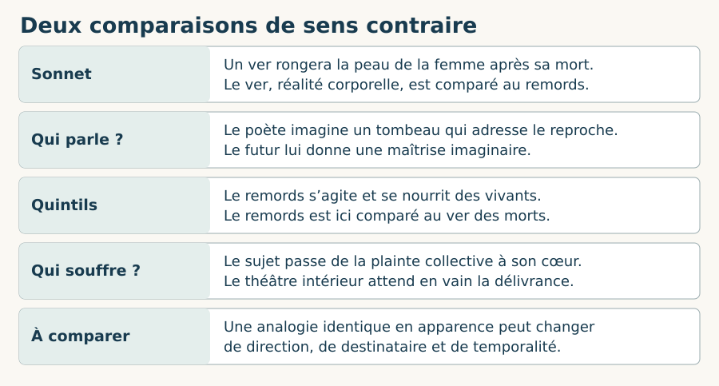
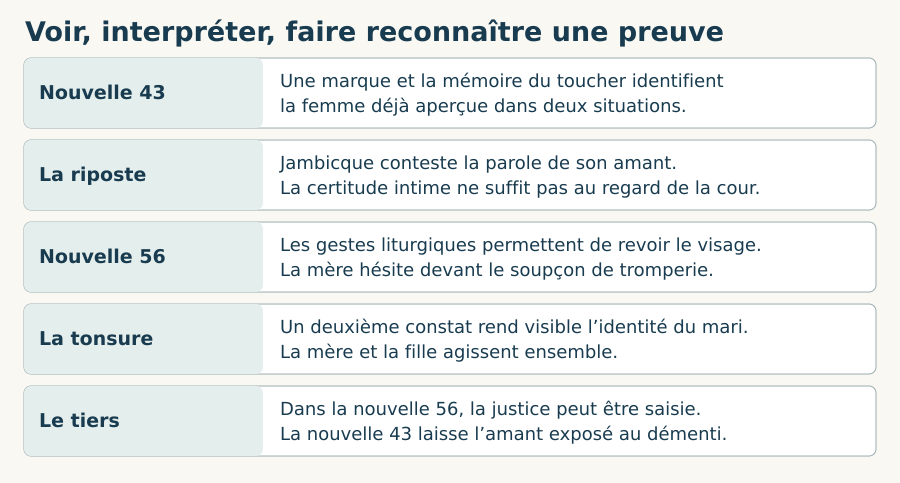

# BEL · AL — Français (oral option 19 juin) 2026 · Corrigé brut

*Corrigé rédigé par IA, non officiel. Signalez toute erreur.*

**Rédaction** · GPT-6.2 Astra Ultra · vitesse non renseignée

**Autocontrôle** · GPT-6.2 Astra Ultra · vitesse non renseignée

Les 6 billets réunissent chacun deux extraits à comparer sous un intitulé commun. Le jury demande de lire un bref passage à voix haute. Les pages indiquées sont celles de l’édition du concours. L’index de l’ENS attribue ces six billets au 19 juin, tandis que l’en-tête du fascicule porte le 18. Les deux fascicules ont des contenus différents. Le rapport confirme les six appariements.

## 1. Férocité

**Passages.** *L’Heptaméron*, nouvelle 51, p. 472-473, dans le débat qui suit l’histoire du duc d’Urbin, et Baudelaire, « Causerie », p. 104-105.

Que fait la parole de conversation à une violence qu’elle dit condamner ? Dans la nouvelle, le récit du prince qui punit de mort une jeune messagère se termine par une adresse aux dames. Le rapprochement de la malice et de la puissance donne à l’atrocité une explication politique. Longarine l’infléchit en jugement sur les Italiens, immédiatement corrigé par une restriction. Saffredent plaisante sur les autres vices supposés et fait de cette généralisation un jeu qui le concerne personnellement. Simontault réduit par comparaison la violence du premier récit, et Geburon produit un contre-exemple plus effroyable encore, relatif à un capitaine et à ses victimes. La comparaison entre ce que l’un raconte et ce que l’autre a fait encourage une surenchère. À l’issue, le lecteur peut s’interroger sur une compagnie qui utilise la souffrance d’autrui comme preuve et divertissement. Le jugement sur une prétendue férocité nationale appartient aux devisants. Il n’est pas en lui-même la vérité de la nouvelle.

« Causerie » fait également entendre des déplacements violents sous un titre de sociabilité légère. Le compliment initial sur le ciel d’automne est retourné dès le deuxième vers par l’arrivée d’une marée intérieure qui laisse au sujet un goût de limon. La main qui s’approche rencontre ensuite un lieu ravagé par une figure féminine animale. Est-ce la même femme que celle à laquelle il s’adresse ? Le passage du « vous » au « tu », puis au vocatif de la Beauté, rend l’identification instable. L’espace du cœur est tour à tour rivage, lieu dévasté et palais livré à la foule. À la fin, le locuteur invite lui-même la Beauté à achever l’œuvre des bêtes. La parole accusatrice devient consentement à sa propre disparition. Le devis renchérit sur la violence par multiplication des voix. Le sonnet rend féroce la voix unique qui organise complaisamment son propre supplice.

**À lire à voix haute.** Le second quatrain de « Causerie ». Faire entendre le passage de l’approche familière au bilan sinistre concentré dans la dernière phrase.

## 2. Rongement intérieur

**Passages.** Baudelaire, « Remords posthume », p. 82, et « L’Irréparable », p. 103-104.

L’analogie du ver et du remords termine le premier poème et ouvre le second. Son orientation est renversée. Dans le sonnet, un ver réel rongera un jour la peau de la femme « comme » un remords. Dans « L’Irréparable », le remords déjà présent se nourrit des vivants comme le ver des morts. La comparaison permet non seulement de figurer l’invisible, mais de demander qui est autorisé à dire de quoi souffre un autre être. « Remords posthume » organise une longue anticipation. Les subordonnées temporelles des quatrains ferment progressivement les mouvements du corps futur. La proposition principale des tercets donne la voix au tombeau. Cette prétendue confidence du monument répond en fait au rêve du poète, qui imagine qu’après la mort la femme entendra un reproche auquel elle ne pourra répondre. Le dernier vers apparaît comme la condamnation dont il est l’auteur.

Dans « L’Irréparable », le sujet ne maîtrise nullement la douleur qu’il nomme. Les questions, l’adresse à la sorcière et les reprises au début et à la fin des quintils font de la demande de remède une expérience répétée de l’impasse. Selon les comparaisons, le ver se redouble de la chenille ou du termite qui attaque un bâtiment par sa base. L’âme désignée comme monument intériorise ainsi le tombeau qui était, dans le sonnet, un interlocuteur extérieur de pierre. La fin oppose l’apparition triomphante vue dans un théâtre à l’absence de tout salut dans le théâtre du cœur. La scène mentale continue à attendre ce qu’une scène banale savait faire paraître à volonté. L’un des textes arme l’imagination amoureuse d’un châtiment futur. L’autre découvre que l’imagination sait trop bien produire les figures de sa propre usure et ne peut se fabriquer la délivrance qu’elle désire.

**À lire à voix haute.** Le dernier vers du sonnet, puis le premier quintil de « L’Irréparable ». Faire varier l’accent sur les deux termes comparés rend audible le changement de sens.

## 3. Un homme qui dort

**Passages.** *L’Heptaméron*, nouvelle 65, p. 544-545, et Baudelaire, « Rêve parisien », les deux sections, p. 155-157.

Dans une chapelle fraîche de Saint-Jean de Lyon, un soldat s’est couché près de figures sculptées gardant le tombeau du Christ. Le lecteur sait d’emblée qu’il est en chair, tandis qu’une vieille dame le prend pour une image. Son erreur répond à la réussite même de la sculpture qui représente les gardes comme s’ils étaient vivants. Lorsque le dormeur réagit à la chandelle, elle croit à un miracle. Le cri qu’elle pousse, les cloches et l’arrivée d’autres témoins transforment rapidement une impression individuelle en événement public. Les rires des uns et le projet de profit prêté à d’autres défont progressivement cette croyance. Il s’agit d’une scène de lecture des signes et d’une satire de l’exploitation des faux miracles. Le texte ne donne pas accès au rêve du dormeur. Son sommeil est un fait physique qui expose les interprétations des éveillés.

Dans « Rêve parisien », au contraire, le poème fait entrer le lecteur dans le spectacle que le dormeur a produit. L’adresse au peintre Constantin Guys et le vocabulaire du tableau éclairent la constitution d’un monde de métal, d’eau et de pierre où le végétal irrégulier est exclu. Le sujet se dit peintre puis architecte. Les nappes d’eau, les colonnades et les reflets organisent une profusion parfaitement soumise à sa volonté. Un feu venu des choses mêmes et le silence d’éternité abolissent jusqu’aux conditions sensibles d’une ville réelle. Les deux quatrains de la seconde section changent brutalement l’échelle et le régime du son. Le palais disparaît devant le taudis et la pendule ramène midi avec violence. Chez Marguerite, le réveil révèle qu’une statue présumée était un homme. Chez Baudelaire, il restitue un homme à sa condition après que son rêve lui a donné la souveraineté d’un bâtisseur. L’opposition entre crédulité et vérité ne suffit donc pas. Seul le récit du rêve préserve l’œuvre que le réveil a détruite.

**À lire à voix haute.** Le dernier quatrain de la première section puis le premier de la seconde. Laisser entendre le blanc entre le silence absolu de l’image et la pauvreté retrouvée du réveil.

## 4. Perfection amoureuse

**Passages.** *L’Heptaméron*, nouvelle 19, p. 242-243, et Baudelaire, « La Mort des amants », p. 182.

La perfection est-elle la réussite d’une union à deux ou ce qui oblige les amants à dépasser toute union finie ? Parlamente propose dans le devis que l’amour d’une créature soit une étape décisive vers l’amour de Dieu. Saffredent lui demande ce qu’elle appelle aimer parfaitement et lui propose une caricature de l’amant transi qui adore de loin. La réponse reprend les beautés sensibles, la bonne grâce et les vertus morales comme indices d’une perfection qu’elles ne peuvent contenir. L’image pédagogique de l’enfant qui abandonne ses petits trésors en grandissant fait sentir le changement de valeur au sein d’une même vie. La montée de l’âme rappelle des traditions platoniciennes, mais l’extrait les reconfigure dans une perspective chrétienne. La seule expérience des choses ne garantit pas l’accès au bien. L’œil de la foi doit être ouvert par Dieu. Cette pensée est proposée dans un échange où le nom de celle qui l’énonce reste visible.

Dans le sonnet de Baudelaire, le futur pluriel établit d’abord la communauté de deux amants et dispose les lits, les divans et les fleurs d’un intérieur imaginaire. Des tombeaux apparaissent pourtant dès le second vers sous la forme d’une comparaison. Les couples d’objets et les reflets du deuxième quatrain multiplient les renvois entre matière, cœurs et esprits. Dans les tercets, un éclair unique semble résoudre la dualité avant que le sanglot et l’adieu n’en menacent l’accomplissement. C’est un ange, au-delà de la dernière chaleur des deux amants, qui ranime les flammes et les miroirs. Chez Parlamente, le mouvement conduit de la créature à la source divine qui peut seule la dépasser. Chez Baudelaire, l’ange de l’avenir conserve au contraire comme objet de son geste l’image de la relation à deux. La perfection tient dans le premier passage à une orientation de l’amour. Dans le second, à la croyance poétique que la mort elle-même pourra lui rendre sa clarté.

**À lire à voix haute.** Les deux tercets de « La Mort des amants ». Donner à l’indication d’un temps ultérieur sa pleine valeur. L’éclair et la reprise des flammes ne sont pas un seul événement.

## 5. Remèdes à l’ennui

**Passages.** *L’Heptaméron*, prologue, p. 62-64, et Baudelaire, troisième « Spleen », qui commence par la comparaison avec le roi d’un pays pluvieux, p. 123-124.

Une troupe isolée peut organiser ses heures, un roi dispose de toutes les distractions de sa cour. Pourquoi la première situation ouvre-t-elle sur une espérance que la seconde semble interdire ? Chez Marguerite de Navarre, les gentilshommes demandent à Oisille de proposer sa règle. Elle ne livre pas une recette extérieure. Elle raconte comment elle lit, chante et examine sa journée. Le corps menacé de languir reçoit son repos de la joie de l’esprit. Le matin, l’après-midi et le soir acquièrent un sens dans cette relation continue avec les Écritures. Le psautier fait passer de la lecture intérieure à la parole chantée. La solution d’Oisille est déjà expérimentée dans sa vieillesse, et la première personne se transforme en proposition adressée à toute la compagnie. La beauté pourrait ainsi se trouver au désert autant qu’à la ville. Dans les bornes de l’extrait, le jeu quotidien de contes n’a pas encore été institué. Cette distinction évite d’attribuer à Oisille seule tout le projet du recueil.

Baudelaire livre, à l’autre extrême du pouvoir, un roi sans divertissement qui rappelle Pascal. La richesse et la jeunesse sont immédiatement contredites par l’impuissance et l’extrême vieillesse. La chasse, la cour, le spectacle du peuple, le bouffon, le désir et le savoir échouent tour à tour. Les négations ne rétablissent entre ces plaisirs aucune hiérarchie. Ils sont également incapables d’atteindre le malade. Lit et tombeau s’échangent, le sang s’efface dans l’eau du Léthé. L’ouverture en première personne établissait une comparaison, puis le roi occupe le poème jusqu’au dernier vers, comme si ce détour englobait désormais le sujet qui l’avait inventé. Le remède d’Oisille tient à une relation qui transforme la perception du monde et peut se partager. L’ennui du roi consiste à n’accueillir aucun changement malgré tous les objets disponibles. L’accumulation des divertissements le rend sensible sans le dissiper.

**À lire à voix haute.** Les quatre premiers vers du « Spleen ». Faire entendre la discordance des âges et du pouvoir avant que l’énumération de la cour ne la déploie.

## 6. Démasquer

**Passages.** *L’Heptaméron*, nouvelle 43, p. 424-426, et nouvelle 56, p. 497-499.

Dans la nouvelle 43, un gentilhomme veut reconnaître l’amante qui le reçoit seulement sous couvert du secret. Il pense un instant que l’assurance publique de Jambicque exclut son hypothèse, puis la marque vue sur son épaule contredit les apparences et les souvenirs du toucher lui permettent de relier les deux femmes. Le récit se garde cependant de faire de cette découverte une fin heureuse. Il se persuade qu’une reconnaissance au grand jour rendra leur amitié plus parfaite. Lorsqu’il parle dans le jardin, Jambicque adopte au contraire le langage d’une femme offensée. Il rit de la fiction, elle renvoie la fiction du côté du prétendu menteur et menace de lui faire regretter ses propos. L’identité avérée dans le regard de l’un reste récusable dans les rapports de pouvoir de la cour. Le paradoxe est qu’une amante démasquée ne reconnaît pas nécessairement la vérité de celui qui prétend la nommer.

Dans la nouvelle 56, une jeune mariée et sa mère vont à la messe et reconnaissent dans le célébrant celui qui s’était présenté comme un époux laïc. Les retours rituels du prêtre donnent rythme et sens comique à la reconnaissance. La mère commence par considérer qu’interpréter ce qu’on voit comme une fraude serait soi-même pécher contre Dieu. La vraisemblance sociale des apparences l’emporte encore sur le témoignage des yeux. Une deuxième vérification, cette fois dans l’espace domestique, rend la tonsure visible. La mère met ensuite le confesseur à l’épreuve et la justice est saisie des deux complices. La fin espère une sanction conforme au bien juger plutôt qu’elle ne rapporte le texte d’une sentence. La nouvelle 43 montre une connaissance qui demeure politiquement dangereuse à formuler. La nouvelle 56 fait d’une interprétation d’abord interdite une preuve publiquement utilisable. Démasquer engage ainsi la position de celui qui montre, le crédit de celui qui nie et la présence éventuelle d’un tiers capable de juger.

**À lire à voix haute.** Dans la nouvelle 56, la première réponse de la mère à sa fille puis le moment où la mère regarde à son tour. La critique de la crédulité passe par le changement d’attitude d’un même personnage.

[Billets du jury](https://www.ens.psl.eu/sites/default/files/sujets_du_19.06.2026_-_option_lettres_modernes.pdf) · [Rapport du jury](https://www.ens.psl.eu/sites/default/files/2026_al_rapport_oral_francais_option.pdf) · [Édition de 1559 de L’Heptaméron](https://fr.wikisource.org/wiki/L%E2%80%99Heptam%C3%A9ron_des_nouvelles_(1559)/Texte_entier) · [Édition Le Roux de Lincy et Montaiglon](https://fr.wikisource.org/wiki/L%E2%80%99Heptam%C3%A9ron_des_nouvelles) · [Les Fleurs du mal, 1861](https://fr.wikisource.org/wiki/Les_Fleurs_du_mal_(1861)/Texte_entier)
