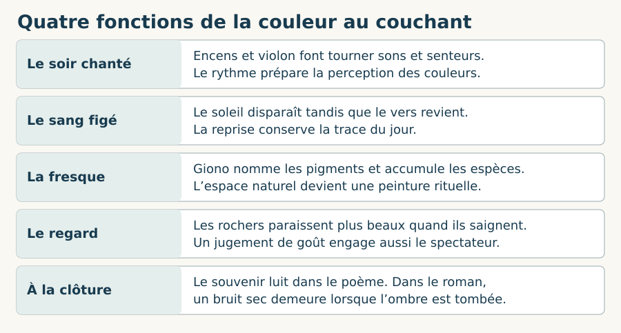
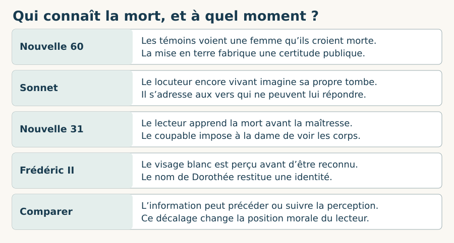

# BEL · AL — Français (oral option 20 juin) 2026 · Corrigé brut

*Corrigé rédigé par IA, non officiel. Signalez toute erreur.*

**Rédaction** · GPT-6.2 Astra Ultra · vitesse non renseignée

**Autocontrôle** · GPT-6.2 Astra Ultra · vitesse non renseignée

Les 6 billets réunissent chacun deux extraits à comparer sous un intitulé commun. Le jury demande de lire un bref passage à voix haute. Les pages indiquées sont celles de l’édition du concours.

## 1. Les couleurs du couchant

**Passages.** Baudelaire, « Harmonie du soir », p. 95, et Giono, *Un roi sans divertissement*, p. 37-38, depuis le retour au col La Croix jusqu’au bruit des arbres dans l’ombre.

Pourquoi un coucher de soleil a-t-il besoin de tant de couleurs pour se dire, et pourquoi ces couleurs finissent-elles par inquiéter ? Baudelaire n’en propose pas un nuancier explicite. Le poème commence par les vibrations de la fleur, le parfum d’encens et la rotation des sons. Le chromatisme se précise au contact d’objets liturgiques, de la noirceur du néant et du sang du soleil qui se fige. Le retour de vers entiers d’une strophe à l’autre, selon une construction apparentée au pantoum, fait éprouver une persistance contraire à l’extinction du jour. La mémoire recueille des vestiges du passé lumineux et le dernier vers les concentre dans l’éclat d’un ostensoir. Le « toi » n’est rendu sensible qu’à la fin. Le couchant devient la condition d’apparition d’une lumière intérieure qui n’est pas simplement celle du ciel.

Chez Giono, le lecteur est placé par un « vous » sur un chemin qu’il est supposé avoir déjà parcouru quelques jours plus tôt. Il peut mesurer la fulgurance du changement de saison. Le bronze, l’or, l’ocre, la pourpre, le vert presque blanc, le violet et le soufre font de chaque couleur une matière appliquée aux parois. Le vert-noir des conifères fait ressortir les autres tons. Le défilé des végétaux se confond avec des dignitaires, des figures du sacrifice et des vêtements de cérémonie. L’ouest semble saigner, tandis que le narrateur entraîne son lecteur à juger les rochers plus beaux ainsi. L’idée que ces enduits rendraient la cruauté acceptable invite à s’interroger sur ce plaisir partagé. La longue description s’achève sur des sons secs dans l’ombre. La liturgie baudelairienne recueillait un souvenir, le monastère imaginaire des montagnes propose des fresques dont l’enchantement inquiète la conscience. L’intitulé fait écho à « La Vie antérieure », mais c’est le fonctionnement propre de ces deux passages qui donne son sens à la comparaison.

**À lire à voix haute.** Les deux derniers quatrains d’« Harmonie du soir ». Modifier légèrement les accents lors des reprises permet de faire entendre le passage du soleil éteint au souvenir lumineux.

## 2. Mise en terre

**Passages.** *L’Heptaméron*, nouvelle 60, p. 517-518, et Baudelaire, « Le Mort joyeux », p. 120.

Qui peut décider ce que signifie être enterré ? Dans la nouvelle, une femme qui vit avec un chantre simule l’agonie et reçoit les sacrements en présence de témoins émus. Le récit place dans le même regard les signes d’une dévotion exemplaire et des remarques qui les discréditent pour le lecteur. La servante qui l’ensevelit prend un soin trop particulier de ne pas lui faire mal. La nuit et les belles torches donnent à la cérémonie l’apparence publique attendue. Une fois les femmes et les prêtres éloignés, le chantre retrouve sa compagne bien vivante. Le mari qui la recherche rencontre, lui, des témoins nombreux et sincères attestant sa mort. Une inhumation défaite matériellement en quelques instants devient donc une mort socialement efficace pendant des années. Le remariage puis le bruit de la survie révèlent les enjeux conjugaux et religieux de ce récit de fausse morte.

Le sonnet donne la parole à quelqu’un qui s’imagine lui-même à la fois fossoyeur et défunt. La terre grasse et peuplée s’oppose aux tombeaux monumentaux, à l’héritage écrit et à l’obligation des pleurs. Le paradoxe contenu dans le titre se déploie quand le mort se proclame libre et invite des vers incapables de l’entendre ou de le voir. L’apostrophe fait de ces destructeurs des interlocuteurs et presque des philosophes. La dernière question est adressée à qui ne peut y répondre. Elle maintient une inquiétude dans la posture bravache du sujet. Chacun des textes retire au cortège des vivants le dernier mot sur la fosse. Chez Marguerite, les signes ordinaires de la bonne mort sont empruntés pour donner à une fuite le crédit d’une vérité publique. Chez Baudelaire, un locuteur utilise ces signes en négatif pour rêver une disparition sans obligations, tout en continuant à parler au-delà du seuil qu’il invoque.

**À lire à voix haute.** Les deux tercets du « Mort joyeux ». Marquer les apostrophes, puis faire entendre que le dernier vers appartient encore à une question.

## 3. Double sens

**Passages.** *L’Heptaméron*, nouvelle 34, p. 365-366, et nouvelle 45, p. 438-439.

Dans la nouvelle 34, un boucher appelle ses porcs des « cordeliers ». Quand un vrai cordelier est retrouvé dans leur abri, l’appel qu’il entend acquiert soudain un sens littéral qui ne lui était pas destiné. Sa peur devant le boucher et la peur du couple devant ce qu’il croit être une sanction de saint François se répondent. Le tableau des demandes de miséricorde faites des deux côtés tient presque de la farce. Ce sont les positions dans l’espace et ce que chacun sait de la nuit qui donnent aux mêmes paroles des référents opposés. L’explication de l’aventure convertit la frayeur en rire sans effacer la blessure réelle du frère tombé. La nouvelle suit enfin la circulation du récit jusqu’à la duchesse d’Angoulême. Un mot qui a failli provoquer une dénonciation produit finalement une histoire digne d’être répétée.

La nouvelle 45 présente un dispositif plus cruel. « Donner les Innocents » renvoie à la coutume de frapper à l’occasion de la fête, mais le tapissier laisse à sa femme ce sens convenu pendant qu’il donne à son geste envers la servante une signification sexuelle. Les traces du châtiment apparent sont interprétées par la maîtresse comme confirmation de ce qu’elle a autorisé. Les pleurs de la jeune femme et l’impossibilité de faire entendre ce qui lui est arrivé demandent à être pris au sérieux. Le récit rapporte ensuite un changement de son attitude ; il ne rend pas rétroactivement consenti le premier acte. La maîtresse empêche précisément la clarification en interrompant la plainte qu’elle croit déjà comprendre. L’ambiguïté de la première histoire était involontaire et se dissipait au bénéfice d’un savoir commun. Dans la seconde, elle est aménagée par le maître et prolongée par la position subalterne de la seule personne qui pourrait le contredire. Le lecteur rit ou s’inquiète selon qu’un mot à double sens réunit les gens dans un éclaircissement ou protège durablement un abus.

**À lire à voix haute.** Dans la nouvelle 34, l’appel du boucher et les premières demandes de miséricorde. Deux intonations distinctes font apparaître que chacun se croit en danger du fait de l’autre.

## 4. Ivresse

**Passages.** Baudelaire, « Le Vin des amants », p. 164, et Giono, p. 24-25, de la garde de Bergues à l’extension d’une menace à tout le village.

Chez Baudelaire, le vin est une monture presque aussitôt débarrassée de tout instrument de conduite. Le premier quatrain adresse un impératif pluriel et ne représente ni bouteille ni scène de consommation. La vigueur des octosyllabes et les propositions exclamatives font de la parole elle-même le véhicule d’un départ. L’image se transforme de cavalcade en vol puis en nage dans les tercets. Le bleu transparent de l’espace et le mirage ont une valeur différente : le premier offre une sensation de clarté, le second rappelle l’incertitude d’une destination née du désir. Les amants paraissent unis dans une course parallèle, mais le dernier possessif rapporte le paradis aux rêves du seul locuteur. L’ivresse partagée reste une proposition chantée à l’autre.

Bergues a réellement trop bu. Le narrateur explique d’abord sa tournée intempestive par l’accueil que lui a réservé le village après sa poursuite. Une garde qu’on voudrait rassurante sème l’alarme, et la langue familière fait entendre une indulgence collective pour les excès d’un voisin. Chez Ravanel qui prépare son cochon, le sang appartient d’abord aux gestes ordinaires d’une maison. Pourtant Bergues dit trouver belle l’association du rouge et du blanc sur la neige. La parenthèse sur Perceval réactive le souvenir du *Conte du Graal* et déplace le commentaire de la physiologie du buveur vers l’hypnose par une image. Le rapprochement des drogues, de l’aspirine et de figures de plusieurs époques empêche de ramener la parenthèse à une cause médicale. Les témoins n’accorderont qu’ensuite sa portée à cet aveu. Le vin baudelairien projette un couple vers une image à venir. L’alcool chez Giono fait apparaître, au détour d’une parole dont personne ne mesure d’abord le poids, la possibilité d’une fascination déjà présente. La clôture ramène chaque habitant à la menace désormais commune.

**À lire à voix haute.** Les deux tercets du « Vin des amants ». Faire entendre le passage du mouvement partagé à la dernière détermination personnelle du paradis.

## 5. Cadavres

**Passages.** *L’Heptaméron*, nouvelle 31, p. 348-349, et Giono, p. 64-65, depuis l’arrêt de Frédéric II jusqu’à sa compréhension de ce qui vient d’avoir lieu.

Un cadavre est ici un corps que quelqu’un se trouve placé en situation de voir. Chez Marguerite, le lecteur connaît déjà les faits avant la dame. Celle-ci commence par chercher le sens d’une absence, s’étonne du retard de sa servante et maintient un temps envers le cordelier des paroles compatibles avec son statut de religieux. La narration donne successivement une place aux deux servantes et au valet qui ne peuvent plus répondre. Le passage d’un intérieur ordinaire à la vision de leur mort tient à une invitation monstrueuse du cordelier à constater son pouvoir. L’immobilité de la dame, comparée à une statue, traduit l’effet des morts sur le corps vivant. Aux paroles d’amour du religieux, le lieu et les cadavres donnent le sens contraire d’une contrainte absolue. L’extrait s’achève sur le regard qu’il lui impose de porter encore sur eux.

Dans Giono, le lecteur accompagne au contraire la découverte de Frédéric. Trois secondes de répit reçoivent une étendue narrative qui excède la minute entière de l’ascension. Le corps raidi, les yeux curieux et le visage très blanc perçu à courte distance isolent des éléments avant que le nom de Dorothée ne rende à la morte une identité familière. L’image de la bergère émaillée d’une horloge fait hésiter entre objet et corps. Au paradoxe du temps immense contenu dans quelques secondes répond la souvenance de la fenêtre allumée vingt minutes plus tôt. Les exclamations et les rectifications recomposent la disparition qui n’en est plus une puisque Dorothée est matériellement là. Le corps est, pour le cordelier, un message déjà interprété destiné à faire plier la dame. Pour Frédéric, il devient la source d’une connaissance bouleversante qu’il doit encore mettre en mots. Les récits interrogent ainsi deux manières de faire regarder la mort, l’une imposée par le coupable, l’autre portée par la curiosité effrayée du témoin.

**À lire à voix haute.** Chez Giono, le passage où le visage émaillé de la bergère cède la place au nom de Dorothée. Le changement de rythme accompagne la reconnaissance d’une personne.

## 6. Incendie

**Passages.** *L’Heptaméron*, nouvelle 37, p. 384-385, et Baudelaire, « Le Flambeau vivant », p. 91.

Dans la nouvelle, le feu intervient quand une longue tentative de corriger l’infidélité par la douceur a échoué. La dame découvre son mari endormi près d’une servante. De l’incendie qu’elle provoque naît un péril qu’elle doit elle-même interrompre. Elle réveille et sauve celui qu’elle voulait avertir, et son discours interprète après coup le passage de l’eau au feu. Le soin accordé au dehors n’avait pas réussi à nettoyer le dedans. L’élément qui doit mettre fin à toutes choses donne une portée à la fois religieuse et redoutable à la correction conjugale. Le ton de l’avertissement rend sensible la proximité entre amour, désespoir et violence. La conversion du mari et le retour à l’entente composent une conclusion exemplaire. La servante chassée n’y reçoit pas la même possibilité de parole. On peut reconnaître l’architecture de l’exemple sans adopter comme allant de soi le jugement porté sur chaque personnage.

Le « flambeau » de Baudelaire ne brûle aucune maison. Les yeux de l’aimée, d’abord désignés par un pronom avant d’être nommés, avancent et guident les pas du poète. Le feu passe entre plusieurs regards, se diffracte à la manière de diamants et suggère le pouvoir d’orientation d’une aiguille aimantée. La relation de maîtrise demeure paradoxale, puisqu’un sujet qui les désigne comme ses serviteurs se dit leur esclave. Dans les tercets, l’image des cierges allumés en plein jour entraîne une distinction. Ils célèbrent la mort, tandis que les yeux chantent le réveil de l’âme. La lumière ajoute au soleil une clarté que celui-ci ne peut défaire. Les deux textes prêtent ainsi au feu le pouvoir d’éveiller. Le réveil physique du mari donne progressivement lieu à une correction morale explicitée par sa femme. Chez Baudelaire, l’éveil est un trajet intérieur dont le guide demeure visible et dont la source résiste à toute appropriation. Le titre « Incendie » met en tension, d’un texte à l’autre, la puissance qui détruit et celle qui éclaire.

**À lire à voix haute.** Les tercets du « Flambeau vivant ». Faire entendre le changement de pronoms au moment où les cierges funèbres se distinguent des yeux qui appellent au réveil.

[Billets du jury](https://www.ens.psl.eu/sites/default/files/sujets_du_20.06.2026_-_option_lettres_modernes.pdf) · [Rapport du jury](https://www.ens.psl.eu/sites/default/files/2026_al_rapport_oral_francais_option.pdf) · [Édition de 1559 de L’Heptaméron](https://fr.wikisource.org/wiki/L%E2%80%99Heptam%C3%A9ron_des_nouvelles_(1559)/Texte_entier) · [Édition Le Roux de Lincy et Montaiglon](https://fr.wikisource.org/wiki/L%E2%80%99Heptam%C3%A9ron_des_nouvelles) · [Les Fleurs du mal, 1861](https://fr.wikisource.org/wiki/Les_Fleurs_du_mal_(1861)/Texte_entier) · [Un roi sans divertissement](https://www.ebooksgratuits.com/details.php?book=3306)
