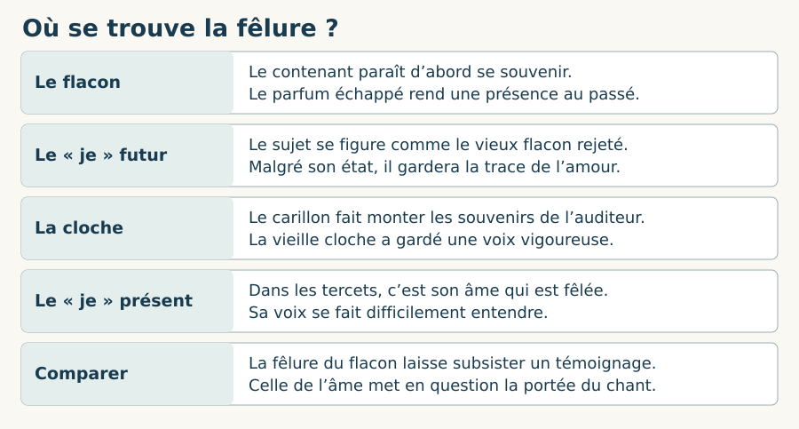
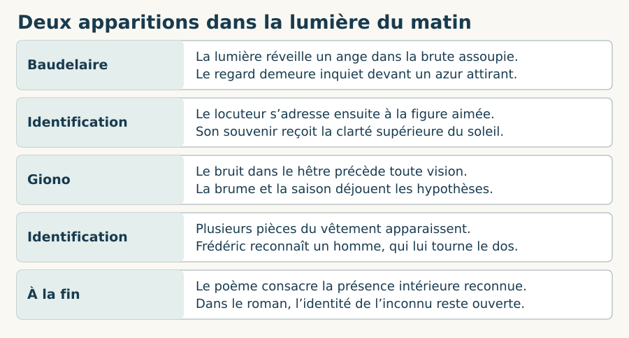

# BEL · AL — Français (oral option 26 juin) 2026 · Corrigé brut

*Corrigé rédigé par IA, non officiel. Signalez toute erreur.*

**Rédaction** · GPT-6.2 Astra Ultra · vitesse non renseignée

**Autocontrôle** · GPT-6.2 Astra Ultra · vitesse non renseignée

Les 12 billets réunissent chacun deux extraits à comparer sous un intitulé commun. Le jury demande de lire un bref passage à voix haute. Les pages indiquées sont celles de l’édition du concours.

## 1. Fins tragiques

**Passages.** *L’Heptaméron*, nouvelle 23, p. 291-293, de la détresse de la mère à la réponse du gentilhomme blessé, et Giono, *Un roi sans divertissement*, p. 243-244, du dernier témoignage sur Langlois à la fin du roman.

Qu’est-ce qui finit lorsque le récit arrive à la catastrophe ? Dans la nouvelle 23, la mort de la mère puis celle de son enfant produisent une scène que découvrent successivement une servante et le frère. La première sait seulement qui est entré dans la chambre. Le second transforme cette information limitée en certitude sur la culpabilité du mari. Le lecteur connaît, lui, la part du cordelier dans le malheur initial. La tragédie se prolonge précisément parce que les personnages ne disposent pas des mêmes paroles au même moment. Les deux hommes recouvrent tardivement la possibilité de s’appeler frères, de poser des questions et de demander pardon. Le repentir est sincère, mais il survient quand le gentilhomme doute déjà de survivre. La réconciliation morale ne défait pas les conséquences de l’accusation.

Chez Giono, une témoin rapporte la longue immobilité de Langlois dans la neige. Elle lui parle deux fois, retourne à ses occupations et constate finalement son départ. Le récit quitte ensuite cette première personne pour reconstruire ce qui a dû arriver. Le dîner, le tricot et la petite lumière au fond du jardin forment autour des deux femmes un cadre familier jusqu’au brusque changement de la scène. Il importe que la mort de Langlois ne livre aucune dernière explication de sa propre bouche. L’image d’une lumière soudaine à l’échelle de l’univers marque la limite des mots ordinaires auxquels recourait la témoin. La question finale reprend Pascal et nous renvoie au titre. Chez Marguerite, la vérité peut se dire, trop tard pour empêcher la catastrophe. Chez Giono, la fin matérielle du récit ouvre une question sur le divertissement et la détresse que les témoins ne peuvent trancher.

**À lire à voix haute.** Dans la nouvelle 23, les questions qu’échangent les deux beaux-frères, puis la demande de pardon. Le changement du ton de l’accusation à celui de l’écoute rend sensible le retard irréparable.

## 2. Mobilier

**Passages.** *L’Heptaméron*, nouvelle 38, p. 388-389, et Baudelaire, deuxième « Spleen » (« J’ai plus de souvenirs que si j’avais mille ans »), p. 122-123.

Une coupe d’argent suffit à déclencher une reconnaissance. Le bourgeois de Tours se rend régulièrement chez sa métayère et rentre transi. Sa femme, qui doit le soigner, visite le lieu de ses séjours. Ce qu’elle fait transporter, du lit garni à la vaisselle, répond exactement aux manques de la chambre et aux habitudes de l’homme dont elle connaît les goûts. Son intervention pourrait être comprise comme une acceptation de l’infidélité. Mais le mari s’étonne de l’ordre nouveau, s’enquiert de la provenance des biens et reconnaît une bonté à laquelle sa propre conduite répondait si mal. La liste du mobilier est donc un discours adressé à quelqu’un qui ne le sait pas encore. Le pouvoir économique de l’épouse et la déférence de la métayère comptent dans cette scène. Le retour au couple termine l’histoire que les objets avaient rendue lisible.

Chez Baudelaire, le meuble à tiroirs fait d’abord l’objet d’une comparaison démesurée. Malgré les papiers administratifs, les vers, les lettres et les mèches de cheveux qu’il rassemble, il contient moins de secrets que le cerveau du locuteur. Cette insuffisance relance les métaphores. La pyramide et le cimetière, puis le vieux boudoir transforment la mémoire en espace qui pourrait ensevelir celui qui se l’imagine. Dans le boudoir, les pastels paraissent encore respirer ce qui reste d’un parfum. À la fin, le locuteur apostrophe la matière vivante comme si elle s’était changée en sphinx ignoré, qui chante encore au couchant. La nouvelle suivait la circulation d’objets d’une maison à l’autre et lui donnait une efficacité morale. Le poème essaie des contenants de plus en plus vastes pour faire sentir un passé accumulé que l’on ne peut plus remettre en circulation entre les êtres.

**À lire à voix haute.** Les premiers vers du « Spleen », de l’hypothèse des mille ans à la comparaison avec le cerveau. Faire attendre jusqu’à la fin de l’inventaire ce que le meuble était chargé de mesurer.

## 3. Allégories

**Passages.** Baudelaire, « Le Flacon », p. 96, et « La Cloche fêlée », p. 121.

Dans les deux poèmes, un objet fait entendre ce qui devient difficile à dire au sujet de l’âme. Le flacon appartient d’abord au monde de l’expérience commune. Une serrure résiste, une armoire s’ouvre et une odeur fait surgir ce qu’on croyait révolu. Mais l’attribution de la mémoire passe de la personne au contenant, qui paraît se souvenir lui-même. Des pensées prennent leur essor comme des chrysalides et, au moment où l’envol semble libre, le Vertige personnifié entraîne l’âme dans un gouffre. Le retour de l’ancien amour reçoit même la figure paradoxale d’un Lazare qui garde encore quelque chose du sépulcre. Le « je » n’intervient qu’ensuite pour se projeter dans un futur d’abandon. Le vieux flacon, fêlé et rejeté, restera pourtant le témoin d’une présence aussi précieuse qu’envahissante.

La cloche commence elle aussi par un souvenir qui s’élève, cette fois au bruit d’un carillon dans la nuit d’hiver. Le titre pourrait conduire à penser que l’on va décrire une cloche défectueuse. Or les quatrains célèbrent au contraire sa vigueur, qui subsiste dans sa vieillesse. Le vieux soldat de la comparaison est resté à son poste. C’est seulement à l’entrée des tercets que la fêlure passe à l’âme du locuteur. La voix qu’elle voudrait faire résonner ressemble à celle d’un blessé oublié dont l’effort ne suffit plus à se faire entendre. La seconde image militaire retourne la première. Dans le flacon, une dégradation matérielle peut encore garder la force d’un souvenir. Dans la cloche, l’objet sonore offre à l’âme le modèle même de la fidélité qu’elle n’est plus sûre de pouvoir soutenir. L’allégorie se découvre par les déplacements des attributs au fil du poème.

**À lire à voix haute.** La transition du second quatrain au premier tercet de « La Cloche fêlée ». L’accent sur « Moi » situe précisément où passe la fêlure annoncée par le titre.

## 4. Passe d’armes

**Passages.** Baudelaire, « Duellum », p. 83, et Giono, p. 148-150, du regard de Saucisse à sa dénégation sur Langlois.

Chez Baudelaire, le titre latin et l’ouverture à la troisième personne semblent promettre un récit héroïque. Dès le premier quatrain pourtant, la comparaison avec une jeunesse encore aux commencements de l’amour réoriente le spectacle. L’apostrophe à la personne aimée et l’apparition de « notre jeunesse » font entrer le couple dans la scène jusque-là regardée de l’extérieur. La maturité ne pacifie rien. Les armes brisées laissent subsister une lutte que les tercets projettent dans un gouffre puis dans l’enfer. Le dernier impératif de la première personne du pluriel fait porter la parole et la responsabilité du vœu au locuteur. Il imagine que la haine pourrait éterniser une ardeur commune. Le sonnet donne à sentir le piège de ce désir en associant de plus en plus étroitement l’étreinte et l’hostilité.

Dans Giono, la métaphore guerrière rend lisible une scène où personne n’a besoin de quitter sa place. Saucisse regarde la nuque de Delphine, Delphine surveille dans les lointains un parapluie rouge. La jeune femme finit par interpréter ce regard immobile comme un jugement sur sa propre apparence. Elle cherche dans son miroir une imperfection que Saucisse n’a pas nommée. Les séries de gestes, les adverbes de répétition et les brèves réponses produisent une durée comique, que ponctue le mouvement presque imperceptible du parapluie. C’est en prononçant le nom de Langlois que Delphine finit par atteindre Saucisse et par s’exposer elle-même. Dans l’échange des possessifs, « ton » puis « mon », chacune conteste le lien que l’autre lui prête avec l’absent. Le poète cherchait dans un duel à deux la forme éternelle d’une relation. Le roman fait apparaître un troisième terme, que le silence initial des rivales ne suffisait pas à écarter.

**À lire à voix haute.** Chez Giono, la dernière réplique de Delphine et la réponse de Saucisse. Faire entendre la différence entre les deux possessifs qui portent toute la dispute.

## 5. Âges de la vie

**Passages.** Baudelaire, « Les Petites Vieilles », première partie, p. 141-142, et Giono, p. 121-122, de l’apparition de Saucisse à la comparaison avec une faisane.

Le billet donne à entendre que la vieillesse peut contenir plusieurs âges. Le poète parisien commence par guetter des passantes que ses épithètes placent entre la répulsion et le charme. Ce regard n’est pas innocent. Il faut un impératif à la première personne du pluriel pour rappeler qu’elles sont des âmes et pour associer le lecteur à ce changement de regard. Les jupons troués et le petit sac brodé disent une vie particulière à même des corps que les comparaisons avec des pantins semblaient rendre interchangeables. Le regard des passantes conserve l’étonnement de la petite fille. Un rapprochement des cercueils d’enfants et des personnes âgées ouvre l’image d’un nouveau berceau avant que la voix ne revienne à une géométrie presque dérangeante. Les yeux qui terminent cette partie renvoient enfin à l’expérience de l’Infortune chez celui qui les observe.

L’apparition de Saucisse devant le café oblige aussi le groupe villageois à reprendre son vocabulaire. Le surnom familier paraît inadapté. Ne sachant plus le nom véritable de celle qu’ils côtoient depuis dix ans, les villageois trouvent un titre, « Madame ». Les nombres dont ils se servaient pour lui donner un âge ne leur disent plus ce qu’ils voient. La transformation de Saucisse vient d’un travail sur ce qu’elle a, auquel le village reconnaît la valeur du métier bien fait. L’étoffe, le gant, l’allure et la tendresse du regard composent une apparition qui garde pleinement son âge. Baudelaire faisait surgir l’enfance dans les yeux des vieilles femmes et interrogeait la place du spectateur. Giono fait changer le jugement d’un groupe devant la capacité d’une femme à donner elle-même forme à son apparition publique.

**À lire à voix haute.** Au début de l’extrait de Giono, la question du nom, la réponse « Madame » et l’énumération des âges possibles. Chaque correction marque le déplacement du regard.

## 6. Péchés d’orgueil

**Passages.** *L’Heptaméron*, nouvelle 26, p. 326-328, devis qui suit le récit, et Baudelaire, « Châtiment de l’orgueil », p. 65-66.

Dans le devis, la première conclusion opposait apparemment une femme sage à une femme folle d’après les effets de leurs amours. Oisille rend une présence au gentilhomme dont il a été question en évoquant sa beauté et son souvenir personnel. Saffredent, lui, requalifie la conduite de la femme qui a contenu ses sentiments. Ne voulait-elle pas se faire passer pour plus vertueuse qu’elle ne l’était ? Parlamente répond que la possibilité d’une faute ne prouve pas le désir de la commettre. Hircan élargit le débat, suppose que la réputation interdit aux femmes des plaisirs tolérés chez les hommes et qu’elles chercheraient, en y renonçant, la gloire d’avoir résisté. L’orgueil appartient donc ici à un discours d’accusation. On peut aussi se demander de quel droit Hircan prétend interpréter les cœurs que lui-même déclare cachés.

Chez Baudelaire, le personnage incriminé fait au contraire entendre sa prétention de sa propre voix. Un grand théologien s’attribue le pouvoir d’avoir porté le Christ jusqu’à sa gloire et d’en défaire l’autorité. Le détour par le temps merveilleux de la théologie et les images de montée donnent au blasphème un relief public. Le récit, engagé sous la forme d’une tradition rapportée, lui fait succéder immédiatement une perte des facultés. Le temple éclairé et ordonné de l’intelligence devient caveau fermé, et les enfants rient de celui que l’on admirait. Ces images appartiennent à une fable morale située, qui mesure la distance entre deux conditions extrêmes. Le devis permettait d’assister à la contestation d’une accusation que personne ne pouvait vérifier absolument. Le poème construit l’enchaînement exemplaire d’une parole démesurée et d’une chute, tout en rendant sensible la cruauté du regard social sur l’homme déchu.

**À lire à voix haute.** Dans le poème, le passage de la parole directe du théologien à la première phrase du châtiment. Le contraste de rythme donne sa force à la chute.

## 7. Attendre la mort

**Passages.** Baudelaire, « La Mort des pauvres », p. 183, et Giono, p. 141-142, de la marche silencieuse à l’apparition de l’aire nue devant la paroi.

Le sonnet donne d’emblée à la Mort la place de sujet grammatical. L’anaphore « C’est » lui attribue ensuite des figures multiples, qu’il faut rapporter aux besoins très concrets de ceux qui parlent. Pouvoir se reposer, manger ou s’asseoir appartient aux images d’une auberge accessible après les intempéries. Le paradoxe initial se comprend dans cette perspective sociale. Une promesse d’hospitalité donne aux gens pauvres le courage de marcher jusqu’au soir. La bourse et le grenier des tercets désignent par contraste ce dont ils manquent de leur vivant. L’ange qui prépare un lit fait passer des nécessités du corps à une espérance spirituelle. Le portique s’ouvre pourtant sur des cieux qualifiés d’inconnus. Le rythme affirmatif de l’attente ne suffit pas à convertir en savoir le contenu de l’au-delà.

Dans Giono, l’attente est d’abord celle des hommes. Le silence autour des torches fait entendre un bruit d’ailes auquel la voix du village associe les colombes de l’arche de Noé. L’image biblique rend sensible le désir de trouver une terre et une issue, alors que la paroi semble précisément interdire tout passage. Le loup, appelé « Monsieur », n’est pas encore visible à la fin de cet extrait. Ce sont les villageois qui demandent si son absence apparente d’inquiétude signifie qu’il attend la mort. L’issue rêvée devient, dans leur discours, une porte puis un arc de triomphe. Cette amplification nous renseigne sur l’imagination de ceux qui ont peur et s’interrogent. Les deux textes cherchent une ouverture dans une situation fermée. Chez Baudelaire, la voix collective construit une espérance à partir de privations partagées. Chez Giono, un groupe attribue une attente singulière à un vivant dont il ignore la pensée.

**À lire à voix haute.** Dans Giono, les questions sur la porte et le portail. Garder aux interrogations la fragilité d’hypothèses que le groupe émet en avançant.

## 8. Plaider sa cause

**Passages.** *L’Heptaméron*, nouvelle 15, p. 206-208, et nouvelle 21, p. 262-264, jusqu’à la défense par Rolandine de sa conduite de jeunesse.

La première dame parle devant le mari susceptible de la juger. Elle retourne d’abord à l’enfance et au choix qu’elle a fait de lui malgré les projets de ses parents. C’est donc une histoire de fidélité mal payée qu’elle oppose aux soupçons présents. Elle diffère de l’avocat qui nierait tout. Les rencontres secrètes et les baisers sont admis et précisément délimités. En revanche elle récuse la définition de l’infidélité que le mari voudrait lui imposer sans jamais se l’appliquer à lui-même. La succession des « vous » et des « moi » met dans la balance l’âge, l’expérience, la façon de traiter son conjoint et les obligations d’amitié envers les autres personnes en cause. Faire appel à la loi de Dieu contre la loi des hommes permet à l’épouse de récuser un double régime de responsabilité tout en continuant à s’adresser à son mari comme juge.

Rolandine plaide aussi devant une autorité qu’elle reconnaît en la nommant respectueusement. Sa dame, comme son père, l’a pourtant laissée attendre jusqu’à trente ans sans lui procurer une place parmi les femmes mariées. Le rappel des occasions perdues fait de celle qui interroge une partie au litige. Le jeune homme aimé peut se prévaloir d’une grande naissance paternelle que l’absence d’un mariage légitime empêche la société de reconnaître pleinement. Le motif de l’anneau relie cette inégalité d’origine à la promesse que Rolandine a personnellement consentie. Elle distingue son engagement et sa volonté d’obtenir l’accord paternel avant de consommer son mariage. La première dame demande que les deux conjoints soient jugés à une même mesure. La seconde soutient qu’une femme peut légitimement prendre une décision lorsque ceux qui devaient veiller sur son avenir y ont manqué. Dans chaque plaidoyer, raconter son passé est déjà contester les termes du procès.

**À lire à voix haute.** Dans la nouvelle 15, la comparaison des deux conduites introduite par l’image de la balance. L’alternance des personnes fait entendre le déplacement du jugement.

## 9. Promesse de l’aube

**Passages.** Baudelaire, « L’Aube spirituelle », p. 94-95, et Giono, p. 61-63, du départ avant le lever de la femme de Frédéric à la disparition de l’inconnu dans la brume.

L’aube du sonnet entre dans une société encore marquée par les excès de la nuit. Sa lumière blanche et vermeille ne dissipe pas simplement le mal. Elle s’accompagne d’un Idéal qui ronge, au sein d’un mystère dit vengeur. Le réveil d’un ange dans un être encore assoupi associe donc la promesse d’une autre vie intérieure à une épreuve de conscience. L’azur spirituel attire comme un gouffre, de sorte que la hauteur n’efface pas le risque du vertige. C’est seulement quand le poète s’adresse à la figure aimée que le souvenir prend une clarté propre. Le terme du sonnet rapproche sa victoire de celle du jour sur les bougies. L’image exacte est celle d’une flamme que la lumière supérieure fait paraître noire. La promesse réside dans ce changement de valeur du visible.

Chez Giono, Frédéric part à une heure qui lui épargne des explications et qui devait lui suffire pour une course à la scierie. Or le lever du jour n’apporte pas la transparence. L’arbre se perd dans le blanc de la brume et l’ouïe s’emploie à donner une cause à un bruit. Les hypothèses animales sont essayées puis abandonnées. Lorsque quelque chose descend du hêtre, l’énumération des pièces du vêtement précède l’identification d’un homme. Pendant un instant la brume paraît s’ouvrir comme une trappe de théâtre. Le personnage entrevu tourne cependant le dos et disparaît sans être reconnu. Les deux textes annoncent donc une apparition en travaillant sur ce qu’une lumière permet ou empêche de distinguer. Le poème appelle et reconnaît une présence intérieure que le souvenir rend plus éclatante. Le roman donne assez de réalité à une présence extérieure pour rendre plus pressante la question de son identité.

**À lire à voix haute.** Chez Giono, la phrase qui énumère ce que Frédéric voit sortir de la brume. Ne prononcer l’identité humaine qu’au moment où le texte la livre.

## 10. Histoires de fantômes

**Passages.** *L’Heptaméron*, nouvelle 39, p. 391-392, et Baudelaire, « Un fantôme », première pièce, « Les Ténèbres », p. 85-86.

Le seigneur de Grignaulx revient après plus de deux ans et apprend qu’un esprit a rendu sa maison inhabitable. Son incrédulité affronte de véritables phénomènes sensibles. On entend une voix, les meubles font du bruit, mais les chandelles s’éteignent. Le nom de la grand-mère rattache le désordre à une histoire de famille et peut donner crédit à l’interprétation surnaturelle. Pourtant l’homme se plaint surtout de perdre son repos. Une seconde nuit fait passer de la chose sentie à la personne reconnue. La lumière montre une chambrière qui avoue avoir organisé la mise en scène pour pouvoir retrouver un serviteur. Le mot « rôle » qui clôt l’extrait fait rétrospectivement de la maison le lieu d’une représentation, dont la peur des spectateurs avait prolongé l’efficacité pendant deux ans.

Le premier sonnet d’« Un fantôme » ménage également une reconnaissance finale, sans attribuer à l’apparition un dessous de scène qui permettrait de la congédier. Le sujet vit dans les caveaux de la tristesse. Dans l’ombre où il se dit relégué, il se compare à un peintre que l’on contraindrait à exercer son art sans lumière. Le mouvement des tercets donne une réponse à cette impossibilité. Une tache brillante se développe par degrés et prend une allure que le poète peut reconnaître. L’exclamation finale nomme seulement « Elle » et maintient le paradoxe d’une visiteuse noire et lumineuse. La nouvelle traduit les signes opaques en gestes humains auxquels on peut assigner une intention. Le sonnet rend visible le parcours même de l’imagination, depuis le manque de lumière jusqu’à la découverte d’une figure qui tire son éclat de l’obscurité où elle paraît.

**À lire à voix haute.** Les deux tercets des « Ténèbres ». Échelonner les verbes de l’apparition pour que l’exclamation qui reconnaît la visiteuse ne devance pas sa venue.

## 11. « L’ennui rend ton âme cruelle »

**Passages.** Baudelaire, poème XXV (« Tu mettrais l’univers entier dans ta ruelle »), p. 74, et Giono, p. 22-23, de la découverte dans la porcherie à l’image finale sur la neige.

L’énoncé du billet est déjà une accusation. Le poète semble en mesure de définir d’emblée le mobile d’une femme à laquelle il s’adresse. Les images de spectacle public, les boutiques et les illuminations font de ses yeux le siège d’un éclat emprunté. Pourtant le même discours lui reproche de ne pas connaître les lois de son propre pouvoir. Quand l’accusation la transforme en instrument aveugle de la nature, la responsabilité du mal cesse de reposer sur elle seule. La question de la formation du génie engage aussi le regard du poète qui utilise cette figure repoussante et sublime pour composer ses vers. Les deux oxymores finaux inscrivent dans le langage de l’accusateur la contradiction qu’il attribuait d’abord à celle qu’il juge.

Les villageois de Giono voudraient eux aussi savoir à quel désir attribuer la souffrance infligée à un animal. Ils constatent que le geste ne répond pas à une nécessité ordinaire. Ils croient y reconnaître un plaisir, mais disent simultanément qu’ils ne comprennent pas. Les marques sont assimilées aux lettres d’un langage inconnu. Il y a donc apparence d’écriture, sans accès au sens ni à celui qui l’aurait produite. La colère de Bergues exprime le refus moral de cette souffrance. Le récit va pourtant lui faire rapporter de son retour sans résultat une dernière image dans laquelle le rouge sur le blanc devient « beau ». Le lecteur ne peut confondre l’acte qui a blessé, la réaction de ceux qui le condamnent et l’attrait que la composition visuelle exerce sur eux. La comparaison invite à prendre ses distances avec une explication toute faite par l’ennui. Affirmée chez Baudelaire, cette explication se retourne contre l’assurance du discours. Chez Giono, elle demeure une question que les villageois ne peuvent résoudre.

**À lire à voix haute.** Dans le poème, les questions qui précèdent les deux oxymores finals. Écouter le moment où la formation d’un génie devient elle-même un problème.

## 12. Effusion de sang

**Passages.** *L’Heptaméron*, nouvelle 50, p. 463-465, de la présentation des deux amants de Crémone à leur sépulture commune, et Baudelaire, « La Fontaine de sang », p. 170.

Le titre semble annoncer un événement dont on pourrait désigner immédiatement l’origine. La nouvelle exploite au contraire un écart entre plusieurs interprétations d’une maladie. Les médecins attribuent la mauvaise santé de Jehan Piètre à une cause physique. La dame sait ce qu’il souffre de son refus et lui envoie une parole de réconfort. Le jeune homme croit à une guérison miraculeuse par la seule promesse de la revoir. Le narrateur laisse apparaître la faiblesse de cette conclusion. Le soulagement moral n’a pas supprimé les conséquences physiques d’une intervention antérieure, et la mort survient alors qu’il se pensait rétabli. La dame, sous l’effet du choc, s’impute toute la faute puis meurt à son tour. Les parents découvrent trop tard le malheur des deux jeunes gens et les enterrent ensemble. Le fait que le récit connaisse plusieurs causes rend particulièrement tragique cette attribution à soi seul de toute responsabilité.

Le premier vers du sonnet introduit, lui, une réserve sur la réalité même de l’expérience. Le locuteur entend le flux, mais cherche en vain une blessure. L’absence d’origine localisable permet à l’image de s’étendre du corps à la cité, des pavés à la nature entière. Le texte fait entendre une plainte régulière jusque dans le rythme prêté à la fontaine. Les tercets abandonnent ensuite l’enquête sur la source au profit d’une recherche de soulagement. Le vin accroît la précision des sens au lieu de les endormir. L’amour, supposé procurer un repos, ravive à son tour la douleur. Chez Marguerite, c’est l’erreur sur une guérison qui précipite l’intrigue. Chez Baudelaire, la répétition de remèdes déçus donne sa forme au poème, dont le langage seul peut rendre accessible à d’autres une souffrance qui n’a pas de signe visible.

**À lire à voix haute.** Le premier quatrain de « La Fontaine de sang ». Faire entendre les degrés entre l’impression incertaine, la certitude d’entendre et l’impossibilité de confirmer par le toucher.

[Billets du jury](https://www.ens.psl.eu/sites/default/files/sujets_du_26.06.2026_-_option_lettres_modernes.pdf) · [Rapport du jury](https://www.ens.psl.eu/sites/default/files/2026_al_rapport_oral_francais_option.pdf) · [Édition de 1559 de L’Heptaméron](https://fr.wikisource.org/wiki/L%E2%80%99Heptam%C3%A9ron_des_nouvelles_(1559)/Texte_entier) · [Édition Le Roux de Lincy et Montaiglon](https://fr.wikisource.org/wiki/L%E2%80%99Heptam%C3%A9ron_des_nouvelles) · [Les Fleurs du mal, 1861](https://fr.wikisource.org/wiki/Les_Fleurs_du_mal_(1861)/Texte_entier) · [Un roi sans divertissement](https://www.ebooksgratuits.com/details.php?book=3306)
