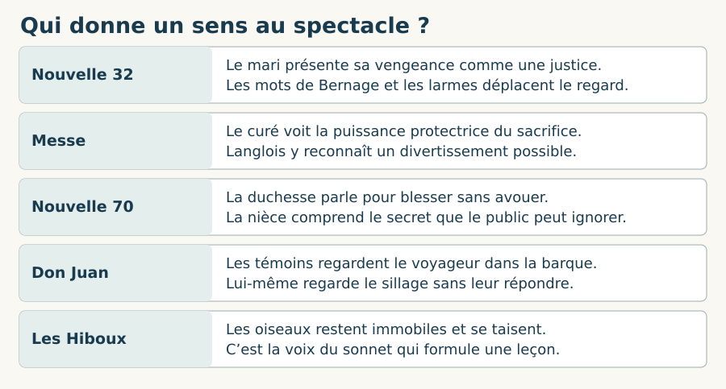
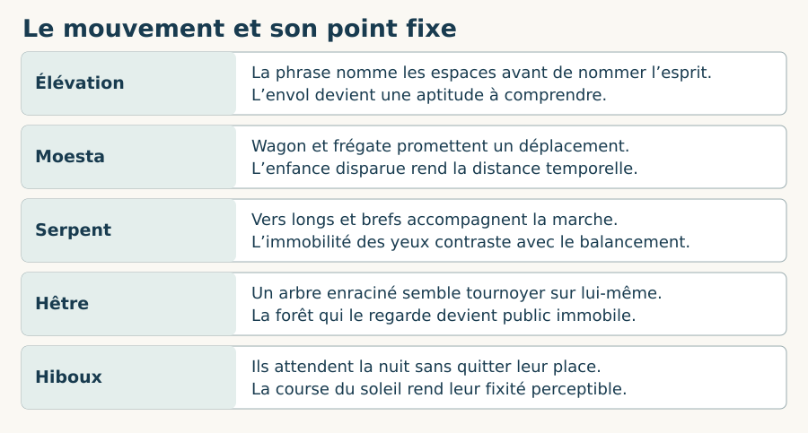

# BEL · AL — Français (oral option 30 juin) 2026 · Corrigé brut

*Corrigé rédigé par IA, non officiel. Signalez toute erreur.*

**Rédaction** · GPT-6.2 Astra Ultra · vitesse non renseignée

**Autocontrôle** · GPT-6.2 Astra Ultra · vitesse non renseignée

Les 11 billets réunissent chacun deux extraits à comparer sous un intitulé commun. Le jury demande de lire un bref passage à voix haute. Les pages indiquées sont celles de l’édition du concours.

## 1. La soif de vengeance

**Passages.** Marguerite de Navarre, *L’Heptaméron*, nouvelle 32, p. 355-356, et Baudelaire, *Les Fleurs du mal*, « Le Tonneau de la haine », p. 120-121.

Si le vengeur a soif, pourquoi sa vengeance ne le désaltère-t-elle jamais ? Chez Marguerite, un mari trompé raconte à Bernage comment il a conçu un supplice qui doit durer plus longtemps que la mort. La métaphore de la soif se matérialise, mais par un singulier déplacement. Celui qui désire la vengeance est le mari, celle qui boit est la femme. À chaque repas, la coupe imposée rappelle l’amant mort. La chambre autrefois associée au plaisir conserve ses os dans une armoire dont l’ouverture transforme Bernage en spectateur requis. Les reprises de l’amitié et de l’inimitié disposent en face l’un de l’autre le vivant et le mort. Le mari tire de ce dispositif une justification prononcée à la première personne. La narration ménage pourtant un déplacement du jugement. Le silence de la femme, le désir de Bernage de lui parler, sa compassion et les larmes de l’épouse donnent au lecteur d’autres raisons de regarder. Le geste du mari qui emmène son visiteur à la fin interrompt ce rapprochement.

Baudelaire fait tomber le liquide en pure perte dès le premier vers. Le tonneau des Danaïdes annonce un travail impossible à achever. Dans les quatrains, Vengeance apporte le sang et les larmes, le Démon dérobe aux morts jusqu’à la possibilité de satisfaire leur bourreau. Dans les tercets, la scène antique devient taverne. La boisson engendre la soif et même l’ivresse heureuse qui permet de dormir est refusée à la Haine. Le châtiment change ainsi de destinataire. Chez Marguerite, l’homme reste maître de la chambre mais ne parvient pas à maîtriser le regard de Bernage. Dans le sonnet, l’allégorie censée agir devient prisonnière de sa propre dépense. Le liquide fait du temps une expérience différente, retour des repas d’un côté, épuisement sans terme de l’autre.

**À lire à voix haute.** Les deux tercets du « Tonneau de la haine ». Marquer la pause avant la comparaison finale permet de faire entendre la surprise du renversement.

## 2. Art de mourir

**Passages.** Baudelaire, « La Mort des artistes », p. 183-184, et Giono, *Un roi sans divertissement*, p. 143-144, de la dispersion possible de la battue au jugement final sur la mort du loup.

Un art de mourir peut désigner une conduite exemplaire devant la fin. Ce titre suggère aussi que la mort achèverait un travail d’artiste ou que des témoins feraient de la mort d’autrui un spectacle. Le sonnet de Baudelaire s’ouvre sur des questions, des efforts répétés de saltimbanque ou d’archer et une cible dite mystique. La diversité des arts empêche de rapporter le texte à un simple portrait du poète. À la première personne succède un « nous » qui engage les artistes dans un labeur de destruction et de reconstruction. Puis le regard se déplace vers les sculpteurs qui n’ont jamais connu leur idéal. La solution arrive dans la phrase prolongée jusqu’au dernier tercet. La Mort, comparée à un soleil neuf, ferait enfin éclore ce qui n’a pu prendre forme dans l’œuvre. Cette floraison reste leur espoir. Aucun témoin ne peut certifier l’accomplissement promis.

Chez Giono, les témoins abondent, mais comprennent-ils ce qu’ils voient ? Le « nous » des villageois commence par imaginer dans une exclamation toute la confusion dont Langlois les a préservés. Son ordre d’apaisement fait de l’agitation une immobilité commune. Répétition de son avance, lenteur et lumière des torches suspendent le récit au moment même où va s’accomplir l’irréversible. L’attention au ventre du procureur introduit une drôlerie qui interdit au tableau de se figer en cérémonie héroïque. Le chien de Curnier gît déjà devant le loup. L’animal fixe le sang sur la neige, à la fois acteur et spectateur de la scène. La formule commerciale qui distribue à la fin les rôles de celui qui expédie et de celui qui reçoit la mort dégrade la noblesse apparente du face-à-face. Au sonnet qui attend de la Mort une œuvre encore invisible répond un récit où tout est vu, et où le sens de ce qu’on a vu échappe. La belle mort n’est un savoir assuré dans aucun des deux textes.

**À lire à voix haute.** Les deux tercets de Baudelaire, en suspendant la voix après l’annonce de l’espoir. L’arrivée tardive du sujet « la Mort » répond à l’attente grammaticale.

## 3. Vampirisme

**Passages.** Baudelaire, « Le Vampire », p. 80-81, et Giono, p. 48-49, depuis l’hypothèse d’une photographie en couleurs jusqu’à l’invitation à parler en peintre.

Boire le sang d’un autre serait une manière littérale de définir le vampirisme. Or aucune prise de sang de cette nature n’est racontée dans les passages. Chez Baudelaire, le titre incline le lecteur à identifier un monstre. L’adresse à la deuxième personne montre surtout une femme installée dans l’esprit de celui qui parle. L’ouverture accumule les comparaisons de l’intrusion. Puis celles de la dépendance associent le forçat et sa chaîne, le joueur et le jeu, l’ivrogne et la bouteille. D’une image à la suivante, la part du consentement trouble augmente. Aux imprécations du locuteur succède une petite scène de jugement. Poison et glaive refusent de le délivrer. La pointe retourne la puissance de vie contre celui qui implorait la mort. Ses propres baisers rendraient vigueur au vampire. Le dernier possessif rend sensible une dépendance dont l’accusation seule ne rendait pas compte.

Giono ouvre une enquête impossible par l’hypothèse anachronique d’une photographie en couleurs. Le narrateur prétend pouvoir induire du physique d’un descendant ou d’un cliché absent l’attrait qu’exerçaient certaines victimes. Sa liste passe de la quantité de sang à une qualité colorée, puis le raisonnement sur Marie Chazottes dérive vers un poivre imaginaire, une saveur et une couleur rêvées. Les dénégations se succèdent. Dire que l’on n’a jamais goûté le sang de personne fait précisément venir l’idée à l’esprit du lecteur. La rectification finale oriente le regard vers la peinture sans en innocenter le plaisir. Le conteur écarte le lieu commun du buveur de sang pour faire surgir un problème plus inquiétant, la possibilité de partager son regard sur la beauté. À l’instar des baisers du poète, la contribution du narrateur et de son public ranime donc ce qu’ils prétendaient diagnostiquer de l’extérieur.

**À lire à voix haute.** Les deux dernières strophes du « Vampire ». Distinguer le récit du locuteur de la réplique que lui adressent ses prétendus instruments de délivrance.

## 4. Sacré et profane

**Passages.** Baudelaire, « À une Madone », p. 107-108, et Giono, p. 56-57, de la messe sans incident à l’effroi du curé.

Chez Baudelaire, l’apposition initiale qui fait de la Madone une maîtresse suffit déjà à compliquer la distinction des domaines. Le sous-titre d’ex-voto annonce une œuvre votive, mais le sanctuaire se construit au plus noir du cœur. Les futurs à la première personne taillent, bâtissent et parent. Les vers eux-mêmes deviennent métal ouvragé, le respect chausse la statue et la jalousie lui impose un manteau. Les objets pieux sont les affects d’un seul sujet, qui dispose souverainement du corps adoré. Les attributs attribués à la Vierge et les sept douleurs mariales reviennent dans une transformation terrible des péchés capitaux. La fin énonce la barbarie jusque-là enveloppée dans l’image du don. L’anaphore autour du cœur ne répare pas la violence que rend possible ce culte imaginaire. Le poème est à la fois celui qui offre l’objet et l’objet offert.

Chez Giono, de véritables cierges et le prix du véritable encens inscrivent la messe dans une paroisse et dans une économie de village. Le vocabulaire des odeurs, des lumières et des mouvements fait éprouver la splendeur du rite avant qu’on en débatte. Pour le curé, si nul n’a disparu cette nuit-là, le sacrifice divin a tenu le mal à distance. Langlois tire de la même absence d’incident une hypothèse inverse. Ce que la cérémonie offre aux yeux a pu suffire à détourner momentanément le désir du criminel. Le sacré même peut faire office de divertissement, au sens pascalien d’une occupation qui détourne de l’ennui. La modestie des modalisations de Langlois contraste avec ce que son idée a d’effrayant pour son interlocuteur. Dans le poème, un amant détourne les formes d’une dévotion pour réaliser son fantasme. Dans le roman, le regard policier découvre que le rite garde ses formes mais pourrait produire plusieurs effets incompatibles. Devant le même spectacle, qui peut s’assurer du sens que lui donne autrui ?

**À lire à voix haute.** Dans Giono, les dernières répliques du dialogue, depuis la question du curé sur la grâce jusqu’à son aveu d’effroi. Le changement d’intonation permet d’opposer deux interprétations d’une même nuit.

## 5. Enfers

**Passages.** *L’Heptaméron*, nouvelle 2 selon le billet, p. 76-77, et Baudelaire, « Don Juan aux Enfers », p. 64-65. Les deux bornes désignent précisément le dialogue qui fait passer du premier récit au deuxième, avant l’histoire de la muletière.

L’enfer est d’abord une manière de parler de soi devant un public. Après l’histoire d’une femme criminelle, Simontault généralise son exemple en évoquant Ève et en accusant les femmes de tourmenter et damner les hommes. Il tourne ensuite ce discours contre lui-même. Il préfère l’enfer reçu d’une certaine main au paradis d’une autre. Le terme religieux devient galanterie, plainte et déclaration à demi dissimulée. Parlamente affecte de ne pas se croire visée et retourne la comparaison en plaisanterie sur le diable. Son interlocuteur varie à son tour les sens de la noirceur et du feu amoureux. Le lecteur saisit donc les intérêts amoureux d’un personnage en même temps que la fragilité de son jugement sur tout un sexe. Le passage de la parole à Oisille change la conséquence narrative de cette généralisation. À une vérité qu’on voulait déduire d’un exemple, elle répondra par un autre exemple, celui d’une femme vertueuse. Sa narration est encore à venir dans les limites de l’extrait.

Dans les cinq quatrains de Baudelaire, Don Juan est bien descendu vers la rive des morts. Charon et l’obole appartiennent à l’Antiquité, Sganarelle, le père, Elvire et l’homme de pierre viennent notamment du théâtre de Molière. Le poète les redispose dans un tableau en mouvement. Les gestes désignent, réclament ou guident, les voix des victimes et le rire de Sganarelle subsistent. Le héros, lui, garde le silence et abaisse les yeux vers le sillage. Sa dernière attitude peut être défi aristocratique ou refus de regarder les conséquences de ses actes. Les enfers deviennent ainsi deux scènes de jugement inachevé. Dans le devis, les interlocuteurs peuvent retourner une accusation et produire une autre histoire. Dans la barque, les anciennes victimes sont présentes mais n’obtiennent pas le regard attendu. La composition du poème, elle, les offre au nôtre.

**À lire à voix haute.** Le dernier quatrain de « Don Juan aux Enfers ». Faire entendre l’adversatif qui détourne la lecture de l’homme de pierre vers le regard du personnage.

## 6. Preuves d’amour

**Passages.** *L’Heptaméron*, nouvelle 18, p. 226-227, et nouvelle 24, p. 299-300.

Une preuve mettrait fin au doute. Les deux devises amoureuses de Marguerite font l’expérience contraire. Dans la nouvelle 18, la dame ne laisse paraître son consentement qu’en fixant à l’amant une épreuve. Elle promet une amitié parfaite s’il respecte la limite qu’elle pose à leur proximité. Le récit traduit le pouvoir de la promesse en sensations et en durée. L’amant demeure auprès d’elle, souffre de la tentation, puis se lève sans contrevenir à son engagement. Son honneur est de tenir parole précisément quand la situation rendrait facile de la violer. La comparaison de sa peine avec le purgatoire associe souffrance et attente d’un bonheur à venir. Mais la dame conclut de sa retenue qu’il pourrait la désirer moins qu’elle ne le pensait. Ce qui devrait constituer la preuve positive devient indice à charge. Une nouvelle épreuve se prépare à la borne finale de l’extrait.

Dans la nouvelle 24, la dame qui requiert la preuve est une reine, ce qui donne au commandement amoureux le poids d’une hiérarchie de cour. Elle prescrit à Élisor de partir sept ans sans échange de nouvelles. L’un a déjà aimé en secret pendant sept ans. L’autre présente l’attente à venir comme la réciproque expérimentale de cette durée passée. La symétrie est une construction de son discours. Il ne lui fallait pas auparavant interdire sa propre présence à autrui. L’objet que l’amant partage en deux au départ matérialise la promesse et sa déchirure. Le récit constate son retrait effectif, sans reproduire sur-le-champ les pensées de sept années entières. Le paradoxe commun est donc sensible et logique. Prouver son amour exige de renoncer à sa satisfaction, alors que le renoncement lui-même devient équivoque. Dans la première épreuve l’amant doit rester sans prendre. Dans la seconde, partir sans écrire. Le jugement des lectrices et lecteurs se forme dans l’écart entre les règles posées par les dames et ce que raconte l’exécution de ces règles.

**À lire à voix haute.** Dans la nouvelle 18, la phrase qui suit le lever de l’amant et expose les deux soupçons de la dame. Accuser les alternatives fait entendre comment se construit une interprétation injuste de son geste.

## 7. Allusions

**Passages.** *L’Heptaméron*, nouvelle 70, p. 574-575, et *Un roi sans divertissement*, p. 208-210, de la demande d’une compagne à la seconde réponse sur ce qui est naturel.

Faire allusion consiste à dire assez pour être compris, parfois tout en dérobant la preuve qu’on a dit quoi que ce soit. Dans la nouvelle 70, la fête, les danses et le cercle des dames donnent une scène publique à la jalousie de la duchesse. La question sur les amours de sa nièce appelle en apparence une réponse polie. La dame du Vergier rappelle sa condition de veuve et son affection pour les enfants de son mari. La duchesse répond par une généralité sur les secrets et par le détail du petit chien. Pour une partie de la cour c’est une image plaisante, pour la destinataire la preuve insupportable qu’un secret est connu. Sa réponse souriante sur le langage des bêtes préserve les apparences. Le récit donne au public lecteur ce que la duchesse ne voit pas directement, le désarroi de la dame et le soupçon que son amant l’a trahie. Même le retrait dans une chambre ne garantit pas le secret, puisqu’une suivante écoute derrière un rideau.

Chez Giono, Langlois demande à Saucisse de lui trouver quelqu’un. Les premières répliques allongent le délai avant le mot de mariage. Les questions brèves, les répétitions et les silences construisent une connaissance mutuelle que la narratrice restitue après coup. Son aiguille, ses lunettes et ses doigts interposés devant les yeux donnent une forme corporelle à sa manière de comprendre sans regarder ostensiblement. Langlois refuse une brodeuse et une épouse qui l’entourerait de son intérieur. Le souvenir de la brodeuse et de l’homme au portrait en pied confère à ces mots un sens que les interlocuteurs n’ont pas besoin d’expliciter complètement. La première allusion avait pour destinataire une femme qu’on voulait atteindre en public. La seconde préserve entre deux personnes un espace de confiance aussi fragile que nécessaire. Dans les deux cas le lecteur devient toutefois un tiers admis au secret, et le récit éprouve sa capacité à ne pas prendre littéralement les paroles les plus innocentes.

**À lire à voix haute.** Dans la nouvelle 70, la relance de la duchesse sur le petit chien puis la réplique de la dame sur le langage des bêtes. Faire entendre le sourire de la seconde sans lui prêter une sérénité que la narration dément.

## 8. Partir au loin

**Passages.** Baudelaire, « Élévation », p. 54-55, et « Moesta et Errabunda », p. 113-114.

Le titre suggère une destination géographique. Ces deux poèmes testent la capacité de la parole à rendre présent ce que la distance met hors de portée. « Élévation » quitte d’abord successivement étangs, vallées, astres et éthers par une suite de compléments qui retarde l’apparition de celui qui se déplace. C’est l’esprit auquel le locuteur s’adresse. La comparaison avec le nageur donne du poids et de la volupté au mouvement aérien. Les impératifs qui invitent à fuir et à boire marquent un saut logique. Le mouvement que la phrase faisait déjà voir est encore un exercice qu’il faut accomplir pour se purifier des miasmes. Le poème s’achève sur une béatitude, celle d’un être dont les pensées s’élèvent avec aisance et comprennent les choses muettes. Le « celui qui » rend cette puissance exemplaire sans l’attribuer une fois pour toutes au poète biographique.

Dans « Moesta et Errabunda », le premier vers interroge Agathe. L’océan noir de la ville appelle un autre océan, clair et bleu. La mer simultanément rauque et berceuse, puis un wagon et une frégate semblent promettre un transport réel. Mais le retour du premier vers à la fin de chaque quintil inverse l’effet des énumérations ascendantes d’« Élévation ». Le refrain ramène la voix à son point de départ malgré l’élan des impératifs. Le lointain se précise finalement en paradis des amours enfantines. On peut se rendre en Inde ou en Chine, on ne peut pas retourner de la même façon dans son enfance. La dernière strophe donne à la voix elle-même la charge de rappeler ce temps et se ferme sur une interrogation. Les deux textes font ainsi éprouver un départ dans le rythme et l’adresse. L’un imagine la capacité de survoler le monde pour en lire le langage, l’autre découvre que la distance la plus difficile à franchir ne se mesure pas sur une carte.

**À lire à voix haute.** Le dernier quintil de « Moesta et Errabunda ». Le retour de la dernière formule doit garder l’intonation d’une question et laisser ouverte la puissance de rappel du chant.

## 9. Serpentement

**Passages.** Baudelaire, « Le Serpent qui danse », p. 76-77, et Giono, p. 38-39, dans la description du hêtre de la scierie.

Un serpentement est moins un animal qu’une manière qu’aurait une forme de se déplacer, de se déformer ou d’entraîner un regard. Le poème de Baudelaire ne déclare pas d’emblée que la femme est serpent. Le regard de celui qui aime voir passe par l’étoffe, la chevelure marine et les yeux de métal. C’est la démarche, envisagée en cadence et sous le mode d’une comparaison, qui fait surgir le serpent dansant. La mention du bâton laisse hésiter entre liberté du balancement et spectacle réglé pour celui qui le regarde. L’alternance d’octosyllabes et de vers de cinq syllabes fait revenir une différence de longueur que la voix épouse sans tracer une ligne droite. Le navire et l’éléphant relaient ensuite le serpent. À la fin, le regard devient désir de boire dans la bouche aimée. La circulation des images est indissociablement esthétique et érotique.

Chez Giono, l’être qui danse ne marche pas. Le hêtre jeune se donne d’abord comme une masse d’une densité de pierre. Pourtant il porte des vols, des essaims, des plumes et des reflets. Les verbes font sortir oiseaux et couleurs du corps de l’arbre et lui attribuent une mobilité qu’on croyait réservée à ses habitants. Les bras entrelacés de serpents et la comparaison de la toupie renversent jusqu’au sens de l’enracinement : le centre semble tenir par la vitesse de sa rotation. Les forêts disposées sur les gradins deviennent le public d’un spectacle auquel le lecteur assiste aussi. Avec l’œil du serpent, le sang sur la neige et les érables comparés à des bouchers, l’émerveillement se teinte de menace. Dans les deux textes, le serpent est un relais parmi d’autres de la fascination. Baudelaire l’insère dans l’oscillation d’une forme métrique et un désir d’approche. Giono construit un tournoiement qui immobilise les spectateurs autour d’un centre déjà préoccupant.

**À lire à voix haute.** La strophe centrale sur la marche dans « Le Serpent qui danse », puis celle qui compare le balancement de la tête à celui d’un autre animal. Respecter l’écart de longueur entre les deux types de vers.

## 10. Insularité

**Passages.** *L’Heptaméron*, nouvelle 5, p. 97-99, et nouvelle 67, p. 549-551.

Pour la batelière de Coulon, des îles se trouvent au milieu d’un passage familier. Pour la femme qui suit son mari pendant l’expédition de Roberval au Canada, l’île apparaît comme un lieu de relégation lointain. Le même espace séparé de la terre ferme est donc ressource pour l’une et épreuve pour l’autre. Dans la nouvelle 5, les deux cordeliers croient que la traversée donne à leur agression l’avantage de l’isolement. La batelière connaît le passage et gouverne la parole. Elle retourne leurs attentes contre eux, et le trajet d’abord fermé devient une séparation des deux hommes, chacun retenu sur un îlot. La prière qu’elle leur conseille ironiquement et leur honte comparée à celle d’Adam dégonflent les prétentions des religieux. Le retour des villageois et de la justice transforme en scène publique une menace qui se voulait invisible. L’insularité, employée par une femme qui conserve le pouvoir de traverser l’eau, rend les agresseurs dépendants.

Dans la nouvelle 67, le capitaine consent à épargner le mari accusé de trahison à la condition qu’il soit abandonné avec sa femme. Celle-ci a demandé à partager son sort. Un premier pluriel fait de l’île un espace de vie conjugale confronté aux bêtes et à la faim. Sa solitude devient plus profonde après la mort du mari, mais son activité demeure. Elle se fait soignante et confesseur, enterre le mort et lit le Nouveau Testament. L’opposition du corps amaigri et de la joie de l’esprit déplace l’idée de désert vers celle de présence divine. On la retrouve vivante et son histoire peut être rapportée. Le cadre du voyage colonial et les animaux issus de l’imaginaire du récit de voyage appartiennent au regard du conteur, à distinguer d’un relevé géographique. La ruse comique donne dans la première nouvelle un public à la honte des puissants. Le récit exemplaire de la seconde rend publique une vertu exercée loin de tout public humain. L’île n’est donc un simple synonyme de solitude dans aucune des deux.

**À lire à voix haute.** Dans la nouvelle 67, la phrase qui oppose la vie du corps à celle de l’esprit après la mort du mari. En équilibrant les deux membres, on entend ce que l’isolement révèle de la foi.

## 11. Immobilité

**Passages.** Baudelaire, « La Beauté », p. 66-67, et « Les Hiboux », p. 116-117.

Comment un poème, forme qui n’existe à la lecture que dans le temps, peut-il donner à l’immobilité une force agissante ? « La Beauté » fait parler à la première personne un idéal qui se déclare de pierre. Son apostrophe aux mortels établit d’emblée une différence de durée. La neige, les cygnes et le sphinx donnent à la blancheur et à la fixité du contour une autorité presque inhumaine. Pleurer ou rire ferait bouger les lignes. Pourtant cette figure qui refuse le mouvement et les signes de l’émotion produit des effets violents et temporels. Ses adorateurs se blessent, les poètes consacrent à son étude leurs jours mortels. La pointe révèle dans ses yeux des miroirs qui embellissent tout ce qu’ils réfléchissent. L’immobile se définit moins par une absence d’effet que par une puissance de fascination capable d’absorber le temps des autres.

Les hiboux sont eux aussi comparés à des dieux et c’est leur regard rouge qui retient l’attention. Le sonnet, écrit en octosyllabes, les présente d’abord comme un groupe observé sous des ifs. Un verbe actif décrit leur regard et un autre leur méditation. Leur absence de déplacement est une conduite, dont la durée est mesurée par la course oblique du soleil et la venue des ténèbres. Dans les tercets, une voix tire de leur attitude une leçon pour le sage puis un jugement sur l’homme qui poursuit une ombre passagère. Rien n’oblige le lecteur à attribuer cette moralité aux oiseaux eux-mêmes. Le contraste entre leur fixité et l’ivresse humaine la produit. Les deux sonnets opposent donc la mobilité de l’observateur à la force d’un regard stable. Dans le premier, une souveraine se définit et veut garder ses amants. Dans le second, l’observateur humain convertit en conseil une disposition animale, tandis que le monde continue à bouger autour d’elle.

**À lire à voix haute.** Le second quatrain des « Hiboux ». Respecter la continuité de la longue phrase. L’immobilité des oiseaux se mesure au mouvement du jour qui s’achève.

[Billets du jury](https://www.ens.psl.eu/sites/default/files/30.06.2026_-_option_lettres_modernes.pdf) · [Rapport du jury](https://www.ens.psl.eu/sites/default/files/2026_al_rapport_oral_francais_option.pdf) · [Édition de 1559 de L’Heptaméron](https://fr.wikisource.org/wiki/L%E2%80%99Heptam%C3%A9ron_des_nouvelles_(1559)/Texte_entier) · [Édition Le Roux de Lincy et Montaiglon](https://fr.wikisource.org/wiki/L%E2%80%99Heptam%C3%A9ron_des_nouvelles) · [Les Fleurs du mal, 1861](https://fr.wikisource.org/wiki/Les_Fleurs_du_mal_(1861)/Texte_entier) · [Un roi sans divertissement](https://www.ebooksgratuits.com/details.php?book=3306)
