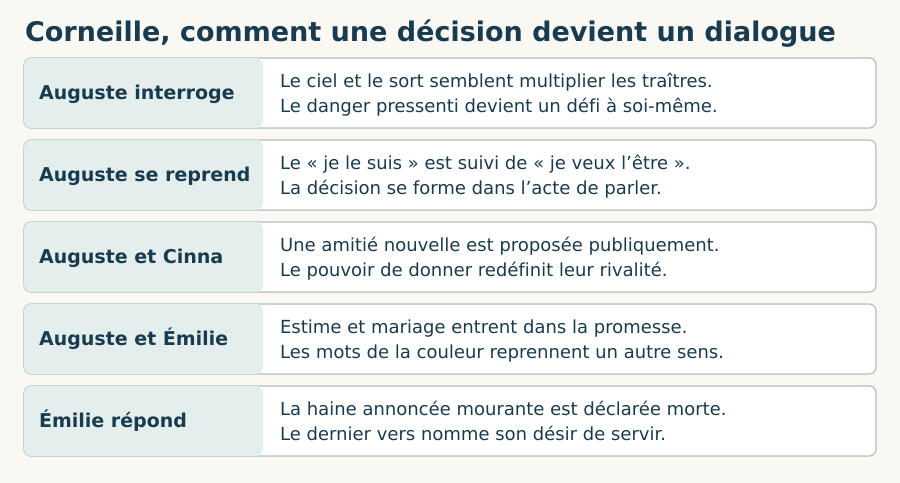
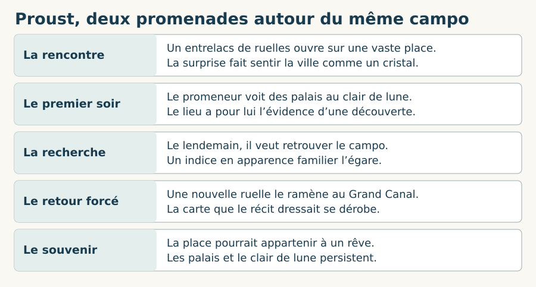

# BEL · AL — Français (oral tronc commun 19 juin) 2026 · Corrigé guidé

*Corrigé rédigé par IA, non officiel. Signalez toute erreur.*

**Rédaction** · GPT-6.2 Astra Ultra · vitesse non renseignée

**Autocontrôle** · GPT-6.2 Astra Ultra · vitesse non renseignée

La feuille du 19 juin recense onze passages dans onze œuvres. Ils sont expliqués ici dans l’ordre du document. Le rapport indique que chaque candidat choisit l’un des deux textes proposés sur son billet. La feuille collective laisse inconnue la composition de ces paires.

## Préparer la lecture et l’entretien

Le candidat dispose d’une heure et demie pour préparer l’un des deux textes de son billet. Il peut réserver une première lecture à la délimitation des voix, une seconde au découpage, puis donner à chaque mouvement une phrase qui formule ce qu’il change pour le lecteur. L’explication occupe vingt minutes, suivies de dix minutes d’entretien. Pendant la lecture à voix haute, un conditionnel chez Voltaire, une reprise chez La Fontaine ou un changement d’interlocuteur chez Corneille font déjà entendre le sens.

| Texte | Question de reprise | Réponse possible |
|---|---|---|
| D’Aubigné | À quoi sert l’objection « On dit qu’il faut » ? | Elle donne une voix au lecteur qui craint la contagion de l’exemple. Le dernier mouvement doit montrer en quoi lire une satire pourrait aider à juger ce qu’elle expose. |
| Corneille | Pourquoi Auguste répète-t-il qu’il est maître de lui ? | Le premier énoncé affirme une maîtrise. L’expression de la volonté qui le reprend fait entendre l’effort requis, avant le pardon adressé à Cinna. |
| Diderot | Pourquoi distinguer l’aventure du récit qu’en fait Jacques ? | Nous avons suivi les hésitations du maître et entendu les voix de l’auberge. Le valet revient et résume très brièvement son aventure. Diderot fait ressentir la part d’un narrateur dans la durée d’une histoire. |
| Sponde | Que modifie le dernier vers dans la comparaison avec Actéon ? | Actéon meurt pour avoir vu Diane. La séparation place l’amant dans la situation inverse et lui fait pourtant éprouver une mort figurée analogue. |
| Proust | La deuxième promenade suit-elle le parcours de la première ? | Le promeneur entreprend de retrouver, au cours d’une nouvelle sortie, une place rencontrée par hasard la nuit. Les repères se dérobent, et la certitude même d’y être allé se défait. Le texte dit « le lendemain », sans indiquer d’heure précise. |
| Retz | Qui juge Brézé, La Meilleraye et leurs mérites ? | Retz distingue l’opinion de Brézé, celle de Richelieu et ses propres appréciations. Son dernier « vous » invite la destinataire à juger en connaissance de ces écarts. |
| La Fontaine | Que devient l’éloge du voyage fait par les canards ? | Leur programme promet de découvrir les mœurs d’autrui. En vol, la tortue devient celle que les autres regardent et qu’ils acclament. Elle perd la vie en voulant confirmer leur éloge. |
| Montaigne | Pourquoi finir par les heures de repas ? | Un usage espagnol a changé la manière dont le voyageur règle sa journée. Les chevaux, les compagnons et l’appétit du narrateur fournissent des observations concrètes, chacun à sa mesure. |
| Chénier | Que marque le glissement de « peut-être » à « sans doute » ? | La conjecture devient un tableau assuré à mesure que l’Inca y projette ses propres repères alimentaires. Le poème donne à lire sa manière de raisonner autant que le pays qu’il imagine. |
| Voltaire | Pourquoi « nous sommes seuls » change-t-il le sens de la tirade au théâtre ? | Zopire est un destinataire privilégié à l’intérieur de la fiction, mais toute la salle entend le secret. Elle peut rapprocher chaque prétention à une mission commune de l’ambition personnelle avouée. |
| Chateaubriand | Quelle différence entre les jardins « peignés » et le seau où pêche le chat ? | Les jardins et le rocher anglais manifestent un effort pour embellir le site que le mémorialiste trouve vain. Le seau ordinaire devient un objet remarquable par l’activité d’un animal et l’attention de celui qui le regarde. |

## 1. Agrippa d’Aubigné, *Les Tragiques*, « Princes », vers 1061–1094

**Du sable de l’Océan au choix de montrer « sa puanteur, et sa punition ».** On vient de lire que le poète allait laisser aux libelles les récits scandaleux. La reprise de « Plustot peut on conter » met ce renoncement à l’épreuve. Le même verbe permet de raconter ces histoires et de compter ce qui se dérobe au nombre. Sables, étoiles, feuilles et fleurs font d’abord entendre une poésie de l’abondance. Deux fois elle se relance avant d’atteindre, au vers 1067, le second terme de sa comparaison. L’inventaire de ce que le monde possède de plus beau servait à mesurer, par défaut, les « infections » de la cour. Le ciel qui brillait à minuit se couvre maintenant d’orages menaçants.

« Qu’on doute des secrets » accorde quelque chose à un contradicteur. À ce qui se raconte, le poète oppose la force du témoignage visuel, « nos yeux ont veu ». Or que montrent ces yeux ? Des boucles, des couleurs, du fard et des gestes. La satire interprète la manière dont les favoris d’Henri III se présentent comme une transgression des rôles féminins et masculins, puis comme un signe de corruption politique. Les comparatifs accumulés transforment la parure en prétendue pièce à conviction. Il importe de faire entendre cette opération du discours. Une norme de genre propre au jugement du polémiste autorise son accusation. Le pluriel « nos » sollicite l’assentiment du lecteur avant même de lui soumettre le portrait.

« On dit qu’il faut » ouvre alors un procès de la satire elle-même. Ensevelir ces choses permettrait, selon l’objection, de soustraire la postérité à leur contagion. La réponse déplace la question de la maladie à celle de la filiation. La science n’engendre pas le vice, l’ignorance n’engendre pas la vertu. Le « chaud fumier » prête au silence une puissance paradoxale de fécondation. Ce que l’on cache risque de grandir. Le dernier couplet revient au vocabulaire de l’infection, avec un complément décisif. Montrer demande d’associer au spectacle du mal celui du jugement qui le sanctionne. La conclusion justifie ainsi, aux yeux du poète réformé, la continuation du poème.

**Comment retrouver le passage.** La feuille indique la p. 121 de l’édition GF, sans incipit ni explicit. Jacques Bailbé identifie et numérote en note les trois vers immédiatement précédents (1058–1060). Éliane Viennot cite le début de la réfutation (1087) et la fin du vers 1094. Le texte continu du témoin lié ci-dessous comprend entre ces deux repères les quatre vers sur le fumier, les vertus intellectuelles et l’erreur qu’omettent certaines éditions. Ce rapprochement établit les bornes de la lecture proposée. [Jacques Bailbé, p. 96, note 36](https://presses.ens.psl.eu/media/upload/document/Pamphlet%20en%20France-secure.pdf) · [Éliane Viennot, paragraphe « Dernier indice »](https://www.elianeviennot.fr/Articles/Viennot-MgV-DivorceSatyrique.pdf)

[Lire le passage dans l’œuvre](https://www.samizdat.qc.ca/arts/lit/LesTragiques_AD.pdf#page=122)

## 2. Corneille, *Cinna*, acte V, scène III, vers 1693–1728

**De la question d’Auguste au dernier vers de la réponse d’Émilie.** La clémence paraît aujourd’hui annoncer d’avance ce que fera l’empereur, parce que le titre complet de la pièce l’attache à son nom. Le début de notre passage la présente au contraire comme une décision encore à prendre. Auguste interroge le ciel, imagine que le sort et les enfers pourraient grossir le nombre de ceux qui ont trahi sa confiance. L’affirmation de sa maîtrise associe le pouvoir le plus vaste, l’univers, et le pouvoir le plus difficile à exercer sur-le-champ, celui qu’on peut prendre sur soi. Surtout, « je le suis » est repris par « je veux l’être ». Le public entend un souverain devenir l’homme qu’il prétend déjà être. L’appel à la mémoire fera de cette victoire intérieure un fait digne d’histoire.

Le vers « Soyons amis, Cinna » accomplit une action publique. Le pardon devient un don qu’Auguste veut redoubler, jusque dans la proposition du consulat et du mariage. Le vocabulaire du combat persiste, mais il s’agit de savoir lequel sera capable de donner ou de recevoir avec le plus de grandeur. Émilie reçoit ensuite sa propre adresse. La pourpre du rang offert à Cinna doit changer de sens pour celle qui voulait verser le sang de l’empereur. Dans sa réponse, elle emploie à son tour les mots du don et de la reddition. L’éclat de la bonté lui rend une vue que la terreur du supplice n’avait pas produite. La fin fait entendre le temps nécessaire à cette conversion. Émilie annonce que sa haine va mourir, puis la déclare morte, et se reconnaît « sujet fidèle ». Le passage ne se contente donc pas de faire admirer une vertu impériale. Il représente l’effet d’une décision sur la façon dont une ancienne adversaire peut désormais parler et se juger elle-même.

[Lire le passage dans l’œuvre](https://fr.wikisource.org/wiki/Cinna_ou_la_Cl%C3%A9mence_d%E2%80%99Auguste/CINNA/Acte_V)

## 3. Diderot, *Jacques le fataliste et son maître*, l’auberge

**De la traversée d’une contrée peu sûre au récit que Jacques fait de son expédition.** La feuille donne « de son expédition » et le témoin consulté porte « de cette expédition » au même endroit. Le narrateur commence par rapporter l’insécurité à une mauvaise administration et à la misère. Dans l’auberge, les cloisons laissent entendre le rire des autres et le repas des voyageurs manque de tout. On ne nous montre d’abord des brigands que les conséquences de leur présence. Le maître, qui fait les cent pas, et le valet, qui essaie de dîner malgré le mauvais vin, occupent la même chambre mais vivent déjà deux aventures différentes.

L’arrivée d’une assiette d’os fait basculer ce tableau dans le dialogue. La provocation est double, priver autrui de nourriture puis lui faire apporter le reste de son propre festin. Les questions répétées du maître n’arrêtent pas Jacques. Quand celui-ci soutient que le nombre de ses adversaires importe peu si les choses sont écrites là-haut, le maître congédie cette philosophie comme un dicton importun. La disproportion comique entre les personnages ne sert donc pas à organiser une discussion abstraite sur le fatalisme. On en entend les effets dans le rythme des réponses. Celui qui croit la suite déterminée agit, celui qui s’inquiète de son issue attend.

La scène suivante laisse percevoir l’importance du ton plus encore que celle du discours. Le narrateur remarque que ces hommes malhonnêtes tiennent à la vie autant que d’honnêtes gens. La généralité morale désamorce leur prestige romanesque et déplace le comique du côté de celui qui sait jouer son rôle avec conviction. Au retour, le maître continue à trembler. Le valet, lui, raconte l’aventure froidement et brièvement. Le roman vient pourtant de consacrer du temps à nous la faire vivre. Ce dernier contraste attire l’attention sur la différence entre une aventure, le récit que le personnage en fait à celui qui ne l’a pas vue et la manière dont Diderot nous en a distribué les incidents.

[Lire le passage dans l’œuvre](https://fr.wikisource.org/wiki/Jacques_le_Fataliste_et_son_ma%C3%AEtre)

## 4. Jean de Sponde, *Les Amours*, sonnet V

**De « Je meurs » au retournement du mythe d’Actéon.** Une déclaration de deux mots place le lecteur devant une mort qui ne cesse pourtant d’être racontée au présent. La suite du premier quatrain complique la certitude initiale. Les soucis naissent du martyre que produit l’absence, les jours et les nuits prolongent cet état, et le sujet ne sait plus décider s’il dépérit ou s’il respire. La syntaxe, qui fait attendre le verbe principal, traduit la difficulté d’un locuteur qui éprouve avant de pouvoir nommer. Il ne donne de portrait ni de la femme absente ni du lieu qui les sépare.

Le deuxième quatrain prend la forme d’une série qui s’engendre elle-même. Un chagrin en suscite mille. Le geste par lequel le locuteur veut se venir en aide lui nuit. Les « roulans ennuis » n’illustrent donc pas seulement une souffrance continue. Ils entraînent jusqu’à la parole qui voudrait s’en dégager. Le dernier vers sépare très nettement sentir et dire. À cette impasse verbale, le premier tercet répond par le nom propre d’Actéon, figure mythologique que le lecteur peut reconnaître sans description développée. L’âme qui devrait faire vivre devient ce qui tue, comme les chiens du chasseur se sont retournés contre leur maître.

Le dernier tercet ne se borne pas à confirmer cette similitude. Les deux destins arrivent au même résultat par des causes opposées. Actéon a vu la déesse qu’il ne devait pas surprendre, le sujet amoureux souffre de ne pas voir celle qu’il aime. Les derniers mots font entendre presque le même verbe pour énoncer cette différence complète. L’exemple antique a donc rendu possible ce que le sujet disait ne pouvoir exprimer. Sponde tire d’une figure connue une définition particulière de l’absence, en la retournant au moment précis où le lecteur croyait avoir reconnu l’histoire.

[Lire le passage dans l’œuvre](https://fr.wikisource.org/wiki/Premier_recueil_de_diverses_po%C3%A9sies_tant_du_feu_sieur_de_Sponde_que_des_sieurs_Du_Perron,_de_Bertaud,_de_Porch%C3%A8res_et_autres,_non_encor_imprim%C3%A9es,_recueillies_par_Rapha%C3%ABl_Du_Petit_Val,_1604/Les_Amours/Sonnet_V)

## 5. Proust, *Albertine disparue*, la place de Venise

**Du départ solitaire au clair de lune.** L’ouverture situe le promeneur dans une ville réelle qu’une comparaison avec les *Mille et Une Nuits* rend déjà disponible au merveilleux. La répétition de « au milieu » ne lui donne pourtant aucun repère fixe. La place qu’il découvre n’existe encore pour lui dans aucun récit de guide ou de voyageur. La comparaison minérale explique comment une telle surprise est possible. Les petites rues paraissent former les lignes de cristallisation de la matière vénitienne. Pour qu’un vaste *campo* y devienne visible, il a fallu que cette matière même paraisse se détendre. L’apparition des palais pâles sous la lune manifeste ainsi un changement de perception de l’espace, non un simple changement de point de vue touristique.

La feuille donne comme borne finale « clair de lune », formule qui revient deux fois dans cette page de l’œuvre. La première occurrence ferme l’apparition nocturne. Les pages 322–324 annoncées motivent aussi l’explication du mouvement qui suit, jusqu’à la seconde occurrence. Dans une autre ville, les rues pourraient signaler un ensemble architectural. À Venise, le trajet qui vient d’y conduire semble avoir été conçu pour le cacher. La comparaison avec les palais du conte oriental se prolonge donc bien au-delà de l’incipit. Elle fait du secret même de l’accès la qualité de l’endroit dont on voudrait se souvenir.

Le lendemain, vouloir retrouver la place s’avère moins efficace que de l’avoir rencontrée par hasard. Les *calli* auxquelles le narrateur demande un indice deviennent des interlocutrices rétives puis l’une d’elles paraît agir comme un mauvais génie. Le cheminement bute sur l’espace bien connu du Grand Canal. La phrase finale tire de cet échec une conséquence sur la mémoire. Si le souvenir d’un rêve diffère si peu de celui d’une expérience réelle, l’émotion vécue devant l’architecture subsiste alors même que la réalité de la visite est devenue incertaine. La reprise du clair de lune invite à comparer la certitude sensible de la première nuit et le doute dans lequel la place vient d’entrer.

[Lire le passage dans l’œuvre](https://fr.wikisource.org/wiki/Albertine_disparue/Chapitre_III)

## 6. Cardinal de Retz, *Mémoires*, première partie, la maison de Richelieu

**De la haine de Richelieu pour Mme de Guémené à l’intérêt qu’il avait à démêler les querelles de sa maison.** Le mémorialiste présente d’abord un sentiment que la puissance d’un ministre rend lourd de conséquences. Richelieu est persuadé que Mme de Guémené a contrarié son inclination pour la reine. Une lettre qu’il destinait à celle-ci est parvenue à sa belle-mère, Marie de Médicis. Il souhaite à son tour rendre publiques des lettres de Mme de Guémené. La circulation des papiers privés laisse ainsi entrevoir la cour comme un système de dépendances et de réputations. Le maréchal de Brézé, sollicité pour servir le ressentiment du ministre, rend ces lettres à Mme de Guémené, qui les avait écrites. Le narrateur juge le geste sans prétendre pouvoir décider s’il procède de l’honnêteté ou de la franchise.

Le portrait se déplace ensuite vers les raisons pour lesquelles Richelieu garde des ménagements à l’égard d’un parent qualifié d’extravagant. L’ancien prix de l’alliance familiale, les liens du maréchal avec le roi et le besoin de paix domestique restreignent la liberté du ministre. La pointe selon laquelle il pouvait tout en France, sauf mettre de l’ordre dans sa maison, résume cette disproportion avant qu’une nouvelle rivalité ne vienne l’exemplifier. Le rang et l’apparence de La Meilleraye nourrissent l’hostilité de Brézé. Richelieu lui reconnaît du courage et lui prête certaines capacités avec un excès d’estime que le narrateur prend soin de mesurer.

Dans la dernière phrase, le « vous » met l’interlocutrice des *Mémoires* en position de tirer une conclusion après avoir fait elle-même l’expérience de cette complexité. L’enchevêtrement des noms et des liens de parenté a une fonction de connaissance. Il montre combien un homme d’État dépend des volontés qu’il ne peut tout à fait gouverner, au lieu de réduire ses actes à la seule figure du tout-puissant cardinal.

[Lire le passage dans l’œuvre](https://www.ebooksgratuits.com/html/cardinal_retz_memoires_1.html)

## 7. La Fontaine, *Fables*, livre X, « La Tortue et les deux Canards »

**Une voyageuse finit par croire au titre que lui donne la foule.** De la tortue immobile, le premier vers fait une « tête légère ». Le corps qu’il faut soulever s’est déjà envolé en imagination. La répétition de « Volontiers » prête à ce désir singulier l’autorité d’une maxime. La seconde remarque fait entendre un railleur, qui s’amuse qu’on souhaite précisément le mouvement lorsqu’on s’y prête le moins. Les canards, eux, trouvent des raisons au voyage. Quelle meilleure école que la comparaison des peuples et de leurs mœurs ? Les futurs de leur discours proposent l’Amérique comme une route toute tracée. Ils finissent par invoquer Ulysse. Avec une coupe en plein vers, le narrateur reprend la parole et s’étonne lui-même de rencontrer un héros de l’*Odyssée* en pareille compagnie. Ce voyage a déjà produit un déplacement de registre.

Du « marché fait » au premier cri des témoins, les propositions se raccourcissent. L’avertissement des canards donne au lecteur une avance sur l’héroïne. Il saura pourquoi il faut qu’elle se taise. La description en vol ménage pourtant un temps de contemplation amusée. « L’animal lent et sa maison » quittent ensemble ce logis dont la tortue s’était lassée. Le public du spectacle prend la relève des canards, avec ses impératifs et la majuscule flatteuse de « Reine ». De spectatrice des peuples qu’on lui promettait, elle devient la merveille qu’un peuple regarde.

« La Reine » passe de la bouche des témoins à la sienne. « Je la suis en effet » veut arrêter l’incertitude du surnom en le confirmant de vive voix. Or la parole même qui prétend assurer le personnage lui fait perdre son appui. L’avis rétrospectif du narrateur retarde d’un instant la chute. Les derniers vers établissent enfin une généalogie. Le « babil » rend dangereuse une curiosité que la vanité a déjà détournée vers le spectacle de soi. La leçon vise cette parenté précise des travers.

[Lire le passage dans l’œuvre](https://fr.wikisource.org/wiki/La_Tortue_et_les_deux_Canards)

## 8. Montaigne, *Essais*, III, 9, « De la vanité »

**D’« Outre ces raisons » à « de faim qu’à table ».** « Le voyager », infinitif pris comme nom, fait de la route un exercice dont on peut juger les effets. Les mots « exercice », « exercitation » et « escolle » annoncent un propos d’éducation. Son maître est cependant la diversité des vies et des usages. L’inconnu oblige l’âme à « remarquer », et le verbe « gouster » fait de cette disponibilité une expérience sensible. L’attention passe au corps dès la phrase suivante. Deux excès écartés, l’oisiveté et la fatigue, définissent l’allure moyenne qui lui permet de tenir longtemps à cheval malgré ses coliques.

L’expérience supporte volontiers la contradiction. La science pratique des Romains a légué des ombrelles dont le cavalier éprouve surtout le poids sur ses bras. Ce que Xénophon raconte des anciens Perses éveille une curiosité qui reste une question. Puis la plus commune des comparaisons succède aux Anciens. Se reconnaître le goût de la pluie et de la boue « comme les canes » est une façon fort peu héroïque de s’accommoder des climats. Les contrariétés les plus difficiles viennent du dedans. Le balancement très net entre la difficulté de partir et l’aisance à poursuivre décompose une disposition qu’un seul adjectif rendrait mal.

Vient enfin la journée « à l’Espagnole ». Une coutume rencontrée ailleurs a modifié l’horaire du voyageur. Le texte en suit les conséquences pour les chevaux puis pour les compagnons, qui peuvent manger à loisir pendant que leur maître tarde à se lever. Une maxime en apparence universelle, « l’appetit me vient en mangeant », se resserre aussitôt sur ce corps-là, capable d’attendre de se mettre à table pour éprouver la faim. L’essai a tenu sa promesse initiale. Comprendre comment vivent les autres aide à observer une manière de vivre jusque dans le détail d’un repas.

[Lire le passage dans l’œuvre](https://fr.wikisource.org/wiki/Essais/Livre_III/Chapitre_9)

## 9. André Chénier, *L’Amérique*, le monde des conquérants imaginé par un Inca

**De « Pour moi, je les crois » à « dans leurs sombres forêts ».** Dans les notes de ce projet poétique, Chénier présente comme un Inca celui qui raconte la conquête du Mexique par les Espagnols. Le lecteur entend ici une voix composée par le poète. L’entrée « Pour moi » marque une prise de position au sein d’une discussion dont le contexte fournit l’enjeu. Les arrivants que l’on a pris pour des dieux pourraient être les fils de puissances mauvaises. L’image de l’« encens » renverse le rite. Ce que les dieux reçoivent avec délices, ce sont les pleurs d’autrui. Puis le locuteur examine ce que chacun peut observer. Vieillesse, maladie, mortalité rapprochent ces étrangers des hommes qui parlent d’eux. Le « Mais » fait surgir une énigme morale. Comment ceux qui leur ressemblent tant peuvent-ils montrer une telle cruauté ?

« Chez eux peut-être » avance une explication par le milieu. Une nature « avare » aurait refusé de nourrir les nouveaux venus. Le passage à « sans doute » donne de l’assurance à une hypothèse que l’orateur ne peut vérifier. Les aliments familiers permettent d’imaginer ce pays inconnu en procédant par soustraction. L’onctuosité du cacao, la douceur du coco, le miel prêté aux bananes et la boisson tirée de la mangue rendent présente l’abondance dont l’Europe hypothétique serait privée. Plusieurs verbes font de la plante, du soleil ou du champ un agent capable de dédaigner, d’ignorer ou de refuser.

Les derniers vers assombrissent la palette. L’eau paraît noire de poissons, mais le filet reste vide. À la fin, l’oiseau lui-même manque à la forêt. L’imagination a reconstitué tout un continent depuis la rive que les Européens prétendaient découvrir. Le lecteur voit à la fois ce que cette géographie a de conjectural et ce que l’interrogation de départ garde de juste. D’où vient une violence que l’apparente communauté de nature rend plus incompréhensible encore ?

[Lire le passage dans l’œuvre](https://fr.wikisource.org/wiki/%C5%92uvres_po%C3%A9tiques_de_Ch%C3%A9nier_(Moland,_1889)/Am%C3%A9rique)

## 10. Voltaire, *Le Fanatisme ou Mahomet le Prophète*, II, 5, vers 523–562

**Une seule réplique de Mahomet à Zopire.** Les conditionnels qui ouvrent la tirade construisent d’abord une scène absente. Devant d’autres auditeurs, la voix du personnage se ferait entendre comme le tonnerre d’un dieu. « Mais je te parle en homme » rend brusquement à la rencontre son caractère privé. Zopire semble obtenir une faveur insigne en devenant le destinataire de cet aveu. Les spectateurs du théâtre partagent pourtant le secret. Ils peuvent entendre dans une même voix la puissance qu’elle s’attribue en public et l’ambition qu’elle reconnaît en privé. « Tout homme l’est » commence par banaliser le trait. « Jamais » revendique aussitôt pour ce projet une grandeur sans précédent.

Aux vers 535 et suivants, le constat sur la succession des peuples dans l’histoire transforme l’ambition individuelle en prétendu destin de l’Arabie. « Par les lois, par les arts » paraît ouvrir plusieurs voies à la gloire. L’adverbe « surtout » fait entendre laquelle le personnage privilégie. La répétition de « Vois » donne l’impression que le monde entier est offert au regard de Zopire. Du trône de Perse aux murs de Constantin, les noms composent une carte orientée vers le déclin. L’Empire romain devient un « grand corps » dont la dispersion des membres autorise dans le discours le passage à « élevons ». Une vision sélective de l’histoire produit un appel à l’adhésion.

Le triple « il faut » associe culte, fers et dieu. Le rapprochement sonore et syntaxique rend sensible le prix de l’ordre annoncé. Défilent alors des figures de fondateurs, d’Osiris à Numa, avant le retour appuyé du « je ». La religion « épurée » occupe le « premier degré » d’une grandeur personnelle. Le vers final tient ensemble par deux infinitifs la gloire promise à la patrie et sa sujétion. La scène donne ainsi à juger l’argument d’un personnage tragique composé par Voltaire pour interroger le fanatisme. La sincérité de l’aveu n’accorde aucune vérité historique à sa représentation de l’islam.

[Lire le passage dans l’œuvre](https://fr.wikisource.org/wiki/Le_Fanatisme/%C3%89dition_Garnier/Le_Fanatisme)

## 11. Chateaubriand, *Mémoires d’outre-tombe*, livre XXVIII, chapitre 4, « Neuchâtel en Suisse »

**De l’ouverture du chapitre au souvenir oublié de Berthier.** Le mémorialiste annonce une « nouvelle opposition », puis résume d’une phrase les événements politiques qui vont en différer la reprise. Au lieu de développer ce programme, il rejoint en juillet la cabane que sa femme a louée. Alpes au loin, Jura dans le dos, le regard part d’une position physique précise. Immédiatement aussi, un souvenir en appelle un autre. Le lac de Bienne rappelle l’inspiration heureuse de Rousseau. La retraite se peuple de littérature jusque dans le « repas du rat des champs », qui fait revenir La Fontaine à la table d’un ancien ministre.

Le changement d’échelle donne à cette solitude son intérêt. À côté des montagnes et des grands noms, voici une « Petite Provence » glacée, un chat qui va pêcher dans un seau et une vieille femme qui tricote en préparant le repas dans sa marmite, la « huguenote ». La petite scène du chat contient un lac en miniature, puisque le seau en contient l’eau. Un goût pour les gestes ordinaires s’affirme au milieu des évocations littéraires. L’imparfait leur prête une durée que l’histoire politique de l’ouverture avait refusée.

« Neuchâtel avait eu ses beaux jours » fait entrer un autre passé dans ce paysage. La duchesse de Longueville, Rousseau en habit d’Arménien et Mme de Charrière se suivent. Puis les personnages des *Lettres neuchâteloises* entrent dans la liste des absents comme s’ils avaient, eux aussi, habité la ville. Le retour du témoin à ce qu’il voyait effectivement isole le pauvre Fauche-Borel. Les jardins « peignés » et le rocher anglais de fabrication humaine font pâle figure auprès du Jura. La dernière phrase met à l’épreuve une autre prétention à durer. Ni le titre princier décerné à Berthier par Bonaparte ni sa route du Val-de-Travers ne l’ont sauvé de l’oubli. Il reste pourtant une trace du prince, précisément dans la phrase du voyageur qui constate sa disparition.

[Lire le passage dans l’œuvre](https://fr.wikisource.org/wiki/M%C3%A9moires_d%E2%80%99outre-tombe/Troisi%C3%A8me_partie/Livre_IX)

[Liste du 19 juin](https://www.ens.psl.eu/sites/default/files/sujet_oraux_francais_19_juin.pdf) · [Rapport du jury](https://www.ens.psl.eu/sites/default/files/2026_al_rapport_oral_francais_tc.pdf)
