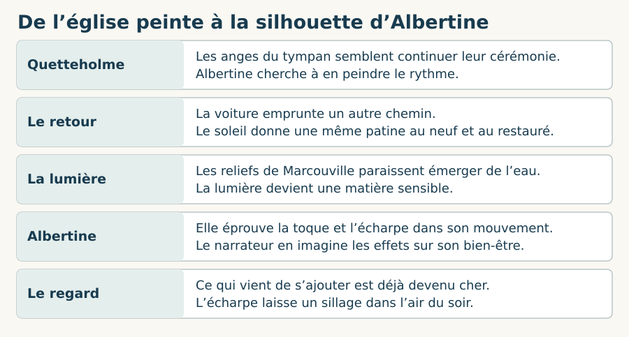
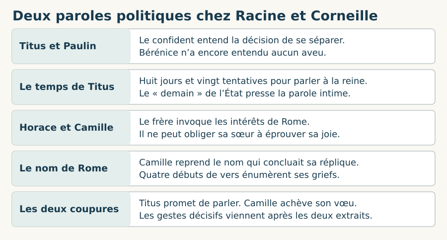

# BEL · AL — Français (oral tronc commun 22 juin commission 1) 2026 · Corrigé brut

*Corrigé rédigé par IA, non officiel. Signalez toute erreur.*

**Rédaction** · GPT-6.2 Astra Ultra · vitesse non renseignée

**Autocontrôle** · GPT-6.2 Astra Ultra · vitesse non renseignée

La première commission du 22 juin énumère onze références. Dix passages donnent lieu à une explication et à une reprise dans le guide. L’entrée 3 signale la pièce de Lamartine dont la référence ne permet pas encore d’établir le texte avec certitude. Les repères de Stendhal et de Balzac qui s’écartent du témoin consulté sont précisés dans les sections concernées.

## 1. Proust, *Sodome et Gomorrhe*, deuxième partie, chapitre III

La descente de voiture, le passage du ruisseau et l’arrivée près d’Albertine se succèdent aux imparfaits. Une habitude a pourtant gardé la précision d’un petit trajet singulier. Devant l’église de Quetteholme, la pierre se couvre des qualités d’un rosier. Les anges du tympan continuent de célébrer une cérémonie du XIIIe siècle devant un couple du XXe. Albertine, qui essaie de les peindre d’après la leçon d’Elstir, chercherait moins à reproduire des contours qu’à retrouver leur rythme. Le lieu réunit ainsi un rite ancien, un regard de peintre et le souvenir d’un amoureux.

Sur le chemin du retour, c’est le soleil qui travaille la seconde église, à Marcouville. Une même lumière donne aux parties neuves ou restaurées une patine que l’on attribuerait volontiers aux siècles. Les saints des reliefs semblent émerger d’une eau mêlée de lumière. Dans la première scène la pierre avait fleuri, dans la seconde elle paraît devenir fluide. Le trajet en automobile rapproche ces deux expériences sans les confondre.

La dernière phrase quitte les saints pour la toque de paille et l’écharpe de soie. Ces pièces récentes du vêtement d’Albertine participent pour elle au sentiment de son propre corps. Le narrateur, qui peut seulement les suivre des yeux, leur prête une impulsion et en perçoit le sillage auprès du cyprès. Ce qu’a déposé le couchant sur la pierre et ce qu’un vêtement ajoute à une personne peuvent, en très peu de temps, devenir inséparables de l’être qu’on aime regarder.

[Lire le passage dans l’œuvre](https://fr.wikisource.org/wiki/Sodome_et_Gomorrhe/Texte_entier)

## 2. Stendhal, *Le Rouge et le Noir*, les journées de Julien au séminaire

La feuille indique « Le lecteur conclura… » et s’arrête aux « tristes journées ». Au début de la première partie, chapitre XXVII, le témoin consulté s’adresse au lecteur par « Le lecteur voudra bien nous permettre ». La seconde borne est littérale. L’explication suit ce passage du chapitre et signale l’écart dans la première formule.

Le narrateur demande la permission de donner peu de faits précis sur cette période. Il affirme pourtant en connaître beaucoup. La privation de détails procède ainsi d’une décision de romancier. La métaphore du coloris et la mention des lecteurs contemporains font paraître deux exigences difficiles à concilier, dire quelque chose du présent et conserver à un conte le pouvoir d’être lu pour le plaisir. La noirceur annoncée se manifeste d’abord dans l’échec très concret de Julien, incapable d’acquérir l’hypocrisie des gestes attendue au séminaire.

Le voici seul à juger la carrière où il se trouve. À côté de l’exemple héroïque des grands hommes surgissent une omelette au lard et le souvenir de l’abbé Castanède. Julien admire les efforts accomplis au nom d’une cause qu’on juge belle. Mais que faire de la volonté admirée dans ses livres quand il éprouve du dégoût pour la compagnie où elle devrait s’exercer ? Les interrogations font entendre cette impasse sans décider d’avance combien l’orgueil y a de part.

Le récit énumère alors deux issues crédibles à Besançon, l’armée ou l’enseignement du latin. Julien pourrait gagner de quoi vivre. Cependant, renoncer à une carrière qu’il puisse imaginer serait pour lui une sorte de mort. La dernière phrase annonce précisément le « détail » d’une journée, après le refus initial d’accumuler les faits. Un seul jour bien choisi pourra faire sentir ce que la généralisation laissait inaperçu.

[Lire le passage dans l’œuvre](https://fr.wikisource.org/wiki/Le_Rouge_et_le_Noir/Texte_entier)

## 3. Lamartine, *Méditations*, pièce XI

La feuille donne pour toute référence le numéro XI et la page 290 de l’édition Garnier. La notice de l’édition établie par Fernand Letessier permet d’identifier un volume compatible avec cette pagination. Il reste à vérifier quelle pièce commence ou se trouve à cette page. Un numéro peut se répéter entre les recueils de *Méditations*. Cette édition du corrigé laisse donc cette lecture en attente du témoin paginé.

[Notice BnF de l’édition Garnier établie par Fernand Letessier](https://catalogue.bnf.fr/ark:/12148/cb466330716)

## 4. Apollinaire, *Alcools*, cinq quintils de « La Chanson du mal-aimé »

Le premier quintil fait courir le regard du soleil à une épouse ténébreuse. Le « tu » auquel le poète a parlé est finalement nommé comme son ombre. Cette compagne inséparable n’a pourtant d’existence propre que dans une formule contradictoire. La lumière même qu’elle aime la fait paraître, et elle porte déjà le deuil de celui dont elle dépend. En l’absence de ponctuation, la voix peut conserver un moment à l’apostrophe la présence d’une personne aimée avant de la rendre au seul locuteur.

Les deux quintils suivants font passer le monde de l’hiver au printemps. La blancheur change de forme, des ruches enneigées aux boucliers d’argent. Les argyraspides portent le nom antique des soldats aux boucliers d’argent, tandis que les dendrophores évoquent des porteurs d’arbres. Ces noms savants donnent à la fuite de la neige l’ampleur d’un changement de règne. Or la saison claire appartient aussi aux gens pauvres qui recommencent à sourire sans avoir les yeux secs. Un reste de douleur traverse la promesse du renouveau.

« Et moi » disjoint alors la saison collective du temps affectif du poète. Une comparaison familière et charnelle donne au cœur gros une dimension presque burlesque, avant le retour d’une déclaration douloureusement simple. Les épées, annoncées au dernier vers d’une strophe, deviennent les premiers mots de la suivante. Elles ont perdu jusqu’au morfil qui rendrait leur action matériellement sensible, mais leur pluralité emplit le cœur. La folie prétend raisonner. La question finale demande à des interlocuteurs incertains comment l’oubli pourrait suivre le retour des saisons.

[Lire le passage dans l’œuvre](https://fr.wikisource.org/wiki/Alcools/La_Chanson_du_mal-aim%C3%A9)

## 5. Balzac, *Le Lys dans la vallée*, le récit du jardin

La liste du jury donne « Quoique délaissé par sa mère ». Le récit lié ci-dessous est à la première personne et porte « par ma mère ». Ce changement de personne importe. Félix raconte à sa destinataire comment il en est venu à trouver un réconfort dans la contemplation, et choisit une aventure de son enfance pour lui faire comprendre ses malheurs.

Les scrupules maternels devraient annoncer un rapprochement. L’enfant les redoute davantage que l’abandon. Dans le jardin, cailloux, insectes et ciel constituent une série de compagnons silencieux auxquels son attention est libre de se donner. Un soir sous le figuier, l’étoile absorbe cette attention. Les cris des sœurs lui parviennent atténués, puis cessent, et la nuit change sans qu’il s’en aperçoive. Le narrateur adulte prête à cette absorption une intelligence affective déjà capable de faire de l’éloignement une ressource.

Le point de vue change brutalement quand la mère remarque son absence. La gouvernante, qui voudrait se soustraire au reproche de sa négligence, transforme le calme de l’enfant en intention mauvaise. Elle sait pourtant fort bien où le trouver. L’échange des voix rend sensible la disproportion des pouvoirs. À une question simple l’enfant apporte une réponse simple. Depuis le balcon, la mère la récuse en supposant qu’il faudrait connaître l’astronomie pour regarder une étoile. La gouvernante profite de cette incrédulité pour annoncer une inondation du jardin. La coupure laisse au lecteur le soin de confronter ce dernier récit alarmant à la scène qu’il a vue de l’intérieur.

[Lire le passage dans l’œuvre](https://fr.wikisource.org/wiki/Le_Lys_dans_la_vall%C3%A9e)

## 6. Rousseau, *Les Rêveries du promeneur solitaire*, septième promenade

Le souvenir promis comme inoubliable commence en récit d’herborisation. Le promeneur s’enfonce de bois en bois, approche de précipices dont la vue même exige une précaution du corps, écoute les oiseaux et distingue des espèces de plantes. Les noms botaniques donnent une précision savante au plaisir de trouver. Ils situent aussi une première façon d’occuper le lieu, avant que le collectionneur oublie sa recherche et s’assoie sur la mousse pour rêver.

Au sentiment d’être à l’abri de ses persécuteurs succède un plaisir tout différent, celui de se croire le premier humain parvenu là. Le souvenir de Colomb donne à la montagne suisse les dimensions d’un monde neuf. Le narrateur désigne après coup ce qu’il y avait de vanité dans ce rêve. Le démenti ne prend pas la forme d’un raisonnement. Un bruit se répète. L’attention du promeneur formée tout à l’heure par les oiseaux le pousse de nouveau à écouter, puis à se déplacer. À vingt pas de sa prétendue découverte, il aperçoit une manufacture de bas.

Le retournement comique ne produit pas un sentiment unique. Une joie immédiate d’être à portée d’autres hommes cède à une douleur plus longue, celle d’imaginer que ses ennemis pourraient l’atteindre jusque-là. Le lecteur peut suivre ce passage rapide d’une interprétation à l’autre sans être tenu d’accréditer l’existence du complot évoqué. Rousseau finit par rire de lui-même. L’aventure montre ce que l’observation peut corriger dans une rêverie, mais aussi la force avec laquelle celui qui rêve compose le sens d’un lieu et de ses bruits.

[Lire le passage dans l’œuvre](https://fr.wikisource.org/wiki/Les_R%C3%AAveries_du_promeneur_solitaire/Septi%C3%A8me_Promenade)

## 7. Clément Marot, les adieux à la ville de Lyon

La première adresse superpose la ville et le lion. Le nom permet d’attribuer à Lyon une douceur accueillante et de lui conserver une vigueur menaçante pour son ennemi. Le jeu de « point », qui entre dans une négation, et de « poingt », qui évoque une atteinte, fait déjà du congé une fête de la parole. L’adieu se distribue ensuite aux visages et aux groupes que le voyageur a connus. Son retour en tête des vers importe autant que la variation des personnes qui le reçoivent.

Aux citoyens, Marot souhaite une fortune meilleure que la sienne. La dette de gratitude excède tout compte. Aux vieillards qui ont gardé leur amour de la vertu il promet des épitaphes, à condition, ajoute-t-il, de ne pas mourir le premier. Avec les jeunes gens que la poésie attirait, le compliment fait un autre détour. Le mérite du succès reviendrait à sa petite Muse. Le poète se donne le rôle du mari peu gracieux qu’on vient voir pour la beauté de son épouse. Chaque destinataire transforme ainsi la façon dont l’auteur lui-même peut se représenter.

La Saône et le Rhône font apparaître deux trajets, celui de l’eau vers Avignon et celui du poète vers Paris. L’adieu qu’il pourrait dire à une maîtresse devient un adieu à la jeunesse lorsqu’il remarque sa barbe grise. Le dernier huitain revient à l’animal du début, en plaçant le petit chien sous la protection du grand lion. Au terme d’un adieu répété jusqu’au million, la mention de Turnus vêtu de rouge donne au congé collectif la précision d’un hommage personnel au gouverneur.

[Lire le passage dans l’œuvre](https://www.dick.wursten.be/marot/marotpoems_dutch.html)

## 8. Céline, *Voyage au bout de la nuit*, Rancy

Bardamu reconnaît à Rancy la même lumière qu’à Detroit. Le rapprochement de deux banlieues industrielles très éloignées efface d’emblée le prestige attendu du voyage. Les premières images donnent à la lumière une consistance de liquide sale et aux cheminées l’apparence de piquets dans la vase. Des fragments de phrase présentent d’abord le décor comme une matière en amas. Une très brève formule y replace brusquement les habitants et le narrateur parmi eux. À la vue de loin succède la parole de celui qui vit là.

La comparaison avec le crabe ramène le bord de mer au courage très ordinaire de demeurer. La Seine pourrait ouvrir sur une méditation au fil de l’eau. Le pont, les berges et les usages du dimanche mêlent au contraire un mouvement vers l’éternité à des gestes corporels triviaux. Il faut attribuer à Bardamu le jugement abrupt porté au passage sur les femmes. Ce raccourci révèle sa manière de distribuer les rôles dans le tableau collectif.

Le matin du départ au travail change l’échelle et la vitesse. Tramway, métro, foule qui se presse, l’allure d’une fuite collective fait imaginer une catastrophe. La rectification du narrateur est mordante. Ces gens se précipitent vers le patron dont ils ont peur de perdre l’emploi. L’alternance de « ils », du « vous » et du « on » fait entrer le lecteur dans une condition physique durable, avec la sueur et la fatigue qui l’accompagnent. Le trajet s’achève sur la querelle d’un billet susceptible d’immobiliser toute la ligne. La même foule que l’aube entraînait d’un seul mouvement redevient ainsi un ensemble de voix irritées.

[Lire le passage dans l’œuvre](https://web-facstaff.sas.upenn.edu/~cavitch/pdf-library/Ce%CC%81line_Voyage_au_bout_de_la_nuit.pdf)

## 9. Racine, *Bérénice*, II, 2

Titus parle à Paulin. Le passé de l’amour est d’abord celui d’un homme qui ne rendait compte qu’à lui-même de ses désirs parce qu’un autre portait la charge de gouverner. La mort du père se précise en un geste intime de la main qui lui ferme les yeux. Ce même instant livre toute la vie restante du fils aux regards de l’univers. « Renoncer à moi-même » porte donc plus loin que le seul renoncement à la femme aimée. Titus se découvre responsable d’un rôle qui change le statut de ses propres sentiments.

Il imagine alors le jugement de Rome sur son premier acte de prince. Le bonheur privé pourrait-il se fonder sur les débris des lois ? La question fait entendre une réponse déjà décidée face au confident. Mais la décision ne donne pas encore le pouvoir de prononcer les mots devant Bérénice. Les vingt tentatives en huit jours opposent le calendrier bientôt pressant à l’immobilité d’une langue qui se glace. Bérénice interprète ses larmes avec une tendresse qui rend l’aveu plus pénible. Son geste veut soulager le mal dont elle ignore être, selon le raisonnement de Titus, la victime prochaine.

Les marques d’un retour à la résolution s’accumulent dans la fin de la tirade. Il faut rompre le silence, faire venir Antiochus, organiser le voyage vers l’Orient. Demain Rome verra partir la reine. Pourtant la phrase qui promet de lui parler pour la dernière fois est encore prononcée devant Paulin. Le spectateur éprouve toute la distance qui reste entre une action racontée comme certaine et la première parole qu’il faudra vraiment adresser à celle qu’on aime.

[Lire le passage dans l’œuvre](https://fr.wikisource.org/wiki/B%C3%A9r%C3%A9nice_(Racine,_%C3%A9ditions_Barbou,_1760))

## 10. Balzac, *La Femme de trente ans*, chapitre VI

Une femme sous un acacia à midi aurait retenu le regard d’un poète de passage. Le conditionnel installe un observateur possible devant celle que le lecteur va connaître comme madame d’Aiglemont. La répétition de l’ombre d’acacia la rend particulièrement grêle auprès du visage pâle. Le narrateur propose qu’on lise sur ce visage une des mille choses qui y seraient écrites. Sa visibilité ne suffit donc pas à assurer à tous les lecteurs le même savoir.

Une promenade imaginaire au musée développe cette expérience. La douleur maternelle, l’innocence au cœur d’une histoire criminelle et la majesté de la royauté constituent autant de rencontres avec des figures qui dominent celui qui les regarde. Le « vous » lui assigne un rôle plus troublant que celui du simple connaisseur. Les tableaux l’interrogent et répondent à ses propres pensées. Puis les images deviennent des poèmes et le passage de Dante rend à la femme assise une profondeur que la seule description de ses traits ne pouvait restituer.

Le dernier mouvement propose la théorie générale d’un narrateur qui croit savoir à quel âge un visage féminin devient lisible. Une rougeur échappe à l’interprétation lorsque la jeunesse donne naturellement des couleurs vives. Le lac à la surface polie offre la dernière image de cette apparente immobilité. La formule sur la trentaine prend alors valeur de seuil dans une esthétique de la physionomie, et fait signe vers le titre du roman. Le commentaire doit faire entendre aussi les présupposés de cette généralisation. Le narrateur mêle une prétendue faiblesse naturelle aux contraintes très réelles qu’il attribue aux lois sociales, et revendique pour lui le pouvoir d’en lire les effets sur un visage.

[Lire le passage dans l’œuvre](https://fr.wikisource.org/wiki/La_Femme_de_trente_ans/Chapitre_6)

## 11. Corneille, *Horace*, IV, 5, vers 1278 à 1318

Le vers 1278 donne d’emblée la parole à Camille. Son frère devrait lui donner son propre cœur pour exiger d’elle son propre sentiment. L’impératif de lui rendre Curiace, qu’elle aimait, révèle aussitôt l’impossibilité de l’exigence inverse. Un parallélisme très simple relie la joie à la vie de l’amant et la douleur à sa mort. Camille peut ainsi soutenir que la fidélité à soi requiert le deuil, là où Horace voudrait voir dans la victoire de Rome une raison commune de se réjouir.

Elle reprend à son frère les mots de la gloire pour lui en faire souhaiter l’envers. Horace appelle alors « outrage » ce qu’il vient d’entendre et invoque le bonheur collectif. La répétition de l’impératif d’aimer laisse éclater la contradiction d’un sentiment commandé. Son dernier vers fait de Rome la créancière de chacun de ses enfants. Camille répond en reprenant quatre fois le nom de la ville au début des vers. Le même nom propre qui terminait l’argument d’Horace devient l’origine d’une série de motifs de haine, le dernier tenant au lien que la ville entretient avec le frère qu’elle admire.

Les souhaits qui suivent élargissent progressivement leur horizon aux voisins, à l’Italie, aux peuples les plus éloignés, à Rome elle-même et au ciel. L’imaginaire donne à la seule voix endeuillée la mesure de l’univers invoqué. Mais toute cette amplitude revient finalement au regard singulier de Camille et aux lauriers du frère. L’ultime vers la voudrait seule cause de la disparition souhaitée et noue le plaisir à sa propre mort. La coupure du jury précède le geste d’Horace. C’est à la puissance d’une parole, encore suspendue sur scène, que l’explication doit ici s’arrêter.

[Lire le passage dans l’œuvre](https://fr.wikisource.org/wiki/Corneille,_Pierre_-_%C5%92uvres,_Marty-Laveaux,_1862,_tome_3/Horace/Acte_IV)

[Liste du 22 juin, commission 1](https://www.ens.psl.eu/sites/default/files/sujet_oraux_francais_tc_1_22_juin_al.pdf) · [Rapport du jury](https://www.ens.psl.eu/sites/default/files/2026_al_rapport_oral_francais_tc.pdf)
