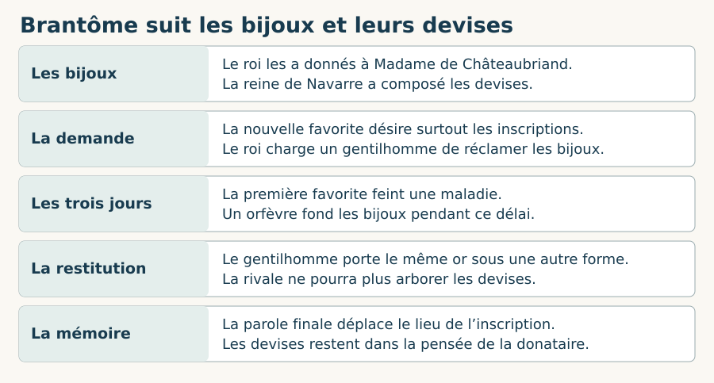

# BEL · AL — Français (oral tronc commun 22 juin commission 2) 2026 · Corrigé guidé

*Corrigé rédigé par IA, non officiel. Signalez toute erreur.*

**Rédaction** · GPT-6.2 Astra Ultra · vitesse non renseignée

**Autocontrôle** · GPT-6.2 Astra Ultra · vitesse non renseignée

La deuxième commission du 22 juin imprime onze références, six le matin et cinq l’après-midi. La lettre CLXI de Laclos et l’anecdote de Brantôme paraissent chacune deux fois. Les neuf explications suivent l’ordre de première apparition. Le candidat choisissait l’un des deux textes de son billet. Le relevé ne précise pas comment ils étaient appariés.

## Préparer la lecture et la reprise

Le rapport accorde une heure et demie de préparation, vingt minutes d’explication et dix minutes d’entretien. Commencez par résoudre une difficulté de lecture à voix haute. Dans la lettre CLXI, marquez à qui Tourvel croit parler à chaque changement de pronom. Pour *Polyeucte*, gardez les conditionnels jusqu’au bout de l’hypothèse. Chez Chateaubriand, faites entendre la différence entre la narration de la promenade et la comparaison des deux moments de la vie. Ces décisions de lecture donnent déjà accès au sens.

| Passage | Question de reprise | Réponse possible |
|---|---|---|
| Corneille | Pourquoi Sévère reprend-il le soupir évoqué par Pauline ? | Pour elle, ce soupir marque le prix intime qu’aurait coûté l’obéissance. Lui en fait ironiquement un remède bien léger, puis imagine qu’une larme lui aurait permis à son tour de guérir. |
| Laclos, LII | Quelle liberté reste-t-il à Tourvel dans une série de questions ? | Elle peut matériellement refuser de répondre. La lettre cherche à renchérir sur le coût moral du refus en le faisant passer pour de l’insensibilité à la souffrance. |
| Laclos, CLXI | Quel mot rattache le milieu de la dictée à la correspondance ? | Tourvel demande que ses amies répondent à « cette lettre ». Leur absence à toutes deux devient alors sensible, après plusieurs répliques adressées à un homme qu’elle croyait présent. |
| Brantôme | Pourquoi le gentilhomme a-t-il tant d’importance ? | Il porte la demande du roi, puis rapporte les lingots et les paroles de la favorite. Par lui, ce qui devait être une restitution silencieuse devient un message que la cour pourra répéter. |
| Rimbaud | Qu’apporte la question sur la langue du locuteur ? | Celui qui refuse le travail des mains reconnaît un pouvoir à la parole qui lui a permis de vivre. Le poème exerce ce pouvoir chaque fois qu’une formule retourne la précédente. |
| Lévi-Strauss | Pourquoi choisir une indication aussi exacte que l’heure d’entrée au port ? | L’heure confère au souvenir le relief d’une chose vue. Elle n’apprend rien à elle seule sur l’organisation de la société étudiée. La phrase donne ainsi à éprouver la difficulté du choix entre deux manières de raconter. |
| Marivaux | Quel changement de rythme introduit l’annonce des dettes ? | Après les propositions qui se font longuement équilibre, deux phrases courtes rapprochent l’étendue de l’expérience et celle des dettes. Le comédien peut préparer le geste qui montrera le paquet. |
| Chateaubriand | Le chant de la grive fait-il éprouver deux fois la même chose ? | La sensation rend les deux lieux présents et permet de comparer deux tristesses. Le jeune homme attendait un bonheur encore inconnu. Le mémorialiste connaît la poursuite qui a occupé sa vie. |
| Malherbe | Qui formule la réponse accordée par la princesse ? | Le poète l’interprète dans un regard et la met lui-même en mots. La question finale attribue ainsi à la dédicataire le pouvoir de fixer le prix de l’hommage. |

## 1. Corneille, *Polyeucte*, II, 2, vers 461 à 496

Sévère, que Pauline a cru mort, retrouve celle qu’il aime mariée à Polyeucte. Le premier « je l’aime » désigne le mari. La franchise même de la réponse est une marque d’estime pour celui qui l’entend. En se nommant à la troisième personne, Pauline engage devant Sévère l’idée qu’elle se fait d’elle-même. Elle lui refuse une consolation commode, celle de croire qu’une information fausse a seule décidé de son sort.

Pauline construit deux mariages imaginaires. Libre de son choix, elle aurait préféré le mérite de Sévère à la grandeur des monarques. Soumise au choix paternel, elle aurait obéi même si Sévère avait porté une couronne, même si elle avait détesté l’époux désigné. Le parallélisme des deux hypothèses fait mesurer la puissance de l’inclination aussi bien que celle du devoir. L’aveu du soupir importe. L’obéissance a un coût, et Pauline prête à la raison le pouvoir de travailler ses sentiments dans le temps.

Sévère recueille le soupir pour lui donner une tout autre valeur. Son « un peu » raille une guérison qu’il imagine trop facile. Il appelle Pauline « reine » de ses désirs après qu’elle a déclaré sa dépendance à l’égard du père. Il rêve à son tour au conditionnel. Une larme lui aurait permis de l’oublier, il serait heureux avec une autre. Mais l’apostrophe du vers 495 rend ce scénario intenable au moment même où il l’achève. Les deux questions finales portent successivement sur la définition de l’amour et sur leur histoire singulière. Ce que Pauline présentait comme l’hommage de sa sincérité devient pour Sévère une raison de douter d’avoir jamais été aimé.

[Lire le passage dans l’œuvre](https://fr.wikisource.org/wiki/Corneille,_Pierre_-_%C5%92uvres,_Marty-Laveaux,_1862,_tome_3/POLYEUCTE/Acte_II)

## 2. Laclos, *Les Liaisons dangereuses*, lettre LII

Tourvel a posé une limite précise. En la rappelant dans les premiers mots de sa lettre, Valmont trouve déjà le moyen de reparler de son amour. Il installe la présidente dans un rôle de juge. Elle aurait ordonné son exil, imposé des privations, exigé des sacrifices. Les états de souffrance s’accumulent avant que le verbe principal, longtemps suspendu, fasse paraître la permission d’écrire comme la dernière consolation à soustraire au malheureux. Le lecteur peut suivre la construction de ce personnage de victime jusque dans la cadence de la phrase.

Les interrogations suivantes accordent à la destinataire une faculté de réponse que chacune réduit sitôt après. Détourner les yeux des pleurs, ce serait manquer de compassion. Plaindre un malheureux devrait convenir à une âme que la lettre qualifie d’avance de douce et d’honnête. Accepter le portrait flatteur revient déjà à devoir examiner la demande de Valmont selon les termes qu’il a choisis.

Puis il attribue à Tourvel une crainte feinte et lui impute les maux qu’elle redoute. À la souffrance du seul épistolier succède le tableau d’un bonheur supposé partagé. La construction en série prête aux promesses abstraites la continuité d’une vie heureuse, mais il manque précisément l’accord de la femme à laquelle ces bénéfices sont promis. La dernière proposition transforme le soupirant en avocat de l’amour lui-même. Son apparente générosité couronne une entreprise très intéressée. La défense d’une idée universelle lui a permis de contester de part en part le refus particulier dont il partait.

[Lire le passage dans l’œuvre](https://fr.wikisource.org/wiki/Les_Liaisons_dangereuses/Lettre_52)

## 3. Laclos, lettre CLXI

L’en-tête laisse vacant le nom du destinataire. Une autre main écrit sous la dictée de la présidente de Tourvel. Ces deux indications donnent leur portée aux changements d’adresse. Au début du passage, le démonstratif et la troisième personne font de l’homme une apparition que Tourvel reconnaît. Le passage au tutoiement lui donne aussitôt la présence d’un interlocuteur. Les impératifs imaginent des gestes d’accueil, tandis que l’injonction de ne plus se séparer répète et prolonge des retrouvailles qui ne se produisent que dans la parole. Tourvel écoute son propre cœur pour y reconnaître de l’amour. Quelques questions suffisent pour que les mêmes traits lui apparaissent méconnaissables. La voix change de direction au milieu d’un ordre. Celle qui voulait être accueillie demande maintenant qu’on la laisse.

L’appel à deux amies ouvre la possibilité d’un secours extérieur. Tourvel distingue assez précisément celle qui conseillait la fuite et celle qui promettait du réconfort. Mais elle échoue à les faire apparaître et demande une réponse à « cette lettre ». L’objet que le lecteur tient retrouve ainsi sa fonction de correspondance au milieu d’un discours presque théâtral.

Dans le dernier mouvement, le retour du tutoiement rallume le conflit. Une maxime sur la haine qui abîme le cœur où elle se forme suspend brièvement la plainte. Puis le « vous » impose une distance que la formule finale, « Adieu, Monsieur », rend presque cérémonieuse. Tourvel se dit privée de la possibilité de répondre, au moment où sa voix remplit la page. La lettre rend audible cet effort pour retrouver une limite et garde la trace de toutes les positions affectives qu’il a fallu traverser.

[Lire le passage dans l’œuvre](https://fr.wikisource.org/wiki/Les_Liaisons_dangereuses/Lettre_161)

## 4. Brantôme, *Les Dames galantes*, les bijoux de Madame de Châteaubriand

Le narrateur a entendu raconter cette histoire et garantit la qualité de son informateur sans le nommer. Cette petite réserve éclaire la suite. L’attrait de l’anecdote tient à une réponse mémorable qu’on pourra transmettre à son tour. Une longue phrase présente d’abord la succession de deux favorites à la cour de François Ier. L’image familière du clou chassé par un autre semble régler en quelques mots le sort de la première. Pourtant, pour l’évincer tout à fait, Madame d’Étampes veut aussi porter quelque chose qui lui a appartenu.

La précision sur le prix des bijoux détache la valeur décisive de leur matière. Les devises viennent de la reine de Navarre, sœur du roi. Le don porte donc à la fois une marque de la faveur royale et l’invention verbale d’une femme. La nouvelle favorite s’adresse au roi, le roi envoie un gentilhomme. L’ordre paraît devoir descendre sans obstacle. Or Madame de Châteaubriand se donne trois jours en feignant la maladie. Le délai met entre ses mains la possibilité de décider de la forme de l’objet rendu.

À l’envoyé qui réclame des bijoux elle remet leur or, fondu en lingots. Sa réponse passe enfin au discours direct. Elle peut parler le langage du don révoqué et rendre exactement le métal qu’elle a reçu. Les devises restent pourtant « empreintes » dans sa pensée. Le mot qui désignait une inscription sur la matière désigne désormais un souvenir dont elle dispose seule. Sa rivale aura d’autant moins obtenu ce qu’elle voulait que le lecteur, lui aussi, ignore la teneur des devises. La coupure du jury donne le dernier mot à celle que le début de l’anecdote annonçait comme remplacée.

[Lire le passage dans l’œuvre](https://fr.wikisource.org/wiki/L%E2%80%99Heptam%C3%A9ron_des_nouvelles/Extraits_de_Brant%C3%B4me)

## 5. Rimbaud, *Une saison en enfer*, « Mauvais sang »

Le premier paragraphe ressemble un instant à un inventaire de traits héréditaires. Une précision sur la chevelure vient déjà dérégler le sérieux du portrait. Le locuteur passe librement du corps à l’habillement, d’un aspect de l’œil à un jugement sur l’intelligence. Sa façon même de compter ses ressemblances rend sensible la fragilité du raisonnement qui prétendrait déduire un être de ses ancêtres. Dans l’inventaire des vices, les incises permettent de changer de ton et même de louer soudain ce qu’on vient d’inscrire au passif.

Le refus des métiers transporte la dispute dans le présent. Main qui écrit, main qui travaille la terre, siècle livré aux mains, puis main que le locuteur refuse d’avoir. Le même mot sert tour à tour à rapprocher deux activités, à congédier un ordre social et à rendre suspecte la position de celui qui écrit. Les échappatoires énumérées ensuite suscitent chacune une objection. Une question sur la « langue » fait alors de la parole elle-même ce qui a permis au personnage de vivre. Il se donne une expérience européenne immense avant de resserrer son affirmation sur les familles qui tiennent leur place de la Révolution et de ses droits.

Un souhait irréel cherche pour finir des antécédents dans l’histoire nationale. La réponse tient en deux mots, « non, rien », que suit pourtant une nouvelle déclaration de filiation. Le terme de « race inférieure » fait entendre une hiérarchie historique et sociale dont le locuteur essaie les catégories contradictoires. L’image finale des loups distingue la révolte dont il se dit incapable du pillage qu’il prête à ses ascendants. Cette généalogie n’a cessé de se fabriquer et de se défaire à mesure que la voix cherchait une place où se tenir.

[Lire le passage dans l’œuvre](https://fr.wikisource.org/wiki/Une_saison_en_enfer_(1873)/Mauvais_sang)

## 6. Claude Lévi-Strauss, *Tristes tropiques*, ouverture

La première phrase condamne l’activité à laquelle le titre du livre pouvait faire attendre un hommage. La seconde annonce des expéditions et rattache directement le narrateur à ce qu’il vient de récuser. Les quinze années écoulées depuis son dernier départ du Brésil donnent à cette contrariété une durée. Il a souvent projeté d’écrire, et chaque recommencement a rencontré une résistance. Une question sur les détails à raconter déplace alors le problème du goût personnel vers le choix même de ce qui mérite un récit.

Le passage au métier d’ethnographe ouvre la phrase à d’autres sujets que le seul « je ». Le temps du trajet, celui de l’attente, celui de la maladie n’ont aucun rapport nécessaire avec la valeur de ce que l’enquête permettra d’apprendre. La comparaison inattendue avec la routine du service militaire rabat la forêt supposée aventureuse sur les corvées répétitives. Les six mois de déplacement opposés aux quelques heures parfois nécessaires pour recueillir un mythe ou une règle de parenté produisent un écart mesurable. La liste des objets savants fait entrevoir ce que le livre pourrait transmettre sur d’autres sociétés.

La dernière phrase offre cependant au lecteur une heure précise, un port, des cris d’oiseaux et l’activité des marchands. Le souvenir de Recife a déjà pris vie quand revient la question de savoir s’il faut l’écrire. Les mots qui désignent un résidu séparent la connaissance de ses circonstances, tandis que l’art de l’écrivain restitue la force de ces circonstances. La question finale place le lecteur en situation d’éprouver la difficulté qui a si longtemps retardé le livre.

[Lire le passage dans l’œuvre](https://www.esgt.cnam.fr/medias/fichier/franc-ais-2022_1666167367668-?ID_FICHE=1276239&INLINE=FALSE)

## 7. Marivaux, *La Fausse Suivante*, I, 1

Trivelin résume quinze années à Frontin. La première phrase place en vis-à-vis le mouvement de celui qui « roule » et l’« état fixe » qu’il aurait voulu atteindre. Ses décisions successives paraissent montrer beaucoup de constance dans son désir de changer. Il a même suspendu ses scrupules pour s’épargner des reproches. Le détour logique a la netteté plaisante d’une règle de morale. Trivelin adapte ensuite ses qualités au besoin du moment. Il peut avoir de l’honneur sur commande et devenir fourbe tout en accordant à sa conscience le léger dédommagement d’un soupir.

Frontin lui concède qu’il est difficile de se protéger de certains plaisirs. La brièveté de cette intervention forme à la fois une pause et une invitation à reprendre. Alors la série des balancements donne à Trivelin la virtuosité d’un acteur qui saurait jouer maître et valet. Le sort qu’on lui réserve dépend de son apparence. La longue suite des métiers, manières et habits finit pourtant par le rendre suspect à tous. Après tant de symétries savantes, deux phrases très brèves font tomber le bilan de ses expériences et de ses dettes.

Le catalogue des logements arrive jusqu’à la justice, plaisamment transfigurée en hôtesse aux appartements peu aimables. Un paquet enfin montré sur scène sert de preuve matérielle à ce récit de métamorphoses. La reprise des quinze ans referme la boucle. Là où Trivelin feint de reprocher au monde son ingratitude, le public voit aussi ce que valent sur le théâtre son éloquence, son inventivité et ce pauvre accessoire. Le dernier mot chiffre la valeur marchande du paquet et laisse entendre, par le contraste, tout ce que son possesseur a su en tirer devant nous.

[Lire le passage dans l’œuvre](https://fr.wikisource.org/wiki/La_Fausse_Suivante/Acte_I)

## 8. Chateaubriand, *Mémoires d’outre-tombe*, le chant de la grive

Le promeneur de Montboissier date son souvenir d’hier soir. Il commence par voir. Au-dessus de la tour d’Alluye le soleil se couche comme il l’a fait pour Gabrielle deux siècles plus tôt. La question sur Henri et Gabrielle change le sens du tableau. Le mémorialiste se place lui-même dans le passé de celui qui le lira. Le futur antérieur fait de sa disparition une réalité déjà accomplie depuis le point de vue de la publication.

Un bruit l’arrache à cette réflexion. La grive fait surgir le domaine de son père avec une soudaineté que les indications temporelles soulignent. La sensation auditive a produit une vision, et le passé de Combourg vient un instant recouvrir le présent de Montboissier. Mais le même chant et une tristesse reconnue comme semblable permettent une distinction précise. Le jeune homme attendait le bonheur. L’homme qui écrit sait ce qu’a été la vie passée à le poursuivre. Les propositions parallèles font tenir ensemble les deux expériences sans que le souvenir rende à l’écrivain les espérances dont il se souvient.

Les questions portent enfin sur les lieux où les *Mémoires* ont commencé et sur la possibilité de les achever. L’urgence trouve une réponse dans les impératifs de la première personne du pluriel. La figure finale du navigateur en train d’écrire conserve le mouvement du temps jusque dans l’acte qui voudrait en sauver la trace. Pour dessiner le rivage il faut encore le voir, et chaque instant où l’on écrit éloigne déjà la terre. Racontée à temps, la promenade devient ainsi une raison de poursuivre l’œuvre.

[Lire le passage dans l’œuvre](https://fr.wikisource.org/wiki/M%C3%A9moires_d%E2%80%99outre-tombe/Premi%C3%A8re_partie/Livre_III)

## 9. Malherbe, sonnet « À Madame la Princesse de Conty »

La feuille indique le livre IV, numéro XXVI. Dans l’édition Blanchemain, ce sonnet de quatorze vers, qui s’ouvre sur « Race de mille rois », porte le numéro XXI parmi les sonnets. La même dédicataire a également inspiré des stances. C’est la forme, autant que le titre, qui permet de retrouver ici le bon poème.

L’apostrophe commence par la longue ascendance royale de la princesse, puis ramène aussitôt ce prestige à une relation personnelle. Le poète a bénéficié de son appui. La promesse qu’il doit acquitter donne un sens très concret au poids dont il désire s’alléger. Dans le second quatrain, l’anaphore de « Telle » relie deux regards. Le siècle peut voir la princesse aujourd’hui, la postérité devra la recevoir de la main du poète. La formule qui la confie à la garde des annales prête à l’écriture le pouvoir de préserver la figure admirée. Cette ambition grandit du même coup le travail du débiteur.

Le premier tercet revient en effet à la pesanteur de l’ouvrage. L’obstacle fait faiblir l’audace affichée dans les quatrains. La phrase passe d’un tercet à l’autre et répond par une interrogation. Le poète lit dans les yeux de la princesse un signe auquel il donne lui-même des paroles. La chute déplace ainsi la condition du paiement. « Bien recognoistre » signifie à la fois savoir ce qu’on a reçu et s’en montrer reconnaissant. Le poème peut s’achever parce qu’il vient précisément de rendre cette reconnaissance publique. La dédicataire semble autoriser la quittance, dans le sonnet même qui imagine sa réponse.

[Lire le passage dans l’œuvre](https://fr.wikisource.org/wiki/Page:Malherbe_-_%C5%92uvres_po%C3%A9tiques_de_Malherbe,_%C3%A9d._Blanchemain,_1897.djvu/258)

[Liste du 22 juin, commission 2](https://www.ens.psl.eu/sites/default/files/sujet_oraux_francais_tc_2_al.pdf) · [Rapport du jury](https://www.ens.psl.eu/sites/default/files/2026_al_rapport_oral_francais_tc.pdf)
