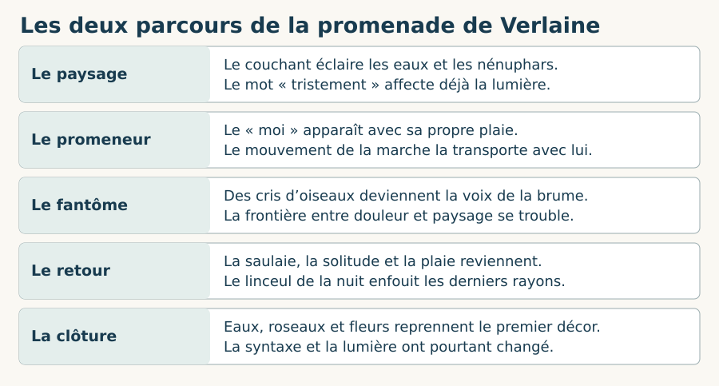
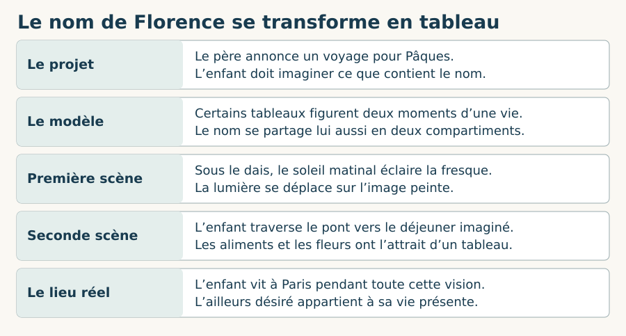

# BEL · AL — Français (oral tronc commun 24 juin) 2026 · Corrigé guidé

*Corrigé rédigé par IA, non officiel. Signalez toute erreur.*

**Rédaction** · GPT-6.2 Astra Ultra · vitesse non renseignée

**Autocontrôle** · GPT-6.2 Astra Ultra · vitesse non renseignée

Le fascicule du matin du 24 juin imprime six références. Le passage de Proust est répété aux places 4 et 6 avec les mêmes pages et les mêmes bornes. Les cinq textes différents sont expliqués dans leur ordre de première apparition. Le rapport précise que le candidat choisit un seul des deux textes de son billet. La liste ne documente pas les paires.

## Reprendre un détail pendant l’entretien

Le même passage de Proust figure aux quatrième et sixième places du fascicule. Il est possible de travailler les cinq lectures différentes en donnant, pour chacune, une valeur précise à un changement de rythme, de point de vue ou de sens d’un mot.

| Passage | Question de reprise | Réponse possible |
|---|---|---|
| Montesquieu | Pourquoi le mot « poids » convient-il au débat sur le poète ? | Dans une opération commerciale on peut comparer des quantités. L’image met au jour le ridicule d’une dispute qui prétend tarifer un mérite littéraire dont le principe fait l’unanimité. |
| Verlaine | Qui pleure dans la saulaie ? | La syntaxe attribue au fantôme les pleurs que l’oreille peut identifier comme les appels des sarcelles. Le chagrin du promeneur donne aux sons une présence imaginaire. |
| Rousseau | Comment faire entendre la double voix de l’autobiographie ? | Élargir d’abord le débit de l’inventaire des dangers, puis distinguer l’enthousiasme du garçon et la discrète ironie de l’adulte lorsque celui-ci réduit son royaume imaginaire à un seul château. |
| Proust | Pourquoi les deux scènes du nom de Florence se présentent-elles à la manière d’un tableau ? | À l’exemple de certaines œuvres de Giotto, la représentation répartit sur une surface deux moments successifs. Elle donne de la durée à ce qui semblait tenir dans le seul nom. |
| D’Aubigné | Le passage signale-t-il la fin de toute référence aux Anciens ? | Non. L’Hippocrène cesse d’être le lieu d’origine convenu du chant, mais Mélpomène est convoquée pour faire entendre le deuil depuis des tombeaux récents. |

## 1. Montesquieu, *Lettres persanes*, lettre XXXVI

**De l’usage du café à la haine des censeurs de l’ancien poète.** Usbek écrit de Paris à Rhédi, qui se trouve à Venise. Les différents établissements où l’on boit du café apparaissent d’abord sous l’angle des usages que découvre un étranger. On y recueille des nouvelles ou l’on joue aux échecs. La propriété du breuvage distribué dans un café particulier paraît plus singulière, donner de l’esprit. Or la restriction qui suit déplace l’effet de la boisson du côté de l’opinion que chacun a de lui-même. La multiplication par quatre ajoute une précision plaisante à ce qui ne se mesure pas. Le regard apparemment naïf produit la satire par une correction discrète de sa première proposition.

Usbek change ensuite de critère. À quoi les talents des beaux esprits servent-ils dans la cité ? La querelle autour d’un très ancien poète grec révèle un étonnant écart entre l’objet de la dispute et son intensité. Les partis conviennent de l’excellence du poète. Ils prétendent seulement en fixer le degré. Les mots du tarif, de la distribution et de la pesée convertissent le jugement littéraire en opération de boutique. L’ironie de l’adverbe « cordialement », accolé aux injures, rend aux comportements leur violence tandis que l’objet du litige paraît toujours plus mince. Le détour par cette querelle sur Homère permet à l’étranger d’observer une société qui dépense sa passion à se distinguer.

L’hypothèse finale met un citoyen vivant à la place du poète mort. Faut-il vraiment croire que la même énergie servirait à protéger sa réputation ? Usbek se garde de répondre à la place de ses lecteurs. Sa dernière prière aux allures de précaution personnelle achève la satire. Une haine capable de poursuivre un poète jusque dans un tombeau vieux de deux mille ans est devenue un renseignement sur les vivants.

[Lire le passage dans l’œuvre](https://fr.wikisource.org/wiki/Lettres_persanes/Lettre_36)

## 2. Verlaine, « Promenade sentimentale », *Poèmes saturniens*

**Poème entier.** Le titre promet un déplacement et un sentiment, mais les quatre premiers vers ne disent encore rien de celui qui se promène. Le couchant lance ses rayons, le vent berce les nénuphars. Les verbes font jouer une énergie qui s’éteint et un balancement qui dure. Les fleurs « blêmes » luisent déjà « tristement ». L’apparente description est donc affectée avant même que le sujet qui souffre soit nommé. Le décasyllabe et les rimes suivies contribuent à la douceur répétitive d’un paysage où la lumière a perdu son éclat triomphant.

L’entrée de « Moi », nettement détaché, met un promeneur auprès de l’étang. Le verbe pronominal attendu a cédé la place à une construction plus étonnante, le locuteur promène « sa plaie ». Il la transporte avec lui comme un compagnon dont il ne peut se défaire. La brume peut dès lors évoquer un fantôme de grande taille, que le passage d’un vers à l’autre fait apparaître avec retard, après l’adjectif « grand ». Le fantôme que l’on croit entendre emprunte la voix d’oiseaux réels qui s’appellent, puis le battement de leurs ailes. Il n’est plus possible de séparer complètement le cri de l’animal, la perception troublée du promeneur et l’expression de son chagrin.

Quand les mots de la marche solitaire reviennent, ils ont changé de place et de ponctuation. Le « linceul » des ténèbres réinterprète jusque dans la rime la solitude du « seul ». Les rayons du début deviennent ce que la nuit vient noyer. Les nénuphars et les roseaux ramènent finalement le lecteur au paysage initial, mais en passant par une syntaxe de reprise presque suspendue. Ce qui avait la forme d’une promenade garde ainsi la douleur en mouvement sans lui procurer de sortie. Le poème fait entendre ce mouvement de retour par la place des mots avant de le formuler comme un état d’âme.

[Lire le passage dans l’œuvre](https://fr.wikisource.org/wiki/Po%C3%A8mes_saturniens_(1866)/Promenade_sentimentale)

## 3. Rousseau, *Les Confessions*, livre II

**Du moment où l’effroi inspire le projet de fuite à la dernière protestation de modération.** Le jeune Jean-Jacques vient de quitter Genève et l’apprentissage auquel il était destiné. Dans la phrase d’ouverture, la construction en « autant » fait tenir ensemble l’effroi qui a inspiré le projet et le charme éprouvé à l’exécuter. Le narrateur adulte n’efface aucune de ces deux expériences. Il commence cependant par déplier ce que le jeune homme aurait dû prévoir. Les infinitifs accumulent tout ce que signifie partir, des appuis familiaux perdus aux ressources professionnelles qui manquent. Une longue phrase retarde le jugement rétrospectif qui rend à cet inventaire son statut précis, celui d’une perspective que le jeune homme n’a justement pas eue.

Une exclamation ramène alors au premier plan ce qu’il se peignait réellement. Sa nouvelle indépendance est exprimée dans une langue d’élan, de vol et d’espace ouvert. L’univers semble à la mesure d’un mérite dont personne n’a encore éprouvé la valeur. Les imparfaits et le futur proche dans le passé l’installent au centre d’une suite d’événements toujours sur le point d’advenir. À chaque pas le monde devrait offrir ressources, aventures et amitiés. Ce qui se présente comme une liberté absolue suppose en réalité quantité de personnes prêtes à satisfaire ses désirs.

Le comique naît enfin d’un rétrécissement soigneusement orchestré. Le jeune rêveur consent à dispenser le reste de l’univers de s’occuper de lui. Un seul château suffira, à condition qu’il y cumule les positions les plus flatteuses auprès de chaque membre de la famille et même des voisins. La « modération » revendiquée au dernier mot garde donc intact le désir de régner. Le recul de l’adulte fait sourire de cette démesure, mais la précision avec laquelle il restitue le plaisir de l’imagination interdit de réduire son récit à la leçon d’un homme raisonnable sur un enfant imprudent.

[Lire le passage dans l’œuvre](https://fr.wikisource.org/wiki/Les_Confessions_(Rousseau)/Livre_II)

## 4. Marcel Proust, *Du côté de chez Swann*, « Noms de pays : le nom »

**Du projet de voyage à Florence et à Venise au pays où l’on se trouve « effectivement ».** La décision du père fait entrer le voyage des vacances de Pâques dans le champ du possible. Pourtant c’est d’abord à l’intérieur du nom de Florence que le narrateur doit loger une ville. L’impossibilité matérielle de faire tenir dans quelques syllabes tous les éléments d’une cité devient le point de départ d’une création. Une saison, des parfums et ce que l’enfant croit comprendre de Giotto engendrent une Florence qu’aucune carte ne lui a donnée. La longue phrase permet de sentir la complexité de cette naissance en retardant le moment où l’image se stabilise.

Le nom manque de durée autant que d’espace. Un procédé des tableaux de Giotto, où la même figure apparaît à plusieurs moments, fournit au narrateur le moyen de disposer deux scènes dans les compartiments de sa propre image. Sous le dais du premier compartiment, une fresque reçoit une lumière matinale en mouvement. Dans le second, l’enfant traverse le Ponte-Vecchio pour atteindre un déjeuner qu’il imagine déjà. La parenthèse explique pourquoi les gestes matériels et les fruits ou le vin de Chianti acquièrent une force esthétique. Parce que la vie qu’il projette là n’a pas été vécue, elle a gardé la plénitude d’un tableau. Les fleurs accumulées sur le pont associent Florence au printemps qu’on lui a promis.

Le déictique « Voilà » offre finalement ces images à notre regard, au moment même où la parenthèse rappelle que l’enfant se trouve à Paris. Le « je » fait place à un « nous » pour dégager une proposition paradoxalement « réaliste ». Une description fidèle de la vie doit inclure la place que le désir donne aux lieux absents. La conclusion distingue donc le lieu où l’on se trouve et l’expérience bien réelle que l’on peut y faire d’un ailleurs. Ce passage, reproduit deux fois avec les mêmes bornes sur la feuille, reçoit une seule explication.

[Lire le passage dans l’œuvre](https://fr.wikisource.org/wiki/Du_c%C3%B4t%C3%A9_de_chez_Swann/Partie_3)

## 5. Agrippa d’Aubigné, *Les Tragiques*, « Misères »

**Du renoncement aux « feux d’un amour inconnu » à la biche dont le faon est perdu.** Le poète protestant qui écrit les malheurs de la France des guerres de Religion commence par définir sa tâche en retravaillant le vocabulaire d’une autre poésie. Les feux de l’amour laissent place au feu dans lequel un pays se consume. La reprise conserve le mot en changeant la portée de ce qu’il engage. L’affliction devient pour le poète la source d’une lucidité nouvelle. À l’eau claire des ruisselets grecs, précieuse comme les pierres qu’on lui compare, succèdent des eaux assombries par les morts. Un seul vers fait ensuite entendre le heurt du doux murmure contre les os. Le sujet n’a pas seulement changé de motif, la langue elle-même doit perdre l’harmonie qu’elle empruntait au paysage de convention.

Le poète se donne à voir en train d’écrire. L’autre « fureur » de son visage, la sueur qui compromet le papier, les bras qui peinent à se séparer de leur équipement font du corps un témoin de ce que le poème avance. Le pluriel qui succède au « je » engage plus largement ceux qui écrivent au milieu de l’épreuve collective. Le verbe choisi pour la naissance difficile des chants dément l’image d’une inspiration aisée dans les vallées de Thessalie. Le luth, étouffé par les trompettes, change de fonction à mesure que se transforme le théâtre du poème.

Sur cet échafaud, la Mort joue en personne. La botte écarte le cothurne tragique et ramène le théâtre vers la réalité qu’il représente. Le poète n’abandonne pourtant pas les figures antiques. Il appelle Mélpomène depuis des tombeaux récents et donne à sa plainte la voix de l’animal qui a perdu son petit. La muse reparaît, mais son autorité dépend désormais de sa capacité à porter le deuil des vivants. La poétique nouvelle trouve ainsi son dernier accent dans une perte singulière plutôt que dans la seule grandeur des références tragiques.

[Lire le passage dans l’œuvre](https://fr.wikisource.org/wiki/Les_Tragiques/%C3%A9d._Read/Livre_I._Mis%C3%A8res)

[Liste du 24 juin](https://www.ens.psl.eu/sites/default/files/francais_tc_24_juin.pdf) · [Rapport du jury](https://www.ens.psl.eu/sites/default/files/2026_al_rapport_oral_francais_tc.pdf)
