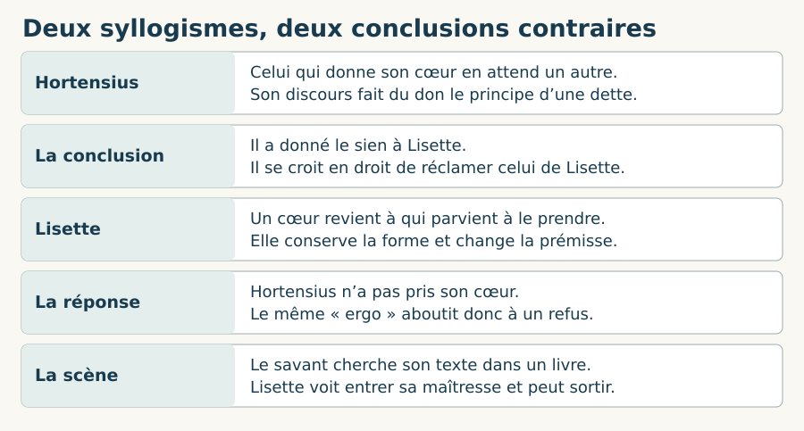
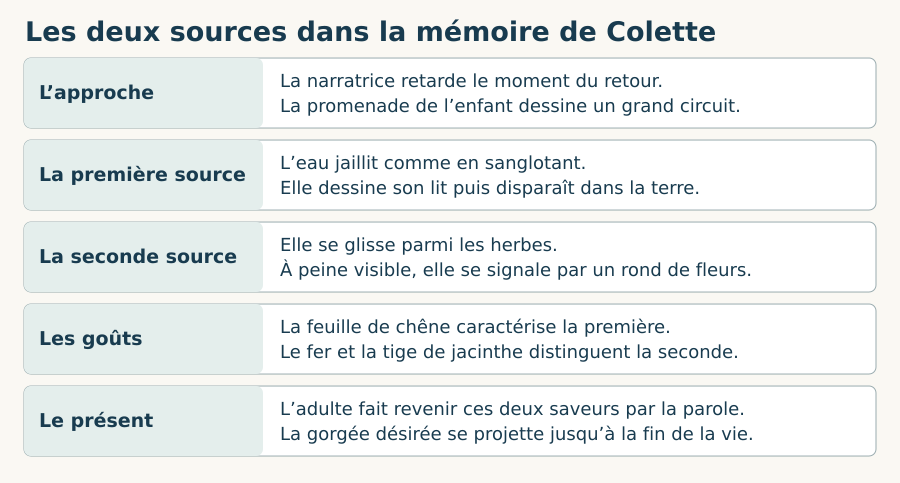

# BEL · AL — Français (oral tronc commun 25 juin) 2026 · Corrigé brut

*Corrigé rédigé par IA, non officiel. Signalez toute erreur.*

**Rédaction** · GPT-6.2 Astra Ultra · vitesse non renseignée

**Autocontrôle** · GPT-6.2 Astra Ultra · vitesse non renseignée

Le relevé du 25 juin comporte six références le matin et six l’après-midi. Les douze passages sont expliqués dans l’ordre de la feuille. Le jury donne à chaque candidat le choix entre les deux textes de son billet. La liste de la journée ne précise pas la composition de ces billets.

## 1. Rabelais, *Gargantua*, chapitre XXIII

Le titre promet une journée dont aucune heure ne se perd. Le début du chapitre prend pourtant le temps de justifier un délai. Ponocrates connaît la mauvaise manière de vivre de Gargantua, mais le laisse d’abord suivre ses habitudes, car un changement soudain pourrait le malmener. Cette attention à une nature particulière introduit un programme éducatif que le lecteur va découvrir en observant un corps précis, celui du géant.

La purge prescrite par le médecin rend comiquement matériel le problème des mauvais enseignements. Elle débarrasse le cerveau des habitudes qu’il a contractées. La comparaison avec Timothée, qui devait défaire ce que d’autres musiciens avaient enseigné, éclaire le paradoxe du premier apprentissage, celui de l’oubli. Le séjour parmi les savants fait ensuite apparaître un ressort que le médicament ne suffisait pas à produire. Gargantua désire à son tour étudier et se distinguer. L’émulation a donné une direction à son énergie.

Le récit passe à la journée ordinaire. Au réveil, pendant qu’on lui frotte le corps, un page lit à haute voix un passage des Écritures. La justesse de la prononciation compte autant que le choix de la lecture. Le géant répond en priant selon ce qu’il vient d’entendre. Aux lieux d’aisances mêmes, son précepteur reprend avec lui les difficultés du texte. La chute de registre amuse et met à l’épreuve la promesse du titre. Le temps du corps devient aussi celui de la reprise et de l’explication. L’élève passe ainsi de l’écoute au désir de comprendre.

[Lire le passage dans l’œuvre](https://fr.wikisource.org/wiki/Les_%C5%92uvres_de_Fran%C3%A7ois_Rabelais_(%C3%89ditions_Marty-Laveaux)/Gargantua/23)

## 2. Bernard-Marie Koltès, *Dans la solitude des champs de coton*, première adresse du Dealer

Le premier mot à faire entendre est le « si ». Le Dealer transforme le passage d’un inconnu à une certaine heure en signe d’un désir. Son raisonnement distribue les rôles avant que l’autre ait prononcé une parole. À celui qui marche il manque quelque chose, celui qui attend aurait de quoi le satisfaire. Ni l’objet ni le lieu ne sont nommés. Le spectateur reçoit en revanche beaucoup de précisions sur la position et la durée de présence de celui qui parle. Sa conclusion fait aussi surgir un besoin de son côté. Ce qu’il possède lui pèse et cherche à passer de ses mains à d’autres.

La seconde avancée se donne à voir. Les paumes ouvertes devraient témoigner d’intentions pacifiques, mais c’est la voix du Dealer qui décrit le geste et en impose l’interprétation. L’image d’une lumière qui paraît à une fenêtre au crépuscule déplace les corps de la rue vers le haut d’un immeuble. La douceur de la comparaison retarde l’instant où l’on saura ce que veut l’inconnu.

Le dernier mouvement reconnaît une ignorance surprenante. Le Dealer ne sait pas ce que désire son interlocuteur. Il évoque le plaisir de laisser un cadeau enveloppé, puis affirme qu’il a lui-même connu tous les désirs possibles. L’ignorance du cas particulier et la certitude de tout posséder coexistent donc dans la même offre. La phrase finale confie au client une tâche décisive, celle de demander. L’échange ne pourra commencer qu’avec une parole que la tirade a minutieusement préparée et dont elle n’a encore reçu aucune confirmation.

[Lire le passage dans l’œuvre](https://www.ancre.be/uploads/spectacles/LANCRE_Carnet_Pedagogique_24-25.pdf)

## 3. Saint-Simon, *Mémoires*, ouverture de *La Mort de Louis XIV*

Le dernier mois du règne devrait sembler le plus simple à raconter dans l’ordre. Or le premier paragraphe des *Mémoires* qui conduit à la borne donnée par le jury explique pourquoi il faut interrompre ce récit avant même de l’engager. Saint-Simon prend pour objet le travail de l’historien. Accumuler les garanties de « vérité », de netteté et d’exactitude dans l’ordre des faits conduit à une décision inattendue de composition. Ce qui précède la mort du roi est déjà lié aux événements de la régence. Les isoler reviendrait à brouiller leur intelligibilité.

Le centre de la phrase se déplace vers le prince appelé à diriger le royaume pendant la minorité. Il faut raconter ses pensées, ses hésitations et les formes d’administration qu’il envisage. Le jeu de Madame de Maintenon et du duc du Maine oblige à distinguer ce que le titre de régent assure et le pouvoir effectif qu’on pourrait lui laisser. Une décision politique en train de se former exige donc un autre accès que la simple chronique des derniers jours.

Le narrateur promet de reprendre le fil qu’il suspend. Un second seuil s’ouvre aussitôt. Avant les projets, il faut faire connaître le personnage qui les porte et les contraintes qui viennent de lui comme de son entourage. La réserve « si l’on peut » donne sa portée à ce dernier programme. Saint-Simon revendique de suivre les raisons des acteurs jusqu’à leur vie personnelle, tout en marquant combien cette connaissance peut être incertaine. Le passage s’arrête sur la tâche du portraitiste, avant que le portrait du duc d’Orléans commence.

[Lire le passage dans l’œuvre](https://fr.wikisource.org/wiki/M%C3%A9moires_(Saint-Simon)/Tome_12/5)

Le témoin Chéruel donne ici le premier paragraphe du chapitre V, jusqu’à l’explicit du jury. Les pages 25–26 indiquées sont celles du Folio de l’épreuve.

## 4. Ronsard, *Sonnets pour Hélène*, « Ah, belle liberté, qui me servois d’escorte »

La liberté tient auprès du poète la place que la poésie amoureuse réserve d’ordinaire à la femme aimée. Il s’adresse à elle, regrette sa compagnie et se souvient d’une marche que guidait son seul désir. Le premier quatrain noue l’élan des exclamations à l’image contraire du joug. Le poète dit l’avoir déjà rompu bien des fois. Cette répétition fait éprouver une difficulté que le registre de la plainte ne suffit pas à expliquer. Comment une entrave plusieurs fois défaite a-t-elle pu redevenir la sienne ?

Le second quatrain répond par un geste du même sujet. C’est lui qui a rattaché le joug. Sans amour, il se dit fait de plomb et de bois. Quand il aime, la voix, l’invention, la Muse elle-même acquièrent une force nouvelle. Les termes presque matériels de la lourdeur cèdent la place à des facultés en exercice. La liberté de marcher selon sa fantaisie a pour contrepartie inattendue une impuissance à écrire.

La déduction du premier tercet transforme ce constat intime en choix d’auteur. L’image des enfants « par escrit » fait de l’œuvre une descendance capable de prolonger le nom au prix de la peine personnelle. Une question cherche alors le sujet le plus fécond. Avec Hélène, le même nom peut désigner la destinataire présente et celle dont Homère a tiré sa poésie. L’hommage final à la dame fait ainsi entendre une ambition pour le poète. Le sonnet qu’on vient de lire est déjà un de ces enfants qu’il souhaitait concevoir.

[Lire le passage dans l’œuvre](https://oeuvresderonsard.wordpress.com/2020/01/06/helen-268/)

Le numéro 67 est celui de la feuille. L’incipit établit la correspondance avec le sonnet transcrit sous le numéro 68 dans le témoin lié. Le poème français figure également dans le traité de Martin Opitz. [Témoin du texte chez Opitz](https://www.linguistics.rub.de/ref/pub/texts/F303_anno.pdf)

## 5. Marivaux, *La Seconde Surprise de l’amour*, I, 5

Hortensius fait des beaux yeux de Lisette l’origine de son savoir. La jeune femme prend la galanterie au pied de la lettre et s’étonne d’avoir des yeux qui enseignent la rhétorique. Elle a déjà compris comment jouer avec l’argument avant que le savant en donne la leçon. Il annonce une thèse, puis un argument en forme, puis un syllogisme. À chaque nouveau terme technique la menace d’un départ oblige Hortensius à raccourcir les préliminaires.

Sa démonstration pose que le don d’un cœur crée une dette. Lisette lui emprunte aussitôt la forme du raisonnement, jusqu’au latin « ergo », mais substitue au don une autre condition. On doit son cœur à qui sait le prendre. L’argument reste impeccablement construit et aboutit cette fois à un refus. Quand elle proteste qu’elle ne fréquente pas la raison, le public vient d’avoir la preuve de son adresse à raisonner. Ce qu’elle refuse au savant, c’est la possibilité de tirer une obligation amoureuse de la logique.

Les vers latins offrent un dernier recours. Les beautés personnifiées de Lisette, qui savaient enseigner tout à l’heure, n’entendent maintenant que le français. La recherche du papier produit enfin une séparation visible. Hortensius baisse le regard sur son livre, Lisette aperçoit la marquise et sort. Il continue en feuilletant et se distribue le rôle de Pâris face à une Hélène qui n’est plus là. Sa dernière approbation de sa propre galanterie ne rencontre pour public que la salle.

[Lire le passage dans l’œuvre](https://fr.wikisource.org/wiki/La_Seconde_Surprise_de_l%E2%80%99amour/Acte_I)

## 6. Balzac, *La Fille aux yeux d’or*, la ville et le vaisseau

La feuille imprime « Cette vue du Paris moral ». Le témoin de l’œuvre lié ci-dessous porte « Cette vue de Paris moral ». Dans les deux cas, la phrase se donne comme la conclusion d’une enquête. Les manières de vivre des Parisiens rendraient intelligible l’aspect physique de leur ville. L’explication prend aussitôt la forme d’une prolifération d’images. Paris change de sexe et de corps. Reine en proie aux envies, tête du globe, cerveau, artiste et politique, la capitale reçoit tous les traits à la fois glorieux et inquiétants que comporte chaque figure.

1789 et 1814 inscrivent dans sa physionomie deux moments historiques d’essor et d’abattement. L’image de la chaudière rend ensuite sensible un envers du spectacle. Le lecteur admire le bateau à vapeur qui avance sans nécessairement regarder la machinerie qui le fait marcher. Une question et sa réponse transforment enfin le bateau réel en vaisseau allégorique. Les armes de Paris fournissent au narrateur une image déjà là qu’il déploie jusqu’aux détails de l’équipage.

Le mât de bronze et Napoléon en vigie transportent un monument dans le navire. Les tribunes, les savants et les artistes lui prêtent des voix qui poussent le monde à les suivre. Mais tous les Parisiens n’ont pas le même rôle à bord. La bourgeoisie fait lest, des passagers voyagent à l’aise dans les cabines et d’autres travaillent à la marche de l’ensemble. À la fin du passage, la gloire, le plaisir et l’or circulent dans ce qui semblait un héroïque élan collectif. L’allégorie fait donc voir une solidarité matérielle jusque dans de profondes différences de condition et de désir.

[Lire le passage dans l’œuvre](https://fr.wikisource.org/wiki/La_Fille_aux_yeux_d%E2%80%99or)

## 7. Balzac, *La Duchesse de Langeais*, le général au parloir

Le geste qui ouvre le passage suspend un instant la rencontre. Le général incline la tête, puis relève les yeux vers la grille. C’est entre deux barreaux que le narrateur laisse paraître le visage de la religieuse. Le regard mesure les transformations en se souvenant des couleurs d’autrefois. À la rose de la jeunesse succède l’image d’une lumière faible sous une coupe de porcelaine. La comparaison retire de l’éclat à la surface mais invite à chercher ce qui l’éclaire encore de l’intérieur.

La chevelure a disparu, le bandeau resserre les contours du visage. Les yeux sont à la fois éprouvés par les austérités et parcourus par moments d’un éclat fiévreux. La formule du narrateur qui réduit la femme à son âme vient après cette attention minutieuse au corps visible. Le général fait une autre lecture de ce qu’il voit. Son premier cri transforme le couvent en tombeau et la religieuse en condition de sa propre vie.

Il parle de promesse, de commandement, d’appartenance. Dans sa bouche, sa fidélité devrait limiter jusqu’à la liberté qu’elle a eue de se donner à Dieu. Puis les lieux recherchés, les distances et les cinq années écoulées composent un argument par la durée de sa souffrance. Tout voyage inutile a accru la force de cette conviction. La dernière phrase tire de la sincérité passée de la femme une conduite qu’elle devrait tenir aujourd’hui. La grille demeure entre eux, et le texte s’arrête avant toute réponse. Le lecteur peut mesurer la distance qui sépare sa recherche fervente de sa prétention à décider pour elle.

[Lire le passage dans l’œuvre](https://fr.wikisource.org/wiki/La_Duchesse_de_Langeais)

## 8. Colette, *Sido*, la promenade à l’aube

À trois heures et demie, le monde n’a pas encore sa forme ordinaire. La couleur enveloppe les choses, le brouillard atteint successivement les différentes parties du corps de l’enfant. La descente du chemin fait apparaître une montée de la brume le long de ce corps. Le choix des sensations fait du paysage une expérience de croissance et de découverte de soi. La solitude est une liberté accordée par la mère, dont les noms précieux accompagnent l’enfant qui s’éloigne.

Le regard de Sido descend la pente avec son « chef-d’œuvre ». L’adulte qui écrit y ajoute un autre moyen de vérification, les portraits d’autrefois, moins affirmatifs que la mère. Elle reprend pourtant à son compte la beauté éprouvée ce matin-là, en lui donnant des causes qui excèdent un visage. L’âge, la lumière, les cheveux encore libres, la différence entre l’enfant éveillée et les autres enfants endormis font ensemble le prix de l’instant.

La cloche assigne une heure au retour, mais la phrase retarde ce retour jusqu’à ce que la promeneuse ait retrouvé ses deux sources. L’une jaillit et se dérobe brusquement, l’autre se décèle presque seulement aux fleurs qu’elle fait pousser. Chacune a un goût aussi précis que son mouvement. Le passage au présent, dans la dernière phrase, rend cette différenciation décisive. La narratrice peut désirer pour sa dernière heure la saveur qu’elle est maintenant en train de nommer. La « gorgée imaginaire » unit une sensation passée très exacte et un avenir où la parole seule pourra encore la lui rendre.

[Lire le passage dans l’œuvre](https://ledeuxiemetexte.fr/extrait.php?id=9)

## 9. Molière, *Monsieur de Pourceaugnac*, I, 2

Monsieur de Pourceaugnac approche. Avant son entrée en scène, Sbrigani le fait exister aux yeux de Julie et d’Éraste par un récit d’observation. Une demi-heure dans une cuisine lui aurait suffi pour le savoir « par cœur ». Il réserve au public la découverte de sa figure et porte déjà un jugement sur son esprit. En le présentant comme une « matière » toute disposée, il change le voyageur en personnage susceptible d’entrer dans la comédie que préparent les autres. La courte question d’Éraste laisse un instant entendre ce que ce portrait doit à la seule assurance de son auteur.

Les éloges réciproques de Nérine et Sbrigani déplacent ensuite l’attention de l’homme qu’on attend vers ceux qui disent le connaître. Nérine salue un héros généreux dont le premier titre de gloire est d’avoir risqué les galères. Le vocabulaire noble laisse filtrer, à côté du dévouement et du péril, le souvenir de sanctions judiciaires. L’exil lui-même compte parmi les preuves de cette singulière honorabilité.

Sbrigani rend le compliment avec encore plus de précision. Les manières admirables qu’il prête à Nérine accompagnent une suite de tromperies aux conséquences de plus en plus graves pour autrui. L’écart se creuse entre les formules de politesse et ce que le public comprend. La dernière réplique affecte la modestie, ramène ces faits au rang de bagatelles et donne à Nérine le rouge au front d’une dame trop louée. Au seuil de la pièce, les spécialistes du déguisement savent déjà transformer leurs propres biographies en rôles de cour.

[Lire le passage dans l’œuvre](https://fr.wikisource.org/wiki/Monsieur_de_Pourceaugnac,_1894)

## 10. Montaigne, *Essais*, I, 25, « Du pédantisme »

La question du pédantisme prend naissance dans la salle de théâtre. Enfant, Montaigne s’indignait de voir le maître toujours distribué dans le rôle du sot des comédies italiennes. Comme il avait été confié aux maîtres, leur réputation engageait quelque chose de la sienne. En revenant sur cette solidarité, l’essayiste fait comprendre pourquoi sa première explication était si favorable aux savants. Il attribuait le mépris à l’incompréhension du vulgaire devant les êtres exceptionnels.

Une locution familière avoue le point où cette explication fait défaut. Il y perdait son latin, justement à propos de gens dont le latin est souvent l’apanage. Du Bellay témoigne que des hommes de jugement peuvent eux aussi détester un certain savoir. Plutarque élargit l’enquête en rapportant un usage romain du mépris. Le changement d’avis que l’âge rend possible prend alors la forme d’un latin comiquement mêlé, comme si une sentence sur les grands clercs pouvait se passer de leur impeccable langue scolaire.

Le cœur du passage est la question qui subsiste. Il ne va pas de soi qu’un esprit puisse recevoir les meilleures pensées du monde sans devenir plus vif. Les métaphores du logement et de la richesse préparent le mot d’une princesse. À l’en croire, il faudrait à l’esprit d’un homme beaucoup d’efforts pour se rapetisser assez et faire place à toutes les cervelles étrangères qu’il accueille. Cette parole de conversation présente plaisamment le problème en termes d’espace. L’essai lui laisse la parole au moment de la coupure, en conservant la valeur de son propre aveu de doute.

[Lire le passage dans l’œuvre](https://fr.wikisource.org/wiki/Essais/Livre_I/Chapitre_25)

## 11. Georges Perec, *Un homme qui dort*, de la chambre aux sorties nocturnes

Le « tu » place le lecteur devant un étudiant qui demeure dans sa chambre. Trois négations semblent d’abord retirer les actions possibles. Pourtant un regard distingue les objets, les parties du corps et jusqu’à son propre reflet dans le miroir fêlé. L’écoute franchit ensuite le seuil. Un voisin existe par ses bruits et ses gestes devinés, sans qu’aucune conversation s’engage. La fissure du plafond, la mouche et les ombres ménagent de petits déplacements au milieu de cette immobilité.

Les deux phrases qui commencent par « Ceci » présentent la chambre comme la totalité d’une vie susceptible d’être inventoriée. L’âge, les dents et le linge se succèdent comme si ces choses se comptaient de la même façon. Pour les livres et les disques, ce qu’on précise est l’usage interrompu. L’inventaire se prolonge ainsi en une autre liste, faite de souvenirs que le personnage n’appelle pas à lui. Attendre devient le dernier verbe qui lui donne une occupation, avec pour horizon l’épuisement de l’attente elle-même.

La suite élargit l’absence de gestes aux relations concrètes avec autrui. Les livres empruntés ne retournent pas à la bibliothèque, les parents ne reçoivent pas de lettre. Quand le personnage sort enfin, le jour est tombé. Les rues et les petits cinémas prolongent un retrait qui peut aussi bien prendre la forme d’une marche. Les deux membres symétriques de la dernière phrase font alterner la nuit entière passée dehors et le jour entier passé à dormir. La seconde personne suit de très près une existence qui a cessé de répondre aux autres.

[Lire le passage dans l’œuvre](https://www.reseau-canope.fr/edutheque-theatre-en-acte/fileadmin/user_upload/pdm/2012/pdm_146_un_homme_qui_dort.pdf)

Le dossier de Réseau Canopé reproduit la première partie du passage avec l’accord de l’éditeur. Les paragraphes suivants ont été collationnés jusqu’à la dernière phrase signalée par le jury. [Transcription consultée](https://fr.scribd.com/document/372667052/Georges-Perec-Un-Homme-Qui-Dort)

## 12. Aloysius Bertrand, *Gaspard de la nuit*, « La Pluie »

L’épigraphe de Hugo donne d’abord voix au chant d’un oiseau et transforme les gouttes en perles. Le petit poème en prose commence avec la même pluie, mais déplace l’écoute jusqu’au lit de fougère des charbonniers de la Forêt-Noire. Le vent entendu de l’intérieur devient un loup. L’abri rend possible une activité de l’imagination que la reprise d’« Ils plaignent » fait progresser, alinéa après alinéa.

La biche, l’écureuil, les oiseaux ont chacun un rapport particulier à l’orage. Le fracas devient une fanfare de chasse, l’éclair une lampe. La bergeronnette ne dispose que de son aile, et la chute d’une goutte déplace tout un océan à l’échelle du ver luisant. Les petits charbonniers savent ainsi changer de mesure pour se représenter des vies plus fragiles que la leur. Du pèlerin aux enfants égarés, la nuit accueille ensuite des figures de légende et des menaces de conte. Pour ces enfants, les formes du conditionnel laissent entendre la part que prend la crainte à leur aventure imaginaire.

Le jour revenu, le passé simple fait place à une trouvaille que personne n’avait prédite. La cabane est à terre, les pièges à oiseaux sont noyés. Les charbonniers qu’on a entendus plaindre les oiseaux s’employaient aussi à les attraper. Ce discret retour matériel change notre compréhension de la scène nocturne. Les oiseaux reçoivent de la pluie un répit inattendu, et le lecteur peut éprouver à son tour pour les enfants une compassion aussi nuancée que la leur.

[Lire le passage dans l’œuvre](https://fr.wikisource.org/wiki/Gaspard_de_la_nuit_(%C3%A9d._1920)/La_Pluie)

[Liste du 25 juin](https://www.ens.psl.eu/sites/default/files/journee_4francais_2_sujets_jury2.pdf) · [Rapport du jury](https://www.ens.psl.eu/sites/default/files/2026_al_rapport_oral_francais_tc.pdf)
