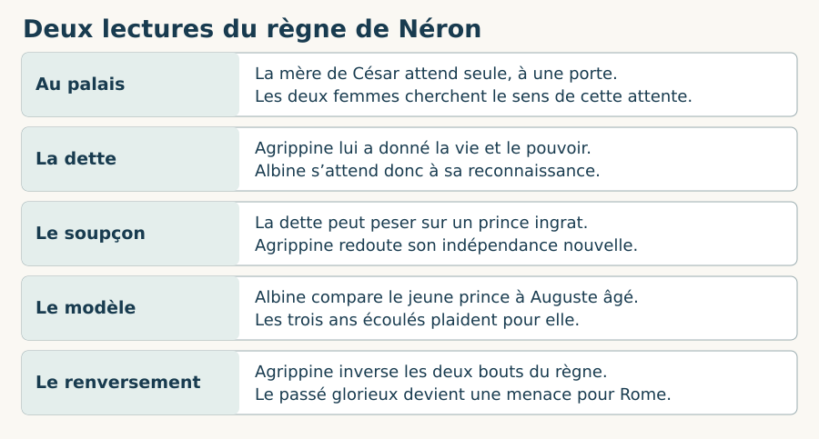
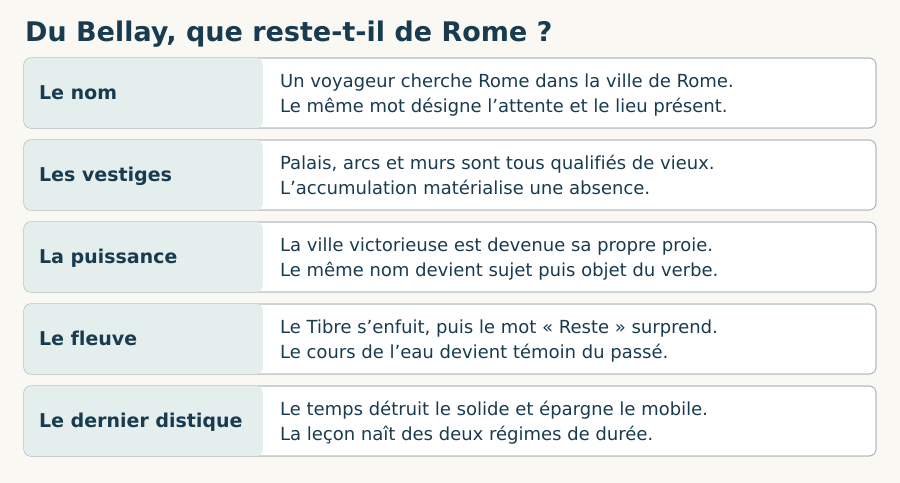

# BEL · AL — Français (oral tronc commun 26 juin) 2026 · Corrigé guidé

*Corrigé rédigé par IA, non officiel. Signalez toute erreur.*

**Rédaction** · GPT-6.2 Astra Ultra · vitesse non renseignée

**Autocontrôle** · GPT-6.2 Astra Ultra · vitesse non renseignée

Le fascicule du vendredi 26 juin contient onze références. Le passage de Britannicus est imprimé deux fois, tout comme celui du Rouge et le Noir et la tirade de Lorenzaccio. Les huit explications suivent l’ordre de première apparition, les trois premières pour le matin et les cinq suivantes pour l’après-midi. Chaque candidat choisit l’un des deux textes de son billet. La feuille collective ne précise pas leur répartition.

## Faire entendre un changement dans le passage

La préparation dure une heure et demie. L’explication linéaire occupe vingt minutes, puis le jury revient pendant dix minutes sur le passage. Pour préparer chaque lecture, on peut choisir un endroit où le sens d’un mot ou le statut d’une voix change. Chez Racine, Albine et Agrippine reprennent la même comparaison avec Auguste. Chez Beckett, une fin annoncée devient presque aussitôt une éventualité. Relire ces inflexions à voix haute donne déjà un principe de découpage.

| Passage | Question de reprise | Réponse possible |
|---|---|---|
| Marivaux | Qui est censé donner la « comédie » et qui regarde déjà ? | La Comtesse promet de faire de Lélio un spectacle. Colombine voit qu’en provoquant cette expérience sa maîtresse s’y engage elle-même. Son dernier mot donne au spectateur une avance sur les deux autres personnages. |
| Racine | Quelle conclusion chacune tire-t-elle de la dette de Néron ? | Albine y voit la meilleure garantie de gratitude. Pour Agrippine, le rappel de ce qu’elle a fait du prince peut le rendre plus impatient de s’affranchir de sa mère. Le dialogue répartit deux interprétations d’une même histoire. |
| Stendhal | Pourquoi Mme Derville intervient-elle ? | Elle croit Mme de Rênal souffrante à cause de sa voix. Sa proposition de rentrer est raisonnable. Seul le point de vue de Julien en fait un péril, parce qu’il juge que le geste a trop peu duré pour compter à son avantage. |
| *Lorenzaccio* | Que change la comparaison finale avec le fiancé ? | L’observateur qui prétend avoir découvert la vérité des hommes avoue combien il désirait à l’avance une vérité particulière, la preuve qu’il y avait quelque honnêteté en eux. |
| Beckett | Que font les acteurs lorsque les personnages prétendent finir ? | Clov reste, sort et revient pour un objet. Hamm bâille, manipule ses lunettes et reprend ses phrases. Ces gestes produisent du temps de spectacle à l’instant où la parole essaie justement de lui donner un terme. |
| *Antiquités*, III | Pourquoi le mot « Reste » est-il si frappant ? | Le Tibre vient d’être décrit en mouvement. Le verbe du vers suivant attribue à ce mouvement la seule permanence que le voyageur puisse constater. Les deux vers finaux donnent à ce paradoxe une portée générale. |
| Lettre à Sand | Quelle différence entre les futurs et les deux « peut-être » finaux ? | L’auteur peut promettre d’écrire et d’achever son hymne. Les générations à venir resteront libres de reprendre ou d’oublier les paroles du livre. La fin de la lettre leur donne une part dans sa réalisation. |
| *Regrets*, XXXI | Comment la syntaxe exprime-t-elle le manque ? | Le retour d’Ulysse et de Jason est accompli avant la fin du premier quatrain. Les questions sur la maison natale restent ouvertes, puis les comparatifs des tercets transportent les lieux en pensée jusqu’à un locuteur encore loin d’eux. |

## 1. Marivaux, *La Surprise de l’amour*, I, 7

**De la réponse de la Comtesse à l’avertissement de Colombine.** Lélio vient de prétendre que son interlocutrice est fâchée. La reprise interrogative du pronom, « Moi, monsieur ! », exprime déjà une vivacité assez difficile à concilier avec l’indifférence qu’elle professe. Elle place les hommes au rang d’« espèce » et se donne la position de qui l’« examine ». Colombine adopte le même point de vue comme si l’affaire ne pouvait les toucher personnellement. Aux passions, les deux femmes préfèrent, disent-elles, le divertissement.

La question toute simple de Lélio, qui veut connaître le motif de cette hilarité, donne à la Comtesse l’occasion d’instruire son procès. En feignant d’hésiter à humilier un interlocuteur présent, elle prononce un réquisitoire contre ses « confrères ». L’allure de la longue phrase compte. Les relatives qui reprennent le mot « espèce », puis la série des « si », laissent à peine à Lélio le temps de reprendre la parole. Les hommes se sont octroyé le pouvoir de déshonorer les femmes pour les mêmes comportements dont ils se font gloire. L’image des fardeaux de la raison et de la vertu transforme une prétendue supériorité masculine en art de faire porter le travail moral aux autres.

La dernière partie de la tirade modifie l’expérience. Elle porte désormais sur un homme, une femme et quelques regards possibles. La Comtesse prétend qu’il lui suffirait d’un geste pour donner à son adversaire un rôle dans sa « comédie ». Le défi de Lélio accepte déjà le principe de cette épreuve. Colombine prévoit que celle qui croit distribuer les rôles pourrait en devenir la première dupe. Sa brève intervention déplace le point d’observation vers le public. Celui-ci a vu deux personnes se consacrer la plus vive attention pour prouver leur détachement.

[Lire le passage dans l’œuvre](https://fr.wikisource.org/wiki/La_Surprise_de_l%E2%80%99amour/Acte_I)

## 2. Racine, *Britannicus*, I, 1, le réveil de Néron

**Du premier vers à la comparaison d’Auguste et de Néron.** Albine ouvre la tragédie par une question étonnée. Que fait la mère de César, seule et sans escorte, à la porte d’un fils qui dort ? Le spectateur reçoit en quelques vers une heure, un lieu et un rapport de forces dont l’anomalie saute aux yeux. Les titres d’Agrippine donnent toute sa portée au mot « seule ». Le désir d’Albine de la reconduire dans ses appartements se heurte à un autre impératif, attendre ici. Au sommeil du fils répondent les chagrins vigilants de la mère.

Chez Agrippine, les verbes de certitude donnent à une interprétation toute la force d’un fait accompli. L’hostilité de Néron envers Britannicus lui paraît annoncer le moment où elle aussi lui deviendra « importune ». La confidente remonte au contraire vers les raisons de la gratitude. Agrippine a donné à son fils deux naissances, d’abord la vie, puis le rang qui a fait de Domitius un César au détriment du fils de Claude. La reprise d’« Il me le doit » retourne le raisonnement. Une dette aussi lourde peut susciter la reconnaissance ou fournir à l’ingrat une raison de haïr. Le même passé engendre deux lectures incompatibles.

Albine dispose pourtant de trois années de bon gouvernement. Elle élargit le débat à la ville de Rome et rapproche le prince encore jeune d’Auguste vieilli, figure de la paix retrouvée. Agrippine reprend loyalement ce rapprochement, puis elle en inverse l’ordre. Si le règne de Néron commence là où celui d’Auguste finit, il pourrait aussi finir dans la violence des débuts d’Auguste. La dernière phrase est un avertissement formulé par une mère dont les intérêts sont en jeu. Le spectateur, qui connaît l’autre visage de Néron, en entend la portée tragique avant l’entrée de l’empereur.

[Lire le passage dans l’œuvre](https://fr.wikisource.org/wiki/Britannicus_(%C3%A9ditions_Didot,_1854)/Acte_I)

## 3. Stendhal, *Le Rouge et le Noir*, I, chapitre 9, la main de Mme de Rênal

**De l’angoisse de Julien au geste qu’il renouvelle à la fin du passage.** Un jardin et trois personnes, mais tout prend d’abord la dimension d’une crise intérieure. Le conditionnel initial rend presque souhaitable à Julien l’arrivée d’un danger extérieur qui l’arracherait au devoir qu’il s’est inventé. Le narrateur sait ce que le jeune homme, occupé de sa propre voix, n’entend pas. Celle de Mme de Rênal tremble aussi. Le mot « combat » qualifie ici un conflit avec la timidité. Il décrit la représentation que Julien se fait de la scène et permet d’en mesurer les limites.

Les heures puis les coups de l’horloge donnent à ce combat une mesure matérielle. Julien s’impose l’échéance de dix heures avec une rigueur démesurée. Le narrateur enregistre jusque dans sa poitrine le retentissement de la cloche. Alors seulement la phrase peut devenir le récit d’un geste. Il étend la main, Mme de Rênal retire la sienne, il la reprend. La froideur de cette main dit une émotion très forte dont le sens demeure incertain pour lui. Les efforts de retrait de Mme de Rênal sont rapportés. Les termes de succès dont Julien se sert ensuite appartiennent à son propre jugement.

Une correction du narrateur rend cette distance explicite. Julien est heureux parce que son angoisse cesse. Sa voix devient éclatante, tandis que celle de Mme de Rênal alarme Mme Derville. Chacun des trois personnages donne un sens différent à un même signe. La proposition de rentrer transforme une sollicitude ordinaire en nouveau péril aux yeux du jeune homme. Le dernier geste revient au contact des mains, après que son monologue en a fait un « avantage » à conserver. L’ironie du récit tient à l’écart entre cette comptabilité héroïque et les émotions d’autrui qui lui échappent.

[Lire le passage dans l’œuvre](https://fr.wikisource.org/wiki/Le_Rouge_et_le_Noir/Chapitre_IX)

## 4. Musset, *Lorenzaccio*, III, 3, la confidence à Philippe

**De « Suis-je un Satan ? » à la comparaison du fiancé qui observe.** La question sur Satan appelle une image toute différente, celle d’un enfant mal assuré dans une armure trop grande. Lorenzo raconte à Philippe ses débuts dans le rôle qu’il s’était donné, celui d’un nouveau Brutus. La disproportion du vêtement traduit la distance entre le jeune homme et l’exemple qu’il s’imagine imiter. Le regret qu’il dit avoir éprouvé rencontre d’emblée le rire inattendu d’une autre personne. Il devient difficile de distribuer dans Florence les rôles tout faits de l’innocent et du corrompu.

Le motif du masque subit alors un retournement. Lorenzo croyait à une corruption visible sur le front des monstres. Il prétend s’être aperçu que les autres ôtaient leur masque lorsqu’ils pensaient reconnaître en lui l’un des leurs. L’apostrophe à Philippe inscrit le récit dans une demande de compréhension qui demeure présente même quand Lorenzo déclare avoir vu toute l’espèce humaine « telle qu’elle est ». La certitude du témoin engendre aussitôt une question. À qui peut encore servir l’action qu’il projetait ?

Le récit fait défiler plusieurs lieux et plusieurs groupes florentins. Les accumulations de verbes à la première personne donnent l’impression d’une enquête. Cependant le « fantôme » qui marche à côté de lui donne une forme visible à son propre dédoublement. Dans les banquets, le vin semble produire de lui-même les figures de rhétorique. Le lecteur entend un orateur brillant reprocher aux autres leur éloquence sans effet. La comparaison finale avec l’amant qui observe sa fiancée donne rétrospectivement un sens nouveau à sa surveillance. Lorenzo désirait passionnément trouver dans l’humanité quelque signe d’honnêteté. Son désenchantement garde la trace de cet espoir déçu.

[Lire le passage dans l’œuvre](https://fr.wikisource.org/wiki/Lorenzaccio/Acte_III)

## 5. Samuel Beckett, *Fin de partie*, les premières paroles de Clov et de Hamm

**De la parole de Clov au premier aveu d’hésitation de Hamm, pages 13–15.** Le spectacle est déjà commencé lorsque Clov prend la parole. L’indication « regard fixe, voix blanche » fait entendre une annonce privée de l’accent triomphant que lui donnerait une certitude. La première formule passe d’une fin déclarée accomplie à une simple éventualité. Des grains s’ajoutent un à un. Aucun grain n’a par lui-même le pouvoir de produire ce changement de nom et de nature qui ferait apparaître un tas. Les suspensions prescrites aux acteurs laissent éprouver cette difficulté temporelle au public.

Clov peut mesurer dans les trois directions la cuisine où il envisage de retourner. Les dimensions sont connues, les gestes prévisibles, jusqu’au mur qu’il regardera et au signal qu’il attendra. L’heure de la fin demeure inaccessible. Il annonce son départ, reste encore, sort, revient chercher l’escabeau et ressort. L’intervalle entre le projet et son exécution devient ainsi quelque chose à voir sur le plateau. Lorsque Hamm bouge, la succession des personnages prend un instant la forme d’un changement de joueur. Son bâillement vient cependant couper jusqu’à l’annonce de son tour. Le soin avec lequel il manie son mouchoir et ses lunettes prolonge ce délai.

Hamm cherche ensuite un terme de comparaison pour sa propre misère. Son père, sa mère, puis son chien occupent, chacun à son tour, le bref espace d’une question. Sa tentative pour se placer au sommet d’une échelle tourne court. La voix passe de la fierté à l’abattement, puis du sentiment de plénitude au vide. Il appelle Clov et se déclare seul. L’évocation fugitive des forêts et des rêves ouvre une profondeur imaginaire dans ce lieu mesuré par l’autre personnage. Lorsque Hamm juge à son tour qu’il est temps de finir, une hésitation coupe la phrase avant le verbe. La feuille retient ce premier aveu, que la réplique reprendra ensuite. Le début du spectacle est fait des délais mêmes qui empêchent ses personnages d’en prononcer la fin.

[Lire le passage dans l’œuvre](https://www.leseditionsdeminuit.fr/images/extrait_1506.pdf)

## 6. Du Bellay, *Les Antiquités de Rome*, sonnet III

**Un voyageur cherche dans Rome le témoin de Rome.** « Nouveau venu » donne au lecteur une place très précise, celle de quelqu’un qui arrive chargé d’un nom et d’une attente. La répétition de ce nom épaissit l’énigme. « Rome » peut désigner le lieu où l’on se tient, la puissance ancienne que l’on cherche et le nom que l’on continue de donner aux vestiges. L’énumération de ce qu’il est possible de montrer du doigt, palais puis arcs et murs, n’abolit aucune de ces différences. La reprise de « vieux » les donne à voir comme fragments d’une durée perdue.

Le second quatrain passe de l’architecture à l’action historique. L’impératif « Voy » invite à lire dans la ruine présente l’orgueil passé. La ville qui donnait au monde ses lois est sujet puis objet du même verbe de domination. L’idée prend au premier tercet une forme presque impossible à prononcer sans suspendre la voix. « Rome de Rome » peut se construire tour à tour comme monument conservé et comme monument funéraire. La répétition atteint son comble lorsque le sujet et le complément de « a vaincu » portent le même nom. Sa puissance passée explique en partie le spectacle de sa propre défaite.

Le Tibre introduit le premier nom nouveau du dénouement. Le seul témoin qui « reste » est précisément celui qui s’enfuit vers la mer. Le rejet de « Reste » après la proposition de mouvement laisse entendre la découverte avant qu’elle ne soit expliquée. L’exclamation sur l’inconstance du monde élargit enfin la méditation. Les deux derniers vers reprennent avec une symétrie saisissante le solide, promis à la destruction, et l’eau qui se soustrait au temps à force de passer. Le sonnet a appris au voyageur à regarder autrement le même paysage.

[Lire le passage dans l’œuvre](https://fr.wikisource.org/wiki/Les_Antiquit%C3%A9s_de_Rome)

## 7. Alfred de Musset à George Sand, lettre donnée au 23 (?) août 1834

**De la promesse du livre au dernier mot, « liberté ».** Le point d’interrogation qui accompagne la date sur la feuille mérite d’être conservé. Le passage commence en revanche par une résolution très nette. La double désignation, écrire sur « moi » et sur « toi », se corrige aussitôt en faveur de la destinataire. La promesse littéraire acquiert peu à peu une consistance matérielle. Les fleurs, le marbre et l’épitaphe font imaginer le travail du livre comme celui d’un monument. Aux pieds de ce monument apparaît déjà un troisième destinataire, la postérité qui devra savoir qui fut George Sand.

La référence aux couples transmis par la littérature, Roméo et Juliette puis Héloïse et Abélard, élargit le public de la lettre. Le rêve d’un nom que l’on ne pourrait prononcer sans l’autre donne au projet la forme d’un « mariage » dont l’Intelligence devient l’officiante. La majuscule et les verbes d’action de la personnification lui prêtent plusieurs rôles. Elle est souveraine, prêtre, puis gardienne d’un nouveau signe gravé. Le texte multiplie les supports d’écriture possibles, de la pierre à l’écorce, et fait de l’avenir un lecteur des initiales du couple.

Le futur personnel reprend ensuite l’initiative lorsque Musset promet l’hymne qui achèvera cette histoire. L’adresse aux enfants de la terre, puis à Jésus, étend la voix du « je » aux dimensions d’une prédication. La lettre demeure pourtant dirigée vers Sand, dont elle rappelle à la fin le voyage. Surtout, le retour de « peut-être » à deux reprises corrige l’assurance de la promesse initiale. Écrire appartient à celui qui en fait le serment. Répéter ses paroles et leur donner un sens dans l’histoire dépendra de lecteurs encore à venir. C’est à eux que le dernier mot ouvre les portes de la liberté.

[Lire le passage dans l’œuvre](https://www.alfred-de-musset.com/correspondance/musset-1834-048-george-sand/)

## 8. Du Bellay, *Les Regrets*, sonnet XXXI

**D’Ulysse à la douceur angevine.** Le premier quatrain semble prononcer une bénédiction assez générale sur l’art de voyager. Sont heureux Ulysse et celui qui conquit la Toison, Jason, désigné par son exploit. Mais le retour a autant d’importance grammaticale que le départ. Le bonheur est d’avoir fait le voyage et de vivre ensuite auprès des siens avec ce qu’il a appris au voyageur. L’alexandrin se ferme sur la durée paisible du reste d’une vie, bien loin du coup d’éclat héroïque qui avait permis d’identifier Jason.

« Quand reverray-je » donne au second quatrain une tout autre temporalité. La rétrospection heureuse des voyageurs exemplaires laisse place à la question d’un retour qui reste à venir. Au lieu d’une célébrité attachée au nom, le poète voudrait d’abord reconnaître la fumée d’une cheminée. Il qualifie de « pauvre » une maison qui vaut à ses yeux davantage qu’une province. La disproportion mesure une préférence éprouvée depuis l’éloignement. Le redoublement de la question empêche encore le séjour natal de devenir une possession assurée.

Les tercets disposent enfin sous le régime du « plus » tout ce que Rome avait à offrir de prestigieux. Les palais ont un « front audacieux » comme un adversaire qui s’avance, tandis que l’ardoise est appréciée pour sa finesse. Le relief et le reflet du marbre cessent ainsi d’être les seules mesures de la beauté. La suite fait se répondre fleuve et fleuve, village et colline, puis des qualités de l’air. Les possessifs font pencher la balance avant même que la comparaison soit achevée. La douceur qui tient lieu de dernier mot au pays natal vient clore la phrase, sans faire disparaître la distance à partir de laquelle ce pays est nommé.

[Lire le passage dans l’œuvre](https://fr.wikisource.org/wiki/Les_Regrets_(du_Bellay))

[Liste du 26 juin](https://www.ens.psl.eu/sites/default/files/journee_5_francais_sujets_jury_2.pdf) · [Rapport du jury](https://www.ens.psl.eu/sites/default/files/2026_al_rapport_oral_francais_tc.pdf)
