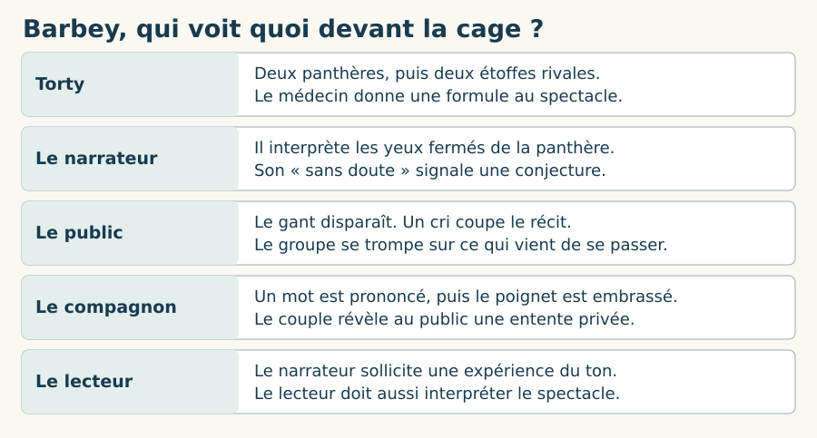
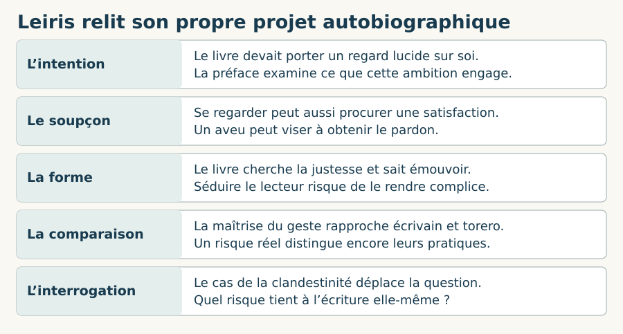

# BEL · AL — Français (oral tronc commun 29 juin) 2026 · Corrigé brut

*Corrigé rédigé par IA, non officiel. Signalez toute erreur.*

**Rédaction** · GPT-6.2 Astra Ultra · vitesse non renseignée

**Autocontrôle** · GPT-6.2 Astra Ultra · vitesse non renseignée

Les neuf textes de la liste du 29 juin sont expliqués dans l’ordre du jury. La commission précise que chaque candidat choisit l’un des deux textes de son billet. La liste ne donne pas la composition de ces paires.

## 1. Barbey d’Aurevilly, *Les Diaboliques*, « Le Bonheur dans le crime »

**De l’exclamation de Torty au baiser final.** La feuille donne « Le Bonheur est dans le crime ». La nouvelle qui contient les deux bornes s’intitule *Le Bonheur dans le crime*. En répétant « panthère », le docteur Torty nous invite à regarder la femme et l’animal comme deux rivales. « Le satin est plus fort que le velours » remplace aussitôt les êtres par deux matières. Le narrateur doit expliquer cette énigme. L’une porte une robe, l’autre a un pelage. Son propre regard prolonge ainsi la comparaison que son compagnon lui a soufflée à l’oreille.

La confrontation se joue d’abord dans les yeux. Selon le narrateur, fermer les siens serait pour la panthère reconnaître la supériorité de l’inconnue. Le « sans doute » signale pourtant le caractère conjectural de cette psychologie animale. Puis le spectacle change de vitesse. Le nombre des boutons et la lenteur avec laquelle la femme retire son gant prolongent l’attente. Les exclamations, les suspensions et le cri du groupe rendent au contraire presque illisible l’instant décisif. Le « nous » engage le narrateur dans une erreur collective. Le public croit un instant que la femme est blessée. Seul le gant a disparu.

La dernière parole fait entrer dans le tableau un autre interprète. L’homme dit « Folle ! », mot qui peut marquer la réprobation, la peur ou la tendresse. Une adresse au destinataire, « Vous savez », sollicite de lui une expérience du ton que les caractères imprimés ne suffisent pas à restituer. Le baiser répond à l’énigme sans l’épuiser. Ce qui a paru au groupe un geste de défi provoque entre ces deux êtres un accord passionné. Dans ce cadre initial de la nouvelle, l’étonnement des spectateurs prépare le besoin d’un récit sur le couple.

[Lire le passage dans l’œuvre](https://fr.wikisource.org/wiki/Les_Diaboliques/Le_bonheur_dans_le_crime)

## 2. Diderot, *Jacques le fataliste et son maître*, l’histoire des amours interrompue

**Du commencement du récit de Jacques à la blessure au genou.** La première phrase tiendrait une promesse, si commencer une histoire garantissait qu’un lecteur va l’entendre. Le temps lourd endort le maître, puis la nuit égare les voyageurs. La colère du maître retombe sur le valet, qui persiste à rapporter ce qui l’atteint à ce qui était écrit. Le contraste de leurs deux voix éprouve une conviction sur laquelle le lecteur aurait volontiers entendu une discussion. L’événement a devancé l’explication.

« Vous voyez, lecteur » ouvre une seconde scène de domination, celle du narrateur sur le récit. Mariage, séparation, périple et retrouvailles tiennent chacun dans une question. La facilité avec laquelle on vient de les imaginer suffit à les congédier, mais leur évocation a bien retardé le récit promis. Les deux voyageurs auront perdu une nuit et le lecteur aura subi un délai. La formule coordonne les deux expériences comme s’il s’agissait de peines comparables. À l’aube, le lecteur supposé cherche à son tour à prendre la direction de l’histoire en demandant où l’on va. Le narrateur lui oppose qu’il doit choisir entre la destination et les amours.

Le maître reprend enfin la question que nous attendions. Jacques revient pourtant à la retraite d’une armée, puis à une charrette qui l’emporte vers l’hôpital. Le passage du présent de narration à un commentaire très personnel sur la douleur fait entendre le corps du conteur au milieu d’un événement collectif. L’explicit de la feuille abrège la formule que donne le témoin au pluriel. La blessure au genou est bien dans les deux cas le point d’arrêt. Le récit nous laisse ainsi devant une nouvelle question de liaison. Comment une histoire d’amour peut-elle passer par là ?

[Lire le passage dans l’œuvre](https://fr.wikisource.org/wiki/Jacques_le_Fataliste_et_son_ma%C3%AEtre)

## 3. Du Bellay, *Les Regrets*, CLXVIII, au cardinal de Lorraine

**Du don de Nature au jugement de la postérité.** Le premier vers tire un effet de proximité sonore de « Nature » et de « naistre ». Au moment où l’enfant vient au monde, la puissance qui lui confère ses qualités semble elle-même atteindre sa fécondité maximale. Cette prodigalité est visible dans les yeux, audible dans l’éloquence. La répétition de « soit » détaille les raisons d’admirer en laissant entendre qu’on pourrait les multiplier. La deuxième personne garde au compliment la forme d’une adresse directe.

Au second quatrain, le donataire du début reçoit encore. Cette fois les sujets du verbe sont sa vertu et son esprit. Les qualités reçues auraient donc produit à leur tour une récompense légitime, le rang auprès des dieux et la faveur du roi. Les superlatifs soutiennent cette ascension. Le mot « Bref » promet ensuite de ramasser l’éloge en deux vers. Richesse, honneur, grâce et savoir semblent épuiser tout ce qu’un homme peut avoir. La question qui suit paraît purement oratoire. Comment pourrait-il rester quoi que ce soit à espérer ?

Le dernier tercet donne pourtant une réponse. Le « libre jugement » de la postérité appartient à des êtres qui échappent à l’autorité du dédicataire comme à celle du roi. Même assigner au cardinal une place dans le ciel resterait, selon la pointe, en dessous de son mérite. Le verbe « donner » revient alors avec la négation, après les dons si abondants de Nature. Le poète trouve dans cette limite de la louange la possibilité d’une louange plus haute encore. En écrivant pour l’avenir, il commence aussi à former ce jugement dont il reconnaît la liberté.

[Lire le passage dans l’œuvre](https://fr.wikisource.org/wiki/Les_Regrets_(du_Bellay))

## 4. Giraudoux, *La Guerre de Troie n’aura pas lieu*, I, 6

**De l’entrée en parole du Géomètre à la dernière formule de Priam.** « Voilà le géomètre » ressemble à la présentation d’un témoin qualifié. La tirade déjoue cette attente en faisant de l’apparence féminine un objet d’arpentage. Les détails de peau et les lignes du paysage troyen entrent dans un même vocabulaire professionnel, au point que chaque défaut supposé de la nature devient une souffrance de spécialiste. Quand Hélène arrive, ce qui semblait mou ou raide prend une forme intelligible. Son pas, sa voix et l’air de son passage fournissent désormais des unités à l’univers. Le comique vient de la rigueur avec laquelle le Géomètre détruit ses propres instruments. Le mot « mesure » demeure, mais il ne désigne plus que le rapport à une seule personne.

Hécube intervient d’une phrase. Au milieu de tant de certitude collective, elle voit simplement un homme qui pleure. Elle ramène l’orateur à son corps et laisse au public le temps de mesurer la part du désir dans sa démonstration.

Priam change alors de preuve et de destinataire. Il invite son fils à regarder les vieillards massés devant eux. Le sentiment qu’ils éprouvent pour Hélène serait une « absolution ». Les exemples choisis sont pourtant assez précis pour que le public s’interroge sur ce pardon. Une construction hypothétique attribue à l’absence de la beauté les injustices et les échecs dont ces hommes sont responsables. La triple formule finale leur prête tour à tour un passé pardonné, une revanche présente et un avenir. Hélène demeure silencieuse dans cet extrait où l’on dit ce que sa présence signifie pour toute une cité. La scène expose ainsi les mécanismes d’une adhésion collective dont dépend une décision politique.

[Lire le passage dans l’œuvre](https://fr.wikisource.org/wiki/La_guerre_de_Troie_n%E2%80%99aura_pas_lieu/Acte_I)

## 5. Michel Leiris, *L’Âge d’homme*, préface « De la littérature considérée comme une tauromachie »

**D’une méconnaissance passée à une interrogation sur le risque d’écrire.** L’incipit indique le lieu du texte dans le livre. L’écrivain reprend, dans la préface, l’intention qui avait été la sienne lorsqu’il s’était raconté. Il commence par associer chaque ambition à un mobile plus embarrassant. S’examiner peut prolonger le plaisir de se regarder. Avouer peut nourrir le désir d’être absous. La reprise des verbes à la première personne évite de laisser ces deux remarques au rang de maximes sur la faiblesse humaine. C’est sa propre pratique que le préfacier passe à l’épreuve.

Un deuxième retournement concerne la forme de l’œuvre. L’auteur voulait composer un livre construit, bien écrit et émouvant. Or ce travail peut séduire le lecteur jusqu’à obtenir sa complicité là où l’auteur disait souhaiter son jugement. L’écrit qui donne à l’aveu une portée publique pourrait aussi en adoucir le scandale. L’image du torero revient à ce point du raisonnement. Lui aussi soigne la forme de ses gestes. Il ne s’abandonne jamais tout entier au hasard. Cette concession fait reconnaître une part de duplicité dans la comparaison elle-même.

L’articulation suivante déplace pourtant la difficulté. Le danger encouru dans l’arène existe indépendamment de l’opinion du spectateur. Pour l’écrivain, faut-il chercher un équivalent dans l’histoire ? La littérature clandestine sous l’Occupation en offre un cas réel, mais lié à une lutte qui dépasse l’acte d’écrire. Les deux interrogations finales restent donc ouvertes. Leiris cherche quel engagement propre à l’écriture pourrait avoir une conséquence effective pour son auteur. « Positif », au dernier mot, signifie ici réel, susceptible d’être éprouvé. La préface retourne sur le livre l’exigence de sincérité que celui-ci avait prétendu appliquer à l’homme.

[Lire le passage dans l’œuvre](https://classiques.uqam.ca/contemporains/leiris_michel/age_dHomme/age_dHomme.html)

## 6. Marivaux, *La Vie de Marianne*, l’aveu de M. de Climal

**De « Mais je n’y gagnai rien » à l’argument que Climal tire de la situation de Marianne.** La narratrice résume d’abord l’effet d’une tentative antérieure pour tenir à distance les déclarations de son protecteur. « Je n’y gagnai rien » annonce rétrospectivement qu’il va mener la conversation et prépare aussi le vocabulaire du profit qui va envahir son discours. D’abord, il avoue sa « faiblesse ». Il attribue dans le même mouvement à Marianne une parfaite connaissance de ses sentiments. Il l’accuse presque de feinte avant de lui laisser répondre. La substitution du mot « amour » au mot « amitié » est alors présentée comme un bénéfice assuré pour sa « fortune ».

La courte réplique de Marianne rompt ce flot de paroles. Elle reprend les deux personnes, « Vous, mon amant ! », puis le titre de respect, « monsieur ». Cette précision rappelle l’inégalité de leur situation au moment même où il prétend parler le langage de l’intimité. Le récit note qu’elle baisse les yeux. Pour le lecteur, ce geste garde une incertitude que les affirmations de Climal voudraient lever à leur avantage.

Le protecteur reprend les devants avec l’apostrophe « ma fille ». En racontant comment sa générosité serait devenue amour à son insu, il maintient intacte sa bonne opinion de lui-même. Il se reconnaît un tort, puis pousse l’hypothèse de la prudence jusqu’à l’absurde. Pour éviter cette inclination, aurait-il fallu abandonner une jeune femme sans ressources ? Les questions qu’il lui adresse la placent devant les conséquences de son refus éventuel. Le dernier retour au mot « faiblesse », accompagné d’une concession apparente sur le nom qu’on voudra lui donner, transforme le désir du bienfaiteur en prétendu bonheur de l’obligée. Marianne fait apparaître cette pression en reproduisant l’argument jusqu’au bout.

[Lire le passage dans l’œuvre](https://fr.wikisource.org/wiki/La_Vie_de_Marianne_(%C3%A9d._Duviquet))

## 7. Perrault, « Les Fées », du début du conte au retour de la fontaine

**Le don se prépare dans la manière de donner à boire.** La veuve et l’aînée forment d’abord une paire où la ressemblance du visage se prolonge en ressemblance d’humeur. La cadette, portrait de son père, reçoit à la fois douceur et beauté. L’explication générale selon laquelle on aime ce qui nous ressemble provoque pourtant ici une injustice particulière. L’amour excessif pour l’aînée a pour envers le travail continuel imposé à la plus jeune. Le texte quitte l’ordre des traits hérités pour décrire une organisation matérielle du logis.

Distance, fréquence du trajet et taille de la cruche rendent sensible la peine qu’il y a à fournir de l’eau à la maison. La même eau donne au bord de la fontaine l’occasion d’un geste entièrement différent. Sollicitée par une inconnue, la jeune fille appelle celle-ci « ma bonne mère ». Cette appellation fait résonner la dureté de sa vraie maison. Plusieurs actions détaillent le soin qu’elle accorde à l’autre, rincer la cruche, choisir le meilleur endroit, soutenir le récipient pendant que la femme boit. Le don précède ici toute espérance de récompense. Le narrateur ne nous apprend qu’après coup, dans une parenthèse, qui posait l’épreuve.

La fée répond par un don dont la forme prolonge la scène. Puisque la parole de la cadette s’accordait à son geste de bonté, chaque parole à venir recevra une forme précieuse, fleur ou pierre. Le passage s’achève toutefois avant que l’on puisse voir ce prodige se produire. De retour au logis, la jeune fille essuie une réprimande pour son retard. Le lecteur sait désormais comment ce temps a été employé. La coupure du jury le laisse ainsi en avance sur la mère et attentif au premier mot que prononcera l’enfant.

[Lire le passage dans l’œuvre](https://fr.wikisource.org/wiki/Histoires_ou_Contes_du_temps_pass%C3%A9_(1697)/Original/Les_F%C3%A9es)

## 8. Rabelais, *Pantagruel*, chapitre XXXII, fin du voyage d’Alcofrybas

**Des dents du fond à la récompense d’Alcofrybas.** À l’endroit où le jury écrit « Puis descendis », le témoin de Marty-Laveaux porte « Puis me descendis ». Le narrateur traite les dents et les oreilles du géant comme les points d’une carte. Vallée, forêt, bourgade, le paysage a toutes les stations ordinaires d’un récit de voyage. Le voyageur est assez précis pour rapporter un tarif et assez faillible pour avoir oublié le nom du village. Son salaire donne une première leçon d’étrangeté. Les habitants paient le sommeil à la journée et rémunèrent davantage qui sait ronfler.

Alcofrybas consulte ensuite des sénateurs. Leur sentence sur les mauvaises gens de l’autre côté des dents lui rappelle ce qu’on dit dans son pays des gens de l’autre côté des monts. Le parallélisme plaisant des frontières corporelles et géographiques révèle au passage l’arbitraire de ces jugements. Un proverbe selon lequel une moitié du monde ignore comment vit l’autre reçoit une illustration littérale. Le narrateur revendique même un grand livre sur les royaumes de la gorge de son maître. La bouffonnerie du nom « Gorgias » et le nombre des royaumes font tenir toute la prétention d’une cosmographie dans une bouche.

Le retour de la barbe au sol change de dimension en quelques verbes. Pour Pantagruel, cependant, ces aventures sont demeurées parfaitement invisibles. Ses questions, qui portent sur le temps écoulé et la vie matérielle, obligent le voyageur à traduire son aventure extraordinaire en gestes ordinaires. L’énumération se termine sur un détail corporel comique, auquel le géant répond en bon compagnon. Le gain du récit, salaires du sommeil d’abord, puis châtellenie enfin, redouble le plaisir de raconter. La modestie finale d’Alcofrybas tient lieu de remerciement et laisse intacte l’incroyable autorité qu’il s’est donnée comme témoin.

[Lire le passage dans l’œuvre](https://fr.wikisource.org/wiki/Les_%C5%92uvres_de_Fran%C3%A7ois_Rabelais_(%C3%89ditions_Marty-Laveaux)/Pantagruel/32)

## 9. Arthur Rimbaud, « Oraison du soir »

**Une prière dont le corps produit lui-même le rite.** Le titre fait attendre une parole adressée au divin à la fin de la journée. Le sonnet ouvre sur la posture du « je », déjà assis et comparable à un ange, mais placé entre les mains d’un barbier. Il faut aussitôt réajuster l’image. La chope et la pipe Gambier assignent la scène au quotidien du buveur. Le cou et le ventre dessinent une pose assez précise pour que le lecteur puisse presque en faire la caricature. Au-dessus de cette figure, les « voilures » réservent encore à l’espace une légèreté lyrique.

Le deuxième quatrain s’intériorise en faisant surgir « mille rêves ». Or leur chaleur reçoit pour premier comparant une matière très terrestre de colombier. La douceur chantante des rimes s’accommode d’un rapprochement discourtois pour le rêve poétique. L’image suivante fait du cœur une partie tendre de l’arbre, l’« aubier ». Les coulures de couleur donnent à ce cœur mélancolique un aspect pictural. Le poème conserve le pouvoir de ses images au moment même où il rend suspecte leur noblesse.

Dans les tercets, « Puis » transforme la contemplation en suite d’actions. Le sujet ravale ses rêves comme une gorgée, puis se « recueille ». L’infinitif suivant donne au verbe dévot une destination physiologique. La reprise du mouvement vers le haut achève ce détournement. Au ciel auquel s’élève ordinairement la prière répond le geste du buveur, accompli sous le regard imaginaire des héliotropes. Leur « assentiment » prête à des fleurs la capacité solennelle d’approuver. Le mélange demeure rigoureusement construit jusque dans les rimes du dernier tercet. Le rire naît aussi de ce sérieux formel appliqué à une oraison si peu édifiante.

[Lire le passage dans l’œuvre](https://fr.wikisource.org/wiki/Po%C3%A9sies_(Rimbaud)/%C3%A9d._Vanier,_1895/Oraison_du_soir)

[Liste du 29 juin](https://www.ens.psl.eu/sites/default/files/francais3_29_juin_2026.pdf) · [Rapport du jury](https://www.ens.psl.eu/sites/default/files/2026_al_rapport_oral_francais_tc.pdf)
