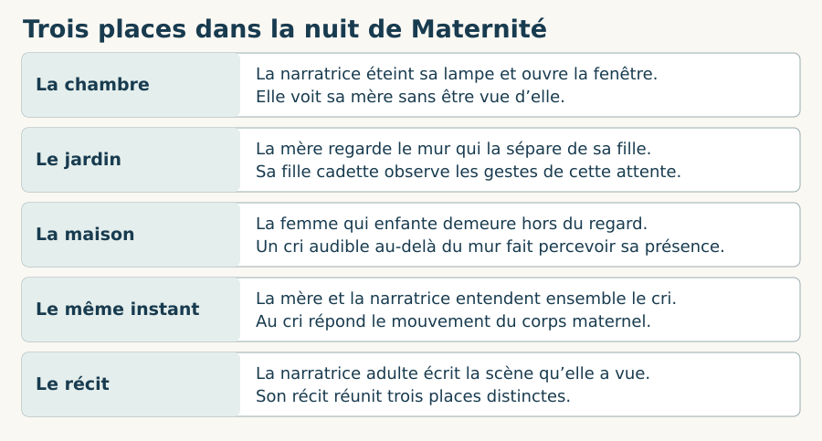
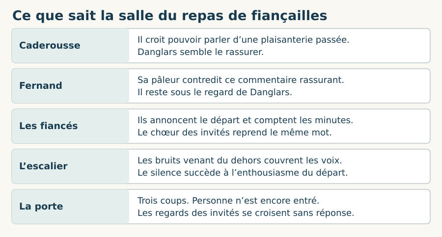

# BEL · AL — Français (oral tronc commun 30 juin) 2026 · Corrigé guidé

*Corrigé rédigé par IA, non officiel. Signalez toute erreur.*

**Rédaction** · GPT-6.2 Astra Ultra · vitesse non renseignée

**Autocontrôle** · GPT-6.2 Astra Ultra · vitesse non renseignée

La liste du 30 juin, intitulée « Français 3 », donne dix références. À l’épreuve, le candidat tire un billet à deux textes, en choisit un et en propose l’explication linéaire. La liste publique ne permet pas de reconstituer les paires de billets. Les dix textes sont expliqués ici dans l’ordre publié.

## Préparer une explication linéaire

Le rapport distingue trois temps dans l’exposé, la présentation, la lecture et l’explication. Pour chaque texte, partir d’un changement perceptible pendant la lecture. Chez Colette, un cri donne aux deux témoins un temps commun. Chez Corneille, le valet passe du jugement sur le maître à l’invention de son propre titre. Pendant l’entretien, il est possible de revenir sur une intonation et de montrer quelle interprétation elle soutient.

| Extrait | Question de reprise | Réponse possible |
|---|---|---|
| Colette | Pourquoi le cri « parvint en même temps » aux deux femmes ? | La simultanéité fait naître une expérience commune entre la fille qui voit et la mère qui mime une douleur venue de l’autre côté du mur. |
| Corneille | Pourquoi le maître interroge-t-il son valet ? | Dorante vient de changer d’état et demande à être reconnu comme cavalier. Cliton dispose du savoir local et parodie à son tour la prétention aux titres. |
| Dumas | L’arrestation de Dantès est-elle dans ces dernières lignes ? | Non. Trois coups retentissent et les regards circulent entre les convives. L’arrêt sur le seuil fait éprouver le suspense avant l’entrée des représentants de l’autorité. |
| Laclos | Pourquoi une lettre à Valmont est-elle le bon lieu pour parler du regard distrait ? | Il a déjà admiré cette expression. Le récit rétrospectif lui révèle qu’en croyant connaître Merteuil, il regardait une apparence qu’elle avait apprise. |
| La Fontaine | Le refus de l’aide du hérisson contredit-il la plainte initiale ? | Le renard persiste à souffrir, mais distingue désormais cette souffrance du mal supérieur qu’occasionneraient des parasites affamés. |
| Malherbe | Comment aborder le passage de l’impératif « Éteins » au dernier quatrain imposé ? | Le poète vient de réclamer l’extinction du souvenir. La concession finale sur les larmes reconnaît une expérience du soulagement que l’ordre seul ne pouvait produire. |
| Rabelais | Pourquoi le père parle-t-il de la Sorbonne ? | Le raisonnement de l’enfant donne la forme du syllogisme à une évidence corporelle. L’éloge raille la solennité universitaire tout en révélant une intelligence de la langue. |
| Racine | Que croit savoir Pylade en voyant les marques du rang d’Oreste ? | Il les interprète comme le signe d’un destin meilleur. Oreste lui répond sur un autre plan, celui d’un amour dont il ignore encore l’issue. |
| Ronsard | Qui est sujet du verbe qui exprime l’appétit au début des tercets ? | C’est l’œil, détaché en apparence de la volonté. La personnification prépare la justification finale par la nécessité. |
| Sand | Pourquoi finir le passage sur l’engagement de ne plus revenir au récit de soi ? | L’écrivaine présente la parole autobiographique comme un acte exceptionnel dont la gravité répond à son ancienne réticence. |

## 1. Colette, *La Maison de Claudine*, « Maternité »

**De la question du père au dernier mot, « enfantait ».** Comment l’écriture donne-t-elle à voir une relation que l’on n’a pas le droit de franchir ? La naissance a lieu dans une maison voisine, chez la sœur de la narratrice, alors séparée de sa famille. L’explication très lacunaire de la mère, les points de suspension et l’adverbe « vaguement » maintiennent d’abord la jeune fille dans une demi-compréhension. Le récit rétrospectif accepte cette limite au lieu de livrer à l’avance le sens du spectacle. L’enfant gagne sa chambre, éteint sa lampe, ouvre sa fenêtre. Sa propre attente est encore celle d’un témoin. La nuit donne plus à entendre qu’à voir, et les petits bruits d’animaux mesurent le silence qui sépare les maisons.

L’ombre en peignoir s’identifie par une brève incise, « ma mère ». La pleine lune fait de son trajet et de chacun de ses gestes une scène lisible pour la fille demeurée à la fenêtre. Le mur qui paraît infranchissable et le rameau froissé donnent une forme concrète à l’impuissance. Mais le premier cri atteint au même instant les deux auditrices. La distance a diminué la force du son sans rompre la simultanéité de l’expérience. La multiplication des cris impose alors son rythme au corps de la mère qui répond, là où ses bras ne peuvent rejoindre sa fille. La longue phrase finale retarde le verbe qui nommera enfin la naissance. « Doubler » ne signifie pas supprimer la distance ou réconcilier la famille. Une mère répète par son corps une douleur éprouvée ailleurs, sous le regard d’une autre fille. Celle-ci, en l’écrivant, rend perceptibles ensemble les trois places d’une même histoire.

[Lire le passage dans l’œuvre](https://fr.wikisource.org/wiki/La_Maison_de_Claudine/15)

## 2. Corneille, *Le Menteur*, acte I, scène 1, vers 1–32

**De la robe et de l’épée à « l’intendant du quartier ».** Dorante entend commencer une vie nouvelle en choisissant un signe immédiatement lisible, l’épée qui remplace la robe du juriste. Le père a donné son accord, mais le nouveau cavalier sollicite encore un jugement, celui de son valet. Les Tuileries sont moins une toile de fond qu’un examen public. Après avoir fait « banqueroute » aux lois, Dorante trouve tout naturel qu’une apparence se fabrique et qu’un visage se mette à la mode. Ses deux questions déplacent ainsi l’exposition comique. Il importe au jeune homme de savoir si l’on voit encore en lui l’écolier qu’il a été.

Cliton entre dans son rôle d’expert en offrant une assurance si excessive qu’elle devient plaisante. Mille jaloux en une heure et beaucoup de maris mis en danger donnent au nouveau venu des succès entièrement imaginaires. Bartole, juriste que Dorante laisse derrière lui, sert de figure de contraste jusque dans l’idée qu’on se fait de son portrait. Une question du valet ramène ensuite le maître de l’image de soi au lieu que l’on habite. Son vers sur l’air doux de Paris et la dure loi qui l’en a banni prend déjà la forme d’un mot d’esprit destiné à produire un effet. Quand il demande comment on « gouverne les dames », Cliton relève la précocité de cet appétit chez un homme arrivé la veille. Le serviteur achève la scène de formation en se donnant à son tour un titre haut en couleur, « intendant du quartier ». Le maître n’a pas encore commis les grands mensonges de la pièce. La scène fait déjà de chaque parole une manière de s’inventer une place devant autrui.

[Lire le passage dans l’œuvre](https://fr.wikisource.org/wiki/Le_Menteur_(Corneille,_Marty-Laveaux,_1862)/Acte_I)

## 3. Alexandre Dumas, *Le Comte de Monte-Cristo*, chapitre V

**De la déclaration de Caderousse, « En vérité », à l’étonnement des convives.** Au repas des fiançailles de Dantès, Caderousse croit pouvoir parler d’un complot comme d’une mauvaise plaisanterie désormais sans conséquence. Le narrateur glisse entre ses deux « en vérité » une explication de sa bienveillance retrouvée, où le bon vin compte autant que les bonnes façons du fiancé. Cette réserve comique empêche de prendre son propos pour une garantie. Danglars ne dément pas directement la préparation de la veille. Il donne à la présence de Fernand le sens rassurant d’un sacrifice consenti. Une seule notation, son teint livide, ouvre sous ce commentaire une autre histoire. La parole de Danglars sur le bonheur de son « futur capitaine » et les douze heures pendant lesquelles il voudrait être Dantès a pour le lecteur une ambiguïté que ne perçoivent pas les invités.

Mercédès demande le départ et compte les minutes. La précision de l’heure substitue une échéance toute proche au suspens diffus de la conversation. Le mot « Partons » passe de Dantès au chœur des convives comme s’ils constituaient enfin une communauté unanime. Or Danglars continue à regarder Fernand. Son mouvement convulsif est perçu avant que tout le monde entende les bruits de l’escalier. Le texte accroît leur présence, du bruit sourd aux voix et aux armes, puis en tire un effet inverse, le silence des convives. Trois coups à la porte ferment le passage. Personne n’est encore entré. Aux paroles assurées du début succède un regard circulaire où chacun cherche chez son voisin un savoir qu’il ne possède pas. Dumas construit ainsi l’irruption de l’événement en réglant les différences d’information, de regard et d’écoute entre ceux qui sont assis à la même table.

[Lire le passage dans l’œuvre](https://fr.wikisource.org/wiki/Le_Comte_de_Monte-Cristo/Chapitre_5)

## 4. Laclos, *Les Liaisons dangereuses*, lettre LXXXI

**Du récit de l’entrée dans le monde à la pensée jugée utile à montrer.** Merteuil écrit à Valmont l’histoire de son apprentissage. La jeune fille qu’elle a été paraît condamnée au silence et à l’inaction par son « état ». La syntaxe lui rend pourtant le rôle de sujet dès la première phrase. Elle observe, réfléchit, choisit d’écouter ce qu’on veut lui cacher. Le regard distrait que Valmont a déjà loué paraît alors sous un jour nouveau. En croyant reconnaître un trait spontané, le destinataire admirait une apparence acquise. Le récit intime est déjà une manière de se mesurer à lui.

Merteuil raconte ensuite le travail sur ses expressions. L’alternance des verbes désignant le sentiment et de ceux qui désignent la figure visible établit deux séries qui ne coïncident plus. La souffrance et la joie peuvent chacune recevoir un visage contraire. Ce que la lettre présente comme une victoire a donc un coût, l’apprentissage d’une séparation presque constante de soi d’avec soi. La reprise « je n’avais à moi que ma pensée » place cette maîtrise sous le signe d’une propriété menacée. Une société qui travaille à surprendre l’intériorité d’une jeune femme lui donne aussi des raisons de la défendre.

Le dernier mouvement militarise ce vocabulaire avec les « premières armes ». Le récit passe de la défense d’un secret au plaisir de prendre différentes formes. La circonstance compte, mais aussi la fantaisie personnelle. L’opposition finale entre sa façon de penser et celle qu’il lui est utile de laisser voir invite à retourner la dernière phrase vers la lettre elle-même. Le lecteur reconnaît les contraintes sociales dont elle expose les effets, tout en devant se demander quelle image de son indépendance Merteuil a jugé intéressant d’offrir à Valmont.

[Lire le passage dans l’œuvre](https://fr.wikisource.org/wiki/Les_Liaisons_dangereuses/Lettre_81)

## 5. La Fontaine, « Le Renard, les Mouches et le Hérisson »

**Fable entière, livre XII, fable XIII.** La réputation littéraire du renard est posée avant la mésaventure. Trois épithètes presque synonymes rappellent sa finesse. Elles contrastent avec la position du vieux blessé que les mouches peuvent tourmenter sans risque. Quand il prend la parole, il se scandalise surtout de ce que cette humiliation arrive au plus habile des animaux. Il voudrait que les parasites se contentent du « commun ». La plainte sur l’injustice du sort laisse donc apparaître les prétentions du plaignant. L’alternance des vers plus brefs et des longs vers se prête aux exclamations d’un personnage qui multiplie les raisons de s’indigner.

Le hérisson arrive avec la double qualité de voisin et de nouveau personnage dans les vers du fabuliste. Le lecteur attend de lui qu’il transforme le récit par son action. C’est pourtant la réponse du renard qui le renverse. L’animal dont l’habileté semblait perdue sait au moins comparer deux maux. Chasser les parasites repus ferait place à des parasites plus avides. La métaphore des « mangeurs » permet de passer des mouches aux courtisans et aux magistrats, puis la mention d’Aristote donne un passé à l’apologue. Ce rappel de l’autorité antique ne l’enferme pas dans l’histoire. L’incise sur le pays « où nous sommes » invite à prendre le présent politique pour terrain d’application. La formule finale économise tout commentaire héroïque. Les puissants qui ont déjà pris leur part deviennent moins importuns, sans cesser de vivre aux dépens des autres. L’esprit du renard lui permet d’énoncer une prudence de victime, dont le fabuliste fait sentir le prix et la portée satirique.

[Lire le passage dans l’œuvre](https://fr.wikisource.org/wiki/Fables_de_La_Fontaine_(%C3%A9d._1874)/Le_Renard,_les_Mouches,_et_le_H%C3%A9risson)

## 6. Malherbe, « Consolation à Monsieur du Périer » sur la mort de sa fille

**Vers 1 à 40.** La consolation ne commence pas par une certitude, mais par des questions qui portent sur la durée du deuil. Le poète semble d’abord demander à du Périer si les discours que lui inspire son amour paternel ne prolongent pas sa souffrance. La métaphore du dédale figure une raison égarée dans le malheur. Pourtant, en appelant son destinataire « ami » et en évoquant ce que l’enfant avait de charmant, il reconnaît que celui qui voudrait diminuer la perte en dépréciant l’être perdu serait lui-même injurieux. La brièveté des vers pairs, en réponse aux alexandrins, donne un poids sensible à cette tension. La comparaison avec la rose achève tout un destin dans les quelques syllabes d’un matin. Sa beauté intacte rend l’argument plus douloureux autant que plus persuasif.

Le poème se demande ensuite ce qu’un surcroît d’années aurait pu changer au sort de l’enfant. Les cheveux blancs projetés dans un avenir imaginaire, la poussière du tombeau et les images de l’autre monde confrontent le temps des vivants à celui des morts. Tithon, dont la vieillesse s’était indéfiniment prolongée, et le très jeune Archémore se retrouvent égaux devant Pluton. L’opposition mythologique rend pensable un ordre dans lequel le nombre d’années ne décide plus du mérite. L’impératif adressé à l’ami demande alors d’aimer l’ombre comme une ombre et d’éteindre le souvenir de cendres déjà éteintes. À cet endroit, la consolation risque de se faire dure. Or la dernière strophe imposée rectifie le ton par « je le confesse ». Pleurer soulage légitimement le cœur. À la borne du concours, la consolation tient ensemble l’effort pour limiter le deuil et la reconnaissance du droit aux larmes.

[Lire le passage dans l’œuvre](https://fr.wikisource.org/wiki/Po%C3%A9sies_de_Fran%C3%A7ois_Malherbe/Consolation_%C3%A0_M._du_P%C3%A9rier)

## 7. Rabelais, *Gargantua*, dialogue de Grandgousier et de son fils

**De « Retournons […] à notre propos » à « la région du cœur et du cerveau ».** La feuille indique XII. Les deux bornes identifient le passage du « torchecul », chapitre XIII dans l’édition Marty-Laveaux. Le père voudrait mettre fin à une digression en vers. La demande de précision du fils, puis la réponse du père, accordent à une conversation sur le bas du corps toute la précision d’un débat savant. Un pari transforme le retour au propos en joute. Gargantua enchaîne deux prémisses et une conclusion impeccable sur l’ordre de deux opérations des plus ordinaires. Grandgousier lui promet, pour cette logique, le titre de docteur en Sorbonne. La solennité académique prête à rire, mais l’admiration du père met aussi en valeur la vivacité intellectuelle de l’enfant.

La promesse d’une récompense en vin ne met pas fin aux jeux de langage. Le vin dit breton pousse dans le Véron. Le mot peut dérouter et inviter à regarder les choses de plus près. Gargantua présente ensuite son expérience par listes successives. Des objets usuels changent de fonction, la catégorie des chapeaux suscite une division en espèces, le verbe savant qui désigne le nettoyage fournit au résultat burlesque sa caution technique. La nouvelle liste mêle animaux et insignes de métiers. Elle pousse la méthode de comparaison jusqu’à l’absurdité. La formule de conclusion, qui ressemble à celle d’une thèse, annonce un choix dont la justification fait remonter la chaleur jusqu’au cœur et au cerveau. Le texte unit ainsi, par son langage même, le bas corporel et le haut de la raison. La scène tire sa gaieté de la rencontre entre l’expérimentation enfantine, la parodie des savoirs et la complaisance amusée d’un père qui reconnaît bien quelque chose de remarquable chez son fils.

[Lire le passage dans l’œuvre](https://fr.wikisource.org/wiki/Les_%C5%92uvres_de_Fran%C3%A7ois_Rabelais_(%C3%89ditions_Marty-Laveaux)/Gargantua/13)

## 8. Racine, *Andromaque*, acte I, scène 1, vers 1–28

**De la première réplique d’Oreste à « ou la vie ou la mort ».** Le premier mot, « Oui », fait entrer le spectateur au milieu d’une reconnaissance déjà commencée. L’expression de l’amitié prend la forme d’un raisonnement sur la Fortune. Parce qu’Oreste retrouve Pylade, il croit son sort près de changer de visage. Mais le rivage d’Épire était funeste à ses vœux et la faveur présente n’efface ni les six mois de séparation ni le souvenir des obstacles. Les interrogations rétrospectives laissent déjà entendre ce que les retrouvailles ont d’inespéré. Les noms propres dans la bouche d’Oreste désignent les deux amis l’un à l’autre tout en introduisant les personnages auprès du public.

Pylade lit à son tour des signes. Le retard que lui imposait le ciel semble avoir eu pour fin de lui rendre son ami. L’évocation de la tempête explique leur séparation, puis l’inquiétude exprimée par les exclamations révèle que la distance lui interdisait de « partager » le malheur de l’autre. Lorsqu’il mesure le danger que la mélancolie faisait courir à Oreste, le secours céleste devient paradoxalement « cruel ». Mais le Pylade du présent aperçoit dans le déploiement public qui accompagne le prince un nouvel argument pour espérer. Le spectateur peut comprendre que l’apparat appartient à la condition de l’arrivant sans régler pour autant ce qui le fait souffrir.

La troisième réplique, brève, oppose aux interprétations optimistes deux questions sur un destin inconnaissable. L’amour est le moteur du voyage et son objet reste à ce moment une femme nommée seulement par sa dureté. La symétrie de « la vie ou la mort » maintient l’issue ouverte au dernier mot du passage. Cette exposition renseigne en faisant jouer l’amitié elle-même. C’est en essayant de se donner des raisons d’espérer que les deux hommes découvrent au public l’étendue de ce qu’ils ignorent.

[Lire le passage dans l’œuvre](https://fr.wikisource.org/wiki/Andromaque/%C3%89dition_Mesnard,_1865/Acte_I)

## 9. Ronsard, *Sonnets pour Hélène*, « Je vois mille beautés »

**Sonnet entier.** La feuille le numérote L. Le même sonnet, identifié par son premier vers, porte le numéro XLIX du second livre dans l’édition Sorg. Le premier vers met à l’épreuve une opération qui semble d’abord très simple, voir et compter. Mille beautés peuvent être vues, aucune ne suffit à contenter les yeux. La répétition de « seule » substitue au nombre une relation d’élection et place la destinataire au principe de l’apaisement des sens. Le dire amoureux passe alors au langage de la nécessité cosmique. Destin, Ciel et Fortune deviennent les noms qu’un même sujet donne à une seule femme.

Le second quatrain continue cet ensemble d’apostrophes et rapproche des registres hétérogènes, de Vénus et de la Charité à la familiarité de « ma brune ». La proximité de ces noms ne résout pas une fois pour toutes le rapport du spirituel au sensible. L’élévation part d’un corps. La destinataire enflamme l’estomac de hautes vertus puis soulève l’amant vers le cercle lunaire. Lorsque le premier tercet reprend le regard, l’œil est devenu sujet d’un appétit. Il se nourrit « goulûment » de regards. Son exclusivité cesse de paraître purement volontaire, car l’habitude a fait de cette beauté sa nourriture ordinaire.

Les derniers vers changent enfin le sens de l’éloge. Si le regard affamé commet une faute en voulant suivre la dame, la cause qu’il faut juger serait la nécessité, non sa libre volonté. Ce raisonnement a quelque chose d’une défense prononcée par celui-là même qui célèbre. Élever la destinataire jusqu’aux puissances qui gouvernent le monde lui permet de lui attribuer le pouvoir de lier les sens de l’amant. Le sonnet fait ainsi du compliment, progressivement, un plaidoyer pour un œil incapable de se gouverner seul.

[Lire le passage dans l’œuvre](https://fr.wikisource.org/wiki/Le_second_livre_des_Sonnets_pour_H%C3%A9l%C3%A8ne/Je_voy_mille_beautez)

## 10. George Sand, *Histoire de ma vie*, ouverture du premier chapitre

**De « Pourquoi ce livre ? » à « n’y plus revenir ».** La question initiale se trouve dans le sommaire du chapitre. Les réponses et les sujets qui s’énumèrent ensuite associent un devoir de transmission, des œuvres antérieures, des objections adressées aux biographes, des métiers et même des oiseaux. La formule générale annonce un livre où le récit d’une personne pourra faire place à de tout autres êtres. La prose proprement dite débute par la réfutation d’un soupçon. Raconter sa vie pourrait passer pour orgueilleux. Sand déplace la valeur de l’entreprise en soulignant la difficulté de se définir et la part de choix qu’implique toute conservation de souvenirs. Plus on étudie le cœur, moins on y voit clair. La sincérité promise doit donc se concevoir comme un travail.

La répétition de « devoir », reprise par un engagement au futur, donne au projet une force morale. La narratrice ne s’excepte pas de l’examen qu’elle avait conseillé aux autres. Puis, avec une ironie discrète, elle s’accuse d’une paresse qu’elle attribue précisément aux esprits occupés. Ce délai a laissé prospérer des biographies pleines d’erreurs jusque dans les louanges. Sand reconnaît aussi avoir résisté aux sollicitations de personnes bienveillantes. Elle avait la tête et le cœur peuplés d’autres personnalités, qu’une longue gradation révélera pour ce qu’elles sont, des personnages de roman. Leur place dans le texte éclaire pourquoi l’évocation de sa propre personne lui répugnait. La phrase finale donne à la décision présente un caractère exceptionnel, parler de soi une fois sérieusement. Le passage fonde l’autorité de l’autobiographie sur la prise en charge de ses difficultés, y compris la part que l’autrice a elle-même prise à la méconnaissance publique de sa vie.

[Lire le passage dans l’œuvre](https://fr.wikisource.org/wiki/Histoire_de_ma_vie_(Sand,_Calmann-Levy_1855)/1/01)

[Liste du 30 juin](https://www.ens.psl.eu/sites/default/files/francais_3_30_juin_2026.pdf) · [Rapport du jury](https://www.ens.psl.eu/sites/default/files/2026_al_rapport_oral_francais_tc.pdf)
