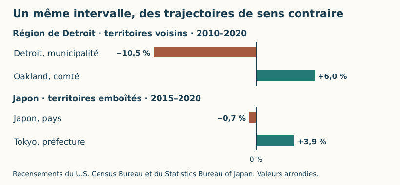

# BEL A/L — Géographie (option Ulm) 2026 · Corrigé brut

*Corrigé rédigé par IA, non officiel. Signalez toute erreur.*

**Rédaction** · GPT-6.2 Astra Ultra · vitesse non renseignée

**Autocontrôle** · GPT-6.2 Astra Ultra · vitesse non renseignée

**Révision (tour 1)** · GPT-6.2 Astra Ultra · vitesse non renseignée

## Les échelles de la décroissance

De 2015 à 2020, la population du Japon diminue de 0,7 %, tandis que celle de la préfecture de Tokyo augmente de 3,9 %. Les deux observations portent sur la même période et décrivent le même pays. La seconde éclaire la première en montrant que la contraction nationale peut s’accompagner d’une concentration géographique. Une décroissance territoriale est une diminution mesurable et durable, démographique ou économique, qui modifie les conditions d’occupation d’un territoire. Le choix d’un indicateur, d’une durée et d’un périmètre fait donc partie de l’explication. Que révèle le passage d’une échelle à l’autre sur les mécanismes de la décroissance et sur la possibilité d’en gouverner les effets ?

### I. Changer de maille change le diagnostic

La petite échelle cartographique permet d’abord de repérer une répartition. Au Japon, le recensement dénombre en 2020 une diminution de population dans 39 des 47 préfectures et dans 1 419 des 1 719 municipalités par rapport à 2015. Une même carte peut donc représenter un phénomène très diffus et l’existence d’exceptions importantes, dont Tokyo. La série nationale ne permet à elle seule de localiser ni la concentration des pertes ni les pôles qui continuent d’attirer. À l’inverse, l’exemple tokyoïte pris isolément ferait manquer la portée de la diminution japonaise. Le choix de l’échelle dépend de la question posée. Pour dimensionner à l’échelle nationale les ressources destinées à une population vieillissante, le pays est une unité pertinente. Pour identifier les habitants qui doivent parcourir de plus grandes distances après le regroupement d’un service, il faut descendre jusqu’aux localités et aux itinéraires.

Le contraste existe à l’intérieur d’une même région urbaine. Entre les recensements de 2010 et 2020, la ville de Detroit passe de 713 777 à 639 111 habitants, soit une diminution de 10,5 %. Dans le comté d’Oakland, au nord-ouest du centre, la population passe de 1 202 362 à 1 274 395 habitants, en hausse de 6,0 %. Le deuxième périmètre se situe dans l’espace métropolitain mais hors de la ville de Detroit. Additionner ces deux seuls nombres ne produirait donc pas le bilan de la métropole entière. Les comparer montre en revanche combien il serait imprudent d’appliquer le taux de la ville-centre à tous ceux qui partagent avec elle un bassin d’emploi.

Un taux dépend aussi du moment retenu. Deux recensements permettent d’établir un solde entre deux dates, mais ne garantissent pas que la baisse a été régulière dans l’intervalle, ni qu’elle se poursuivra. Pour parler de décroissance économique, il faut mobiliser un indicateur distinct, comme les emplois situés dans le périmètre. Un nombre d’usines qui baisse ne dit encore ni combien d’emplois persistent dans les services ni où habitent ceux qui les occupent. La cartographie la plus explicative superpose donc rarement tout. Elle met en regard quelques indicateurs construits dans des mailles et des temps comparables.

À Detroit et dans le comté voisin d’Oakland, les évolutions opposées s’observent à l’intérieur d’une même région urbaine. Au Japon, Tokyo appartient au total national dont sa trajectoire s’écarte. Dans le premier cas, il faut encore connaître les autres territoires pour établir le bilan régional. Dans le second, il faut connaître les effectifs pour calculer la contribution de Tokyo.

### II. Relier les échelles fait apparaître des mécanismes

Une parcelle vacante est un résultat local qui admet plusieurs explications. À Detroit, les déplacements d’usines et d’emplois, la suburbanisation résidentielle, la ségrégation et les difficultés d’accès aux ressources dans certains quartiers ont, au cours du XXe siècle, recomposé l’agglomération. Des mobilités de courte portée peuvent retirer des habitants et des recettes fiscales à une municipalité sans les retirer à toute la région. La désindustrialisation peut aussi détruire des emplois à l’échelle régionale lorsque les décisions d’investissement sont prises ailleurs. Le constat du recul de Detroit et celui de la croissance d’Oakland ne suffisent toutefois pas à reconstituer les trajets de personne à personne. Il faudrait des données de mobilité pour établir combien de personnes ont directement quitté l’un pour l’autre.

L’exemple de Halle-Neustadt, en Allemagne orientale, précise ce que l’échelle historique ajoute à cette analyse. Cet ensemble résidentiel planifié sous la RDA était relié aux complexes industriels de Buna et Leuna. Les transformations économiques après 1990 ont fragilisé ce système associant logement, transport et travail. La vacance de logements s’est concentrée dans certains grands ensembles. Le quartier entier a intégré en 2002 le périmètre de financement du programme *Stadtumbau Ost*. Ce qui se compte à l’immeuble correspond donc à la transformation d’un bassin industriel et à une transition nationale. Mais la perte d’un emploi à l’usine, le départ d’un ménage et la vacance persistante d’une cage d’escalier sont des événements distincts dont ni le lieu ni le calendrier ne coïncident nécessairement.

Le Japon révèle enfin un mécanisme que la seule histoire des bassins industriels restitue mal. Dans une localité âgée, les décès peuvent dépasser les naissances. Le départ de jeunes adultes vers un pôle d’études ou d’emploi peut simultanément diminuer les effectifs locaux et le nombre de futurs parents. La migration intérieure redistribue la population à l’échelle nationale, alors que le solde naturel contribue directement à l’évolution de son total. Cette différence de mécanisme explique qu’une politique d’attraction locale puisse changer la répartition des habitants sans modifier le total du pays. Le passage entre échelles sert ici à départager deux façons, pour un territoire, de perdre de la population.

### III. Ajuster l’échelle de la décision à celle du problème

À Detroit, le programme de cession de parcelles attenantes aux propriétaires voisins permet de traiter à l’échelle de l’îlot une partie des terrains vacants. Il redonne à un lieu sans usage un responsable de proximité et une fonction possible pour le ménage voisin. Il dépend toutefois de la maîtrise du foncier, de l’éligibilité de l’acquéreur et des moyens qu’il peut consacrer au terrain. Il suffit d’une limite communale pour que cet instrument change, alors que le marché du logement et les déplacements quotidiens dépassent cette limite. Le nombre de parcelles réaffectées mesure l’activité du programme. En déduire une reprise démographique de la ville entière exigerait une autre observation.

À Halle, agir sur la vacance a conduit à intervenir sur le parc lui-même. Le bilan municipal recense 5 163 logements démolis à Neustadt jusqu’en 2016, dans le cadre de la restructuration urbaine et en dehors des opérations subventionnées. Une décision sur un bâtiment peut adapter les charges d’entretien à une demande moindre. Elle engage aussi les réseaux de quartier et la possibilité, pour les habitants restants, de garder leurs repères et leurs services. Les échelons fédéral et régional peuvent soutenir des dépenses qu’une ville dont les ressources diminuent peinerait à assumer. Il faut donc apprécier l’intervention à plusieurs endroits à la fois, jusque dans les immeubles où se relogent les ménages, et distinguer amélioration des conditions de vie et retour à la croissance.

Une lecture géographique de la décroissance commence par la question « de quoi et où mesure-t-on la diminution ? » et aboutit à une autre, « à quel niveau peut-on agir sur ce qui diminue ? ». Les réponses se recouvrent rarement. La ville dessine le périmètre d’un problème fiscal, le bassin d’emploi celui de certaines de ses causes, et le quartier celui de l’accès quotidien à un service. Rendre ces échelles explicites évite de présenter tout un territoire comme condamné et permet de juger les politiques à l’aune des conditions concrètes qu’elles transforment.

[Énoncé officiel](https://www.ens.psl.eu/sites/default/files/al_opt_geo_261106.pdf)
