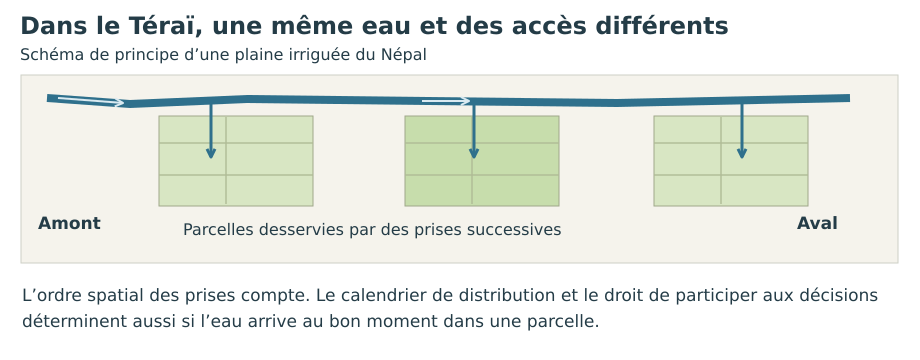
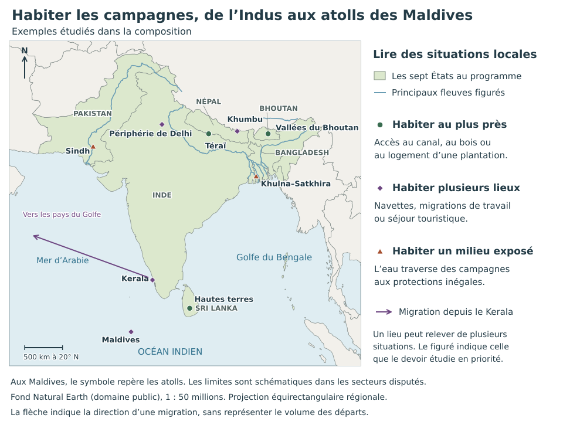
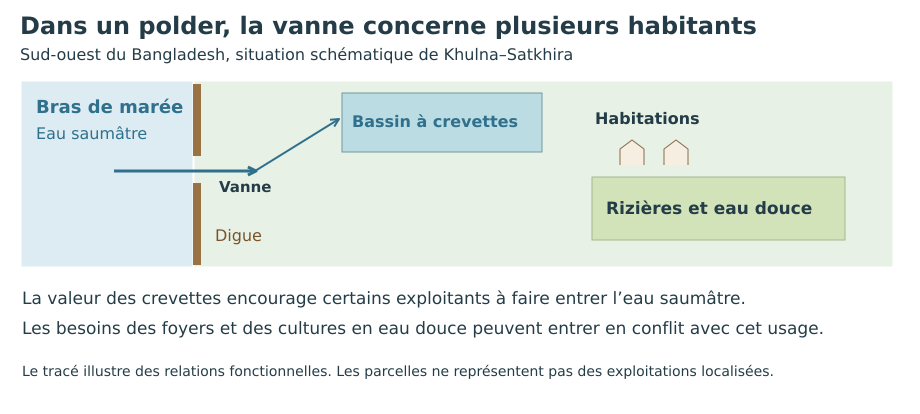

# BEL A/L — Géographie 2026 · Corrigé brut

*Corrigé rédigé par IA, non officiel. Signalez toute erreur.*

**Rédaction** · Modèle : OpenAI Codex (famille GPT-6) · Effort de raisonnement : non renseigné · Mode de vitesse : non renseigné.

**Révision** · Modèle : OpenAI Codex (famille GPT-6) · Effort de raisonnement : non renseigné · Mode de vitesse : non renseigné.

**Problématique** — Comment des habitants inégalement dotés peuvent-ils maintenir ou recomposer leurs liens avec ces campagnes lorsque les ressources et les activités qui les font vivre se déploient sur plusieurs lieux ?

## Introduction

Dans le delta du Gange, du Brahmapoutre et de la Meghna, une digue permet de maintenir des maisons et des cultures à l’abri de certaines marées. Pour comprendre ce que signifie habiter derrière elle, il faut pourtant savoir qui décide de l’ouverture des vannes, qui tire son revenu d’une rizière ou d’un bassin à crevettes et qui se procure l’eau douce du foyer. Des familles voisines partagent une exposition aux cyclones sans avoir les mêmes intérêts, les mêmes trajets quotidiens ni les mêmes possibilités de partir. Leur campagne se dessine à travers ces relations autant que par les terres cultivées que distingue une carte.

Habiter, c’est faire avec un lieu par des pratiques régulières, s’y reconnaître, le transformer et, parfois, en partager l’usage avec des personnes qui n’y séjournent que temporairement. Les mondes indiens considérés ici comprennent l’Inde, le Pakistan, le Bangladesh, le Népal, le Bhoutan, le Sri Lanka et les Maldives. Leurs espaces ruraux associent des villages, de petites centralités, des terres de culture et de pâturage, des forêts, des milieux aquatiques. Certains sont très denses et fortement reliés aux villes. D’autres demandent des heures de trajet pour rejoindre un service ou un marché. Comment des habitants inégalement dotés peuvent-ils maintenir ou recomposer leurs liens avec ces campagnes lorsque les ressources et les activités qui les font vivre se déploient sur plusieurs lieux ? Il faut d’abord descendre à l’échelle des espaces pratiqués, puis suivre les liens qui les prolongent au loin, avant d’examiner dans quelles conditions les habitants peuvent continuer à y faire des choix.

## I. Une même campagne contient plusieurs territoires de la vie quotidienne

Les paysages ruraux ne déterminent pas à eux seuls les façons de les habiter. Dans le Téraï népalais, au pied de l’Himalaya, la plaine rizicole est structurée par les parcelles, les chemins et les canaux d’irrigation. Pour un cultivateur placé en aval, une terre proche du canal peut rester difficile à irriguer au bon moment. Le chemin de l’eau passe en effet par des prises, des tours de distribution et des décisions d’entretien qui engagent les autres usagers. Habiter cette plaine implique de contribuer à des travaux, de pouvoir faire valoir un droit et d’accorder le calendrier du travail familial à la distribution de l’eau. La distance décisive n’est donc pas seulement celle qui sépare la maison de la rizière. Elle réside aussi dans la relation, plus ou moins directe, à ceux qui règlent l’usage de l’infrastructure.

Dans les hautes terres du centre du Sri Lanka, le paysage de plantations de thé peut apparaître à un visiteur comme une succession de versants cultivés. Il est aussi, pour des familles ouvrières, un espace de résidence organisé par l’emploi. Des habitations en bande, connues sous le nom de *line houses*, ont été fournies par les employeurs dans de grandes plantations. La proximité du logement facilite le départ pour la cueillette et peut maintenir la famille dans une dépendance à l’égard du domaine pour le logement et certains services. Une route vers la ville voisine, une possibilité d’emploi extérieur ou l’accès à un logement plus autonome changent la portée de cette relation. Le thé relie le domaine aux marchés mondiaux, mais cette intégration ne renseigne, à elle seule, ni sur l’état du logement ni sur la facilité avec laquelle une ouvrière peut choisir un autre lieu de résidence.

À l’intérieur d’un même village indien, la distribution des habitations peut également inscrire les hiérarchies sociales dans l’espace. Dans certains villages, des quartiers historiquement habités par des familles dalits ont été relégués vers les marges du noyau principal. Deux foyers très proches sur une carte n’ont pas nécessairement le même accès aux points d’eau, aux lieux de sociabilité ou aux espaces religieux. De telles situations varient selon les régions, les luttes locales et les parcours familiaux. Les prendre au sérieux évite de parler d’un « village indien » immuable. Une conduite d’eau à domicile ou une nouvelle desserte peut déplacer des pratiques sans effacer des relations de domination. Inversement, organiser collectivement un accès à un lieu autrefois réservé peut transformer la géographie sociale sans modifier la distance matérielle entre les maisons.

Dans les vallées rurales du Bhoutan, l’espace domestique déborde lui aussi les champs immédiatement visibles. Les bois voisins peuvent fournir du combustible ou du bois pour construire, tandis que les habitants hier comme aujourd’hui associent à certains lieux des usages spirituels et des règles de respect. Les forêts gérées par des groupes d’usagers font intervenir des plans de gestion et des droits de prélèvement. Une forêt conservée sur la carte nationale correspond donc aussi à des trajets, à un travail d’entretien et à des décisions locales. Dans la plaine irriguée comme dans la vallée forestière, il faut connaître la nature des droits attachés à la ressource pour comprendre la carte des déplacements.

## II. Habiter au village suppose souvent de pratiquer plusieurs lieux

La route, le car, le bateau et le téléphone élargissent l’espace vécu. Au Kerala, dans le sud-ouest de l’Inde, les migrations de travail vers les pays du Golfe donnent à des familles rurales des ressources gagnées à plusieurs milliers de kilomètres. Un transfert peut financer l’amélioration d’une maison ou des études et favoriser le maintien d’une partie du foyer au village. Le départ redistribue aussi les tâches. Une personne restée sur place doit prendre en charge des proches âgés, suivre une culture ou décider de réparations sans pouvoir compter quotidiennement sur le membre parti. La maison agrandie par un revenu extérieur peut donner une visibilité locale à la réussite migratoire, quand d’autres familles ont surtout porté le coût du voyage et l’incertitude de l’emploi. L’étude des lieux effectivement reliés distingue ainsi le privilège de pouvoir circuler de la nécessité de partir pour que quelqu’un puisse rester.

Une route nouvelle change également la place d’un village par rapport à la ville sans que tout le territoire devienne urbain. À la périphérie de Delhi, des espaces de culture, des parcelles mises en vente, des villages anciens et des activités de service peuvent coexister le long d’un même axe. Un propriétaire bien situé tire éventuellement parti de la hausse des prix ou de la location d’un bâtiment. Le travailleur sans terre qui obtenait des journées d’emploi sur ces mêmes parcelles doit chercher d’autres chantiers ou allonger son trajet. Un axe qui rapproche la ville en temps de transport peut donc éloigner, pour un ménage, l’activité dont il vivait. Une campagne en cours de conversion conserve la mémoire des anciens usages et des solidarités villageoises tout en offrant des possibilités très différentes à ses résidents.

La relation entre îles habitées et îles touristiques des Maldives fait ressortir le rôle du mode de transport. Dans plusieurs atolls, le modèle de l’île-hôtel concentre hébergements et équipements touristiques sur un site spécialisé. Les habitants d’une île voisine peuvent vivre de la pêche, échanger avec d’autres îles ou occuper un emploi dans ce secteur. Les horaires des bateaux et l’organisation des périodes de travail décident de la possibilité de rentrer auprès de leur famille. Depuis 2009, l’autorisation des maisons d’hôtes sur des îles habitées a permis à certains ménages d’accueillir eux-mêmes des voyageurs. Elle a ainsi introduit dans le bourg des usages autrefois davantage séparés, avec de nouveaux revenus possibles et des demandes accrues sur l’eau et les services. Le tourisme ne donne pas le même territoire quotidien à un visiteur de passage, à une famille qui loue une chambre et à un salarié qui passe plusieurs jours sur une île-hôtel.

Le tourisme de montagne au Népal présente une configuration différente de cet habiter temporaire. Dans le Khumbu, région de l’Everest, les sentiers entre villages, hébergements et pâturages sont aussi parcourus par des groupes de trek. Des ménages tirent un revenu du portage, du guidage ou de l’accueil. Une maison bien placée le long d’un itinéraire fréquenté devient une ressource, tandis qu’un hameau en retrait peut recevoir peu de visiteurs. La saison touristique introduit son propre calendrier dans celui des activités domestiques. Comme dans l’atoll, le gain d’accessibilité concerne d’abord certains lieux et certains acteurs. La figure régionale situe ces exemples parmi d’autres manières d’habiter, sans réduire les États à une spécialisation unique.

## III. Rester, se protéger ou partir sont des choix inégalement ouverts

Dans le sud-ouest du Bangladesh, notamment dans les districts de Khulna et de Satkhira, le système des polders permet de comprendre pourquoi l’amélioration d’une ressource pour un groupe peut en dégrader une autre. Des digues ont été construites pour régler les entrées d’eau et protéger les cultures. Dans certains secteurs, l’élevage de crevettes en eau saumâtre offre des débouchés rémunérateurs et conduit à rechercher une circulation d’eau salée vers les bassins. Pour des riziculteurs voisins ou pour des ménages qui doivent se procurer de l’eau douce, ces choix peuvent accroître le coût de l’approvisionnement ou compromettre une récolte. Les cyclones, les ruptures de digues et les difficultés de drainage peuvent accentuer la vulnérabilité, selon les sites. Les habitants répondent en adaptant les cultures, en diversifiant les revenus, en collectant de l’eau de pluie ou en demandant l’entretien d’un ouvrage. La capacité de faire entendre sa voix dans la gestion des vannes peut ainsi compter autant que la hauteur du terrain.

Dans le Sindh pakistanais, les inondations de 2022 ont simultanément touché des maisons, des récoltes et des voies de circulation. Un relogement provisoire peut sauver une famille tout en l’éloignant des terres, des animaux ou des clients qui assuraient ses ressources. Rentrer une fois les eaux retirées suppose des moyens pour reconstruire et reprendre le travail. Un propriétaire et une famille qui travaille sur des terres qu’elle ne possède pas ne disposent pas des mêmes garanties pour investir sur place. Se déplacer a donc plusieurs significations. Une évacuation, une migration saisonnière réversible et le départ durable d’une famille dont le logement demeure inhabitable ne relèvent ni du même calendrier ni de la même capacité de choisir. Les réunir sous l’étiquette de l’exode ferait disparaître l’essentiel de l’expérience vécue.

Ces choix engagent enfin la définition du lieu que l’on veut préserver. Dans le delta, relever une digue protège certaines circulations et peut en rendre d’autres plus difficiles. Au Bhoutan, donner à des habitants une place dans la gestion d’une forêt peut renforcer leurs droits tout en les obligeant à arbitrer les prélèvements. Dans une île habitée des Maldives, des revenus touristiques peuvent soutenir le maintien de services, alors qu’une pression supplémentaire sur l’eau douce touche particulièrement les ménages les moins aptes à s’en procurer ailleurs. Le problème se pose chaque fois à plusieurs échelles. La décision du gestionnaire d’une vanne, de l’assemblée locale ou du responsable d’un équipement transforme des trajets particuliers. À l’échelle de l’État, ces décisions prennent place dans des politiques de développement, de conservation ou de protection face aux risques. Il faut donc interroger les habitants sur les lieux qu’ils entendent garder accessibles et sur le droit de décider dont ils disposent.

## Conclusion

Habiter les espaces ruraux des mondes indiens, c’est tenir ensemble des lieux qui n’ont ni la même distance ni la même signification pour tous. Le canal du Téraï, la plantation sri-lankaise et les villages de l’Inde rendent visibles des droits différenciés au sein des espaces de proximité. La migration depuis le Kerala, l’archipel touristique et les itinéraires du Khumbu montrent comment les lieux lointains peuvent soutenir ou contraindre la vie au village. Les deltas et les plaines inondables rappellent enfin que la possibilité de rester dépend de choix fonciers, techniques et collectifs autant que de l’exposition physique. Une politique rurale évaluée au seul nombre de logements reconstruits ou de routes ouvertes manquerait une part de ses propres effets. Elle gagnerait à suivre les trajets effectivement redevenus possibles, depuis la maison jusqu’au travail, au point d’eau, à l’école ou au lieu de culte.
