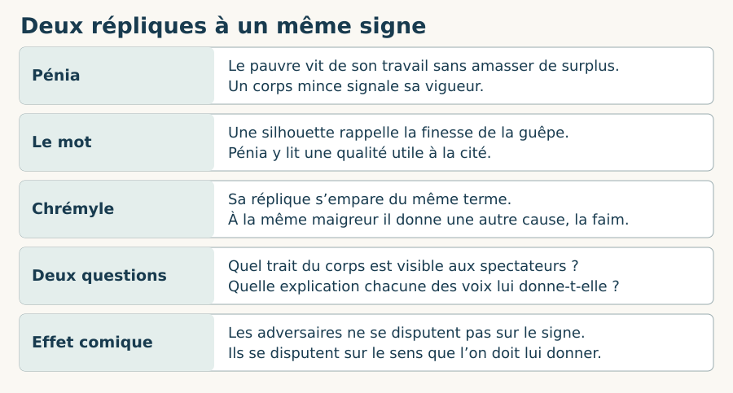

# BEL · AL — Grec (oral option, exemple du jury Ploutos) 2026 · Corrigé brut

*Corrigé rédigé par IA, non officiel. Signalez toute erreur.*

**Rédaction** · GPT-6.2 Astra Ultra · vitesse non renseignée

**Autocontrôle** · GPT-6.2 Astra Ultra · vitesse non renseignée

## Vertueuse pauvreté

Le rapport de l’option grecque publie cet **exemple de billet**, aux pages 5 et 6. Il donne les vers 551 à 570 du *Ploutos* d’Aristophane, avec une coupure après le vers 565. Les deux feuilles de juin qui mentionnent Aristophane ne précisent pas les vers. Le billet peut ainsi être expliqué en entier sans lui assigner une date de passage.

Chrémyle soutient le rétablissement de Ploutos, la Richesse personnifiée. Pénia, la Pauvreté, se présente pour défendre sa place dans la cité. Les interlocuteurs viennent de lui reprocher la misère de leur existence. Le duel de paroles va mettre à l’épreuve la définition même de la pauvreté.

### Traduction du passage du jury

**551–554. La Pauvreté.** Mais la vie que moi je donne ne connaît rien de tel, non, par Zeus, et elle ne le connaîtra pas non plus ! Car la vie que tu décris, celle du mendiant, c’est vivre sans rien posséder. Celle de l’homme pauvre, c’est vivre en faisant des économies et en s’appliquant au travail. Il ne lui reste rien de trop, certes, mais il ne lui manque rien non plus.

**555–556. Chrémyle.** Par Déméter, quelle vie bienheureuse tu nous as dépeinte là, si, après avoir économisé et peiné, il ne laisse même pas de quoi se faire enterrer !

**557–561. La Pauvreté.** Tu essaies de plaisanter et de me tourner en comédie au lieu de parler sérieusement, sans comprendre que je produis des hommes meilleurs que ne le fait Ploutos, tant par l’esprit que par la mine. Car chez lui ils ont la goutte, le ventre proéminent, les jambes épaisses, ils sont gras à l’excès. Chez moi, ils sont minces, ont la taille de guêpes et donnent du fil à retordre à leurs ennemis.

**562. Chrémyle.** Oui, c’est peut-être en les affamant que tu leur procures cette taille de guêpe !

**563–564. La Pauvreté.** À présent donc, au sujet de la maîtrise de soi, j’irai au bout de ma démonstration et je vous apprendrai, à vous deux, que la bonne conduite habite avec moi, tandis que la démesure est le propre de Ploutos.

**565. Chrémyle.** Bien sûr, c’est le comble de la bonne conduite que de voler et de percer les murs pour cambrioler !

**[…]** Le jury omet le vers 566.

**567–570. La Pauvreté.** Eh bien, regarde les orateurs dans les cités. Tant qu’ils sont pauvres, vois comme ils sont justes envers le peuple et la cité. Mais une fois qu’ils se sont enrichis sur les deniers publics, les voilà sur-le-champ devenus injustes. Ils complotent contre la multitude et font la guerre au peuple.

### Commentaire

Pénia ne se défend pas en promettant de sortir ses interlocuteurs de la pauvreté. Elle conteste d’abord leur usage du mot. Le *ptôchos* est réduit à mendier. Le *penês* vit de son travail sans disposer d’un excédent. Les deux infinitifs de la fin du vers 554, « rester en surplus » puis « faire défaut », tracent les limites exactes de cette seconde condition. La formule paraît équilibrée tant que l’on s’en tient au jour présent. Chrémyle la met à l’épreuve du lendemain, au moment où il faudra payer des funérailles. Avec « après avoir économisé » il reprend à Pénia son propre vocabulaire et retourne le mérite invoqué en objection matérielle. L’épithète élogieuse de « bienheureuse » prend une teinte funèbre avant même que la phrase arrive à la tombe.

La dispute devient un spectacle des corps. Pénia se plaint qu’on la tourne en comédie au sein même d’une comédie. Elle répond pourtant par des mots qui donneraient à jouer aux acteurs. L’accumulation des difformités attribuées à la richesse installe un groupe imaginaire sur scène, en face des silhouettes minces dont Pénia revendique la vigueur. La taille de guêpe est le point de bascule. Pour Pénia, elle figure la disponibilité du corps au travail et son utilité pour la cité. Pour Chrémyle, le même trait a une cause plus cuisante, la faim. Le comique ne tient pas seulement au contraste entre deux portraits. Il naît de deux interprétations incompatibles d’une même apparence.

Pénia passe de l’apparence à la maîtrise de soi et affirme que la bonne conduite habite chez elle. Chrémyle répond sur le même terrain lexical. L’adjectif « convenable » appliqué au vol suffit à faire entendre la dérision. Le dernier mouvement conservé change alors d’échelle et de preuve. Les orateurs, considérés avant puis après leur enrichissement aux dépens des ressources communes, rendent sensible la différence entre gain individuel et justice collective. La personnification parlait d’elle-même. Elle demande maintenant à son adversaire d’observer la cité. Son réquisitoire donne une force politique à la défense paradoxale de la pauvreté. La faim objectée par Chrémyle demeure pourtant audible. Confondre la parole de Pénia avec une leçon de l’auteur reviendrait à priver la comédie de celui qui lui répond.

[Exemple de billet et notes, rapport du jury, p. 5–6](https://www.ens.psl.eu/sites/default/files/2026_al_rapport_oral_grec_ancien_option.pdf#page=5) · [Texte grec de comparaison, édition Hall et Geldart](https://scaife.perseus.org/reader/urn:cts:greekLit:tlg0019.tlg011.perseus-grc2:551-570/)
