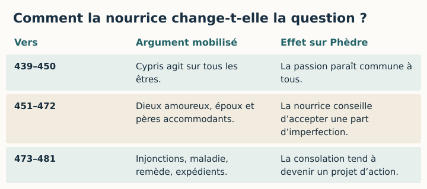

# BEL · A/L · Grec (oral Textes antiques, exemple du jury Chariton et Euripide) 2026 — Corrigé guidé

*Corrigé rédigé par IA, non officiel. Signalez toute erreur.*

**Rédaction** · GPT-6.2 Astra Ultra · vitesse non renseignée

Traduction de Chariton, Chairéas et Callirhoé III, 3–4, et commentaire d’Euripide, Hippolyte, vers 439–481. Le rapport présente un exemple de billet sans indiquer un jour de passage ni attester son tirage par un candidat.

## Présentation

Le double billet associe deux gestes distincts de l'épreuve. On traduit le récit de Chariton, où une porte fermée fait naître un soupçon injustifié. On commente ensuite la tirade de la nourrice dans l'*Hippolyte* d'Euripide, où la parole entreprend de donner un sens à un amour qui fait souffrir Phèdre.

## Traduction de Chariton

À la vue de la foule devant les portes, Chairéas fut d'abord surpris. Mais, dès qu'il en apprit la raison, il se précipita à l'intérieur, hors de lui. Trouvant la chambre encore fermée, il se mit à frapper avec empressement. Lorsque la servante eut ouvert, il se jeta sur Callirhoé. Sa colère se changea en chagrin et, déchirant ses vêtements, il pleurait. Comme elle lui demandait ce qui s'était passé, il restait sans voix. Il ne pouvait ni refuser de croire ce qu'il avait vu, ni croire ce qu'il ne voulait pas croire.

## Commentaire d’Euripide, Hippolyte 439–481

**L'amour de Phèdre devant la loi de Cypris, vers 439–450.** La nourrice s'adresse à sa maîtresse, qui aime Hippolyte, le fils de son époux. Son premier mot, *ἐρᾷς*, « tu aimes », pose le fait à la deuxième personne. Aussitôt, *τί τοῦτο θαῦμα*, « qu'y a-t-il là d'étonnant ? », en conteste le caractère exceptionnel. La question suivante rapproche l'amour et le projet de mourir. La nourrice raisonne par les conséquences. Si l'amour devait coûter la vie, que deviendraient tous ceux qui aiment et tous ceux qui aimeront ? Elle fait alors de Cypris une puissance qui coule à flots (v. 443). La déesse ménage qui cède et humilie qui se croit supérieur. Elle parcourt l'éther, habite le flot de la mer et donne l'élan dont tous les hommes sont issus. Phèdre, qui craint une faute singulière, se découvre incluse dans la condition de tous.

**Des dieux aux pratiques ordinaires, vers 451–472.** La nourrice invoque ceux qui connaissent les écrits anciens et les poètes. Zeus a aimé Sémélé, l'Aurore a enlevé Céphale. L'exemple décisif est ce qui arrive après. Les dieux qui ont aimé continuent d'habiter le ciel et de fréquenter les autres dieux. « Et toi, tu ne supporterais pas ? » (v. 459). L'ironie des vers suivants suggère qu'il eût fallu à Phèdre une naissance assortie de conditions spéciales ou d'autres dieux pour maîtres. L'oratrice change ensuite de milieu. Des époux font comme s'ils ne voyaient pas l'infidélité, des pères couvrent la faute de leurs enfants. Au vers 466, *λανθάνειν τὰ μὴ καλά* présente comme une sagesse le fait de laisser inaperçu ce qui est peu honorable. Le raisonnement a changé de nature. La puissance universelle du désir est devenue un argument en faveur de l'accommodement social et du secret. L'image du toit qu'on ne peut ajuster à la perfection (v. 468–469) ramène la conduite de la vie aux limites d'un travail humain.

**Du conseil au remède, vers 473–481.** « Mon enfant chérie » enveloppe les impératifs dans la tendresse. Mais la nourrice accuse aussi Phèdre d'*ὕβρις* (v. 474–475). Dans sa logique, c'est vouloir être plus forte que les dieux qui constitue la démesure. Une telle reformulation retourne contre Phèdre le langage moral par lequel elle voulait tenir sa passion à distance. Des mots de la maladie, *νοσοῦσα* et *νόσον*, la nourrice passe aux incantations, aux paroles qui charment et au *φάρμακον*. Le terme laisse ouverte la nature du remède. Aucun moyen déterminé n'est encore administré dans ces vers. Le futur final *μηχανὰς εὑρήσομεν*, « nous trouverons des expédients », mobilise une solidarité des femmes et fait entendre l'assurance de celle qui parle. Le mouvement dramatique vient de l'écart entre son intention de soulager et le risque d'aggraver le mal en voulant agir à la place de Phèdre.

Ainsi la tirade ne se contente pas de déclarer que l'amour est commun. Elle permet d'entendre comment une interlocutrice, raisonnable lorsqu'elle refuse qu'on meure d'aimer, passe de cette prémisse à une promesse d'intervention dont le bien-fondé reste en suspens.

## Préparation et reprise orale

**Chariton.** Enchaîner les trois changements du récit, surprise devant la foule, colère devant la chambre fermée, puis larmes devant Callirhoé. *τὸ μὲν πρῶτον* signifie « d'abord », comme l'indique la note. Les deux verbes opposés du dernier membre se construisent avec le datif. Le dernier « croire » est sous-entendu en grec après « il ne voulait pas ». Ce que le héros voit, c'est une foule puis une porte fermée. Aucun de ces signes ne lui donne accès aux intentions de Callirhoé.

**Euripide.** À la présentation orale, citer en grec, même brièvement. Le début du v. 439 individualise Phèdre, alors que le « tous » du v. 450 l'englobe. Puis passer du mythe des v. 453–456 à la maxime du v. 466 pour montrer en quoi consiste le glissement argumentatif. Les deux reprises d'*ὕβρις* aux v. 474–475 préparent le changement du conseil en injonction. Les premiers et derniers mots du billet coïncident avec les vers 439 et 481 de l'édition grecque de Gilbert Murray contrôlée ici.

**Répartition de l'oral.** Le jury indique environ dix minutes pour la traduction avec reprise (6 points) et vingt minutes pour le commentaire avec échange (14 points). Le texte de Chariton est reproduit sur le billet. Le commentaire se préparait sur un texte bilingue fourni pendant l'épreuve. Le rapport imprime la référence et les bornes d'Euripide. L'édition grecque liée en fin de corrigé fournit les vers dans cet intervalle.

[Billet et rapport officiels, p. 6](https://www.ens.psl.eu/sites/default/files/2026_al_rapport_oral_grec_tronc_commun_textes_antiques.pdf#page=6) · [Euripide, Hippolyte 439–481, texte grec édité par Gilbert Murray](https://scaife.perseus.org/reader/urn:cts:greekLit:tlg0006.tlg005.perseus-grc2:439-481/)
