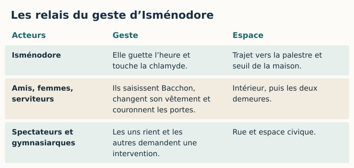

# BEL · A/L · Grec (oral tronc commun, exemple du jury Les noces de la veuve) 2026 — Corrigé brut

*Corrigé rédigé par IA, non officiel. Signalez toute erreur.*

**Rédaction** · GPT-6.2 Astra Ultra · vitesse non renseignée

Les noces de la veuve — Plutarque, Dialogue sur l’Amour, 10. Le rapport présente un exemple de billet sans indiquer un jour de passage ni attester son tirage par un candidat.

## Présentation

Le passage appartient au *Dialogue sur l'Amour* de Plutarque. Dans ce récit enchâssé, une veuve de Thespies, Isménodore, prend l'initiative d'un mariage avec le jeune Bacchon. Comment faire comprendre la puissance d'Éros en racontant une affaire qui divise les habitants ? Il faut d'abord observer à qui appartient le projet, puis suivre son exécution et enfin écouter la cité réagir.

## Traduction de Plutarque

Car Isménodore, à ce qu'il semble, pensait que Bacchon, pour sa part, n'était pas fâché à l'idée de ce mariage, mais qu'il éprouvait de la gêne devant ceux qui l'en détournaient. Elle décida donc de ne pas laisser échapper le jeune homme. Parmi ses amis, elle fit venir les plus jeunes d'allure et de mœurs, ceux qui prenaient son amour à cœur, ainsi que ses intimes parmi les femmes. Elle les réunit et guetta l'heure à laquelle Bacchon avait coutume de passer sagement devant sa maison en se rendant à la palestre.

Quand donc, ce jour-là, il s'approcha avec deux ou trois compagnons, le corps frotté d'huile, Isménodore vint elle-même à sa rencontre sur le seuil et se contenta de toucher sa chlamyde. Ses amis, eux, saisirent adroitement le beau garçon, enveloppé de sa chlamyde et de son manteau, le portèrent tous ensemble dans la maison et fermèrent aussitôt les portes. Au même moment, à l'intérieur, les femmes lui arrachèrent sa petite chlamyde et le revêtirent d'un habit de noces. Les serviteurs s'élancèrent à la ronde et couronnèrent d'olivier et de laurier les portes, celles d'Isménodore aussi bien que celles de Bacchon. La joueuse d'aulos parcourut la ruelle en jouant de son instrument.

Parmi les Thespiens et les étrangers, les uns riaient, les autres s'indignaient et excitaient les gymnasiarques à intervenir. Ceux-ci ont en effet une grande autorité sur les éphèbes et prêtent une attention très vive à leurs agissements.

## Commentaire de Plutarque

**Un projet vu par celle qui le forme.** Le premier mot important pour notre interprétation est la réserve *ὡς ἔοικεν*, « à ce qu'il semble ». À cette réserve du narrateur s'ajoute le participe qui signifie « pensant ». La disposition de Bacchon est évaluée par Isménodore. Sa propre voix demeure absente. La litote « pas fâché à l'idée du mariage » donne à la veuve une raison d'agir, mais elle ne vaut pas déclaration de consentement du jeune homme. La décision, au contraire, est très nette. Au verbe signifiant « elle décida » répondent le rassemblement de ses amis et la surveillance de l'heure. Un trajet familier vers la palestre devient l'occasion d'un changement de condition.

**Le mariage comme spectacle en deux lieux.** Sur le seuil, Isménodore « touche seulement » le vêtement. Le petit geste commande une action collective dont le texte répartit minutieusement les tâches. Les hommes saisissent Bacchon et ferment la porte. Les femmes substituent à l'habit du jeune homme le vêtement nuptial. Les serviteurs décorent les deux demeures et la musicienne prolonge la scène jusque dans la rue. Le contraste entre *τὸν καλόν* et *καλῶς*, le « beau » garçon saisi « bel et bien » ou « adroitement », ajoute un trait spirituel au mouvement. Le vêtement qu'on touche, puis qu'on enlève, rend visible un passage du monde de la palestre à celui des noces. Mais le geste de saisir et la fermeture immédiate des portes donnent aussi à cette comédie nuptiale la forme d'un enlèvement.

**Une ville qui débat par ses réactions.** Les couronnes sur les deux maisons proclament une union qui n'avait au départ que la veuve comme interprète et organisatrice. Les habitants et les étrangers se partagent entre le rire et l'indignation. Cette seconde réaction fait intervenir l'institution chargée des éphèbes. Le dernier présent interrompt la succession des événements pour expliquer le pouvoir des gymnasiarques. Le récit ne résout pas le débat en faisant parler Bacchon. Il montre qu'un même geste peut, selon celui qui le regarde, manifester l'ingéniosité de l'amour ou apparaître comme une atteinte à l'ordre civique.

[Billet et rapport officiels, p. 6](https://www.ens.psl.eu/sites/default/files/2026_al_rapport_oral_grec_tronc_commun_traduction_commentaire.pdf#page=6)
