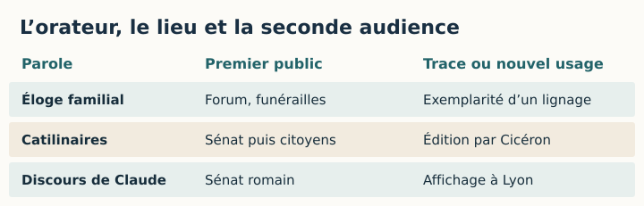
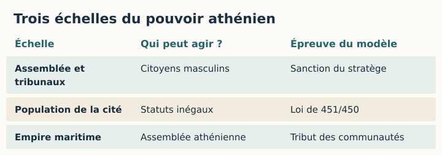
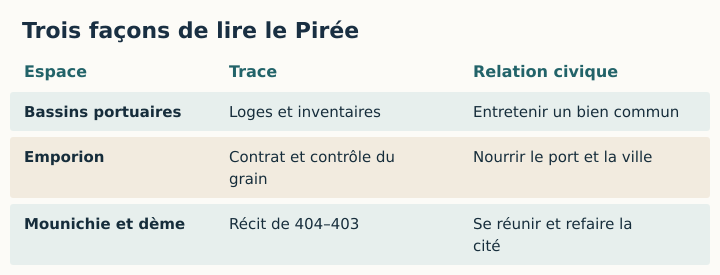

# BEL A/L · Histoire ancienne, option latin-grec · 16 juin 2026 — Corrigé brut

*Corrigé rédigé par IA, non officiel. Signalez toute erreur.*

**Rédaction** · GPT-6.2 Astra Ultra · vitesse non renseignée

Le fascicule du 16 juin donne 12 questions indépendantes. Après le tirage entre histoire grecque et histoire romaine, le candidat choisit une des deux questions proposées dans le domaine tiré. Il dispose de 1 h 30 de préparation sans ouvrage. Il présente une seule question pendant vingt minutes, puis s’entretient dix minutes avec le jury. Les réponses ci-dessous sont des propositions de leçon. [Fascicule officiel](https://www.ens.psl.eu/sites/default/files/al_option_histoire_ancienne_opt_lcl_sujets_16_juin_2026.pdf) · [Rapport de l’option](https://www.ens.psl.eu/sites/default/files/2026_al_rapport_oral_histoire_ancienne.pdf)

## 1 · Vivre à Athènes au IVe siècle

### De quelle Athènes et de quels habitants parle-t-on ?

Dans le *Contre Euboulidès* transmis sous le nom de Démosthène, Euxithéos conteste au IVe siècle son exclusion de la liste des citoyens de son dème. On a retourné contre lui la condition modeste de ses parents et, notamment, les activités rémunérées de sa mère. Sa défense révèle une ville où un travail au marché met une femme en contact avec bien des Athéniens, et où ces contacts deviennent pourtant des préjugés quand on juge de l’origine d’une famille. Vivre à Athènes ne revient donc pas à participer tous les jours à la démocratie pour peu qu’on soit présent dans les rues. Le terme désigne aussi bien la ville que la cité, qui s’étend aux dèmes de l’Attique et au port du Pirée. Comment la cité relie-t-elle ces espaces et ces personnes sans leur ouvrir les mêmes possibilités ?

### La maison dans un territoire organisé

La maison, ou *oikos*, réunit des personnes, des ressources et des relations de dépendance. Toutes les familles ne possèdent pas le domaine que l’*Économique* de Xénophon présente par la voix d’Ischomaque. Ce propriétaire a les moyens de confier des tâches, d’organiser une exploitation agricole et d’assigner à sa jeune épouse une place dans la direction intérieure du foyer. Le dialogue est un discours éducatif tenu par des hommes d’un milieu aisé. Le prendre pour le journal d’une famille moyenne ferait disparaître la diversité entre cultivateurs, artisans, salariés, résidents étrangers et personnes asservies. Le cas de la mère d’Euxithéos permet de reprendre le même thème depuis l’autre bout de l’échelle sociale.

Le dème est à la fois un cadre local de sociabilité, de culte et d’inscription politique. À dix-huit ans l’inscription d’un jeune homme citoyen exige une appréciation de son âge et de son origine par les membres du dème. C’est ce que décrit la *Constitution d’Athènes*, 42. Plus tard, l’appartenance peut encore être contestée. Le démotique accolé à un nom ne fournit pas l’adresse actuelle d’une personne. Il signale son inscription héréditaire dans une unité de la cité. Habiter la ville, connaître son voisinage et appartenir à un même dème sont trois relations distinctes.

### Gagner sa vie et nourrir une cité

Au Pirée arrivent notamment des céréales qui complètent la production de l’Attique. Le commerce suppose des entrepôts, des barques, des porteurs et du crédit ; il amène des équipages et des marchands qui repartent. Dans le *Contre Lacritos*, le contrat de prêt maritime cité par le plaideur relie un projet de voyage, des marchandises, la rémunération du prêteur et l’obligation de rendre des comptes. Il montre comment un produit susceptible de finir sur un marché athénien dépend de relations nouées bien au-delà de la cité. La protection des créances et la question du ravitaillement font entrer dans les tribunaux des affaires que les Athéniens n’avaient pas tous les moyens de financer.

Les intérêts du négociant n’épuisent pas l’expérience du travail. Un éloge funèbre, un plaidoyer et une stèle domestique parlent rarement à la première personne au nom d’un esclave des mines ou d’une servante. Pourtant la concentration de la main-d’œuvre servile au Laurion, les ateliers et le service domestique montrent l’étendue des dépendances qui permettaient à une partie des citoyens de libérer du temps pour les affaires publiques. À l’inverse, un citoyen pauvre pouvait être contraint de travailler un jour d’assemblée. La question est aussi concrète que celle de la distance séparant un dème rural de la Pnyx.

### Vivre en public, à des titres différents

Au IVe siècle, l’assemblée décide sur la Pnyx, les tribunaux populaires font siéger des jurés citoyens et la Boulè organise une part importante du travail préalable. Des indemnités rémunèrent certaines participations. Elles contribuent à lever un obstacle économique sans rendre identiques toutes les disponibilités. La parole du citoyen qui intervient à l’assemblée, le bulletin du juré et le témoignage d’un proche devant des juges sont différentes formes d’action publique. Les métèques peuvent durablement participer au commerce et aux cultes, mais ne votent pas à l’assemblée. Des citoyennes exercent des fonctions religieuses importantes sans prendre part aux décisions de l’assemblée, l’*ekklêsia*.

Les fêtes modifient la géographie ordinaire du travail. Une procession mobilise des personnes et des compétences que l’assemblée politique ne réunirait pas dans les mêmes rôles. La cité s’y donne à voir comme communauté de cultes, de familles et de quartiers. Elle est aussi exposée à des ruptures. Après la restauration de 403, les institutions démocratiques fonctionnent pendant la plus grande partie du IVe siècle ; la défaite de 322 et l’intervention macédonienne imposent une restriction censitaire des droits politiques. Un Athénien vivant à la fin du siècle n’a donc pas exactement les mêmes droits que l’homme qui se défend dans le *Contre Euboulidès*. Du marché où travaillait sa mère à l’assemblée dont dépend sa qualité de citoyen, son procès montre le double mouvement du quotidien athénien : la proximité matérielle entre habitants rend possibles de nombreuses activités communes, tandis que la cité leur assigne des droits distincts.

### Reprise possible

**Peut-on confondre dème et quartier de résidence ?** L’inscription dans le dème définit une appartenance civique transmise. Un déménagement ne change pas automatiquement le démotique. Les membres d’un dème peuvent donc ne pas habiter tous à proximité.

**Pourquoi utiliser une plaidoirie pour étudier le travail des femmes ?** Pour convaincre, le plaideur doit rendre plausible devant des juges qu’une citoyenne ait travaillé hors du foyer. Cette possibilité est historiquement éclairante, même si la carrière particulière racontée par la défense reste une construction intéressée.

Sources anciennes : Démosthène, *Contre Euboulidès*, 30–36 ; Xénophon, *Économique*, VII ; *Constitution d’Athènes*, 42 ; corpus démosthénien, *Contre Lacritos*, 10–13.

## 2 · L’héritage de César

### Qui reçoit quoi aux ides de mars ?

En mars 44 avant notre ère, l’assassinat de C. Julius Caesar laisse à Rome un testament, une série d’actes publics et un conflit sur la légitimité de la dictature. Ces trois héritages n’obéissent pas aux mêmes règles. Son petit-neveu Octavius peut devenir héritier et porter son nom sans devenir automatiquement chef de la République. Ses adversaires peuvent vouloir supprimer le dictateur tout en conservant des décisions qu’il a prises. Enfin, des groupes fort différents peuvent invoquer sa mémoire. Le devenir de l’héritage dépend de la capacité de ses prétendants à lier ce que le droit privé, les institutions et le souvenir civique séparent.

### Un testament ne transfère pas un commandement

Suétone, dans le *Divin Jules*, relate que César institue son petit-neveu principal héritier et l’adopte par testament. Des dispositions favorisent aussi les citoyens, notamment un legs en argent et des jardins ouverts au public. Le récit, rédigé sous l’Empire, nous fait voir deux échelles de transmission. Un jeune parent accède à un nom et à une fortune ; la population de Rome est invitée à se reconnaître parmi les bénéficiaires. Les choix d’Octavius à son retour montrent qu’accepter le nom signifie également assumer les risques liés aux dettes, aux revendications des anciens soldats et à l’hostilité des titulaires du pouvoir en 44. Le jeune homme se présente comme C. Julius Caesar ; « Octavien » est le nom commode de l’historien pour éviter de confondre les deux hommes.

Antoine dispose, lui, du consulat, de papiers et de relations accumulés auprès du dictateur. Dans les jours qui suivent l’assassinat, les sénateurs se résignent à une solution qui protège provisoirement les meurtriers tout en reconnaissant les *acta Caesaris*. Des magistratures attribuées, des installations de vétérans et des privilèges ne pourraient être annulés sans susciter de nouvelles oppositions. Cette transaction distingue clairement mémoire personnelle et continuité de l’État. Dès lors, déterminer si telle mesure était réellement arrêtée par César devient un enjeu. Les *Philippiques* de Cicéron dénoncent les usages que ferait Antoine des papiers du mort. C’est le discours d’un adversaire. Il témoigne en tout cas de la valeur politique que possède la preuve, réelle ou alléguée, d’une décision césarienne.

### Des héritages qui ne se recouvrent pas

Le calendrier réformé par César, entré en application en 45, est un exemple d’œuvre qui survit par l’utilité publique. Désormais le calendrier civique suit une organisation solaire prévisible. Son entretien a certes nécessité des corrections, mais les institutions postérieures peuvent le conserver sans accepter une dictature perpétuelle. Dans l’espace urbain, le forum de César et le temple de Venus Genetrix, inaugurés en 46, rattachent à la fois une entreprise monumentale à un commandant victorieux et la gens Julia à une ascendance divine. Le passant est placé devant un lien généalogique précisément là où Rome rend visibles ses activités publiques. Cet héritage monumental se prête mieux qu’une règle calendaire à la reprise par un parent qui revendique ce nom.

Il existe aussi un héritage d’opposition. Sur un denier émis au nom de Brutus en 42, la légende *EID MAR*, deux poignards et le bonnet de la liberté présentent le 15 mars comme un acte de libération. Le portrait de Brutus occupe l’autre face. La monnaie demande de comprendre le meurtre en termes politiques ; elle diffuse cette revendication dans un milieu de guerre civile. Elle n’établit pas que les citoyens de Rome y aient majoritairement souscrit. Elle montre que, deux ans plus tard encore, la date de la mort de César est une ressource pour ses adversaires aussi bien que pour ses héritiers. La disparition d’un homme n’a pas fait disparaître la question de savoir quand un commandement devient domination.

### Se dire fils du divin et renoncer au titre de dictateur

La divinisation officielle de César en 42 permet à Octavien de se dire *divi filius*, fils du divinisé. Le nom hérité reçoit ainsi une autorité religieuse qu’il n’avait pas au départ. Après la victoire finale, le temple du divin Jules, dédicacé en 29, inscrit la mémoire du mort au Forum. Cependant le régime qui se forme n’est pas une simple restauration de la dictature césarienne. La charge a été abolie après les ides de mars ; Auguste, dans les *Res gestae* 5, souligne plus tard son refus de la dictature. Une construction fondée sur l’*imperium*, la puissance tribunicienne et une prééminence présentée comme personnelle lui permet de disposer de pouvoirs durables sous d’autres formes. La posture d’Auguste répond donc à une double nécessité : se présenter comme fils et vengeur du grand homme, tout en évitant l’identification à la charge dont les meurtriers avaient fait le symbole de la tyrannie.

L’usage ultérieur de « César » par les princes fait vivre une relation dynastique, même lorsque la filiation ne procède plus d’une descendance biologique directe. Il ne prouve pas rétroactivement qu’en 44 il existait un trône à transmettre. Le nom de César a pu survivre comme nom de pouvoir précisément parce que ceux qui l’ont repris ont modifié les moyens d’exercer ce pouvoir. Au terme de cette histoire, l’héritage le plus durable n’est pas un testament dont toutes les clauses auraient été exécutées à la lettre. C’est l’ensemble des institutions, des objets et des mémoires grâce auxquels les Romains ont dû continuer à se situer par rapport au dictateur.

### Reprise possible

**Antoine est-il l’héritier de César ?** Le testament fait d’Octavius le principal héritier privé. Antoine peut en revanche revendiquer une continuité politique et la gestion des actes de César grâce à sa position de consul et à sa proximité avec le dictateur.

**Comment une monnaie hostile contribue-t-elle à son héritage ?** Le denier de Brutus met en circulation la date des ides de mars comme symbole de libération. Il fait de la mort de César une référence politique durable, tout en lui attribuant un sens opposé à celui des partisans du divin Jules.

Sources anciennes : Suétone, *Divin Jules*, 83–85 ; Cicéron, *Philippiques*, II ; Plutarque, *Antoine*, 14–16 ; Auguste, *Res gestae*, 5 et 21 ; denier de Brutus, Crawford, *Roman Republican Coinage*, 508/3.

## 3 · La parole publique dans le monde romain (de la deuxième guerre punique à Néron)

### De la bouche du magistrat au bronze d’une cité

La Table claudienne de Lyon conserve des paroles prononcées par Claude devant le Sénat romain en 48 de notre ère. Leurs lecteurs gaulois ne sont pas identiques au premier auditoire. Cet écart permet de définir la parole publique par le public qui lui donne sens et par l’effet recherché : informer, faire voter, juger, honorer ou faire mémoire. Entre la deuxième guerre punique et le principat de Néron, les lieux et les occasions se multiplient avec l’extension de Rome. Le droit de s’adresser à une assemblée reste profondément inégal. Comment les Romains d’abord, puis les habitants de l’Empire, font-ils entendre une voix qui puisse engager une collectivité ?

### Une circulation réglée de la parole

La *contio* républicaine réunit des auditeurs pour entendre un magistrat ou un orateur à qui celui-ci donne la parole. Elle permet de présenter ou de contester un texte, d’expliquer une action, de travailler une réputation. La réunion qui adopte une décision par un vote obéit à d’autres opérations. Il faut en particulier distinguer le bruit approbateur ou hostile d’une foule du suffrage compté par unités. Les tribuns de la plèbe peuvent utiliser les réunions publiques pour faire entendre au-delà du Sénat un conflit avec d’autres dirigeants. L’accès à la tribune est donc une ressource que le peuple ne distribue pas tout seul. Mais un magistrat qui convoque une foule ne décide pas d’avance comment elle réagira.

Polybe, VI, 53–54, décrit la parole funèbre prononcée en public pour un membre éminent d’une famille. La présence des images des ancêtres et l’évocation de leurs dignités transforment une mort domestique en histoire exemplaire de la cité. L’auditeur est invité à admirer les services rendus et à vouloir rivaliser avec les morts. Ce témoignage grec du IIe siècle cherche à expliquer la force de Rome à des lecteurs qui ne sont pas nécessairement romains. Il révèle aussi une condition inégalement partagée de la parole : les grands lignages peuvent donner à leurs histoires une scène publique et faire de leur prééminence un service civique. Un artisan qui perd son père n’a pas les mêmes possibilités de faire tenir ensemble mémoire domestique et histoire de Rome.

### Persuader suppose de pouvoir réécrire

L’activité de Cicéron permet de suivre une même voix devant le Sénat, le peuple, un jury et des lecteurs. La première *Catilinaire*, en 63 avant notre ère, met en scène le consul s’adressant à Catilina devant les sénateurs ; la deuxième reformule la situation devant les citoyens après le départ de Catilina. Le premier discours fait de la présence de l’adversaire un scandale et somme les sénateurs d’en reconnaître le danger. Le second cherche à obtenir l’approbation d’un public auquel il faut expliquer le départ du même homme. Les deux textes ont été publiés et travaillés. Lire l’apostrophe initiale de la première comme si on possédait la bande sonore de la séance confondrait un discours prononcé et son monument littéraire.

Le corpus des *Verrines* fait apparaître une différence plus forte encore. Cicéron plaide en 70 pour l’accusation dans le procès du gouverneur de Sicile. Une grande partie des discours de la seconde action, celle qui développe notamment les spoliations d’objets d’art, est publiée sans avoir été prononcée dans le procès : Verrès est parti en exil. Une parole destinée à une audience civique peut donc produire ses effets sur les lecteurs en prenant la forme d’une adresse aux juges. Ces lecteurs, comme les sénateurs ou les jurés, ne sont pas tous situés au même endroit de la chaîne politique. Les provinciaux dont on invoque les malheurs fournissent récits, témoignages et objets à charge ; l’orateur romain décide largement de la manière dont leur cause prend forme devant le public de Rome.

### Davantage de publics, une autorité plus concentrée

Sous le principat, on continue à parler en justice, dans les conseils des cités et devant le Sénat. L’audience et la capacité de contradiction se transforment lorsque l’orateur est le prince. La Table claudienne conserve un raisonnement dans lequel l’histoire ouverte de Rome autorise l’accès de notables gaulois aux honneurs. Ceux qui font afficher le texte à Lyon manifestent l’intérêt de la décision pour les élites provinciales. Tacite, *Annales*, XI, 23–25, compose à son tour le débat pour des lecteurs postérieurs, avec des mots et une construction qui lui sont propres. Rapprocher les deux versions rend visible la différence entre la délibération sénatoriale, la circulation de la parole impériale et sa transformation en histoire écrite.

Sous Néron encore, lorsque le jeune prince prononce l’éloge funèbre de Claude, Tacite attribue le discours à Sénèque et décrit les réactions de l’assistance. Les auditeurs peuvent louer certaines qualités du défunt et accueillir avec des rires l’évocation de sa sagesse. Le récit de Tacite est ironique et postérieur, mais il attire l’attention sur deux points. Il faut distinguer l’auteur des mots et l’autorité qui les profère. Et l’éloge solennel ne garantit pas que l’auditoire accomplira avec la même conviction tous les gestes attendus de lui. Du cortège familial décrit par Polybe aux funérailles d’un empereur, la parole publique s’est concentrée autour de la maison du prince, sans jamais devenir indépendante des lieux où elle se fait entendre, des groupes auxquels elle s’adresse et des réactions qui rendent son succès incertain.

### Reprise possible

**Une réunion qui ne vote pas peut-elle être un espace politique ?** Dans une *contio*, l’argument et la réception publique préparent la décision, modifient des réputations et informent les magistrats des résistances possibles. La validité juridique du vote requiert cependant une assemblée et une procédure distinctes.

**Pourquoi le silence des provinciaux est-il trompeur dans les textes de Cicéron ?** Le discours conservé donne à entendre une cause organisée par le patron romain. Les Siciliens ont pourtant envoyé des représentants et contribué à l’accusation. Leur voix a été relayée et mise en forme selon les conditions d’un tribunal romain.

Sources anciennes : Polybe, *Histoires*, VI, 53–54 ; Cicéron, première et deuxième *Catilinaires*, *Verrines* ; Table claudienne, CIL XIII, 1668 ; Tacite, *Annales*, XI, 23–25 et XIII, 3.

## 4 · Riches et pauvres à Athènes à l’époque classique

### Mesurer la richesse à ce qu’elle permet de faire

Dans le discours de Lysias *Pour l’invalide*, un Athénien défend devant le Conseil l’allocation publique qu’un adversaire lui conteste. Il explique qu’il exerce un petit métier, n’a pas les moyens d’acquérir un esclave pour le remplacer et se sert parfois du cheval d’un autre. Le même indice, monter à cheval, sert à l’accuser de richesse et à plaider sa difficulté à se déplacer. La situation ouvre la question des preuves. Un homme fortuné possède des terres, des biens mobiliers, des créances, du temps et des relations. Un homme pauvre peut encore avoir un foyer, un métier, voire quelques moyens de production. Ces ressources sont inégalement visibles et se convertissent très différemment en pouvoir. Comment la cité démocratique donne-t-elle une place politique aux citoyens pauvres tout en mettant les riches à contribution et en maintenant des écarts de condition considérables ?

### Des fortunes et des dépendances hétérogènes

Les terres fournissent des revenus, une certaine sécurité et du prestige, mais les Athéniens connaissent aussi la fortune commerciale, les ateliers et le crédit. Le *Contre Ératosthène* de Lysias introduit le cas d’une famille de métèques disposant d’un atelier de boucliers, de biens et d’une main-d’œuvre servile nombreuse. La confiscation de ses biens et la mort de son frère Polémarque, sous les Trente en 404, font partie d’une dénonciation qui sert l’accusation. Le récit suffit en tout cas à établir que la richesse d’un résident ne lui donne pas automatiquement la citoyenneté ni une protection assurée. À l’autre extrémité de l’échelle, le citoyen qui cherche une allocation n’est pas dépourvu de tous biens. Le travail quotidien entretient son indépendance aussi longtemps que son corps la permet.

Les personnes esclaves occupent une place importante dans ces dossiers, mais les qualifier simplement de « pauvres » ferait perdre le facteur décisif de leur condition. Elles peuvent, selon les situations, manier de l’argent ou exercer une compétence recherchée sans disposer de la liberté d’un homme pauvre. Les femmes citoyennes peuvent transmettre des biens et jouer un rôle dans la continuité des fortunes domestiques, sans voter ni exercer les charges politiques ordinaires. Une opposition entre riches et pauvres n’explique donc pas seule la hiérarchie athénienne. Elle la traverse.

### Transformer les dépenses des riches en prestations communes

Les liturgies mettent à la charge de particuliers fortunés des dépenses dont la cité définit la fin. La chorégie finance la préparation d’un chœur pour des concours civiques et religieux ; la triérarchie engage les ressources d’un homme aisé dans le service de la flotte, selon des modalités qui changent avec le temps. Le liturge peut obtenir une visibilité considérable, faire dresser un monument pour commémorer une victoire chorégique ou invoquer au tribunal les services qu’il a rendus. Une dépense exigible peut ainsi devenir une forme de concurrence pour l’honneur. Les Athéniens tirent parti d’intérêts privés sans supposer que tous les riches consentent spontanément à la même charge.

La procédure d’*antidosis* éclaire la part de conflit. Celui qui estime qu’un autre, plus riche, devrait assumer une liturgie peut le mettre au défi de prendre la charge ou d’échanger leurs patrimoines. Le discours d’Isocrate intitulé *Sur l’échange* utilise ce cadre dans une présentation largement littéraire de sa propre vie. Il ne faut pas transformer cette œuvre en procès-verbal d’un tel échange. La procédure invite néanmoins à poser une question économique concrète : une terre est difficile à cacher, une créance ou de l’argent peuvent être plus difficiles à évaluer. L’égalité entre contribuables fortunés dépend donc elle aussi des moyens de savoir qui possède quoi.

### Une démocratie dont le temps a un coût

Les indemnités versées aux jurés, puis pour la participation à l’assemblée au IVe siècle, rendent possible la présence de citoyens pour qui abandonner une journée de travail représente une perte. Le montant, le trajet et la situation du foyer continuent de peser. On peut avoir le même droit de parler sans posséder le même entraînement oratoire ni la même aisance devant un public. Dans les *Guêpes* d’Aristophane, le salaire du juré est à la fois une question de budget domestique, d’amour-propre et de pouvoir. Le rire de la comédie vise des comportements reconnaissables, mais grossit les traits ; il ne livre pas la composition sociale mesurée des tribunaux.

La fiscalité et les distributions ne visent pas à égaliser toutes les fortunes. Elles organisent la contribution à la puissance de la cité et l’accès à ses activités. Les crises oligarchiques de 411 et 404 montrent cependant qu’en période de défaite certains Athéniens veulent faire de la fortune ou de la capacité à servir à leurs frais une condition de plein exercice politique. La restauration de 403 donne un autre avenir à la citoyenneté populaire. Ni la liberté politique d’un citoyen pauvre, ni l’influence d’un riche donateur ne sont des données naturelles. La démocratie classique les organise par des institutions où chacun peut être amené à justifier son besoin d’argent, sa contribution ou le prestige qu’il entend en tirer.

### Reprise possible

**Un liturge est-il un bienfaiteur volontaire ?** Il assume une charge définie par la cité. Le choix d’y dépenser au-delà du minimum, le prestige d’une victoire et le rappel de ces services au tribunal introduisent une dimension de compétition et de reconnaissance.

**Pourquoi la défense du bénéficiaire de l’allocation est-elle difficile à utiliser ?** Le discours vise un verdict favorable. Les signes qu’il discute renseignent sur ce que les auditeurs pouvaient associer à la richesse ou à la pauvreté, même si ses revenus exacts restent impossibles à reconstituer.

Sources anciennes : Lysias, *Pour l’invalide* et *Contre Ératosthène*, 8–20 ; Aristophane, *Guêpes* ; Isocrate, *Sur l’échange* ; *Constitution d’Athènes*, 49 et 62.

## 5 · Faire du commerce dans le monde grec à l’époque classique

### Du vin vers le Pont, du grain vers un port égéen

Dans le *Contre Lacritos* du corpus démosthénien, un prêteur présente aux juges un contrat de prêt maritime. Le voyage convenu, qui doit conduire au Pont-Euxin et revenir à Athènes, prévoit une cargaison de vin, une sûreté et des conditions de remboursement. Le plaideur a intérêt à faire apparaître le comportement adverse comme contraire à l’accord. Le document cité rend néanmoins visible une opération qui suppose de réunir des ressources, d’assumer un risque et de trouver des institutions capables de régler un différend. Comment des échanges de portée très différente relient-ils des populations qui n’obéissent ni aux mêmes autorités ni toujours aux mêmes usages ?

### Des circuits qui se croisent

Le commerce grec des Ve et IVe siècles accompagne des économies où les foyers produisent eux-mêmes une partie de ce qu’ils consomment. À l’agora ou dans des boutiques, on peut vendre une petite quantité de produits agricoles, du poisson, des outils ou des objets courants. L’accès au marché compte pour les ruraux proches de la ville, pour un artisan qui a besoin de matières premières et pour un foyer urbain qui achète une part importante de sa nourriture. Le détail et la vente à longue distance ne sont ni des mondes étanches ni les étapes d’une évolution uniforme. La même amphore peut avoir connu une longue navigation avant de faire l’objet de plusieurs transactions à proximité de ses consommateurs.

Une amphore de transport révèle par sa pâte, sa forme ou un timbre éventuel des informations sur un centre de production ou une autorité. Sa découverte dans un autre port établit une circulation d’objets. Pour en tirer un prix, l’identité du marchand, la certitude que le contenu est resté celui du premier remplissage ou le nombre d’intermédiaires, des preuves supplémentaires seraient nécessaires. Les concentrations d’amphores thasiennes, chiotes ou issues d’autres centres montrent que le monde grec demeure polycentrique. Le Pirée n’est pas la seule porte d’entrée dans l’Égée. Les cités du Pont, de la côte d’Asie, de Rhodes ou de Grande-Grèce ont leurs partenaires et leurs intérêts propres.

### Obtenir les moyens de partir et de revenir

Le *nauklêros*, lié à la propriété ou à l’exploitation du navire, et l’*emporos*, marchand engagé dans un trafic à distance, désignent des fonctions qu’un même individu peut parfois cumuler. Le créancier qui avance les fonds n’est pas nécessairement du voyage. Dans le contrat cité dans le *Contre Lacritos*, les parties nomment une route, la cargaison donnée en garantie et un taux qui varie selon la date du retour ; elles répartissent ainsi les conséquences d’un voyage entrepris à une saison plus exposée. Il faut éviter de plaquer sur tous les prêts les conditions de cet acte particulier. Il permet en revanche de comprendre pourquoi le taux exprimé pour une opération maritime ne se compare pas simplement à celui d’un placement annuel à terre.

Les marchands peuvent recourir à des liens personnels de confiance, à des associations et à des garants. Ils rencontrent aussi des autorités qui protègent certaines transactions. À Athènes, les procédures pour les affaires commerciales permettent à des étrangers comme à des citoyens de faire trancher des litiges entrant dans le champ prévu. Cela donne au choix d’un port une dimension juridique. Le prêteur qui n’accompagne pas sa cargaison doit pouvoir produire un écrit et assigner les personnes dont il conteste la conduite. La multiplication des règles ne supprime pas la possibilité d’une fraude ou d’une perte. La fréquence des accusations dans les plaidoyers renseigne d’abord sur les contentieux arrivés devant un tribunal.

### Des cités intéressées au commerce

La cité perçoit des taxes, veille au fonctionnement des places de marché et peut réglementer certains flux. À Athènes, l’enjeu du ravitaillement en grain donne aux relations avec les souverains du Bosphore cimmérien une forte dimension publique. Dans le *Contre Leptine*, Démosthène invoque les facilités offertes par Leucon aux navires se dirigeant vers Athènes, notamment en matière de droits et de priorité de chargement. Il en tire un argument sur la fidélité due aux bienfaiteurs. Le grain devenu honneur civique relie ainsi deux calculs : celui de négociants qui choisissent un circuit avantageux et celui d’une cité qui veut rendre durable une relation privilégiée avec une région productrice.

Les formes d’intervention diffèrent selon le statut d’un lieu et selon ce qui y est échangé. Dans un sanctuaire ou lors d’une fête, les rassemblements religieux créent aussi une demande, sans que ces événements puissent être réduits à des foires. À l’échelle d’un grand port, le contrôle des poids et mesures, des espèces monétaires ou de la qualité des marchandises engage la confiance d’acheteurs qui ne se connaissent pas. À l’échelle du foyer, vendre du poisson à l’agora ou emprunter pour un voyage en mer demeure l’affaire de personnes qui disposent de ressources très différentes. Faire du commerce, dans le monde grec, c’est donc convertir une production en une vente à travers des lieux, des risques et des institutions qu’aucune autorité unique ne contrôle tous à la fois.

### Reprise possible

**Une amphore importée prouve-t-elle la présence d’un marchand de sa cité d’origine ?** Elle atteste un déplacement, qui a pu passer par des intermédiaires de plusieurs origines. Identifier une personne ou son statut requiert un autre témoignage, par exemple une inscription ou une procédure judiciaire.

**Pourquoi une cité honore-t-elle un fournisseur de grain ?** Les facilités garanties dans un port étranger ont une valeur pour ses marchands et pour son propre approvisionnement. L’honneur rendu peut contribuer à stabiliser ces facilités et à rendre crédible une relation de réciprocité.

Sources anciennes : corpus démosthénien, *Contre Lacritos*, 10–13 ; Démosthène, *Contre Leptine*, 29–40 ; Xénophon, *Revenus*, III ; *Constitution d’Athènes*, 51.

## 6 · L’Athènes de Périclès est-elle une démocratie ?

### Un même livre, deux jugements sur le pouvoir

Dans l’oraison funèbre que Thucydide prête à Périclès, l’Athènes qui honore ses premiers morts de la guerre du Péloponnèse porte le nom de démocratie parce que les affaires sont administrées dans l’intérêt du grand nombre. Peu après, l’historien juge que sous Périclès elle fut de nom une démocratie, mais en fait le gouvernement du premier citoyen. S’agit-il d’une contradiction ? Le premier texte est un éloge civique recomposé ; le second une analyse de la conduite des dirigeants dans la guerre. Les confronter permet de demander à quelles conditions la prééminence d’un homme d’élite, plusieurs fois élu stratège jusqu’à sa mort en 429 avant notre ère, a pu se déployer au sein d’institutions où le corps des citoyens détenait des pouvoirs effectifs.

### Des citoyens qui décident et qui jugent

Périclès agit dans une démocratie qu’il n’a pas créée seul. Les réformes de Clisthène à la fin du VIe siècle ont réorganisé les appartenances des citoyens et établi un Conseil des Cinq-Cents. En 462/461, Éphialte contribue à réduire les compétences politiques de l’Aréopage au profit d’organes associant beaucoup plus largement les citoyens. Au temps de Périclès, l’assemblée débat et vote sur des mesures qui vont de l’administration des affaires communes aux relations avec les alliés. Le Conseil prépare le travail de l’assemblée et assure une continuité indispensable. Le tirage au sort utilisé pour de nombreuses fonctions vise à faire participer successivement des citoyens ordinaires, sous réserve de conditions d’âge et de procédures de contrôle.

La rétribution des jurés, que la *Constitution d’Athènes* 27 associe à Périclès, pose un problème matériel de démocratie. Un citoyen qui doit gagner sa journée perd un revenu lorsqu’il siège. Une indemnité limite ce coût et permet de constituer de grands tribunaux populaires. Ce serait en revanche un anachronisme de lui attribuer le paiement de la participation à l’assemblée tel qu’il fonctionne au IVe siècle. Ce que changent les institutions du Ve est déjà considérable. Une personne de moyens modestes peut contribuer au jugement de justiciables fortunés et à l’évaluation de la conduite des magistrats. Le pouvoir populaire ne se mesure donc pas seulement au nombre des citoyens qui parlent à la tribune.

### Un premier citoyen qui doit convaincre

La stratégie est une charge élective. La compétence attribuée à un homme et la confiance acquise peuvent conduire à le réélire, alors que le tirage au sort et la rotation limitent l’accumulation de maintes autres fonctions. Périclès appartient à une famille aristocratique, dispose d’une formation oratoire et intervient durablement sur les grands choix athéniens. Thucydide, II, 65, lui reconnaît une autorité suffisante pour résister à une émotion collective et amener les citoyens à changer d’avis. Cette supériorité d’intervention est profondément inégale dans sa distribution. Elle n’a pourtant d’effets que par la capacité de rallier des citoyens qui doivent encore voter. Le pouvoir d’influencer un suffrage et la capacité de l’annuler sont des choses différentes.

La séquence de 430 offre une épreuve plus rigoureuse que le portrait abstrait. La guerre, l’évacuation des campagnes et l’épidémie rendent les citoyens hostiles à l’action de Périclès. Thucydide évoque l’amende qui lui est infligée, puis sa réélection comme stratège. Les deux gestes appartiennent à la même histoire. Son prestige ne le soustrait pas à la sanction, et le mécontentement ne détruit pas durablement la confiance dans ses compétences. La formule sur le « premier citoyen » désigne donc une relation politique variable. Elle ne donne pas à Périclès un titre constitutionnel supérieur à l’assemblée. L’historien, qui admire sa capacité de modération, oppose aussi son autorité à celle de successeurs qu’il juge trop sensibles à l’opinion.

### Quel peuple gouverne et quels peuples obéissent ?

La loi de 451/450, associée à Périclès, restreint la qualité de citoyen aux enfants issus, selon la formulation de la *Constitution d’Athènes*, de deux parents athéniens. Définir plus strictement les bénéficiaires de droits politiques et sociaux peut aller de pair avec une participation plus étendue des hommes admis dans le corps civique. Les femmes citoyennes comptent dans la transmission de celui-ci et jouent des rôles cultuels importants ; elles ne votent pas. Les métèques, même aisés, et les esclaves en sont exclus. Retenir seulement cette exclusion effacerait l’égalité civique que les citoyens pauvres peuvent mettre en œuvre. L’ignorer ferait du *dêmos* l’ensemble des habitants, ce qu’il n’est pas.

Il faut encore changer d’échelle. Les cités de la ligue de Délos ne disposent pas d’un vote à l’assemblée athénienne qui décide pourtant de questions touchant directement leur autonomie. Les listes de la soixantième partie du tribut consacrée à Athéna, conservées sous forme épigraphique, permettent d’identifier des contributions et de suivre leurs variations. Elles distinguent les communautés par leur nom et matérialisent leur participation aux ressources d’un ensemble dominé par Athènes. Les décisions relatives à ces ressources reviennent à un corps civique plus restreint que l’ensemble des populations qui les procurent. L’empire ne rend pas fictif le vote des citoyens athéniens. Il oblige à nommer ceux sur lesquels ce vote produit des effets sans qu’ils aient pris part à son élaboration.

L’Athènes de Périclès mérite donc le nom de démocratie si l’on considère le pouvoir de décision et de jugement exercé par les citoyens, les responsabilités qui tournent et la possibilité de sanctionner leur premier orateur. Elle est une démocratie où l’accès au peuple est fermé, où l’accès à la parole reste inégal et où l’autonomie garantie aux citoyens s’accommode d’une domination extérieure. C’est en tenant ensemble ces trois échelles, assemblée, cité des habitants et empire, que le jugement de Thucydide cesse d’être un paradoxe verbal.

### Reprise possible

**Pourquoi élire les stratèges si le tirage au sort est démocratique ?** L’élection permet de rechercher une capacité reconnue et de renouveler la confiance. L’existence de choix électifs n’enlève pas le rôle populaire dans la nomination, mais elle donne aux citoyens déjà visibles des chances particulières de réélection.

**Peut-on citer l’oraison funèbre comme le programme personnel exact de Périclès ?** Thucydide expose au livre I sa méthode de composition des discours. L’oraison répond à une circonstance commémorative et donne une image de soi à la cité. Ses affirmations gagnent à être testées sur les institutions et les épisodes que raconte l’historien.

Sources anciennes : Thucydide, I, 22 et II, 35–46, 59–65 ; *Constitution d’Athènes*, 25–27 ; listes athéniennes des quotes-parts de tribut, IG I³ 259 et suivantes.

## 7 · La dictature à Rome (de la deuxième guerre punique à Néron)

### Un titre qui disparaît avant de redevenir décisif

Auguste prend soin de rappeler au chapitre 5 de ses *Res gestae* que, devant une crise d’approvisionnement, il a refusé la dictature offerte par le peuple et le Sénat. Il a en revanche accepté de prendre en charge l’annone. Pourquoi souligner le refus d’un titre tout en revendiquant le pouvoir d’agir ? Pour le comprendre, il faut partir de la dictature comme magistrature républicaine à mission déterminée, suivre sa reprise dans les guerres civiles et discerner l’usage que les premiers princes font de son souvenir.

### Faire face à une situation définie

Dans le fonctionnement républicain traditionnel, le dictateur est normalement nommé par un consul. Il reçoit un *imperium* supérieur pour une tâche définie et s’adjoint un maître de la cavalerie. La règle de la courte durée, normalement au plus six mois et souvent moins si la tâche est accomplie, compte autant que la concentration du commandement. Une dictature peut servir à tenir des élections ou à accomplir une opération religieuse ; elle n’exprime pas toujours une urgence militaire. Les magistrats ordinaires ne cessent pas tous d’exister avec son entrée en charge. Il ne faut donc pas imaginer un pouvoir moderne qui suspendrait uniformément tout l’État. Il s’agit de confier, dans des circonstances définies, une capacité d’action dont l’usage et la fin engagent une personne.

Après la défaite du lac Trasimène en 217 avant notre ère, les conditions ordinaires d’une nomination consulaire font défaut. Fabius Maximus accède par une procédure exceptionnelle, faisant intervenir le peuple, à une autorité que les sources rapprochent de la dictature. Son maître de cavalerie, Minucius, reçoit temporairement un pouvoir égal au sien. Tite-Live souligne ces singularités. Pour l’historien, l’intérêt n’est pas d’évaluer une méthode de combat. Une autorité qu’on a coutume de présenter comme indivisible fait ici l’objet d’une décision collective qui modifie les rapports entre deux hommes en pleine crise. Le retour à une relation hiérarchique fait lui-même partie du récit romain de la concorde restaurée. Après la guerre, la charge cesse d’être employée pendant plus d’un siècle ; les urgences ultérieures sont traitées par d’autres moyens.

### Sylla et César donnent un autre contenu au nom

En 82, après sa victoire dans la guerre civile, Sylla devient dictateur en vertu d’une loi portée par l’interroi Lucius Valerius Flaccus. La formule qui l’autorise à faire des lois et à réorganiser la République élargit considérablement la mission. Une refonte du Sénat, des magistratures et des tribunaux excède la solution d’une affaire ponctuelle. L’installation s’accompagne des proscriptions et de confiscations. Elles modifient les rapports de propriété et l’accès de familles entières à la vie publique. Appien rapporte ces faits très longtemps après Sylla et cherche dans les crises romaines les conditions d’une domination personnelle. La qualification juridique et le contexte coercitif doivent être étudiés ensemble. Sylla abdique ensuite la dictature. Une mission immense, une durée sans échéance ordinaire fixée d’avance et la possibilité d’un abandon volontaire coexistent.

César reprend le titre dans les guerres civiles à partir de 49. Ses dictatures successives ne sont pas identiques. La première est brève et lui permet notamment de tenir des élections. Viennent des attributions plus longues, puis le titre de dictateur perpétuel accepté au début de 44. Sur des deniers où figure son portrait, la légende *DICT PERPETVO* rapproche son visage vivant et la durée extraordinaire de sa charge. Le témoignage numismatique est particulièrement parlant. Il fait circuler une formule officielle s’appliquant à une personne, sans établir par lui-même le sentiment de tous ceux qui ont reçu la monnaie. Le passage à une dictature sans terme prévisible ôte à la magistrature l’un des moyens traditionnels d’expliquer pourquoi elle demeure compatible avec la liberté républicaine. Les opposants peuvent y voir le signe d’une volonté royale sans que César ait pris le titre de roi.

### Un pouvoir refusé, une mémoire entretenue

Après l’assassinat de César en mars 44, Antoine fait abolir la dictature. La mesure permet de condamner la possibilité d’une charge jugée dangereuse tout en laissant subsister de nombreuses décisions de César. Cicéron lui reconnaît ce mérite dans la première *Philippique*, avant de mener contre lui une lutte de plus en plus dure. Le paradoxe tient à la suite : la disparition du titre ne fait pas disparaître les pouvoirs extraordinaires. Le triumvirat de 43, créé par une loi pour réorganiser la République, confie à trois hommes une autorité considérable. Une proximité de fonction ou de justification ne rend pas les trois titulaires « dictateurs » au sens de la magistrature.

Auguste peut précisément s’appuyer sur cette distinction. Il se fait reconnaître durablement des pouvoirs, dont la puissance tribunicienne et des commandements, en affirmant avoir refusé la dictature. Dans ses *Hauts faits*, le refus offre la preuve d’une modération personnelle ; la prise en charge effective du blé montre en retour que le secours peut venir du prince. Sous Néron, on peut critiquer la concentration du pouvoir impérial ou le comportement d’un souverain en mobilisant le vocabulaire du tyran. On ne doit pas pour autant lui attribuer la magistrature de dictateur. De Fabius à César, puis de César aux Julio-Claudiens, le déplacement central concerne donc le rapport entre tâche, durée et personne. Le titre a pu devenir impossible à porter alors que les problèmes politiques qu’il désignait n’avaient jamais été aussi présents.

### Reprise possible

**Sylla et César ont-ils eu exactement la même dictature ?** Le premier reçoit mission de réorganiser la République et finit par remettre sa charge. Le second connaît des nominations successives de portée et de durée variables, jusqu’à la dictature perpétuelle de 44. Les deux cas doivent être datés séparément.

**Pourquoi inclure Néron dans un sujet sur une magistrature abolie ?** La borne fait étudier l’après-vie institutionnelle de la dictature. Les Julio-Claudiens peuvent concentrer des pouvoirs durables sans reprendre le titre, dont le refus a même servi la légitimation d’Auguste.

Sources anciennes : Tite-Live, *Histoire romaine*, XXII, 8 et 25–30 ; Appien, *Guerres civiles*, I, 98–104 ; Cicéron, première *Philippique*, 3 ; Auguste, *Res gestae*, 5 ; deniers au portrait de César et à légende *DICT PERPETVO*, 44 av. J.-C.

## 8 · La ville de Rome à l’époque d’Auguste

### Le regard du passant et celui du prince

Dans ses *Res gestae*, Auguste compte les temples, les bâtiments et les restaurations dont il entend laisser le souvenir. Suétone lui attribue la formule d’une Rome reçue de brique et laissée de marbre. La première source est une œuvre de présentation de soi, la seconde une biographie postérieure. Les prendre à la lettre ferait perdre la ville habitée derrière ses monuments les plus visibles. Entre les guerres civiles et la mort d’Auguste en 14 de notre ère, comment la transformation des lieux de la décision et de la mémoire travaille-t-elle avec la gestion d’une agglomération de très grande taille ?

### Greffer le nouveau pouvoir sur les lieux anciens

Le vieux Forum n’est pas simplement remplacé par un centre neuf. La dédicace du temple du divin Jules en 29 avant notre ère et l’achèvement de la Curie Julia y mettent en relation culte du père divinisé, espace de la parole et siège du Sénat. Le nom du prince et celui de sa famille peuvent s’inscrire dans une institution qui continue à se réunir. À proximité, le forum d’Auguste, inauguré en 2 avant notre ère, répond à la fois à un besoin d’espace pour des activités judiciaires et à un projet de représentation historique. Le temple de Mars Ultor rappelle le vœu associé à la vengeance de César. La mise en série de figures de l’histoire romaine, parmi lesquelles les grands hommes de la République, rattache la réussite d’Auguste à une histoire aristocratique plus vaste que celle de sa seule famille.

Un même lieu permet donc de régler des litiges, de commémorer une guerre civile sous la forme d’un devoir filial et de donner un ordre aux modèles proposés aux citoyens. Le projet a aussi des limites matérielles. Suétone rapporte que le forum fut plus étroit que prévu, Auguste n’ayant pas voulu contraindre certains propriétaires à céder leur terrain. Ce récit sert le portrait d’un prince respectueux des droits privés et doit être lu comme tel. Il rappelle en tout cas que bâtir suppose d’acheter ou d’obtenir des parcelles dans une ville déjà densément occupée.

### Le pouvoir se voit dans plusieurs quartiers

Sur le Palatin, la proximité de la résidence du prince et du temple d’Apollon, dédié en 28, met en rapport vie domestique, religion civique et protection divine. Le mot français « palais » ne doit pas faire imaginer d’emblée sous Auguste l’ensemble monumental construit par des empereurs ultérieurs. La relation topographique entre maison et sanctuaire permet déjà d’identifier une part de la vie publique à un lieu fortement associé à une personne. Au Champ de Mars, le mausolée de la famille et l’autel de la Paix augustéenne inscrivent dans l’espace les préoccupations de succession et de retour à la paix.

L’*Ara Pacis* constitue un cas précis. Le Sénat décide l’autel en 13 avant notre ère au retour du prince des provinces occidentales ; il est dédié en 9. Sur les longs côtés de l’enceinte, des figures en procession mêlent prêtres, hommes en toge, femmes et enfants. Toutes les identifications individuelles ne sont pas certaines. Ce que l’on peut décrire avec confiance, c’est une série réglée de corps et de gestes qui met la maison dirigeante en relation avec les collèges et les rites de Rome. Le relief végétal de la partie inférieure donne à voir l’abondance. L’autel est un lieu de sacrifice périodique. Il est réducteur de n’y voir qu’une image immobile de la paix : des agents publics doivent y accomplir des rites qui rendent le sens du lieu durable dans le calendrier de la ville.

### Faire vivre une grande agglomération

L’enjeu de l’eau révèle ce que masque l’inventaire des marbres. Les réalisations d’Agrippa, notamment l’aqueduc de l’Aqua Virgo en 19 avant notre ère, alimentent des usages publics et des équipements liés à ses interventions au Champ de Mars. L’eau doit parvenir, être distribuée et entretenue ; un aqueduc spectaculaire ne suffit pas à garantir à tous les habitants le même accès domestique. De même, l’arrivée de blé et les distributions impliquent des routes d’approvisionnement, des magasins, des opérations de transport et une identification des bénéficiaires. On ne doit pas attribuer à Auguste le grand port artificiel que Claude fera construire plus tard. La gestion de l’annone est déjà un domaine dans lequel le prince est jugé sur des résultats concrets.

Les quartiers constituent une autre échelle décisive. L’organisation en quatorze régions, en 7 avant notre ère, et la réorganisation des *vici* articulent les lieux de résidence et les cultes de carrefour à la vie de la ville. Des affranchis peuvent trouver dans les fonctions de quartier une visibilité distincte des magistratures romaines auxquelles ils n’ont pas accès. La création des cohortes de vigiles en 6 de notre ère répond aux dangers bien réels de l’incendie dans des quartiers d’habitat dense. Un prince qui se présente comme restaurateur des temples se rend donc aussi présent par la répartition de services et par de nouvelles formes de contrôle urbain.

La Rome d’Auguste se laisse comprendre comme une superposition d’usages. Des hommes et des femmes vont chercher de l’eau, voient une procession et traversent un espace où l’on juge en passant devant les images des grandes familles. Les réalisations du prince donnent à cette pluralité une orientation visible, mais elles travaillent avec des situations existantes et une foule d’acteurs : Sénat, Agrippa, propriétaires, habitants, responsables de quartiers et agents de l’approvisionnement. Lire ensemble les vestiges et les usages donne au marbre de Suétone sa portée politique sans prendre la ville entière pour un décor.

### Reprise possible

**Comment commenter l’Ara Pacis sans inventorier des identifications fragiles ?** Décrire d’abord le support, l’enceinte, l’autel, la procession, les groupes et les figures d’âge et de statut différents. Relier ensuite ces éléments au sacrifice récurrent et à la décision sénatoriale de 13.

**Peut-on appeler le forum d’Auguste un lieu de propagande ?** Le terme ne vaut que si l’on précise le dispositif et les usages. L’association de Mars Ultor, des grands hommes et de la parenté augustéenne oriente le regard, tandis que les activités judiciaires apportent au lieu des usagers qui y viennent aussi pour leurs propres affaires.

Sources anciennes : Auguste, *Res gestae*, 12, 19–21 ; Suétone, *Auguste*, 28–30 ; Frontin, *Les aqueducs de la ville de Rome*, 10 ; autel de la Paix augustéenne, consacré en 9 av. J.-C.

## 9 · Rome et la mer (de la deuxième guerre punique à Néron)

### Un pouvoir établi sur des traversées qu’il ne maîtrise jamais entièrement

Dans les *Annales*, Tacite signale sous Néron, pour l’année 62 de notre ère, des pertes considérables de navires du commerce des grains, les unes dans le port, les autres sur le Tibre. Les aménagements portuaires réalisés sous Claude n’avaient donc pas aboli les risques qui séparaient la capitale des lieux qui la nourrissaient. À l’autre terme du programme, pendant la deuxième guerre punique, Rome possédait déjà l’expérience maritime acquise lors de la première. Il ne s’agit pas de raconter comment un peuple exclusivement terrien se serait enfin tourné vers la mer. Il faut comprendre par quels moyens une puissance qui lutte pour sa survie dans l’ouest méditerranéen devient le centre d’un ensemble d’échanges, et pourquoi sa domination accroît ses dépendances.

### Du contrôle des relations entre les rives à l’organisation des provinces

La deuxième guerre punique, de 218 à 201 avant notre ère, met en relation l’Italie, l’Espagne, la Sicile et l’Afrique. La mer permet de soutenir des alliés et de maintenir les liens entre des armées, des places portuaires et leurs arrière-pays. Elle n’est pas un théâtre secondaire au motif qu’Hannibal a atteint l’Italie par voie de terre. Le changement de camp de Syracuse, puis son incorporation dans l’ordre romain, montre qu’une grande cité portuaire possède à la fois des intérêts propres, une situation stratégique et des liens commerciaux qu’une guerre rend instables. Le traité de paix de 201, dont Polybe rapporte les clauses, restreint la capacité militaire extérieure de Carthage et lui impose notamment une très forte réduction de sa flotte de guerre. Interdire à une autre cité certains usages de la mer diffère de posséder la mer elle-même.

Au IIe siècle, le développement de l’autorité romaine sur les îles et les rivages s’appuie sur des provinces, des ports et des partenaires très divers. La Sicile fournit du grain dans des conditions fiscales dont les *Verrines* de Cicéron, à propos de la gestion de Verrès au Ier siècle, permettent d’analyser les tensions. Cicéron oppose la légitimité du prélèvement romain aux exactions qu’il impute à un gouverneur. Les producteurs et transporteurs se trouvent à l’intersection de plusieurs obligations. Pour que Rome reçoive du grain, il faut pouvoir prélever, stocker, transporter, compter et rendre des comptes. Une domination territoriale devient maritime par la répétition d’opérations économiques et administratives.

### Une mer dite commune, des circulations disputées

Au Ier siècle avant notre ère, la « piraterie » devient dans le discours romain une menace à la navigation, au ravitaillement et à la dignité de la puissance dominante. La loi Gabinia de 67 confie à Pompée un commandement exceptionnel. Cicéron, dans le discours *Pour la loi Manilia*, revient l’année suivante sur les peurs anciennes et sur la rapidité de l’amélioration pour défendre une nouvelle mission en faveur du même homme. Il a donc intérêt à exagérer la rupture que Pompée aurait produite. Son argumentation rend néanmoins perceptible un déplacement politique. Pour assurer une circulation tenue pour vitale, des citoyens acceptent que des responsabilités jusqu’alors réparties se concentrent à l’échelle de la Méditerranée. La « liberté » de naviguer dépend de l’autorité qui se charge d’en définir les bénéficiaires et les adversaires.

Les guerres civiles montrent une autre division. Les difficultés d’approvisionnement de Rome au temps de Sextus Pompée rendent visibles les conséquences politiques d’une interruption des circulations. Un combattant de la guerre civile peut être présenté comme un pirate par l’adversaire qui entend régner au nom de la paix. La victoire d’Actium en 31 est ensuite commémorée par Octavien dans des sanctuaires, des images de victoire navale et la fondation de Nicopolis en Grèce. Le succès sur Antoine et Cléopâtre est ainsi transformé en un changement d’époque. L’usage commémoratif de la mer ne doit pas faire perdre l’usage alimentaire : l’intégration de l’Égypte au nouvel ensemble impérial engage aussi l’acheminement des céréales d’Alexandrie vers l’Italie.

### Construire la sécurité d’un carrefour

L’Empire utilise durablement des flottes basées notamment à Misène et à Ravenne. Il faut les distinguer des transporteurs privés dont le travail est nécessaire à l’annone. Rome se trouve sur le Tibre, en retrait de la côte. Des cargaisons arrivées par mer doivent pouvoir aborder, être fractionnées ou transférées, puis remonter le fleuve. Ostie et, avant les grands aménagements près de l’embouchure, Pouzzoles jouent des rôles distincts et complémentaires. La circulation reste saisonnière, les embouchures s’ensablent et les tempêtes rendent coûteuse l’exigence d’une arrivée régulière tout au long de l’année.

Claude engage la construction d’un grand port au nord de l’embouchure du Tibre et encourage les transporteurs. Suétone, *Claude*, 18–20, relie son action à la crainte de la pénurie. Un sesterce de Néron célèbre le port d’Ostie en montrant le bassin et des navires, dans une composition dont le point de vue rend l’ensemble intelligible au détenteur de la pièce. La monnaie propose le tableau d’un espace ordonné par le prince ; les pertes que rapporte Tacite rappellent l’écart entre une image de maîtrise et les conditions d’une arrivée effective. De 201 avant notre ère à 62 de notre ère, Rome a étendu la portée de ses décisions aux deux bouts de la Méditerranée. Cette puissance la met aussi à la merci du travail des gens de mer, des équipements portuaires et du passage d’un fleuve que les empereurs ne peuvent entièrement commander.

### Reprise possible

**Les flottes de Misène et de Ravenne transportent-elles ordinairement tout le blé de Rome ?** Il faut distinguer présence navale impériale et transports de denrées. Le ravitaillement mobilise en particulier des armateurs et des navires marchands, que l’autorité publique réglemente et encourage.

**Que prouve l’image monétaire du port sous Néron ?** Elle prouve que le pouvoir a choisi de faire circuler une représentation ordonnée des aménagements. Une monnaie n’établit ni le tonnage effectivement reçu ni la sécurité de chaque traversée.

Sources anciennes : Polybe, *Histoires*, XV, 18 ; Cicéron, *Pour la loi Manilia*, 31–35 et *Verrines*, deuxième action, livre III ; Suétone, *Claude*, 18–20 ; Tacite, *Annales*, XV, 18 ; sesterces de Néron représentant le port d’Ostie.

## 10 · Delphes (VIe–IVe siècle)

### À qui appartient la voix d’Apollon ?

Pourquoi des cités souveraines, qui combattent parfois les unes contre les autres, consacrent-elles des monuments durables au même endroit ? À Delphes, sur les pentes du Parnasse, il faut distinguer la cité habitée, le sanctuaire d’Apollon et les institutions qui assument des fonctions d’administration ou de surveillance. Du VIe au IVe siècle avant notre ère, Delphes donne accès à une parole divine, rassemble des visiteurs de nombreuses origines et concentre des biens qu’il faut protéger. Loin de constituer un gouvernement central de la Grèce, ce lieu partagé rend visibles les différends sur la manière d’agir au nom de tous.

### Venir consulter, repartir avec une décision à prendre

La consultation de la Pythie est un acte situé. Il faut se rendre au sanctuaire ou y envoyer des délégués, accomplir des gestes et recevoir une réponse qu’une personne ou une cité devra ensuite interpréter. Les conditions religieuses, les calendriers de consultation et les privilèges d’accès distinguent les consultants. L’oracle peut être sollicité dans des affaires privées comme dans une crise collective. La réponse ne se substitue pas nécessairement à la délibération de ceux qui l’ont demandée. Dans le récit d’Hérodote, VII, 140–143, les Athéniens confrontés à la menace perse en 480 discutent le sens du « rempart de bois ». Thémistocle intervient dans une interprétation dont les conséquences politiques sont immenses. Le récit ultérieur connaît l’issue des événements. Il renseigne avec une particulière netteté sur le travail de persuasion qu’une cité grecque pense nécessaire pour convertir une parole divine en décision humaine.

L’horizon de Delphes s’étend au-delà des seules communautés de langue grecque. Hérodote associe la consultation de Crésus, roi de Lydie, aux dons somptueux qu’il fait parvenir au sanctuaire. Les oracles qu’il rapporte sont mis en forme à la lumière de la chute du roi. La circulation de présents et de prestige, elle, dessine un réseau où la reconnaissance accordée à Apollon ouvre un espace de relations avec d’autres puissances.

### Consacrer pour être vu des autres Grecs

Le trésor des Siphniens, construit dans la seconde moitié du VIe siècle, est un petit édifice destiné aux offrandes, doté d’un riche décor sculpté. Il rend visible sur une voie fréquentée la capacité d’une communauté insulaire à consacrer une part de ses ressources. La prospérité dont Hérodote attribue une part aux mines de l’île n’est pas transportée intacte à Delphes. Elle a été convertie en pierre, en images et en présence durable de Siphnos sous le regard de visiteurs qui ne verront jamais l’île. L’édifice permet d’expliquer pourquoi un sanctuaire commun intensifie, autant qu’il la limite, la rivalité entre les donateurs.

Un autre monument célèbre une action collective. Après Platées en 479, un trépied est consacré à Apollon et repose sur une colonne de serpents entrelacés. Une liste des cités participantes est inscrite sur le bronze. Le monument comporte donc un élément commun et une série de noms distincts. Hérodote évoque la consécration ; Thucydide rapporte la contestation de la prétention de Pausanias à s’en donner personnellement le mérite. Le rapprochement des témoignages et de l’inscription du monument, dont le bronze survivant se trouve aujourd’hui à Istanbul, fait apparaître un problème politique précis. Commémorer l’union ne règle pas de soi la question de savoir si l’honneur revient à un commandant, aux Lacédémoniens ou à plusieurs cités nommément reconnaissables.

Les jeux Pythiques ajoutent une autre périodicité au sanctuaire. Les concours amènent des visiteurs et des concurrents ; les victoires peuvent être célébrées par un monument ou un poème. L’Aurige de Delphes, élément conservé d’un groupe plus vaste, invite à distinguer le conducteur représenté, le propriétaire ou dédicant et le travail des artisans. La gloire acquise dans le sanctuaire peut retourner avec le vainqueur ou son entourage dans une cité d’Occident. Le mot « panhellénique » décrit de tels horizons de fréquentation. Il ne signale pas une participation également ouverte à tous les individus ni une unanimité politique entre les cités.

### Administrer un bien partagé suscite des conflits

L’amphictionie pyléo-delphique réunit des communautés chargées d’intérêts religieux communs. Elle possède ses délégués et ses procédures ; elle ne représente pas toutes les cités grecques comme le ferait un parlement. À côté de son action, les Delphiens ont leur cité et leurs institutions. L’entretien du temple, notamment après les destructions du IVe siècle, mobilise des administrateurs, des artisans, des apports financiers et une reddition des comptes. Les comptes épigraphiques des travaux donnent à l’histoire du sanctuaire des acteurs et des temporalités que la seule succession des oracles laisserait invisibles.

La troisième guerre sacrée, de 356 à 346, révèle le prix de la maîtrise du sanctuaire. Les Phocidiens occupent Delphes et puisent dans les trésors pour financer la guerre. Les adversaires peuvent donner au conflit la forme d’une défense d’Apollon. Le règlement de 346 fait perdre aux Phocidiens leurs sièges amphictioniques et accorde à Philippe II une place dans les affaires de l’amphictionie. Le prestige de l’institution reste assez fort pour qu’un roi ait intérêt à y être admis ; il n’est pas assez fort pour empêcher l’occupation du sanctuaire et l’utilisation de ses richesses. Delphes unit ainsi des communautés sur des procédures, des divinités et des lieux de mémoire. Ce qu’elles déposent en commun devient aussi la matière de luttes sur la propriété, l’autorité et la définition du monde grec.

### Reprise possible

**Faut-il parler d’une cité de Delphes ou d’un sanctuaire panhellénique ?** Les deux expressions renvoient à des réalités différentes qui occupent en partie les mêmes lieux. Les citoyens de Delphes ont des institutions locales ; l’oracle et les consécrations intéressent des visiteurs bien plus largement répartis.

**Que la liste de la colonne serpentine ajoute-t-elle au récit d’une victoire commune ?** Elle fixe au sanctuaire des noms de communautés qui peuvent revendiquer une part du mérite. Cette liste rend la dimension collective visible et délimite aussi le groupe des participants reconnus.

Sources anciennes : Hérodote, I, 46–56, III, 57, VII, 140–143 et IX, 81 ; Thucydide, I, 132 ; Diodore, *Bibliothèque historique*, XVI ; trésor des Siphniens, colonne serpentine et comptes de construction du temple d’Apollon.

## 11 · Rome et les Gaulois (de la deuxième guerre punique à Néron)

### Les limites d’un nom romain

Quand Claude prend la parole au Sénat en 48 de notre ère sur les notables de Gaule chevelue, il convoque l’histoire ancienne des apports de populations nouvelles à Rome. Certains de ses interlocuteurs peuvent au contraire faire du souvenir des guerres un argument d’exclusion. Deux siècles et demi plus tôt, pendant la guerre contre Hannibal, des populations que les Romains nomment gauloises occupaient largement la plaine du Pô. Le terme *Galli* vient des usages romains et couvre des communautés diverses, en deçà ou au-delà des Alpes. Étudier leurs relations avec Rome exige de ne donner par avance ni aux frontières ni aux identités de la Gaule conquise le statut de points de départ.

### Au nord de l’Italie, la pluralité des partenaires

Pendant la deuxième guerre punique, l’Italie septentrionale constitue un espace de passages et de rivalités. Les Boïens et les Insubres ont des motifs propres de résister à l’avancée de Rome et aux nouvelles implantations coloniales. Le passage d’Hannibal rend possible la réactivation d’alliances et d’oppositions dont les Romains ne maîtrisent pas seuls les termes. Polybe, dans ses livres II et III, distingue des peuples, des lieux et des choix variables ; son récit explique néanmoins ces événements à partir de la montée en puissance de Rome. Il faut garder aux communautés du Pô leur histoire antérieure et leurs intérêts fonciers. La fondation des colonies de Plaisance et Crémone en 218 ne constitue pas seulement un geste sur une carte. Elle installe de nouveaux groupes de titulaires de terres dans une région contestée.

Au IIe siècle avant notre ère, les conquêtes, routes et colonies intègrent plus fortement le nord aux réseaux de l’Italie. Cela ne signifie ni remplacement général de la population ni accès immédiat à la citoyenneté romaine. Des collectivités gardent des traditions, des noms et des droits distincts. Les changements de statut des populations de Cisalpine au Ier siècle, puis l’incorporation de la région à l’Italie, déplacent la frontière politique sans déplacer toute la population. Un habitant dont on aurait présenté les ancêtres comme gaulois peut donc militer, servir ou voter comme Romain. Il importe de distinguer le droit civique dont bénéficie une personne et l’origine qu’un adversaire peut encore lui opposer.

### La conquête transalpine dans le récit du conquérant

À la fin du IIe siècle, Rome établit sa domination sur des territoires situés entre l’Italie, la Méditerranée et la route de l’Espagne. La colonie de Narbonne, fondée en 118, signale la durabilité de cette présence. Les rapports noués avec Massalia, certains peuples de la future province et des partenaires plus éloignés ne se résument pas à l’opposition entre Romains et Gaulois. Au moment où César prend son commandement, la *Provincia* existe déjà. La célèbre phrase d’ouverture de la *Guerre des Gaules* qui divise la Gaule en trois parties concerne un autre ensemble que la province déjà soumise. César combine des critères de langue, d’institutions et de mœurs et met en avant des degrés de proximité avec des marchands romains. Ce tableau est un instrument de son récit, non une carte ethnographique neutre.

Dans le livre VII, la coalition autour de Vercingétorix en 52 ne s’impose pas uniformément à toutes les communautés ni dans toutes les familles. Les Éduens, longtemps qualifiés d’alliés de Rome, connaissent des débats, des rivalités et des changements de position. Les décisions se prennent aussi dans des conseils et au sein d’aristocraties locales qui agissent avec leurs divisions propres. Même le récit du vainqueur laisse ainsi apercevoir un espace politique gaulois dont l’unité n’est jamais donnée d’avance. La défaite des adversaires de César étend les prélèvements et la dépendance romaine. Les violences de la conquête et les intérêts de l’auteur interdisent de lire ses *Commentaires* comme le récit consensuel d’une intégration désirée.

### Gouverner les Gaules, sélectionner de nouveaux Romains

Le Principat organise les provinces et fait intervenir les cités dans la levée des ressources, la gestion locale et la représentation politique. Lugdunum, colonie fondée en 43 avant notre ère, devient un centre majeur. Le sanctuaire fédéral des Trois Gaules, à la confluence du Rhône et de la Saône, offre à des représentants de cités la possibilité de se rassembler autour du culte de Rome et d’Auguste. Une consécration commune et l’accès à des fonctions sacerdotales donnent un lieu de reconnaissance à certaines élites, sans effacer les différences entre cités ni conférer à chaque habitant la citoyenneté. Aux yeux de Rome, les communautés peuvent désormais fournir des recettes, des soldats et des notables aptes à servir à des niveaux nouveaux.

Les deux témoins de 48 donnent à cette histoire une conclusion précise. La Table claudienne, inscription de bronze retrouvée à Lyon, conserve une partie du propos impérial favorable à l’ouverture des honneurs. Tacite, *Annales*, XI, 23–25, construit un débat et signale la priorité reconnue aux Éduens. Il faut distinguer trois degrés : vivre en Gaule, être citoyen romain, pouvoir accéder aux magistratures et au Sénat de Rome. La décision de Claude concerne une élite et le troisième degré. Elle ne naturalise pas tout un territoire. Sous Néron, le mouvement de Vindex en 68, gouverneur issu des élites de Gaule, témoigne encore du changement d’échelle : une opposition ayant son point de départ dans les provinces s’inscrit dans une crise portant sur le titulaire du pouvoir à Rome. De la plaine du Pô aux bancs du Sénat, le pluriel « les Gaulois » désigne donc des relations changeantes, qui associent contrainte impériale, capacités politiques locales et accès très sélectif aux ressources romaines.

### Reprise possible

**César a-t-il conquis toute la Gaule à partir de 58 ?** Rome domine déjà une province transalpine, ainsi que la Cisalpine. Les campagnes de César étendent la domination sur des territoires situés au-delà de cette province, avec des rapports variables selon les peuples.

**Pourquoi les Éduens reviennent-ils dans le discours d’intégration ?** Leurs anciennes relations privilégiées avec Rome peuvent être invoquées en faveur de leurs notables. L’argument sélectionne une mémoire politique particulièrement utile ; il ne suffit pas à établir une fidélité ininterrompue de tous les Éduens.

Sources anciennes : Polybe, *Histoires*, II, 14–35 et III ; César, *Guerre des Gaules*, I, 1 et VII ; Strabon, *Géographie*, IV, 3, 2 ; Table claudienne, CIL XIII, 1668 ; Tacite, *Annales*, XI, 23–25.

## 12 · Le Pirée à l’époque classique

### Une cité se prolonge jusqu’à trois bassins

Thucydide attribue à Thémistocle l’idée décisive que, pour Athènes, le Pirée et ses trois ports naturels offrent une ressource supérieure à l’ancien mouillage de Phalère. La transformation du port s’engage avant même la guerre contre Xerxès et se poursuit après 480. Le Pirée, presqu’île au sud-ouest de l’asty, est un dème de la cité ; il possède des habitants, des cultes et une vie locale. Il est aussi un ensemble portuaire où se côtoient marchandises privées, navires de guerre, délégations et migrants. Comment ces fonctions se soutiennent-elles et comment rendent-elles un lieu périphérique capable de peser sur le régime de la cité ?

### Construire une articulation entre la mer et la ville

Le grand bassin de Kantharos assure une large part des activités commerciales ; les bassins de Zéa et de Mounichie accueillent des installations navales importantes. Il ne faut pas imaginer un partage immuable et parfaitement exclusif entre civil et militaire. Toutefois un navire de commerce exige des lieux de déchargement, de stockage et d’échange, tandis qu’un navire public exige aussi des installations où l’abriter, le remettre en état et contrôler le matériel qui lui est affecté. Les vestiges des loges à bateaux, avec leurs rampes, permettent d’appréhender des capacités d’entretien à terre que les seuls récits de batailles ne feraient pas connaître.

Les Longs Murs édifiés au Ve siècle relient Athènes à son débouché maritime. Ils modifient la portée d’un siège terrestre et la relation entre ville, campagne et port. Pendant la guerre du Péloponnèse, une partie des habitants de l’Attique doit quitter les campagnes et vivre dans un espace urbain plus densément occupé. L’accès continu à la mer peut être une ressource pour la cité et une expérience douloureuse pour des familles contraintes d’abandonner leur maison. Les murs figurent parmi les exigences de la paix de 404 ; leur reconstruction au début du IVe siècle donne à la liaison entre ville et port une deuxième histoire. L’existence du Pirée classique ne dépend donc pas d’une politique suivie sans interruption pendant deux siècles.

### Un port fait de comptes, de métiers et de droits

Le commerce des grains y tient une place centrale. Le *Contre Lacritos* donne à lire un contrat de prêt pour un voyage au Pont et le retour de la cargaison à Athènes. Le créancier attend de pouvoir identifier le chargement, sa destination et les responsables de sa restitution. Les magistrats qui surveillent l’*emporion*, ceux qui contrôlent le marché ou les grains, et les procédures judiciaires commerciales donnent aux opérations une existence juridique. La *Constitution d’Athènes*, 51, distingue les fonctions et décrit, pour les surveillants de l’*emporion*, la règle portant sur l’acheminement en ville d’une partie des grains importés. Cette réglementation signale que l’approvisionnement du port et celui de l’asty ne s’équilibrent pas spontanément.

Les inventaires navals inscrits sur pierre fournissent un autre type de comptabilité. Ils nomment des navires, enregistrent le matériel et les responsabilités attachées à sa remise. Une entrée lacunaire ne permet pas de reconstruire toute une campagne. La répétition des listes, en revanche, montre que les navires appartiennent à un patrimoine civique entretenu entre deux sorties en mer. Les liturgies des triérarques, le travail des charpentiers et celui des personnels affectés à l’équipement relient la fortune et la compétence d’individus aux exigences du service commun. Le Pirée rend ainsi voisines l’évaluation d’une cargaison privée et celle d’un bien public, mais par des procédures différentes.

### Un espace de rencontre et de conflit politique

La première scène de la *République* de Platon situe Socrate au Pirée, où il est descendu pour une fête de la déesse Bendis. Les processions des habitants du lieu et des Thraces attirent son regard. Le dialogue n’est pas le registre d’une fête réelle dont chaque détail serait daté ; son cadre suppose néanmoins un public capable de reconnaître que la vie religieuse du port est plus variée qu’une simple répétition des cultes centraux de l’Acropole. Métèques, étrangers de passage, citoyens de métiers différents et personnes asservies s’y rencontrent. Tous n’y ont ni les mêmes protections ni les mêmes droits politiques. La présence de communautés étrangères peut conduire à la reconnaissance de lieux ou de pratiques cultuelles sans conférer automatiquement à leurs membres la citoyenneté.

En 404–403, la topographie devient décisive pour une lutte sur le régime politique. Les adversaires des Trente, autour de Thrasybule, se regroupent au Pirée. Xénophon, dans les *Helléniques* II, fait apparaître l’opposition entre « ceux du Pirée » et « ceux de la ville ». Les morts, les négociations et l’amnistie conduisent ensuite à la reconstitution de la communauté civique. Les deux expressions ne sont pas des catégories sociologiques permanentes qui feraient de tout marin un démocrate et de tout habitant de l’asty un oligarque. Elles désignent des camps qui se forment dans une conjoncture et qui investissent des lieux dont les capacités matérielles et les réseaux humains comptent.

Le Pirée est bien davantage qu’une ouverture sur la mer. Ses bassins, ses murs, ses inventaires et ses cultes articulent des échelles différentes de la vie athénienne. Il permet à des hommes éloignés de peser sur l’alimentation de la ville, aux citoyens de posséder en commun une flotte et à des étrangers de faire voir leurs dieux. Parce qu’il concentre ces ressources, il peut aussi, en temps de crise, devenir le lieu d’où l’on refonde le pouvoir à Athènes.

### Reprise possible

**Qu’apporte une loge à bateaux que n’apporte pas Thucydide ?** Elle rend visibles l’espace, l’investissement et le travail destinés à l’entretien des navires. Le récit historique permet quant à lui de relier les infrastructures à des choix politiques datés.

**La formule « ceux du Pirée » désigne-t-elle tout le peuple pauvre ?** Chez Xénophon, elle désigne d’abord un camp de la crise de 404–403. Pour en faire une proposition sur la composition sociale du port, il faudrait des preuves supplémentaires et tenir compte des armateurs, métèques aisés et autres groupes qui y vivent.

Sources anciennes : Thucydide, I, 93 et 107 ; Xénophon, *Helléniques*, II, 4 ; *Constitution d’Athènes*, 51 ; Platon, *République*, I, 327a ; inventaires navals athéniens du IVe siècle, IG II² 1604 et suivants.
