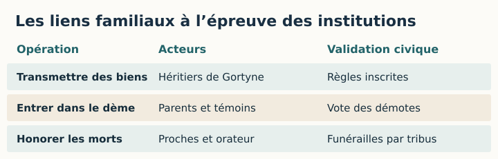

# BEL A/L · Histoire ancienne, option latin-grec · 17 juin 2026 — Corrigé guidé

*Corrigé rédigé par IA, non officiel. Signalez toute erreur.*

**Rédaction** · GPT-6.2 Astra Ultra · vitesse non renseignée

Le fascicule du 17 juin donne 11 questions indépendantes. Après le tirage entre histoire grecque et histoire romaine, le candidat choisit une des deux questions proposées dans le domaine tiré. Il dispose de 1 h 30 de préparation sans ouvrage. Il présente une seule question pendant vingt minutes, puis s’entretient dix minutes avec le jury. Les réponses ci-dessous sont des propositions de leçon. [Fascicule officiel](https://www.ens.psl.eu/sites/default/files/al_option_histoire_ancienne_opt_lcl_sujets_17_juin_2026.pdf) · [Rapport de l’option](https://www.ens.psl.eu/sites/default/files/2026_al_rapport_oral_histoire_ancienne.pdf)

## 1 · Les Grecs et la mer (VIe–IVe siècle)

### Préparer la leçon

Partir d’une traversée attestée plutôt que d’une formule générale sur un « peuple de marins ». Nommer une cargaison, son lieu de départ, une escale ou une destination et ceux qui assument le risque. Changer ensuite de littoral et d’échelle politique. Distinguer accès à la côte, capacité de naviguer et pouvoir de réglementer la navigation des autres.

### Une proximité géographique qui ne dicte pas une seule façon de vivre

Chez Hérodote, les Phocéens apparaissent comme de grands navigateurs qui fréquentent l’Adriatique et l’Occident. Cette singularité n’aurait aucun sens si tous les Grecs étaient marins au même degré et pour les mêmes raisons. Des vallées de l’intérieur aux ports du Pont-Euxin, des îles égéennes aux établissements d’Occident, les communautés grecques des VIe, Ve et IVe siècles ont des rapports inégalement directs à la mer. Le mot désigne un milieu à parcourir, des ressources que l’on cherche, mais aussi un espace de relations politiques dont les limites sont contestées. Que faut-il pour qu’une étendue qui sépare des territoires devienne une liaison régulière entre eux ?

### Des routes entretenues par des hommes et des ports

Pour une communauté côtière, la navigation permet le transport de marchandises lourdes et une relation avec des terres qu’aucun chemin ne relie aisément par voie terrestre. Le vent, l’état de la mer et la saison imposent attentes et détours. La sûreté d’un mouillage, l’accueil reçu et la possibilité d’y vendre comptent au moins autant qu’une distance mesurée à vol d’oiseau. Les Phocéens fréquentent des régions où vivent des populations non grecques et où circulent déjà des navigateurs phéniciens ou étrusques. Dans le livre I d’Hérodote, la prise de leur cité par les Perses au VIe siècle provoque de nouveaux départs et des choix divergents. Même chez des navigateurs renommés, abandonner une terre et ses sanctuaires demeure une décision douloureuse. La mobilité n’efface pas la force de l’enracinement.

Un objet de transport permet d’observer une circulation sans supposer que les hommes qui le déplacent parlent tous la même langue. Des amphores de vin égéennes retrouvées dans des sites de Méditerranée occidentale ou du Pont attestent l’arrivée de récipients produits loin du lieu de dépôt. Il faut encore examiner le contexte, la possibilité d’un réemploi et les intermédiaires pour reconstituer une transaction. L’épave dite de Kyrénia, au large de Chypre, avec ses amphores et ses meules, appartient à la charnière de la fin du IVe et du début du IIIe siècle selon les indices de datation. Elle oblige précisément à distinguer la date de construction d’un navire, celle des objets embarqués et celle du naufrage. Pour le plein IVe siècle, le contrat du *Contre Lacritos* donne une autre prise, directement située dans les bornes du sujet : un trajet vers le Pont, une cargaison et des conditions de remboursement convenues à Athènes.

### S’approprier les avantages de la circulation

Certaines communautés tirent des revenus des taxes et services portuaires. D’autres, ou les mêmes, ont intérêt à ce que des denrées leur arrivent avant leurs concurrentes. Les relations entre Athènes et les souverains du Bosphore cimmérien en donnent un exemple. Démosthène, dans le *Contre Leptine*, invoque les facilités accordées par Leucon aux marchands qui approvisionnent les Athéniens en blé. Il plaide pour la crédibilité des honneurs et immunités promis en retour. La mer apparentée à un grand marché reste donc partagée entre plusieurs autorités qui peuvent accorder des avantages ciblés. Sur une même route, le marchand cherche un prix, le prêteur le remboursement, la cité un approvisionnement raisonnablement sûr.

Le rapport à la mer est également social. Il y a une grande distance entre financer un navire, organiser une traversée, en manœuvrer les avirons et décharger des sacs au port. Dans la *Constitution des Athéniens* attribuée au Vieil Oligarque, I, 2, un adversaire de la démocratie fait valoir que les hommes du peuple, dont le travail fait marcher la flotte, ont acquis de ce fait une forte position politique à Athènes. Le raisonnement reconnaît la contribution du travail collectif tout en cherchant à discréditer le régime qu’il soutient. Il ne permet pas de déduire de la proximité de la mer le gouvernement démocratique de chaque port grec. Le périmètre du corps des rameurs n’est d’ailleurs pas toujours identique à celui des citoyens.

### Dominer des traversées, donner sens à leurs dangers

En 480, les références à Salamine occupent une place déterminante dans la mémoire des guerres médiques. Au Ve siècle, la ligue de Délos devient progressivement un espace où Athènes contrôle des ressources, exige des contributions et limite l’autonomie de certains alliés. Une inscription portant la quote-part d’un tribut consacrée à Athéna montre ici plus qu’une route : elle convertit les ressources d’une cité nommée en un versement compté à Athènes. Toutes les côtes ne sont pas gouvernées par elle pour autant. Les adversaires d’Athènes nouent à leur tour des alliances et mobilisent des ressources maritimes. La défaite athénienne de 404 suffit à montrer que la « maîtrise de la mer » est une relation provisoire, jamais la possession matérielle d’une étendue.

Les sanctuaires et les récits associent enfin des traversées à la protection d’une divinité. Poséidon au cap Sounion honore un dieu dont la puissance est ressentie comme bienfait ou comme menace. Un promontoire portant un temple articule le territoire de l’Attique et la vue de ceux qui arrivent par mer. Les dons votifs et les prières attestent le souci des voyageurs d’être protégés, sans fournir une statistique des traversées réussies. Entre le VIe et le IVe siècle, les Grecs ont donc appris à financer, encadrer, raconter et commémorer de nombreuses circulations. Le maintien des différences entre les ports, les hommes et les pouvoirs explique pourquoi leur mer commune ne forme jamais une communauté politique unique.

### Reprise possible

**Qu’est-ce qu’une thalassocratie ?** Le terme désigne une prépondérance fondée sur la capacité maritime. Il faut préciser les routes, les partenaires, les prélèvements et la période sur lesquels cette prépondérance se vérifie. Elle ne suppose pas que toute la mer obéisse à une administration continue.

**Pourquoi employer un pamphlet hostile à Athènes ?** Il reconnaît un lien entre le travail naval du peuple et sa position politique. Son hostilité indique comment il interprète ce lien ; elle incite à le comparer aux pratiques documentées et à éviter de généraliser à tous les ports grecs.

Sources anciennes : Hérodote, *Histoires*, I, 163–167 ; Vieil Oligarque, *Constitution des Athéniens*, I, 2 ; Démosthène, *Contre Leptine*, 29–40 ; corpus démosthénien, *Contre Lacritos*, 10–13 ; listes des quotes-parts du tribut athénien.

## 2 · Alea iacta est !

### Préparer la leçon

Traduire puis interroger la citation : qui dit que César a dit ces mots, en quelle langue et combien de temps après les faits ? Établir ensuite ce qui change concrètement quand il quitte sa province avec ses troupes. Utiliser le silence de César sur le mot célèbre comme élément de comparaison entre deux récits, jamais comme preuve suffisante qu’il n’a pas été prononcé.

### Le dé est jeté, mais sous quelle forme nous est parvenu le mot ?

L’expression latine du billet, « le dé est jeté », attache une décision à un geste après lequel le résultat dépend encore de la fortune. Dans le *Divin Jules* 32, Suétone donne la formule dans l’ordre *iacta alea est*. Plutarque transmet dans la *Vie de César* un impératif grec qui revient à dire « que le dé soit jeté ». La différence entre constat et exhortation n’est pas insignifiante. Les deux auteurs, qui écrivent bien plus d’un siècle après le passage du Rubicon au début de 49 avant notre ère, font de quelques mots un moyen de représenter un instant de décision. Il faut distinguer ce qui rend cette décision possible, le seuil juridico-politique qu’elle franchit et la manière dont les récits ultérieurs isolent ce seuil dans la mémoire des guerres civiles.

### Une crise de la sortie de charge

Le César qui arrive au terme de son commandement en Gaule dispose d’un prestige militaire, de relations nouées en Italie et d’une ambition consulaire. Renoncer au commandement avant de devenir consul signifierait perdre l’autorité de sa charge et s’exposer comme simple particulier à des adversaires puissants. Les arrangements politiques antérieurs avec Pompée et Crassus ont cessé de garantir une solution. Crassus est mort en 53 ; Pompée a accédé à un consulat exercé d’abord sans collègue en 52, puis s’est rapproché de ceux qui entendent mettre fin au commandement de César. Il n’en faut pas conclure qu’un camp a toujours incarné le Sénat et l’autre le peuple. Chaque partie regroupe des hommes aux positions variables et revendique la protection de la République.

Les échanges de la fin de 50 et du début de 49 donnent à cette crise la forme de propositions et de conditions réciproques. Si chaque chef conserve des ressources politiques et militaires que son adversaire redoute, le désarmement de l’un avant celui de l’autre change les termes mêmes de la négociation. La réunion du Sénat, les demandes de rappel et les pouvoirs de blocage des tribuns deviennent des éléments d’un différend sur la décision légitime. Au début de janvier, la proclamation sénatoriale d’urgence et le départ de tribuns favorables à César lui donnent matière à proclamer qu’il défend des droits atteints. Dans le début de la *Guerre civile*, il met en scène l’obstruction de ses adversaires et l’indignation de ses hommes. Son témoignage est à la fois proche des événements et intéressé à leur justification.

### Un petit fleuve et une grande différence d’autorité

Le Rubicon marque alors sur l’Adriatique une limite entre la province de Gaule cisalpine et le territoire de l’Italie proprement dite. Un magistrat qui commande légitimement des troupes dans le cadre de sa province ne dispose pas de ce seul fait du droit d’entrer avec elles en Italie pour contraindre ses adversaires. Le passage vers Ariminum matérialise donc le moment où les institutions ne suffisent plus à régler le conflit dans les conditions ordinaires. Que l’identification exacte du cours d’eau moderne ait été discutée enseigne une précaution élémentaire. La signification du seuil procède de la géographie politique de 49, pas de la taille ou du caractère naturellement impressionnant d’un fleuve.

Tous les témoins ne dramatisent pas ce moment de la même manière. Dans son propre récit, César se concentre sur les délibérations, les griefs et la marche sur Ariminum. Il n’organise pas le tournant autour d’un mot spirituel au bord de l’eau. Il faut comprendre l’intérêt de cette écriture : présenter la suite des décisions comme une réponse aux actes d’autrui rend plus difficile d’isoler un moment où il aurait librement choisi la guerre. La correspondance de Cicéron avec Atticus, au début de 49, laisse au contraire voir les hésitations, les rumeurs et la difficulté à choisir une ligne de conduite au jour le jour. L’incertitude demeure entière pour les acteurs après que la postérité croit avoir identifié le point où tout serait devenu évident.

### Le succès ultérieur ne rend pas l’issue certaine en janvier 49

Le départ de Pompée et de nombreux sénateurs vers la Grèce, les changements de camp et la longueur de la guerre empêchent d’identifier la traversée au jour d’une victoire assurée. Plusieurs années séparent le Rubicon des dernières grandes opérations de la guerre menée par César, et la mort de celui-ci en 44 ouvre d’autres conflits. Même la dictature perpétuelle de 44 ne faisait pas partie des résultats juridiques du passage de la frontière. Lire le franchissement à la lumière du pouvoir ultérieur est possible à condition de distinguer conséquences et projet initial démontré.

Chez Plutarque, le héros s’arrête, délibère et mesure les maux qui peuvent suivre avant de prononcer une formule de joueur. Chez Suétone intervient aussi un signe extraordinaire qui oriente le récit de la décision. Le premier écrit une vie attentive aux mouvements du caractère, le second une biographie où les gestes et signes mémorables ont leur place. Leur désaccord de forme et leur distance chronologique ne privent pas l’épisode de tout intérêt. Ils permettent d’étudier la construction d’une responsabilité personnelle à partir d’une crise qui a engagé beaucoup d’autres acteurs. « Alea iacta est » résume bien la différence entre choisir de franchir un seuil et choisir l’issue qui va en résulter. Le mot cesse d’expliquer l’histoire si, fasciné par sa brièveté, on lui demande de remplacer les institutions, les intérêts et les alternatives que le passage du Rubicon a bouleversés.

### Reprise possible

**César est-il déjà dictateur au moment où il franchit le Rubicon ?** Non. Il commande dans le cadre provincial et la crise concerne notamment l’avenir de ce commandement. Il exercera ensuite plusieurs dictatures de durée et de portée différentes.

**Quel est l’intérêt de la variante grecque ?** L’impératif met l’accent sur la décision à prendre ; la formule latine devenue proverbiale se comprend comme le constat du geste accompli. Ces nuances font partie de l’histoire des versions de l’épisode et ne suffisent pas à établir les mots exacts prononcés.

Sources anciennes : César, *Guerre civile*, I, 1–8 ; Cicéron, *Lettres à Atticus*, VII–VIII ; Plutarque, *César*, 32 ; Suétone, *Divin Jules*, 31–33.

## 3 · Famille et cité dans le monde grec (VIe–IVe siècle)

### Préparer la leçon

Définir *oikos* comme maison, patrimoine et groupe de personnes ; distinguer cette unité de la parenté plus large. Pour échapper à un exposé exclusivement athénien, confronter une inscription judiciaire de Gortyne et une procédure athénienne d’inscription civique, puis une pratique funéraire ou cultuelle impliquant les proches.

### Quel rapport entre être né quelque part et appartenir à une cité ?

Dans la *Constitution d’Athènes*, 42, un jeune homme de dix-huit ans est soumis à l’examen des membres de son dème. Son âge et son origine doivent permettre son inscription parmi les citoyens. Le jeune homme provient d’une maison et de parents déterminés, mais ce sont d’autres citoyens qui décident si les conditions de son admission sont remplies. Le dossier d’Athènes fait voir une articulation plus générale dans le monde grec des VIe, Ve et IVe siècles. Les cités se reproduisent à travers des maisons, des liens de filiation et des patrimoines. Elles en déterminent pourtant les effets par leurs propres règles et accordent une valeur publique à certains gestes des proches. Comment ces deux ordres de relations se soutiennent-ils et quand entrent-ils en conflit ?

### Des maisons indispensables, des règles de transmission différentes

L’*oikos* est une unité de production, de consommation, d’habitation et de transmission. Il dépasse le couple et ses enfants : des domestiques asservis peuvent vivre et travailler dans le même groupe sans faire partie d’une même lignée ni partager les droits de ses membres libres. L’*Économique* de Xénophon fait exposer par Ischomaque et son interlocuteur une répartition des tâches entre hommes et femmes. Le texte choisit une maison aisée dont le chef peut diriger une exploitation et prétend enseigner à son épouse l’administration domestique. Le modèle d’ordre qu’il propose constitue aussi un argument sur la capacité d’un bon citoyen à gouverner les gens et les biens. Il ne fournit pas une statistique de la vie familiale grecque.

L’inscription de Gortyne en Crète donne au Ve siècle un autre point d’observation. Son long texte règle notamment séparation conjugale, part des biens et successions. Il traite la transmission selon les catégories de personnes et les relations de parenté. Les conditions prévues pour la fille héritière, souvent désignée par le terme crétois de *patrôïôkos*, ne doivent pas être mécaniquement assimilées à celles de l’*épiclère* athénienne. Comparer les deux cas révèle un problème commun, celui de la continuité des biens et de la maison en présence d’une héritière, mais aussi la diversité des solutions juridiques. L’intérêt d’une cité pour les arrangements domestiques ne fait donc pas de la famille grecque une institution partout identique.

### L’identité civique se prouve par des liens qui ne sont pas tous politiques

À Athènes, la loi de 451/450 attachée à Périclès fait de l’origine athénienne des deux parents la condition normale d’appartenance. La mère, absente de l’assemblée et des tribunaux de jurés, devient une personne dont le statut peut être publiquement discuté au moment où son fils fait valoir le sien. Dans le *Contre Euboulidès*, le plaideur produit des témoins et fait appel à des relations de parenté et de voisinage. Il doit expliquer la situation modeste et les activités de sa mère que ses adversaires veulent transformer en preuve d’une origine étrangère. Un événement domestique ancien se reconstitue donc à travers des relations et des souvenirs dont la cité apprécie la crédibilité.

La cité peut aussi reconnaître des liens que la naissance seule ne suffirait pas à établir. L’adoption athénienne permet notamment à un homme sans descendant mâle d’assurer la continuité de son *oikos*, de ses biens et de certains devoirs cultuels. Les plaidoyers successoraux d’Isée montrent des parties qui reconstruisent une intention, un rite familial ou une relation d’affection pour convaincre des juges de la validité d’une adoption. Les discours opposés ne sont pas tous conservés. On peut néanmoins y observer que la volonté individuelle s’exerce dans des formes dont d’autres parents, parfois intéressés aux mêmes biens, peuvent contester l’accomplissement.

### Servir, honorer, pleurer : des familles mises en présence d’un public

Les cultes domestiques et les rites civiques n’ont pas une frontière étanche. Des parents présentent des enfants à des groupes religieux ou de parenté ; des citoyennes exercent des prêtrises ou prennent part à des fêtes où leurs fonctions ne se réduisent pas à celles de futures mères. À Sparte, les mêmes relations entre mariage, descendance et corps civique prennent d’autres formes, dont Xénophon fait une singularité dans la *Constitution des Lacédémoniens*. Il présente les règles de formation des jeunes et les arrangements entourant la descendance comme orientés vers l’intérêt de la communauté. Son admiration pour certains usages invite à identifier un discours sur la bonne reproduction de la cité avant d’y voir la description exhaustive de tous les foyers spartiates.

Les funérailles publiques des morts au combat à Athènes permettent de conclure. Chez Thucydide, II, 34, les restes sont exposés, puis transportés par tribus avant l’éloge public. Les proches peuvent se rendre au convoi et des parentes expriment le deuil. Le mort reste celui d’une famille, mais sa mémoire est publiquement réorganisée selon les divisions civiques et louée comme service rendu à tous. Le même geste peut donc reconnaître la perte privée et lui imposer une interprétation collective. De Gortyne à Athènes et Sparte, les liens de famille donnent aux cités une partie de leur population, de leurs biens et de leur mémoire. Ils ne reçoivent leur pleine portée juridique ou politique qu’à travers des institutions propres à chaque cité.

### Reprise possible

**Une femme exclue du vote est-elle extérieure à la cité ?** Elle possède un statut, participe à des cultes, peut détenir ou transmettre des biens dans les conditions locales et compte dans la filiation civique. L’accès aux assemblées politiques n’épuise pas l’appartenance à la communauté.

**Pourquoi l’adoption est-elle un bon exemple ?** Elle montre que la reproduction d’une maison est aussi un acte social et juridique. La réception d’un descendant, les droits successoraux et les actes attendus envers les morts peuvent être discutés et jugés en public.

Sources anciennes : inscription de Gortyne, IC IV, 72 ; Xénophon, *Économique*, VII, *Constitution des Lacédémoniens*, 1–2 ; *Constitution d’Athènes*, 26 et 42 ; Démosthène, *Contre Euboulidès* ; Isée, *Sur la succession de Ménéclès* ; Thucydide, II, 34.

## 4 · Honorer les dieux dans le monde grec (VIe–IVe siècle)

### Préparer la leçon

Pour chaque exemple préciser un dieu et son épiclèse, un espace, des gestes et le groupe qui prend en charge la dépense. Montrer ce qu’un objet offert peut révéler de son donateur, puis ce que seul un calendrier sacrificiel permet d’établir. Diversifier les participants, du foyer à la cité et au sanctuaire partagé.

### Donner sa part à une puissance située

En Attique, le calendrier sacrificiel du dème d’Erchia, inscrit au IVe siècle, précise pour diverses dates des destinataires, des lieux, des victimes et des dépenses. Une divinité invoquée sous une épiclèse déterminée, dans un lieu déterminé, ne reçoit pas une marque vaguement interchangeable de piété. L’inscription organise des relations récurrentes entre puissances, groupes humains et ressources du dème. Du VIe au IVe siècle, les Grecs ne disposent pas d’une Église centrale qui dicterait un rite uniformément valable dans toutes les cités. Comment des gestes aussi différents qu’une offrande personnelle, un grand sacrifice civique et la consécration d’un trophée peuvent-ils se comprendre comme autant de manières d’honorer les dieux ?

### Des gestes précis, accomplis devant des témoins

Dans la prière, l’invocation nomme la puissance à laquelle on s’adresse et peut rappeler des relations antérieures ou promettre une offrande. Il ne s’agit pas d’un marché garantissant mécaniquement le résultat voulu. La diversité des réponses humaines à une naissance, une guérison ou un danger suppose des relations qui se prolongent dans le temps. Une petite offrande, même sans inscription, établit qu’un objet a été déplacé de son usage ordinaire vers le domaine d’une divinité lorsqu’on peut en identifier avec assurance le contexte de dépôt. Une inscription dédicatoire peut ajouter le nom du donateur, la divinité et la raison qu’il souhaite lui-même faire connaître. Elle sélectionne donc ce qui devra rester visible après le geste.

Le sacrifice animal, forme importante mais non exclusive d’hommage, implique le choix d’une victime, un autel, des agents et une répartition. Une partie revient au dieu selon le rite ; la consommation crée souvent aussi des relations entre humains autorisés à partager les chairs. D’autres formes d’offrandes emploient des produits végétaux, des libations ou des objets. Le calendrier d’Erchia impose pour certains sacrifices des restrictions à l’emport des parts. Un détail de distribution devient alors décisif : si la viande doit être consommée sur place, le rassemblement n’a ni la même durée ni exactement la même fonction que si chacun pouvait retourner chez lui avec sa part. L’inscription permet de restituer la règle, mais pas de vérifier que chaque célébration historique l’a observée sans variation.

### Une cité répartit les honneurs et les fonctions

Les Grandes Panathénées à Athènes unissent procession jusqu’à l’Acropole, sacrifices, concours et remise du péplos à Athéna. La remise d’huile dans des amphores panathénaïques à des vainqueurs de concours offre un témoin transportable de la fête. Une face de ces vases montre Athéna, l’autre peut désigner une épreuve. Le prix fait sortir de la cité l’image de sa protectrice et le prestige de ceux qu’elle récompense. Le succès d’un athlète individuel renouvelle donc le renom de la fête et la relation de la communauté à la déesse.

Il faut distinguer la société qui honore la déesse de la seule assemblée politique. Des citoyennes remplissent des fonctions sacerdotales, participent au textile ou à des actes processionnels auxquels l’exercice du droit de vote ne donne pas accès. Des résidents étrangers peuvent se voir assigner des places déterminées. Les charges et les honneurs varient suivant les sanctuaires, les règles locales et les statuts. La communauté religieuse ne constitue ni un espace sans hiérarchie ni la simple copie du corps des votants. Les cultes des maisons, des dèmes et des cités se recoupent sans former une chaîne administrative unique. L’Athénien qui participe aux cultes de son dème peut également honorer des puissances dans son foyer et faire une dédicace à Delphes.

### Offrir au dieu sous les yeux d’autres cités

Dans un sanctuaire fréquenté au-delà d’une seule cité, l’offrande s’adresse également à des visiteurs. Au VIe siècle, le trésor des Siphniens à Delphes transforme en architecture durable le rang et les ressources d’une communauté insulaire. De telles constructions garantissent la visibilité d’un donateur, sans épuiser la portée cultuelle du geste par un calcul publicitaire. Après la victoire de Platées en 479, la consécration d’un trépied à Apollon s’accompagne d’une inscription énumérant des communautés participantes sur la colonne serpentine. Le dieu reçoit une marque de reconnaissance et les hommes fixent la liste de ceux dont la participation mérite mémoire. La contestation des honneurs qu’aurait voulu tirer Pausanias de cette victoire montre combien l’identité du dédicant compte.

Dire qu’un dieu a été mal honoré ou que son sanctuaire a été violé peut enfin fournir un langage commun de protestation. Les conflits pour la maîtrise de Delphes au IVe siècle ne disparaissent pas parce que les combattants reconnaissent tous la dignité d’Apollon. Au contraire, l’importance qu’ils accordent aux biens du dieu donne à leur usage une forte portée politique. Honorer les dieux engage donc de la nourriture, du temps, du travail, des parcours et des mémoires partagées. L’historien peut restituer assez précisément certains de ces gestes. La conviction intime de chaque participant demeure beaucoup plus difficile à atteindre à partir d’un tarif, d’un vase ou d’un monument.

### Reprise possible

**Comment savoir à qui s’adresse un objet trouvé dans un sanctuaire ?** Une dédicace peut le dire ; le contexte archéologique, le lieu de découverte et le type d’objet peuvent aussi orienter l’identification. Il faut préserver l’incertitude lorsque plusieurs destinataires sont plausibles.

**Les femmes sont-elles marginales dans l’ensemble de ces pratiques ?** Certaines ont des rôles déterminants de prêtresses ou d’agentes rituelles. Leurs fonctions sont organisées différemment de celles exercées par les hommes, et varient avec la divinité, le rite et la cité.

Sources anciennes : calendrier sacrificiel d’Erchia, SEG 21, 541 ; amphores de prix panathénaïques ; Hérodote, IX, 81 ; Thucydide, I, 132 ; trésor des Siphniens à Delphes.

## 5 · Citoyens et non-citoyens à Athènes au IVe siècle

### Préparer la leçon

Préciser d’abord si « citoyen » désigne l’appartenance juridique à la cité ou la pleine participation aux institutions politiques. Construire les cas d’un citoyen adulte, d’une Athénienne, d’un métèque et d’un esclave sans poser « non-citoyen » comme un statut unique. Puis suivre les procédures qui font franchir ou contestent une frontière.

### Un vote local peut-il rendre un homme étranger ?

Dans le *Contre Euboulidès*, Euxithéos affirme avoir été rayé à tort de la liste des citoyens de son dème lors de la révision du IVe siècle, généralement datée de 346/345. Il doit convaincre des juges que son père et sa mère étaient athéniens. L’accent attribué à son père, ses propres activités et les ressources modestes de la famille deviennent des arguments disputés. L’affaire interdit de réduire la citoyenneté à un caractère que l’on reconnaîtrait au premier coup d’œil. À Athènes, elle s’établit par des règles de filiation et par des procédures collectives ; ceux qui en sont exclus n’ont pas tous la même condition. Quels droits sont attachés à ces distinctions et comment les habitants en négocient-ils les frontières ?

### Une appartenance reconnue, des pouvoirs différenciés

Selon la *Constitution d’Athènes*, 42, les jeunes gens sont examinés à dix-huit ans et inscrits dans leur dème. La condition d’origine, régulièrement rattachée à la loi de Périclès de 451/450 et réaffirmée dans la démocratie restaurée, exige une ascendance athénienne des deux côtés. Il faut établir les liens de parenté et convaincre ceux qui les évaluent. Des témoins de la vie du foyer, de cérémonies ou de relations entre proches peuvent alors devenir les garants d’un droit public. L’inscription dans un dème rattache le citoyen à la cité tout entière. La résidence dans un autre quartier n’entraîne pas par elle-même un changement d’appartenance.

Un citoyen masculin adulte peut voter à l’assemblée et, sous les conditions d’âge ou autres requises, siéger comme juré ou exercer une magistrature. Ses devoirs incluent le service militaire et, pour les plus riches, des contributions particulièrement importantes. Tous n’ont ni les mêmes ressources ni la même facilité à se rendre à la Pnyx. Les Athéniennes dont le statut compte dans la filiation ne siègent pas à l’assemblée, mais disposent d’une place juridique et cultuelle propre. On peut parler de citoyennes en précisant ce mode d’appartenance. Classer sans commentaire la mère d’Euxithéos dans la même catégorie qu’un résident étranger ferait précisément disparaître la distinction dont dépend tout le procès de son fils.

### Plusieurs façons d’être extérieur au corps des votants

Le métèque est un résident libre d’origine extérieure établi dans la cité. Son régime comporte obligations, taxe de résidence et conditions particulières ; il peut exercer un métier, fréquenter les tribunaux selon les procédures prévues, servir dans des forces de la cité et participer à certains cultes. Un privilège particulier peut, par exemple, lui permettre d’acquérir terre et maison dans les conditions définies par la cité. Une exemption fiscale ou un droit de propriété n’équivaut pas à l’octroi de la citoyenneté. Un étranger de passage et un métèque installé de longue date n’entretiennent pas non plus les mêmes relations avec les institutions athéniennes.

Dans les *Revenus*, écrits au IVe siècle, Xénophon propose d’améliorer les conditions offertes aux métèques et aux marchands pour accroître les ressources d’Athènes. Sa démonstration dépend de leur utilité supposée. Elle invite à séparer une proposition de réforme des conditions déjà en vigueur. Plus généralement, l’intérêt de la cité pour les revenus apportés par les étrangers ne débouche pas automatiquement sur leur égalité politique. La reconnaissance civique peut prendre de nombreuses formes avant le vote et la magistrature.

L’esclave, pour sa part, est sous la dépendance d’un maître. Il peut être affecté à un atelier, à une maison, à une exploitation ou à des tâches publiques. Un homme libre et pauvre a parfois un mode de vie matériel proche de celui d’un travailleur asservi ; son statut et les moyens de contrainte qui peuvent s’exercer sur sa personne sont différents. L’affranchissement ouvre à la liberté et impose éventuellement des obligations envers l’ancien maître. Il ne transforme pas automatiquement la personne affranchie en citoyen athénien. Les carrières de certains banquiers illustrent que l’accès à l’argent, à la liberté et à la citoyenneté peut se faire à des moments différents.

### Des frontières politiquement opératoires et parfois franchies

Le cas de Pasion met les distinctions en mouvement. Ancien esclave devenu banquier, il est affranchi puis se voit accorder la citoyenneté en récompense de services. Le corpus des plaidoyers autour de sa banque, de sa famille et de Phormion est intéressé aux fortunes et aux successions en litige. Il permet néanmoins de distinguer une concession exceptionnelle de la voie normale par filiation. La cité qui reconnaît un bienfaiteur rend visible son pouvoir de créer un citoyen. Le fait que la décision soit remarquable interdit d’en tirer une trajectoire ordinaire pour tous les affranchis.

Des contre-exemples montrent la force de la catégorie. Une personnalité étrangère honorée peut rester extérieure au *dêmos* qui l’honore ; un citoyen soumis à l’*atimia* perd tout ou partie de l’exercice de certains droits sans devenir de ce fait un métèque. Enfin, le changement politique de 322 après la guerre lamiaque, sous la pression macédonienne, soumet l’exercice des droits à une qualification de fortune qui exclut de nombreux citoyens jusque-là participants. Le IVe siècle ne forme donc pas un moment politiquement homogène. Les distinctions de naissance, la décision des dèmes, le vote d’un privilège ou la restriction collective des droits permettent de comprendre en termes historiques ce que « citoyen » veut dire à Athènes.

### Reprise possible

**La fortune peut-elle servir de preuve de citoyenneté ?** Elle peut influencer les réputations et, à certaines dates, les droits politiques. Dans la démocratie du milieu du siècle, elle ne remplace pas l’ascendance requise ou un décret de naturalisation. La défense d’Euxithéos s’attaque justement à cette confusion.

**Quelle différence entre un résidant privilégié et un citoyen naturalisé ?** Des avantages déterminés peuvent réduire les contraintes d’un résident, par exemple en matière fiscale ou foncière. La naturalisation confère une appartenance civique et obéit à une procédure distincte.

Sources anciennes : *Constitution d’Athènes*, 42 ; Démosthène, *Contre Euboulidès* ; corpus démosthénien, *Pour Phormion* et *Contre Nééra*, 89–92 ; Xénophon, *Revenus*, II–III ; Diodore, XVIII, 18.

## 6 · Thémistocle

### Préparer la leçon

Le fascicule ajoute au nom de Thémistocle une parenthèse allant de la deuxième guerre punique à Néron. Le rapport officiel classe le même tirage en histoire grecque et y donne seulement « Thémistocle ». Le personnage et les sources imposent l’Athènes de la fin du VIe et de la première moitié du Ve siècle avant notre ère. Construire la leçon entre le jugement d’Hérodote sur Salamine et le portrait rétrospectif de Thucydide.

### Un Athénien admiré pour avoir prévu l’imprévisible

Le billet porte une borne romaine sans rapport avec le personnage. Le rapport le classe explicitement en histoire grecque à l’intitulé « Thémistocle ». Nous traiterons donc de l’Athénien actif au tournant des VIe et Ve siècles et dans la première moitié du Ve avant notre ère. Thucydide s’interrompt dans son récit pour louer chez lui une intelligence politique exceptionnelle, capable d’apprécier rapidement la situation présente et d’anticiper ce qui va suivre (*Guerre du Péloponnèse*, I, 138). Ce jugement surprend pour un homme que les Athéniens ont ostracisé et qui a fini par gagner l’Empire perse. Comment expliquer qu’une même carrière ait été commémorée comme l’incarnation de la puissance athénienne et comme un cas exemplaire de déplacement et d’exil ?

### Mobiliser des ressources et obtenir l’assentiment des citoyens

Thémistocle agit dans une cité où les réformes de la fin du VIe siècle ont donné aux citoyens de nouveaux cadres de décision. Il n’est ni roi ni maître permanent de la politique athénienne. La tradition lui attribue une intervention précoce en faveur des installations du Pirée ; Thucydide, I, 93, signale qu’il avait commencé à travailler à son aménagement lors de son archontat. Les trois bassins naturels et la liaison avec la ville donnent à Athènes des moyens matériels. Les bassins n’auraient pourtant créé aucune flotte sans des décisions sur la propriété et l’usage des ressources communes.

Hérodote, VII, 144, met en relief le débat sur les revenus de l’argent du Laurion. Les Athéniens auraient pu se les partager ; Thémistocle les persuade de les employer à la construction de navires. Le conflit avec Égine fournit un motif immédiat à ce choix, dont l’utilité se révèle ensuite devant l’invasion perse. Dans la *Constitution d’Athènes*, 22, le mécanisme financier fait intervenir des hommes fortunés et donne un autre détail sur le financement des constructions. Les versions ne doivent pas être fondues en un compte rendu sténographique. Toutes montrent néanmoins que le choix met en jeu des revenus de la cité et qu’un particulier doit en persuader ses concitoyens. La réputation de prévoyance de Thémistocle est en partie fabriquée après coup par la rencontre entre une décision motivée par Égine et la crise de 480.

### À Salamine, interpréter un oracle et maintenir une coalition

En 480, l’expédition de Xerxès place les Athéniens devant des choix dramatiques quant aux personnes, aux sanctuaires et au territoire. Selon Hérodote, les réponses de Delphes suscitent une controverse. Les mots sur le « rempart de bois » et la « divine Salamine » se prêtent à plusieurs lectures. Thémistocle fait valoir une interprétation qui invite à confier une part décisive de la défense à la flotte. Son rôle n’est pas celui d’un traducteur qui posséderait seul le sens certain d’un oracle. Il construit une lecture capable de mobiliser une assemblée. Hérodote connaît la victoire lorsqu’il rapporte le débat, ce qui donne à son récit une évidence que les contemporains n’avaient pas nécessairement.

Salamine rassemble des communautés dont les intérêts et les peurs diffèrent. La part remarquable des navires athéniens n’implique pas que tous leurs partenaires acceptent d’emblée une hégémonie athénienne. Les débats entre responsables et les récits de messages attribués à Thémistocle soulignent son talent de persuasion autant que son goût de la dissimulation. Plutôt que de détailler un affrontement naval, on peut voir comment les conséquences politiques de la victoire sont distribuées. Athènes revendique le mérite de ceux qui ont exposé leur ville et fourni tant de navires ; les autres cités revendiquent un succès commun. Le monument collectif après Platées, l’année suivante, rappellera à quel point une victoire partagée se prête à plusieurs attributions de gloire.

### De l’autorité acquise à l’exil et à ses mémoires

Après l’invasion, Thucydide lie Thémistocle à la reconstruction des fortifications athéniennes et à la mise en valeur du Pirée. Son récit de la négociation avec Sparte insiste sur l’habileté individuelle, mais la construction suppose la mobilisation des habitants et des ressources de la cité. La permanence matérielle des murs ne garantit pas la permanence de la prééminence de leur promoteur. Thémistocle est ostracisé, probablement vers le début des années 470 ou autour de 471 selon les datations. L’ostracisme écarte temporairement un citoyen selon une procédure politique ; il ne faut pas le confondre avec une condamnation pénale pour trahison. Des ostraka portant son nom attestent matériellement des suffrages ou préparations au vote. Ils ne racontent pas à eux seuls le motif qu’aurait eu chaque votant.

Impliqué ultérieurement dans les soupçons liés à Pausanias, Thémistocle quitte le monde des cités qui peuvent le livrer et gagne l’Empire perse. Thucydide nomme Artaxerxès et associe sa fin à Magnésie du Méandre. Les récits plus tardifs varient sur les détails et sur sa mort. Rien n’oblige à dramatiser celle-ci par un suicide certain. Il importe davantage qu’une carrière athénienne ait pu se prolonger dans une relation avec le Grand Roi, révélant des réseaux d’hospitalité et des possibilités de service que l’opposition sommaire entre Grecs et « barbares » ne permettrait pas d’imaginer.

Thémistocle n’est donc pas un héros qui aurait commandé d’une seule voix la politique athénienne. Des ressources disponibles, des procédures civiques et une coalition lui ont donné des occasions successives de convaincre. Les mêmes Athéniens qui ont bénéficié de ses choix ont pu l’écarter. Le jugement de Thucydide magnifie une capacité individuelle de prévision, mais les choix contradictoires dont sa vie a gardé la trace rendent mieux compte de la liberté et de la vulnérabilité d’un dirigeant dans une cité grecque.

### Reprise possible

**Pourquoi le témoignage d’un ostrakon est-il particulièrement précieux et limité ?** L’objet associe concrètement un nom à une pratique de vote. Une série peut faire apparaître des régularités d’écriture. Aucun tesson pris isolément ne permet de connaître toute la campagne ni les raisons de l’ensemble des votants.

**La victoire de 480 est-elle la seule explication du choix du Laurion ?** Hérodote donne à la rivalité avec Égine une place immédiate dans la décision. Le bénéfice ultérieur contre Xerxès explique pourquoi le choix a pu être relu comme prévision de l’avenir.

Sources anciennes : Hérodote, VII, 139–144 et VIII ; Thucydide, I, 89–93 et 135–138 ; *Constitution d’Athènes*, 22 ; Plutarque, *Thémistocle* ; ostraka athéniens au nom de Thémistocle, fils de Néoclès.

## 7 · Les chevaliers à Rome (de la deuxième guerre punique à Néron)

### Préparer la leçon

Distinguer soigneusement trois ensembles : les titulaires d’un cheval public, les personnes satisfaisant à un niveau de fortune et les chevaliers appartenant à un ordre reconnu. Il y a recoupement mais les mots ne sont pas partout synonymes. Pour la fin de la République, choisir un tribunal ; pour le principat, une fonction dont le titulaire reste distinct des sénateurs.

### Un nom militaire pour plusieurs formes de distinction civique

Comment expliquer qu’un mot formé sur le cheval puisse désigner, au temps de Néron, des hommes qui administrent les approvisionnements ou commandent au nom du prince ? Entre la deuxième guerre punique et 68 de notre ère, la catégorie des *equites Romani* change de contenu sans perdre les marques de dignité qui l’attachent à l’ancienne cité. Les chevaliers ne forment ni un corps de cavalerie resté identique durant trois siècles ni une bourgeoisie d’affaires unie par la même profession. Pour comprendre leur place, il faut suivre les manières de classer une partie des citoyens, les tâches publiques qui leur sont confiées et leur nouveau rapport avec la maison impériale.

### Un cheval, une fortune et un honneur public

Dans la République du temps de la guerre contre Hannibal, l’équipement et le service militaires renvoient à la capacité des citoyens à fournir des ressources différentes. Les chevaliers qui disposent de l’*equus publicus* reçoivent un cheval dans un cadre civique. Leur revue par les censeurs associe entretien du cheval, aptitude, conduite attendue et dignité publique. Être distingué de cette manière ajoute à la richesse privée la reconnaissance de magistrats. La place des centuries équestres dans les comices centuriates confère aussi à cette distinction une conséquence politique : le peuple vote par unités dont le poids et l’ordre ne reproduisent pas simplement le nombre des individus.

L’expansion méditerranéenne rend insuffisante une définition par la seule fonction militaire. D’importantes fortunes sont engagées dans les terres, les créances, les marchés de l’État ou les compagnies de publicains. Des chevaliers prennent part à ces activités ; chaque chevalier n’est pas pour autant un publicain, et être adjudicataire d’une prestation n’est pas la définition juridique de l’ordre. Le seuil de fortune de quatre cent mille sesterces, bien attesté pour l’époque tardorépublicaine et impériale, ne doit pas être appliqué rétrospectivement comme le chiffre immuable d’une catégorie depuis le IIIe siècle. La relation entre les élites équestre et sénatoriale est en outre faite de proximité, de carrières personnelles et d’alliances familiales. Le fils d’une famille équestre peut briguer des charges qui le conduiront au Sénat.

### Juger l’usage du pouvoir provincial

Les réformes judiciaires associées à Caius Gracchus dans les années 120 avant notre ère donnent aux élites extérieures au Sénat une place centrale dans les jurys, notamment en matière de concussion provinciale. Cela introduit un autre rapport entre chevaliers et sénateurs. Un gouverneur venu de l’aristocratie sénatoriale peut devoir rendre compte de ses actes devant des hommes d’une élite distincte. Des textes épigraphiques de la fin du IIe siècle relatifs au recouvrement des sommes extorquées montrent combien la sélection des juges obéit à des conditions minutieuses. Il faut éviter de confondre une réforme précise avec toutes les lois judiciaires du siècle suivant. La composition des jurys change plusieurs fois, preuve que classer les juges est en soi un enjeu de pouvoir.

L’accusation de Verrès par Cicéron en 70 intervient dans cette histoire changeante. L’orateur s’adresse alors à des juges sénateurs et leur présente le procès comme une occasion de prouver que leur ordre peut juger sans corruption. Il faut se garder de transformer ce procès en exemple d’un jury entièrement équestre. La même année, la loi Aurelia organise la participation de trois catégories, sénateurs, chevaliers et tribuns du trésor. Le débat sur la dignité de chaque groupe fait partie des ressources argumentatives des orateurs. Cicéron, lui-même issu d’une famille équestre et engagé sur le chemin des magistratures, peut valoriser la concorde entre les ordres. Ce programme politique ne prouve pas l’unité permanente de leurs intérêts.

### Servir le prince sans devenir sénateur

Auguste et ses successeurs utilisent la richesse, les compétences et la dépendance personnelle d’hommes de rang équestre dans des responsabilités que n’ouvre pas le cursus sénatorial ordinaire. Le cas de l’Égypte après 30 avant notre ère est particulièrement révélateur. Le préfet, choisi par le prince au sein de l’ordre équestre, administre un territoire important avec des pouvoirs étendus. Rome confie donc à un homme qui n’a pas rang sénatorial un gouvernement dont le poids pourrait concurrencer les plus grands commandements. Cette décision permet aussi au prince de contrôler plus étroitement le recrutement de son représentant. Il serait anachronique de supposer dès Auguste une carrière équestre partout normalisée sous la forme que lui donneront des réorganisations ultérieures.

D’autres fonctions engagent la préfecture de l’annone ou celle du prétoire. Sous Néron, le préfet du prétoire Burrus participe au premier plan de la vie politique. Le récit de Tacite, centré sur le prince et ses proches, donne à sa mort en 62 la valeur d’un changement dans les relations de la cour. Il serait trompeur d’identifier la carrière de la majorité des chevaliers à celle d’un des plus puissants. Beaucoup doivent leur rang à une fortune et à une reconnaissance qui ne les conduisent jamais à une préfecture de premier plan. L’organisation des places au théâtre, notamment les quatorze rangs traditionnellement attribués aux chevaliers depuis la loi Roscia de 67 avant notre ère, donne une traduction visible de la hiérarchie à des hommes extérieurs aux plus hautes charges.

Des revues censitaires aux préfectures, le trait commun est la capacité d’assigner un rang publiquement reconnaissable à certains citoyens et d’en tirer des services. Le principal changement est l’identité de celui qui distribue les reconnaissances et les offices. Sous la République, la classification censitaire, le vote des lois et les débats sur les jurys donnent à l’ordre plusieurs lieux de légitimation ; sous le principat s’y ajoute une voie d’ascension étroitement liée au choix du prince.

### Reprise possible

**Tous les chevaliers ne formant pas une profession, pourquoi leur rang est-il important ?** Il a des effets reconnaissables dans la hiérarchie publique, le recrutement de certains jurys, des privilèges honorifiques et, sous le principat, l’accès à certains offices.

**Pourquoi l’Égypte est-elle un exemple plus parlant qu’une liste de postes ?** Son préfet équestre dispose d’un gouvernement de grande importance hors du cursus sénatorial. L’exemple oblige à expliquer le choix du prince et la redistribution des fonctions, au lieu de seulement mémoriser des titres.

Sources anciennes : Polybe, *Histoires*, VI, 19–23 ; Plutarque, *Caius Gracchus*, 5–6 ; Cicéron, première action *Contre Verrès*, 1–3 ; Strabon, *Géographie*, XVII, 1, 12 ; Tacite, *Annales*, XIV, 51.

## 8 · Les sacerdoces à Rome (de la deuxième guerre punique à Néron)

### Préparer la leçon

Pour chaque fonction envisagée, préciser le mode de recrutement, la durée, les gestes ou décisions dont elle autorise l’accomplissement. Comparer un collège masculin, les Vestales et le cumul des sacerdoces par le prince. Distinguer le magistrat qui prend les auspices, l’augure qui connaît le droit augural et les responsables politiques qui tirent les conséquences d’un avis religieux.

### Quand un prince énumère ses sacerdoces

Au chapitre 7 de ses *Res gestae*, Auguste énumère notamment ses qualités de grand pontife, d’augure, de quindécemvir chargé des rites et de septemvir des épulons. Il fait aussi mémoire d’autres appartenances religieuses. Quel intérêt y aurait-il à accumuler ces noms si toutes les prêtrises n’étaient que des façons équivalentes d’être prêtre ? La société romaine distribue des compétences rituelles et des honneurs entre collèges et titulaires aux conditions variées. La plupart n’abandonnent pas la vie civique pour exercer une vocation séparée. De la guerre contre Hannibal à Néron, les sacerdoces donnent à voir des formes de spécialisation qui peuvent soutenir une autorité collective, attirer la compétition des notables puis contribuer à la prééminence d’un prince.

### Des compétences distinctes devant une situation publique

Lors de la deuxième guerre punique, le Sénat reçoit à plusieurs reprises des informations sur des prodiges et sur les défaites. Il peut requérir la consultation des livres sibyllins par le collège compétent, alors les décemvirs *sacris faciundis*. Les avis donnés contribuent à la prescription de rites. Les épisodes racontés par Tite-Live après Cannes, au livre XXII, montrent aussi que des fautes attribuées à des Vestales peuvent être interprétées dans un moment d’extrême inquiétude collective. Plusieurs acteurs interviennent : autorités politiques, corps sacerdotaux particuliers, agents chargés du rite. Regrouper leurs actions sous le seul terme de « superstition » ferait disparaître les responsabilités que les Romains distinguaient dans la consultation, l’avis et la décision.

Les pontifes conservent des compétences relatives aux rites et au droit sacré. Les augures sont experts dans le domaine de l’auspication et dans la délimitation rituelle de certains espaces. Le magistrat qui agit avec les auspices publics possède lui-même un droit lié à sa charge ; il n’a pas besoin d’être augure pour chaque prise d’auspices. Les épulons sont associés à l’organisation de banquets sacrés ; les prêtres chargés des livres sibyllins peuvent guider l’adoption de rites prescrits à l’issue d’une consultation. La différenciation porte sur des opérations et des relations avec les dieux. Elle suppose aussi une mémoire professionnelle, des décisions de collège et des procédures de transmission.

### Qui entre dans une prêtrise, qui peut y rester ?

Les collèges les plus recherchés procurent à leurs membres un honneur souvent durable, fréquemment à vie, à la différence de magistratures annuelles. Les grands noms s’y retrouvent, mais le recrutement fait lui-même l’objet de désaccords civiques. La loi Domitia de 104 avant notre ère accorde à une assemblée de dix-sept tribus tirées au sort parmi les trente-cinq un rôle dans le choix de titulaires de certains grands collèges, dont l’intégration est complétée selon les procédures sacerdotales. Les règles connaissent ensuite des changements, en particulier sous Sylla et en 63. Ne pas réduire l’alternative à « nomination par les prêtres » ou « élection directe par tous les citoyens » : la République peut combiner des étapes et limiter le groupe électoral de manière à préserver un caractère propre au sacerdoce.

L’élection de César comme grand pontife en 63 avant notre ère révèle le prestige attaché au titre dans une carrière politique déjà ambitieuse. Les récits biographiques insistent sur les risques financiers et personnels de la compétition ; on ne peut chiffrer l’usage de l’argent en se contentant d’une anecdote. Il est clair en revanche que le grand pontificat confère une autorité et une visibilité durables, qui ne se confondent ni avec le commandement d’une province ni avec le vote d’une loi.

Les Vestales introduisent une autre logique. Choisies jeunes, elles assument une longue durée de service, doivent respecter des obligations propres, dont la chasteté, et se voient reconnaître des honneurs et une position juridique exceptionnelle. La garde du feu de Vesta engage symboliquement la continuité de la cité ; elle ne leur ouvre ni le consulat ni le vote aux comices. Une femme peut donc être investie d’une responsabilité publique majeure dans un ordre civique qui réserve les magistratures aux hommes. Il faut aussi distinguer ces sacerdoces publics des nombreux gestes religieux accomplis par les familles ou par des magistrats qui ne s’identifient pas principalement comme prêtres.

### Le grand pontificat et la continuité du principat

Après la victoire d’Octavien, Lépide demeure grand pontife jusqu’à sa mort. Auguste revendique dans les *Res gestae* 10 le fait de n’avoir pas dépossédé son prédécesseur vivant. Il accède au grand pontificat en 12 avant notre ère et met en scène l’ampleur de l’adhésion à son élection. Le récit montre comment la durée du sacerdoce peut servir deux acteurs successifs. Elle protège formellement Lépide contre une destitution immédiate, puis permet à Auguste d’inscrire sa prééminence religieuse dans le langage de la continuité et de l’adhésion populaire. Dans la présentation des actes du prince, le respect d’une procédure contribue à légitimer une concentration de fonctions.

La présence du titre de grand pontife dans la titulature des Julio-Claudiens, jusqu’à Néron, ne dissout pas les collèges. Ceux-ci continuent d’offrir des occasions d’honneur et d’action rituelle aux membres des élites. En dehors de Rome, les collèges et prêtrises de cultes locaux ou du culte impérial créent d’autres hiérarchies ; ils ne sont pas des sections uniformes du collège pontifical romain. Ce qui change à l’échelle de la capitale est la difficulté croissante de concevoir le premier sacerdoce public durablement séparé du premier personnage politique. Les prêtres restent multiples, leurs gestes spécialisés, mais la convergence des plus grands titres en une personne donne une nouvelle signification à l’exercice d’anciennes fonctions.

### Reprise possible

**Un consul doit-il être augure pour prendre les auspices ?** Sa qualité de magistrat peut lui donner le droit et le devoir de consulter les auspices publics. Le collège des augures détient une compétence propre pour les questions relevant du droit augural. Les deux autorités peuvent collaborer mais ne se confondent pas.

**Pourquoi est-il important qu’Auguste attende la mort de Lépide ?** Il peut se présenter comme respectueux du caractère durable d’un sacerdoce et de ses procédures, tout en obtenant à terme la réunion des principales formes de prééminence.

Sources anciennes : Tite-Live, *Histoire romaine*, XXII, 57 ; Cicéron, *Des lois*, II ; Suétone, *Divin Jules*, 13 ; Auguste, *Res gestae*, 7 et 10 ; Aulu-Gelle, *Nuits attiques*, I, 12.

## 9 · Communiquer avec les dieux dans le monde romain (de la deuxième guerre punique à Néron)

### Préparer la leçon

Pour chaque exemple, tracer la chaîne de communication : de qui vient la demande ou le signe, qui l’accepte comme recevable, qui en propose le sens, qui agit ensuite ? Traiter des relations familiales et provinciales à côté d’un exemple sénatorial. Un présage raconté par un biographe très postérieur est un témoin d’un autre type qu’une pierre offerte à la suite d’un vœu.

### Quand la cité décide qu’un signe la concerne

Tite-Live rapporte que, pendant la deuxième guerre punique, des nouvelles d’événements extraordinaires venues de lieux différents sont portées à la connaissance du Sénat. Il ne suffit pas qu’un individu ait aperçu quelque chose d’étrange pour que toute la République en soit rituellement responsable. Le signalement doit être reçu, interprété et suivi d’un acte approprié. « Communiquer avec les dieux » désigne aussi le mouvement inverse, lorsqu’une famille ou une communauté cherche à les remercier, à demander un consentement ou à accomplir un vœu. Entre les années 218 avant notre ère et la mort de Néron en 68 de notre ère, ces relations changent d’échelle et s’organisent de plus en plus souvent autour du prince. Quelles opérations permettent de reconnaître dans un événement une adresse faite aux hommes, ou dans un acte humain une adresse jugée valable aux dieux ?

### Ouvrir une communication dans des formes reconnaissables

Une prière nomme une puissance et l’action souhaitée. L’exactitude des paroles et des gestes protège celui qui les accomplit contre l’ambiguïté ou l’erreur. Dans le *De agricultura*, 141, Caton donne au maître du domaine une formule pour la lustration de ses terres et le sacrifice à Mars. La demande porte sur la santé des personnes, des animaux et des productions du domaine. Le rite emploie donc le nom d’un dieu qu’une classification scolaire réduit volontiers à la guerre dans une relation de protection foncière et domestique. La formule conservée est une prescription de propriétaire, non l’enregistrement de toutes les manières dont les agriculteurs d’Italie priaient dans la vie ordinaire.

Le vœu est une promesse conditionnelle qui peut être formulée par un individu ou publiquement par un magistrat dans son domaine de compétence. Si la condition est remplie, l’accomplissement du don promis rend visible la relation maintenue entre le dédicant et la puissance divine. Des inscriptions votives comportent la formule abrégée *VSLM*, pour *votum solvit libens merito*. La pierre peut nommer le dieu, le dédicant et l’accomplissement du vœu sans préciser la demande initiale. Sa conservation renseigne mieux sur la reconnaissance rendue visible que sur les demandes restées sans suite. À l’échelle d’une ville, un temple dédié longtemps après le vœu peut lier des générations différentes au nom d’un acte public.

### Interpréter des signes et décider de leurs conséquences

Il faut distinguer la recherche de signes dans le cadre des auspices et les événements extraordinaires que l’on signale comme possibles prodiges. Un magistrat prend les auspices avant certaines actions publiques afin de vérifier leur acceptabilité du point de vue religieux. Un prodige peut être rapporté sans qu’un magistrat l’ait demandé. Le Sénat et les spécialistes compétents examinent alors si la communauté est concernée et quelle réponse doit être donnée. Les livres sibyllins, consultés sur décision publique par le collège responsable, ne servent pas à trancher indistinctement chaque événement : leur usage est institutionnellement encadré. Lors de la crise de Cannes, Tite-Live fait apparaître le recours à plusieurs autorités pour chercher comment rétablir une relation correcte avec les puissances divines.

L’introduction de la Grande Mère en 204 avant notre ère montre que cette communication peut conduire à faire venir une puissance honorée ailleurs. En fin de guerre contre Hannibal, les autorités romaines organisent l’accueil de la déesse à partir du monde anatolien, au terme d’une consultation et de démarches rapportées par Tite-Live au livre XXIX. Présenter l’adoption comme le simple glissement spontané d’une religion « orientale » vers Rome masquerait le rôle du Sénat, des relations entre communautés et de la construction de lieux ou de fêtes dans la ville. L’origine étrangère d’un culte et son intégration au calendrier public romain peuvent précisément être les deux aspects du même acte.

### Discuter la valeur des signes, prier pour le prince

Le dialogue de Cicéron *De la divination* oppose des positions argumentées sur la possibilité de connaître les intentions divines à partir des signes. Les interlocuteurs ne sont ni deux enquêteurs modernes ni les porte-parole transparents de toute une époque. Le fait qu’on discute le crédit à accorder aux rêves, aux présages ou aux pratiques de spécialistes n’abolit pas les règles qui donnent aux auspices une portée dans la vie publique. À Rome, une divergence sur l’interprétation religieuse peut aussi devenir un conflit sur la validité d’une décision politique. Le sens d’un signe est d’autant plus contestable que ses conséquences sont lourdes.

Sous Auguste et ses successeurs, les vœux publics pour le salut du prince lient plus étroitement la prospérité de la collectivité à une personne. La dédicace en 9 avant notre ère de l’autel de la Paix augustéenne, décidée lors du retour d’Auguste des provinces occidentales, organise un sacrifice récurrent. Une procession représentée sur le monument transforme l’événement daté en relation rituelle appelée à se renouveler. Le culte adressé à des princes divinisés après leur mort se distingue soigneusement des vœux adressés aux dieux pour un empereur vivant. Les pratiques locales, notamment dans les cités de l’Orient grec, ne se réduisent pas partout aux mêmes distinctions formulaires que celles de la capitale.

Après l’incendie de Rome en 64, Tacite, *Annales*, XV, 44, mentionne entre autres la consultation des livres et des supplications à différentes divinités. Le récit est postérieur et marqué par le portrait hostile de Néron ; il montre pourtant la persistance de séquences religieuses collectives dans un régime impérial. Entre Caton qui prie pour son domaine et la cité qui accomplit des rites après un désastre, les publics et les effets recherchés diffèrent. Mais dans les deux cas il faut des paroles, des agents, des lieux et des critères de reconnaissance pour que la relation aux dieux devienne une action intelligible à ceux qui y prennent part.

### Reprise possible

**Les auspices et les prodiges sont-ils deux noms d’un même présage ?** Les auspices appartiennent notamment à la procédure par laquelle une action est soumise à un assentiment divin. Les prodiges signalés peuvent survenir sans sollicitation ; leur reconnaissance publique et leur traitement appellent d’autres décisions.

**Peut-on connaître la prière d’un individu grâce à VSLM ?** On connaît l’accomplissement d’un vœu, et parfois son destinataire et son auteur. La formule seule ne révèle ni la requête initiale ni le détail du sentiment religieux du dédicant.

Sources anciennes : Caton, *De l’agriculture*, 141 ; Tite-Live, XXII, 57 et XXIX, 10–14 ; Cicéron, *De la divination* ; Auguste, *Res gestae*, 12 ; Tacite, *Annales*, XV, 44 ; inscriptions votives à formule VSLM.

## 10 · Innovation et tradition à Rome (de la deuxième guerre punique à Néron)

### Préparer la leçon

Choisir trois changements dont les acteurs invoquent le passé : l’accueil d’un culte nouveau sur prescription traditionnelle, le vote d’une mesure présentée comme retour à une règle et l’ouverture de carrières à des notables provinciaux. Distinguer la nouveauté des effets du caractère ancien ou neuf du vocabulaire employé. Éviter de faire de « Rome » un acteur toujours favorable ou toujours rétif au changement.

### Que change-t-on au nom des ancêtres ?

Sur le bronze de Lyon qui transmet une partie du discours prononcé par Claude en 48 de notre ère, le prince mobilise l’histoire de Rome pour justifier l’ouverture des honneurs romains à des notables de Gaule chevelue. Les exemples anciens d’intégration servent un changement présent. Il ne suffit donc pas de ranger parmi les traditions ce qui précède et parmi les innovations ce qui vient ensuite. Il faut aussi demander qui a le pouvoir de définir la conduite des ancêtres, le *mos maiorum*, et à quelle fin on la rappelle. Entre la deuxième guerre punique et Néron, l’extension du monde romain rend indispensables des modifications profondes que leurs auteurs n’ont pas toujours intérêt à présenter comme des ruptures.

### Modifier l’ordre religieux et civique pour lui rester fidèle

En 204 avant notre ère, Rome accueille la Grande Mère venue du monde anatolien. Tite-Live décrit les consultations, les ambassades et l’accueil qui donnent à cet événement sa forme publique. L’adjonction d’une puissance dont l’origine étrangère est revendiquée paraît une innovation remarquable. Elle s’effectue pourtant sur l’autorité d’une consultation des livres sibyllins, par l’action du Sénat et d’acteurs reconnus de la cité, dans une situation de guerre contre Hannibal. Si les autorités estiment nécessaire à la sécurité de Rome d’entretenir autrement les relations avec les dieux, la fidélité aux procédures peut mettre en mouvement le contenu même du culte public.

Ces transformations n’affectent pas toutes les pratiques de la même façon. Le sénatus-consulte de 186 sur les Bacchanales, transmis notamment par une inscription latine trouvée à Tiriolo dans le sud de l’Italie, encadre étroitement des réunions et prévoit des autorisations. Plutôt que d’y lire un refus romain général de tout culte perçu comme venu d’ailleurs, examinons le support et la portée de la décision. Le texte est communiqué à des communautés d’Italie, fixe des limites en matière de responsables ou de rassemblement et affirme la capacité du Sénat à définir les conditions d’une pratique. L’inscription renseigne directement sur une règle, le récit beaucoup plus dramatique de Tite-Live sur la mémoire construite d’une affaire. Le point de continuité, entre la réception de la Grande Mère et le contrôle des Bacchanales, est la revendication d’un pouvoir de sélection.

### Les précédents donnent des arguments aux deux camps

En 133 avant notre ère, Tiberius Gracchus propose une loi agraire limitant les prises individuelles sur les terres publiques et prévoyant des redistributions. La présentation du projet fait appel à une limite de possession attribuée à une règle ancienne. Son application renouvelée et la création d’une commission pour rendre la redistribution effective peuvent cependant modifier réellement l’équilibre des terres et des pouvoirs. Les propriétaires ou occupants n’aperçoivent pas la même continuité que les bénéficiaires attendus. Le précédent est donc un argument, dont il faut examiner la datation, le statut et surtout l’usage dans le débat.

La déposition votée contre le tribun Octavius, qui s’opposait au projet, fait apparaître un conflit plus vif encore. Tiberius fait valoir que l’autorité d’un tribun tient à la protection de la plèbe et que la plèbe peut la retirer à celui qui entrave ses intérêts. D’autres peuvent juger que la protection traditionnellement accordée au tribun et son droit d’interposition perdent leur fonction si la majorité peut d’abord le déposer. Plutarque et Appien reconstruisent ce conflit bien après les événements. Leurs récits ne nous dispensent pas d’identifier les bénéficiaires concrets de la réforme. Ils permettent surtout de voir comment deux principes de continuité hérités de la République, l’autorité populaire et l’indépendance tribunicienne, deviennent incompatibles dans une situation inédite.

### Créer un régime durable en restaurant des formes anciennes

Le règlement de 28–27 avant notre ère fournit un cas presque expérimental. Au chapitre 34 de ses *Res gestae*, Auguste affirme avoir transféré la République de sa puissance au jugement du Sénat et du peuple romain. Il revendique ensuite une supériorité d’*auctoritas*. Les anciennes magistratures, les collèges et le Sénat subsistent. Mais l’accumulation durable de commandements, de prérogatives, de ressources et d’honneurs dans les mains d’un homme puis de ses successeurs crée une configuration qui n’a pas d’équivalent dans la République du IIe siècle. Dire qu’Auguste ment ou qu’il restaure simplement les institutions manquerait le mécanisme : la reconnaissance des titulaires et des formes reçues constitue l’un des moyens de rendre la nouveauté acceptable et durable.

La réorganisation de la ville illustre cette articulation à une autre échelle. Les cultes des carrefours n’attendent pas Auguste pour exister. La réorganisation des quartiers et la place reconnue aux Lares Augusti permettent à des habitants, notamment à des affranchis dans des fonctions locales, d’inscrire de nouvelles formes de prestige dans des lieux familiers. La maison dirigeante gagne une présence régulière dans la vie religieuse des quartiers. Un changement de vocabulaire, d’image et de fonction peut donc se diffuser à travers un carrefour et les honneurs de proximité aussi bien qu’à travers un grand règlement constitutionnel.

En 48, la Table claudienne et la réécriture du débat par Tacite mettent une dernière fois les précédents au travail. Les anciens rois de Rome et l’entrée successive des élites italiennes dans les honneurs fournissent des ressources pour faire place à de nouveaux notables. Cela ne veut pas dire que Rome ait jamais suivi un programme d’intégration uniforme et sans recul. Les critères d’origine, de dignité sociale et de services demeurent sélectifs. Sous Néron encore, un prince peut tenir des pouvoirs exceptionnels tout en se soumettant publiquement, selon les circonstances, à un langage de tradition sénatoriale ou religieuse. Innovation et tradition forment donc un rapport à examiner à chaque décision : la question porte moins sur l’attachement abstrait des Romains au passé que sur les actes présents qu’ils peuvent autoriser en se réclamant de lui.

### Reprise possible

**Pourquoi rapprocher deux cultes accueillis ou encadrés différemment ?** L’écart montre que l’élément décisif n’est pas une origine étrangère supposée, mais la capacité des autorités à organiser la relation entre le culte, la sécurité de la cité et leur propre compétence.

**Peut-on prendre le récit de la « restitution » augustéenne pour la description de tous les pouvoirs ?** C’est le récit du bénéficiaire de l’arrangement. Il faut le confronter à la durée des commandements, au cumul des prérogatives et à la position de ses successeurs.

Sources anciennes : Tite-Live, XXIX, 10–14 et XXXIX, 8–19 ; sénatus-consulte sur les Bacchanales, CIL I² 581 ; Plutarque, *Tiberius Gracchus*, 8–15 ; Auguste, *Res gestae*, 34 ; Table claudienne, CIL XIII, 1668 ; Tacite, *Annales*, XI, 23–25.

## 11 · L’oligarchie dans les cités grecques (VIe–IVe siècle)

### Préparer la leçon

Partir de la distinction d’Aristote entre le petit nombre et les riches. Comparer un régime durable à une crise de changement de régime. Dans les deux cas, préciser les droits retirés ou réservés, l’organe qui décide, les soutiens du pouvoir et les conditions de sa reproduction. Ne pas prendre le portrait hostile d’un adversaire pour une constitution.

### Combien faut-il être pour être « peu » ?

Aristote remarque dans la *Politique* que le petit nombre et la fortune vont fréquemment ensemble et qu’il est pourtant insuffisant de définir l’oligarchie par un pur décompte des gouvernants. L’enjeu est le groupe social qui s’approprie les fonctions de décision et l’intérêt qu’il sert. Cette réflexion du IVe siècle invite à poser une question historique sur les cités des trois siècles envisagés. Par quels dispositifs une minorité peut-elle durablement gouverner des hommes libres qui se reconnaissent comme membres d’une même communauté ? Le terme d’oligarchie est à la fois un outil de classement, un programme que des groupes cherchent à instaurer et une accusation que lancent leurs adversaires.

### Restreindre, recruter, contrôler

Il faut d’abord distinguer un conseil restreint auquel l’assemblée confie des tâches et une minorité qui contrôle durablement l’accès aux décisions essentielles. Dans une cité démocratique, cinq cents conseillers peuvent effectuer un travail préparatoire au nom d’un corps civique plus large et renouvelé. Leur nombre, pris isolément, ne suffit donc pas à conclure à l’oligarchie. Les critères significatifs sont le mode de désignation, les conditions de fortune ou de naissance, la durée des fonctions, le pouvoir de l’assemblée et les recours contre les dirigeants. Une magistrature théoriquement accessible à beaucoup peut rester de fait monopolisée par des familles possédant les ressources nécessaires. À l’inverse, l’existence d’une élite riche et influente ne dispense pas de prouver que le régime retire au peuple la décision finale.

Dès le VIe siècle, certaines cités voient des lignages concurrents contrôler une part très importante des charges et de la terre. À Athènes, les classes censitaires attachées à la tradition solonienne différencient les capacités d’accès à des magistratures. La documentation est tardive et les compétences de l’assemblée ne sont pas celles d’une démocratie classique déjà constituée. Il serait donc trompeur de tracer une succession générale où toutes les cités passeraient nécessairement de la noblesse au gouvernement des riches puis à la démocratie. Le conflit entre familles, une tyrannie personnelle, une minorité censitaire et une aristocratie revendiquant l’excellence ne sont pas des termes interchangeables.

### Sparte, un cas à mettre à l’épreuve de la définition

La gérousie spartiate réunit vingt-huit anciens élus à vie et les deux rois. La durée et les modalités d’accès donnent à des hommes sélectionnés une position centrale dans la préparation ou le traitement des affaires. Les citoyens de plein droit réunis en assemblée disposent eux-mêmes d’un rôle dans les décisions, et les éphores sont élus pour l’année. Le régime combine donc des organes de principes différents. Aristote, livre II, examine précisément la composition et le mode de vie de ces institutions, avec des critiques portant autant sur les éphores que sur les anciens. Qualifier Sparte d’oligarchie a du sens si l’on précise la faiblesse numérique du groupe civique, les dépendances sociales et les pouvoirs de ses organes restreints. Le mot ne doit pas faire disparaître la double royauté ni les procédures électives.

Le problème de la reproduction du groupe éclaire ce point. L’accès effectif à la pleine citoyenneté spartiate suppose de satisfaire à des exigences de formation et de participation aux repas communs. Les ressources foncières nécessaires et leur concentration peuvent réduire le nombre des citoyens en mesure de maintenir leur position. Périèques et hilotes participent à la vie économique et, selon leur condition, à diverses activités publiques ou militaires sans accéder aux organes politiques de Sparte. Une minorité durable ne se définit donc pas exclusivement par une constitution écrite. Des règles d’appartenance et la distribution des ressources peuvent renforcer le poids d’un groupe déjà restreint.

### Quand des citoyens fabriquent une oligarchie

Les crises athéniennes de 411 et 404 montrent ce qui se produit lorsqu’une démocratie existante est interrompue. En 411, au cours de la guerre du Péloponnèse, des groupes favorables à un changement de régime invoquent les exigences de la guerre et la recherche d’appuis extérieurs. Le pouvoir des Quatre-Cents s’installe avec la promesse d’une participation des Cinq-Mille dont l’effectivité est d’abord profondément incertaine. Thucydide, livre VIII, distingue entre les acteurs, leurs objectifs et les menaces qui pèsent sur les citoyens susceptibles de s’opposer. Du côté de la flotte à Samos, la contestation montre aussi que l’autorité sur la cité physique ne garantit pas l’adhésion de tous les citoyens athéniens dispersés hors de la ville.

En 404, après la défaite devant Sparte, l’installation des Trente prend un autre chemin. Ils revendiquent la restauration d’un ordre ancestral et tentent de stabiliser un cercle politique privilégié, notamment au moyen de la liste des Trois-Mille. Leur pratique de la violence et des confiscations atteint citoyens et métèques. Dans le *Contre Ératosthène*, Lysias fait de la mort de son frère un exemple des exactions d’hommes qui s’étaient présentés comme défenseurs de la bonne constitution. Le plaidoyer d’une victime n’est pas un tableau désintéressé du régime. Il permet d’étudier les effets matériels qu’une restriction du pouvoir produit sur un groupe aisé demeuré juridiquement extérieur à la citoyenneté. La restauration démocratique de 403, négociée dans des conditions particulières, empêche de traiter l’oligarchie comme un état irréversible.

Le IVe siècle conserve une grande diversité de gouvernements et de débats sur les meilleurs principes de sélection. Après la guerre lamiaque, en 322, l’intervention d’Antipater impose à Athènes un régime où une qualification de fortune ferme l’accès politique à de nombreux citoyens. La délimitation d’une minorité peut donc résulter d’une décision soutenue de l’extérieur aussi bien que de la reproduction locale d’un ordre de propriétaires. Entre VIe et IVe siècle, ce qui définit historiquement une oligarchie n’est pas que certaines personnes disposent de davantage d’argent ou de prestige. C’est la transformation de ces différences en conditions durables, ou imposées dans une crise, de l’accès au pouvoir commun.

### Reprise possible

**L’élection est-elle toujours un signe d’oligarchie ?** Elle peut favoriser les candidats déjà visibles et fortunés. Pour qualifier le régime, il faut connaître le corps électoral, les candidats admissibles, le renouvellement des charges et les droits de l’assemblée.

**Pourquoi comparer les Quatre-Cents et les Trente ?** Les deux crises interrompent la démocratie athénienne, mais leurs conditions de guerre, leurs soutiens, leurs organes et la place d’une intervention spartiate diffèrent. La comparaison éclaire les mécanismes de restriction plutôt qu’un modèle unique.

Sources anciennes : Aristote, *Politique*, II, 9 et III, 7–8 ; Thucydide, VIII, 47–98 ; Xénophon, *Helléniques*, II, 3–4 ; Lysias, *Contre Ératosthène* ; Diodore, XVIII, 18.
