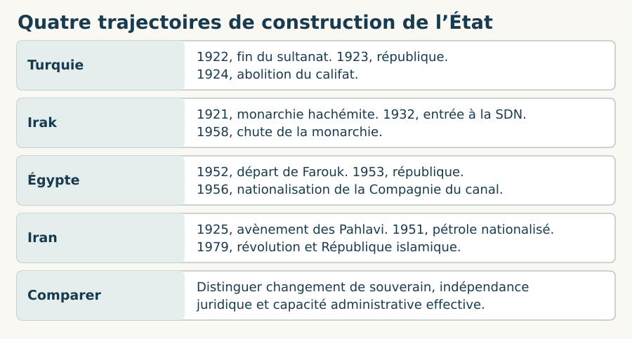

# BEL · AL — Histoire contemporaine (oral tronc commun 16 juin) 2026 · Corrigé guidé

*Corrigé rédigé par IA, non officiel. Signalez toute erreur.*

**Rédaction** · GPT-6.2 Astra Ultra · vitesse non renseignée

**Autocontrôle** · GPT-6.2 Astra Ultra · vitesse non renseignée

## Préparer un seul des deux sujets tirés

La commission a publié douze billets de deux sujets. Les vingt-quatre exposés ci-dessous suivent leur ordre, y compris les deux billets finaux dont les sujets portent sur une même aire. Les dates explicites de la feuille priment sur le cadre usuel du programme, France 1939-1995 et Moyen-Orient 1920-2011. Pour chaque choix, préparez une définition, deux inflexions chronologiques et un exemple dont vous expliquez effectivement le rôle.

| Billet | Relance sur le premier sujet | Relance sur le second sujet |
|---|---|---|
| 1 | Que change le discours du Vél’ d’Hiv de 1995 si la rafle était déjà connue ? Il engage l’autorité de l’État dans la reconnaissance d’une responsabilité française. | L’armée fonde-t-elle toujours une république ? Les cas turc et iranien mettent en regard une république et une dynastie nouvelle. |
| 2 | Qui traite qui de « terroriste » sous l’Occupation ? Distinguez le vocabulaire du pouvoir et votre propre catégorie d’analyse. | Pourquoi comparer communistes irakiens et socialisme nassérien ? Ils n’attribuent ni le même rôle au parti ni la même place à la nation arabe. |
| 3 | Pourquoi les licences sous-estiment-elles la pratique ? La course de loisir peut se pratiquer hors fédération. | L’union avec la Syrie a-t-elle duré ? La République arabe unie naît en 1958 et le retrait syrien intervient en 1961. |
| 4 | Une loi donne-t-elle la date d’un changement de mœurs ? Elle définit un droit dont les usages dépendent ensuite de l’accès aux soins et des normes sociales. | Pourquoi dater précisément le suffrage féminin turc ? Le droit national de 1934 coexiste avec le parti unique. |
| 5 | Que fait la retraite complémentaire de 1947 ? Elle contribue à donner une frontière institutionnelle à un groupe salarié hétérogène. | Que sépare 1922 de 1924 ? L’abolition du sultanat précède celle du califat. |
| 6 | Tous les conservateurs ont-ils soutenu Vichy ? La Résistance compte aussi des conservateurs attachés à la souveraineté. | Comment éviter une histoire intemporelle de la violence ? Datez les contestations de mandat, les conflits nationaux puis les mobilisations transnationales. |
| 7 | La baisse de la pratique efface-t-elle l’influence catholique ? L’enseignement sous contrat et les mobilisations de 1984 montrent d’autres formes de présence. | Les opposants au shah voulaient-ils tous le gouvernement du juriste ? La coalition révolutionnaire débordait largement le courant de Khomeini. |
| 8 | Que reste-t-il à l’État après les privatisations ? Il régule le secteur et maintient un service public. | Pourquoi comparer Irak et Palestine ? L’organisation monarchique et l’indépendance irakiennes ne se retrouvent pas à l’identique en Palestine. |
| 9 | En quoi un procès diffère-t-il d’une recherche ? Le premier statue sur des responsabilités définies en droit, la seconde n’est pas cantonnée à l’accusation. | OPEP et embargo arabe désignent-ils la même chose ? L’organisation rassemble aussi des producteurs non arabes. |
| 10 | Que donnent à Chirac la mairie de Paris et le RPR ? Des ressources municipales et partisanes qu’il faut distinguer. | Une monarchie pétrolière survit-elle toujours ? L’Iran en 1979 réfute ce déterminisme. |
| 11 | Une agence internationale peut-elle administrer sans souveraineté ? L’UNRWA rend des services sans constituer un État palestinien. | Quand faut-il parler de révolution ? Comparez les transformations du régime et les ambitions parfois non satisfaites des participants. |
| 12 | Un immigré reste-t-il nécessairement étranger ? L’acquisition de la nationalité modifie la seconde catégorie, pas la première. | Quand le PCF revient-il au gouvernement ? En 1981, jusqu’en 1984, avec un rapport de forces à gauche désormais favorable aux socialistes. |

La date de naissance de Khomeini est discutée dans les notices. La feuille annonce 1900. Le corrigé conserve cet intitulé et signale la date de 1902 retenue par l’*Encyclopaedia Iranica*.

## Billet 1

### Les commémorations en France

Commémorer, c’est choisir au présent une date, des gestes et des participants pour donner un sens collectif au passé. Entre 1939 et l’entrée en fonction de Jacques Chirac en 1995, la France n’a pas simplement accumulé des anniversaires. Elle a déplacé les frontières de ce que l’État reconnaît comme sien. Pendant l’Occupation, la célébration publique est elle-même disputée. Le 11 novembre 1940 à Paris, la manifestation d’étudiants et de lycéens détourne une date patriotique de son usage contrôlé. À la Libération, les anniversaires locaux de libération, les monuments aux fusillés et les hommages nationaux font tenir ensemble des expériences diverses. En 1964, l’entrée de Jean Moulin au Panthéon et le discours de Malraux proposent une Résistance unifiée autour d’un mort qui avait effectivement travaillé à son rassemblement. La cérémonie éclaire autant les besoins de la Ve République que la clandestinité elle-même.

Le calendrier change aussi d’échelle. En 1984, le geste de Mitterrand et Kohl à Douaumont fait d’un lieu de deuil national le support d’une réconciliation franco-allemande. En 1989, le bicentenaire de la Révolution transforme une histoire disputée en spectacle mondial, sans clore les querelles sur son héritage. La mémoire des persécutions antisémites, portée notamment par les témoins et associations, conduit à une rupture différente. Le 16 juillet 1995, Jacques Chirac reconnaît la responsabilité française dans la rafle du Vél’ d’Hiv. Cette parole présidentielle ne crée pas la connaissance de la rafle. Elle change la position publique de l’État devant des faits établis. Une histoire des commémorations doit donc articuler décision politique, action des groupes et réception des cérémonies. Le même rituel peut autoriser un récit commun et laisser durablement des expériences hors cadre.

### Les militaires dans la construction de l’État au Moyen-Orient (1920-1948)

À la sortie de la Première Guerre mondiale, un officier peut posséder une formation administrative, des réseaux et une légitimité nationale sans disposer d’un État souverain. La place des militaires dépend du lien qu’ils nouent avec les notables, les autorités religieuses et les puissances européennes. En Turquie, Mustafa Kemal transforme le prestige acquis dans l’armée ottomane en autorité politique autour de la Grande Assemblée d’Ankara. Le sultanat est aboli en 1922, la république proclamée en 1923. La souveraineté nouvelle ne repose plus sur la maison ottomane. Mais le parti unique et la centralisation montrent que l’affirmation nationale ne conduit pas mécaniquement au pluralisme.

En Iran, Reza Khan s’impose dans le contexte de 1921, devient ensuite souverain en 1925 et fonde la dynastie Pahlavi. Le développement d’une armée nationale et d’une administration centralisée vise à subordonner des pouvoirs locaux et à organiser la levée des ressources. En Irak, la monarchie hachémite de Fayçal, créée en 1921 sous influence britannique, s’appuie notamment sur d’anciens officiers ottomans. L’armée nationale devient progressivement un arbitre de la politique, comme en témoigne le changement de pouvoir de 1936 associé à Bakr Sidqi. L’indépendance formelle obtenue en 1932 laisse pourtant subsister une tutelle britannique importante. Dans les territoires français du Levant, le recrutement militaire dépend encore d’une institution mandataire dont les nouveaux États héritent en partie. En 1948, la guerre en Palestine met à l’épreuve ces États et leurs prétentions à défendre une cause arabe commune. Il faut s’arrêter à cette date et distinguer les ressources politiques déjà accumulées par les officiers des régimes militaires qui s’établiront ultérieurement.

## Billet 2

### Le terrorisme en France

Le mot désigne l’usage de violences destinées à imposer de la peur à un public plus large que leurs victimes immédiates. C’est aussi une qualification disputée, que les autorités et les acteurs ne manient pas symétriquement. La France de l’Occupation en offre une première illustration. Vichy et les autorités allemandes utilisent le terme pour délégitimer la Résistance. L’historien doit distinguer le mot de propagande des formes de violence qu’il entend analyser, en restituant le contexte de l’occupation et de la persécution. La guerre d’Algérie transforme ensuite la métropole en espace du conflit. Les violences du FLN, les rivalités nationalistes et celles de l’OAS n’ont ni les mêmes objectifs ni la même chronologie. Elles participent cependant à un conflit sur l’avenir de l’Algérie et sur l’autorité de l’État français. Il faut également décrire, dans des catégories propres, la violence et la répression d’État, notamment le 17 octobre 1961.

Après les indépendances, les violences politiques recouvrent d’autres revendications, qu’il s’agisse de groupes révolutionnaires, de séparatismes régionaux ou de prolongements de conflits étrangers. Action directe marque les années 1980. Les attentats antisémites de la rue Copernic en 1980 et de la rue des Rosiers en 1982 inscrivent la peur dans l’expérience quotidienne de populations ciblées. Les attentats de 1986 puis de 1995 contribuent à nationaliser le sentiment de menace au-delà des lieux affectés. La réponse publique associe protection, coopération internationale et spécialisation judiciaire, notamment avec la loi de septembre 1986. Les procès, les associations de victimes et la couverture médiatique modifient également la manière dont la société comprend ces événements. Le fil conducteur est ainsi le rapport entre violence politique, expérience collective et réponse de droit. Le bilan d’une période ne se réduit ni au décompte des morts ni au vocabulaire d’un gouvernement.

### Le socialisme au Moyen Orient

Le singulier du sujet invite à mettre à l’épreuve l’unité du mot. Le socialisme peut désigner une organisation communiste internationaliste, un programme de redistribution mené par un État national ou la doctrine d’un parti qui associe unité arabe et justice sociale. Dès l’entre-deux-guerres, ouvriers des ports et du pétrole, intellectuels et militants de partis communistes donnent à la question sociale une existence propre. Le Parti communiste irakien, fondé en 1934, rencontre un terrain de mobilisation dans une société où l’ordre foncier et la place des Britanniques sont vivement contestés. Les communistes du monde arabe ne sont cependant ni tous alignés sur les nationalistes ni toujours admis dans leur coalition.

Après 1945, l’indépendance économique apparaît comme le complément de l’indépendance politique. En Égypte, la réforme agraire engagée en 1952 et les nationalisations du début des années 1960 illustrent le socialisme arabe de Nasser. La redistribution des terres, l’extension de l’emploi public et des services sociaux doivent rendre concrète l’égalité nationale. Le Baas, fondé à Damas dans les années 1940, propose d’associer socialisme et unité arabe. Ses branches syrienne et irakienne construisent toutefois des régimes rivaux. L’expansion du secteur public ne transfère pas nécessairement le pouvoir aux travailleurs. Elle donne aussi à la direction du parti et à l’appareil d’État des instruments de patronage et de contrainte. Après 1970, l’ouverture économique de Sadate en Égypte fragilise l’héritage nassérien, comme le montrent les protestations de 1977 contre la remise en cause des subventions. Les régimes continuent parfois à se réclamer d’une vocation sociale tout en libéralisant des secteurs de l’économie. En 2011, les demandes de pain et de justice rappellent la persistance de la question sociale sans constituer partout un retour au socialisme organisé.

## Billet 3

### Faire du sport en France

Entre 1939 et 1995, faire du sport devient pour une part croissante de la population une activité ordinaire. Il faut suivre les pratiquants plutôt que de ne raconter que les grands champions. Vichy prétend régénérer la nation par l’éducation physique, la discipline et un encadrement distinct des sexes. L’appareil sportif ne repart pas de zéro en 1944, mais la Libération replace progressivement les fédérations, les municipalités, les associations et l’école dans une autre perspective politique. L’accès à un stade ou à un gymnase dépend encore du lieu d’habitation, du temps disponible et des ressources du foyer. Les clubs d’entreprise, les patronages et les municipalités ouvrières proposent des appartenances collectives différentes.

Dans les décennies de forte croissance, l’urbanisation, les équipements scolaires et municipaux, les congés et l’offre associative élargissent le recrutement. Les Jeux d’hiver de Grenoble en 1968 participent à la visibilité du ski, mais pratiquer en montagne reste socialement plus sélectif que jouer sur un terrain de quartier. La féminisation est tout aussi différenciée. En 1970, la Fédération française de football reconnaît officiellement le football féminin. Cette reconnaissance ne supprime ni les inégalités d’équipements ni les stéréotypes de légitimité sportive. À côté de la compétition fédérale se développent la course de loisir, l’entretien physique et des pratiques moins dépendantes d’un club. Les écrans diffusent des modèles de corps et de réussite dont s’emparent aussi les annonceurs. Une progression des licences mesure l’extension des fédérations, sans compter correctement la personne qui court seule. La démocratisation résulte ainsi d’une croissance réelle de l’accès et d’une diversification qui redessine, sans les abolir, les distances de sexe, d’âge et de classe.

### L’Egypte nassérienne (1952-1970)

La révolution des Officiers libres de juillet 1952 met fin au règne de Farouk. La république de 1953 se donne d’abord pour président Mohammed Naguib. Nasser devient l’homme fort en 1954, puis président en 1956. Le changement de régime entend associer souveraineté, transformation sociale et rayonnement arabe. La réforme agraire limite la grande propriété et redistribue une partie des terres. Le développement du service public, de l’enseignement et de l’emploi diplômé donne à l’État une présence nouvelle dans la vie des familles. Le haut barrage d’Assouan symbolise la maîtrise des ressources. Ses bénéfices énergétiques et agricoles ont pour contrepartie des déplacements de populations, notamment nubiennes.

La nationalisation de la Compagnie du canal de Suez en juillet 1956 porte l’articulation du national et de l’international à son plus haut degré. L’intervention israélienne, française et britannique se solde par un retrait qui renforce politiquement Nasser. Son prestige favorise la République arabe unie avec la Syrie en 1958, mais la rupture syrienne de 1961 révèle les limites d’une unité trop centralisée. Les nationalisations de 1961 donnent plus de consistance au socialisme arabe tandis que le parti unique et la répression des oppositions, notamment des Frères musulmans et à certains moments des communistes, rétrécissent l’espace politique. Le rapprochement avec l’URSS n’efface pas l’ambition de non-alignement. La défaite de 1967 et la perte du Sinaï imposent une crise de légitimité. Nasser annonce sa démission puis la retire face aux mobilisations. Sa mort en 1970 laisse un État social renforcé, des contraintes économiques et une mémoire régionale durable. Il faut donc distinguer la puissance du modèle symbolique de ses résultats contrastés dans le pays et dans le monde arabe.

## Billet 4

### La sexualité des Français

La sexualité est ici un objet d’histoire parce que les pratiques, les mots disponibles pour les dire et les interventions publiques changent à des rythmes différents. Sous Vichy, la valorisation de la famille et la répression de l’avortement associent la sexualité féminine à un impératif nataliste. La Libération ne fait pas disparaître d’un coup l’ordre moral. La dissymétrie de 1942 portant sur l’âge du consentement dans les relations homosexuelles est maintenue après la guerre et ne disparaît qu’en 1982. Les normes juridiques disent ce que l’État permet et réprime. Elles ne révèlent pas à elles seules comment tous les couples vivent ou se représentent leur intimité.

Les transformations des années 1960 et 1970 doivent beaucoup aux mobilisations, aux changements de sociabilité et aux ressources médicales. La loi Neuwirth de 1967 autorise la contraception, dont la diffusion pratique reste progressive. Le mouvement féministe, le procès de Bobigny en 1972 et la loi Veil de 1975 font de l’avortement un enjeu de liberté et de santé. L’extension des possibilités de choix concerne inégalement les femmes selon leur âge, leur revenu et leur accès aux soins. La visibilité croissante des mobilisations homosexuelles contribue aussi à déplacer les frontières entre vie privée, identité et droit. À partir des années 1980, le sida modifie l’expérience de la sexualité et de son exposition publique. Les associations, parmi lesquelles AIDES fondée en 1984, articulent entraide, lutte contre le stigmate et revendication d’une place des malades dans les décisions. Les enquêtes sur les comportements doivent enfin être lues en fonction de ce que les personnes acceptent de déclarer. Parler de libération ne suffit pas à décrire la permanence d’inégalités ni la succession de nouveaux impératifs sanitaires et sociaux.

### Les femmes dans la politique au Moyen-Orient

La politique commence ici avant l’obtention du droit de vote. Participer à une manifestation nationale, éditer un journal, animer une association ou transmettre un programme militant peut donner une voix publique sans donner accès aux institutions. L’Égypte de la mobilisation de 1919, légèrement en amont du programme, rend intelligible l’activité de Huda Shaarawi et la création de l’Union féministe égyptienne en 1923. Les mouvements nationaux offrent des réseaux et une légitimité. Ils peuvent aussi subordonner durablement les revendications sur la famille, l’instruction ou le travail à la priorité de l’indépendance.

Les États réformateurs accordent ensuite des droits selon des calendriers distincts. En Turquie, le vote des femmes aux élections nationales est acquis en 1934 dans un régime de parti unique. En Égypte, les droits politiques reconnus en 1956 accompagnent un État qui encadre étroitement les organisations autonomes. Dans l’Iran du shah, les femmes obtiennent le droit de vote en 1963. Le contraste entre promotion publique, hiérarchies familiales et fermeture du jeu politique invite à ne pas mesurer toute la participation au seul suffrage. Les femmes contribuent aussi à des organisations nationalistes palestiniennes, à des mouvements de gauche, religieux ou islamistes. Ni leurs intérêts ni leurs projets ne sont homogènes. En Iran, des femmes participent massivement à la révolution de 1979 puis contestent certaines orientations de la République islamique, tandis que d’autres soutiennent le nouveau régime. Les mobilisations de 2011 rendent visible une nouvelle génération de militantes mais ne garantissent pas leur participation égale aux transitions. Une histoire comparée doit donc tenir ensemble droit, capacité d’organisation et accès aux lieux réels de décision.

## Billet 5

### Être cadre en France

Un cadre peut diriger des salariés, exercer une expertise ou occuper une position qui ouvre certains droits sans lui donner un pouvoir hiérarchique important. L’histoire du groupe entre 1939 et 1995 ne se confond donc ni avec celle des patrons ni avec la simple montée des diplômes. La Confédération générale des cadres, fondée en 1944, donne une représentation syndicale à des salariés qui se veulent distincts des ouvriers sans se confondre avec les propriétaires du capital. Le régime complémentaire de retraite établi en 1947 contribue à stabiliser administrativement la catégorie. Une identité sociale se construit par des institutions aussi bien que par les tâches exercées.

La croissance des grandes entreprises et de l’administration multiplie ensuite les fonctions d’ingénierie, de gestion et de coordination. Diplôme de grande école, promotion interne et expérience commerciale dessinent des voies d’accès inégalement prestigieuses. La « distinction » du cadre s’affiche dans les perspectives de carrière, la rémunération, parfois la disponibilité horaire et la mobilité géographique attendues. Elle se joue aussi dans la famille. La carrière d’un homme mobile est souvent facilitée par le travail domestique d’une épouse auquel les statistiques professionnelles n’attribuent pas de place. La féminisation des études supérieures et des emplois qualifiés ne supprime pas les écarts d’accès aux directions. À partir des années 1970, restructurations et chômage fragilisent la promesse d’une progression régulière. L’informatisation et les nouvelles méthodes de gestion modifient le travail et l’évaluation là où l’autonomie professionnelle paraissait acquise. S’appuyer sur les catégories statistiques successives, sur des conventions de branche et sur des enquêtes de trajectoire permettrait de distinguer extension numérique du groupe, changement de ses frontières et expérience vécue d’une même position salariale.

### Mustapha Kemal (1881-1938)

Officier né à Salonique dans l’Empire ottoman, Mustafa Kemal appartient à une génération dont l’expérience fondatrice est la fragilisation impériale. Son prestige durant la Première Guerre mondiale lui donne une autorité qu’il convertit après 1918 en projet politique. En 1919 s’organise en Anatolie une résistance au règlement envisagé par les vainqueurs. La Grande Assemblée réunie à Ankara en 1920 revendique une souveraineté concurrente de celle du gouvernement du sultan. L’abolition du sultanat en 1922, le traité de Lausanne puis la proclamation de la République en 1923 marquent la constitution d’un État centré sur l’Anatolie. L’échange obligatoire de populations entre Grèce et Turquie, assorti d’exceptions, rappelle que cette souveraineté nouvelle se construit aussi au prix de déplacements et d’une définition sélective de l’appartenance.

Président jusqu’en 1938, Kemal ne se borne pas à substituer un titre à un autre. L’abolition du califat en 1924, le Code civil de 1926, l’adoption de l’alphabet latin en 1928 et les droits politiques nationaux accordés aux femmes en 1934 modifient les médiations entre État, religion et individus. L’attribution du nom d’Atatürk en 1934 s’inscrit elle-même dans une politique des noms et de la continuité nationale. Ces réformes ne signifient ni disparition de l’islam de la vie sociale ni démocratie concurrentielle. L’État républicain administre le religieux et le parti dominant encadre la participation. La répression de révoltes kurdes révèle les limites de la citoyenneté homogène proclamée. Dans les années 1930, l’étatisme économique et la diplomatie de reconnaissance consolident l’État territorial. La trajectoire associe ainsi une capacité d’émancipation vis-à-vis des tutelles impériales et des formes autoritaires de construction nationale. L’héritage kémaliste, encore disputé bien après 1938, ne doit pas être confondu avec chacune des décisions du fondateur.

## Billet 6

### Être conservateur en France

Conserver quoi, et au nom de quelle autorité ? Entre 1939 et 1995, le régime politique, l’empire, la structure familiale et la religion changent suffisamment pour que l’identité conservatrice ait plusieurs objets successifs. En 1940, une partie des droites voit dans la Révolution nationale de Vichy l’occasion d’une revanche contre la République parlementaire. D’autres conservateurs rejoignent la Résistance par patriotisme, attachement à la souveraineté ou conviction chrétienne. Identifier toute conservation au pétainisme ferait disparaître une division fondatrice des recompositions de l’après-guerre. La Libération discrédite certaines références sans abolir les électorats attachés à la propriété, à la famille ou à l’ordre social.

Sous la IVe République, indépendants, démocrates-chrétiens et gaullistes ne proposent pas le même rapport à l’État, à l’Europe ou à la protection sociale. La guerre d’Algérie renforce ces fractures. Le retour de de Gaulle en 1958 peut rassurer des conservateurs soucieux de stabilité, alors que l’issue algérienne les sépare ensuite. Mai 1968 donne une forte visibilité à la demande d’ordre, mais ne rend pas réversible la transformation des comportements. L’élection de Valéry Giscard d’Estaing en 1974 et les réformes sur la majorité, le divorce ou l’avortement montrent qu’une majorité politique de droite peut porter des évolutions combattues par une partie de son propre électorat. Dans les années 1980, les mobilisations pour l’enseignement privé, le libéralisme économique d’une partie des droites et l’essor du Front national ne relèvent pas d’une seule tradition. Les institutions de la Ve République, désormais éprouvées par l’alternance, deviennent elles-mêmes un héritage à défendre. Être conservateur désigne ainsi une relation au changement qui se reformule selon les milieux, les institutions et les causes, et non une opinion demeurée identique pendant cinquante-six ans.

### Le terrorisme au Moyen-Orient

Le premier enjeu historique est la nomination. Le terme de terrorisme est revendiqué, récusé ou appliqué sélectivement dans des conflits où se jouent la souveraineté et la sécurité des populations. L’historien peut prendre pour objet la violence qui vise à intimider un public plus large que ses victimes immédiates, tout en distinguant organisations, objectifs et contextes. Sous le mandat britannique en Palestine, l’action de certaines organisations sionistes radicales s’inscrit dans un conflit à la fois colonial et intercommunautaire. Elle ne saurait être imputée à l’ensemble du mouvement sioniste. Après 1948 et plus encore après 1967, des organisations palestiniennes différentes recourent à des violences spectaculaires dont la portée s’internationalise. Leurs revendications nationales, leurs rapports aux États arabes et les controverses internes palestiniennes sont essentiels pour comprendre leurs transformations. Il faut refuser de réduire la cause palestinienne à l’action de ces groupes.

La guerre civile libanaise, les affrontements régionaux et les occupations déplacent ensuite la place de ces violences dans les années 1970 et 1980. Dans les années 1990 et 2000, des organisations se réclamant de l’islam politique poursuivent des buts tantôt nationaux, tantôt transnationaux. Les attentats du 11 septembre 2001, commis aux États-Unis, modifient les politiques américaines dans la région et le vocabulaire d’innombrables gouvernements. La guerre d’Irak après 2003 accroît l’insécurité des civils et transforme les conditions de mobilisation et de répression. Il importe de distinguer populations musulmanes, mouvements politiques islamistes et organisations qui pratiquent ces violences. Les réponses d’État, la justice, les déplacements, la peur des minorités et la circulation internationale des qualifications appartiennent à l’histoire du phénomène. La périodisation montre précisément pourquoi il serait faux d’en proposer une explication intemporelle par la religion.

## Billet 7

### Les catholiques en France

En 1939, le catholicisme structure encore le calendrier, l’enseignement, les associations et la sociabilité de nombreux Français, sans que la fréquentation des églises soit uniforme. L’Occupation révèle la diversité politique du monde catholique. Des évêques accueillent initialement le régime de Vichy avec faveur. Des chrétiens s’engagent dans la Résistance ou dans le secours aux persécutés. En 1942, la lettre pastorale de l’archevêque de Toulouse Jules Saliège dénonce publiquement le traitement des juifs. Ces positions ne sont pas celles d’un bloc social unanime. La Libération permet l’affirmation du MRP et de multiples engagements syndicaux ou associatifs tout en réouvrant la question d’une présence chrétienne dans une République laïque.

Les décennies suivantes sont traversées par une double transformation. Le concile Vatican II, de 1962 à 1965, modifie le rapport à la liturgie et, plus largement, les modes d’intervention de l’Église dans le monde contemporain. En France, urbanisation, mobilité et évolution des comportements familiaux contribuent au recul de la pratique régulière et des vocations. Une identité culturelle catholique peut survivre au déclin de l’assistance à la messe. Dans le même temps, ouvriers chrétiens, intellectuels, mouvements de jeunesse et associations humanitaires multiplient les formes d’engagement. L’évolution de la CFTC, dont la majorité devient la CFDT en 1964, rappelle qu’une tradition chrétienne peut se prolonger dans une organisation déconfessionnalisée. L’enseignement privé sous contrat, encadré par la loi Debré de 1959, garde un pouvoir de mobilisation considérable, comme le montre la crise scolaire de 1984. Les débats sur les mœurs et les divergences sur les réformes conciliaires révèlent des styles très différents de présence publique. Entre le catholicisme majoritaire de coutume et les catholiques pratiquants de la fin du siècle, ce sont les modalités d’appartenance autant que les effectifs qui ont changé.

### Khomeini (1900-1989)

La feuille donne 1900 comme année de naissance. L’*Encyclopaedia Iranica* retient 1902. Cet écart n’affecte pas la chronologie politique de la trajectoire. Formé dans le chiisme savant et devenu une autorité religieuse à Qom, Ruhollah Khomeini s’affirme comme adversaire de Mohammad Reza Shah. Les réformes de la Révolution blanche et la dépendance à l’égard des États-Unis nourrissent sa dénonciation du régime. Contestation de 1963, arrestation puis exil en 1964 font de sa personne un pôle de rassemblement. En exil, notamment à Najaf, il développe la doctrine du gouvernement du juriste-théologien, *velayat-e faqih*. Cette prétention à l’autorité politique ne recueille pas l’assentiment de tous les religieux chiites.

La révolution de 1978-1979 résulte d’une coalition beaucoup plus large que ses seuls partisans. Clercs, commerçants, étudiants, salariés, libéraux et organisations de gauche contribuent à la crise du régime selon des buts divergents. Le bref séjour de Khomeini en France lui donne une audience internationale. Son retour en Iran le 1er février 1979 puis la proclamation de la République islamique ouvrent une autre phase. La Constitution associe des institutions électives à une autorité religieuse suprême et à des organes de contrôle. La prise d’otages à l’ambassade américaine radicalise durablement les rapports avec Washington. La guerre déclenchée par l’invasion irakienne en 1980 permet au régime de faire appel à la défense nationale et s’accompagne d’un fort durcissement politique. L’acceptation du cessez-le-feu en 1988 précède de peu la mort du Guide en 1989. Le bilan tient à la transformation d’un magistère religieux contestataire en État durable, au prix de l’élimination ou de la marginalisation d’une grande partie des forces ayant porté la révolution.

## Billet 8

### L’État et les médias en France

De la presse à la radio puis à la télévision, l’État français est successivement et parfois simultanément censeur, propriétaire, financeur, régulateur et acteur médiatique. Pendant la guerre, l’information est un enjeu de souveraineté. Vichy, l’occupant, la presse clandestine et les émissions de la France libre proposent des récits concurrents dont la réception dépend des moyens techniques et des risques encourus. À la Libération, le renouvellement des titres et la réorganisation de la radiodiffusion revendiquent une indépendance rompue sous l’Occupation. Le secteur public audiovisuel reste cependant étroitement lié aux gouvernants.

La Ve République donne aux interventions télévisées du chef de l’État une place majeure. La création de l’ORTF en 1964 associe missions d’information, d’éducation et de divertissement dans un cadre public. Les conflits de 1968 montrent que le statut de service public ne règle pas la question de l’indépendance journalistique. La suppression de l’ORTF en 1974 répartit ses fonctions entre plusieurs organismes, sans produire immédiatement un marché privé de la télévision. L’alternance de 1981 ouvre une autre étape. Les radios libres contribuent à contester le monopole, la loi de 1982 affirme la liberté de la communication audiovisuelle, Canal+ commence à émettre en 1984 et TF1 est privatisée en 1987. La création du CSA en 1989 manifeste la persistance d’une régulation publique dans un environnement concurrentiel. La concentration économique, la publicité et l’audience deviennent des contraintes plus visibles. Comparer la pluralité des propriétaires, la diversité des programmes et l’autonomie des rédactions évite de prendre le passage du contrôle gouvernemental à la concurrence pour un progrès uniforme de la liberté d’expression.

### Les mandats et leurs conséquences au Moyen-Orient

Après la Première Guerre mondiale, la disparition de la souveraineté ottomane dans les provinces arabes pose la question de leur statut. Le pacte de la Société des Nations, notamment son article 22, prévoit une tutelle exercée au nom de la communauté internationale et présente certaines anciennes communautés ottomanes comme susceptibles d’une reconnaissance provisoire d’indépendance. Le langage de préparation au gouvernement autonome diffère juridiquement de l’annexion. Sur le terrain, la puissance mandataire détermine souvent les règles administratives, les ressources et la réponse aux oppositions. Les choix de San Remo en 1920 donnent un rôle central à la France et au Royaume-Uni.

La France établit son autorité sur la Syrie et le Liban, où la proclamation du Grand Liban en 1920 modifie la composition du territoire et les relations entre communautés. En Irak, placé dans la sphère britannique, une monarchie hachémite et le régime de traités organisent la relation avec Londres jusqu’à l’entrée à la SDN en 1932, puis au-delà. En Palestine, le mandat britannique associe l’engagement relatif au foyer national juif à des obligations envers les habitants. Le conflit sur la représentation et l’avenir du territoire rend sa sortie particulièrement violente. La Transjordanie suit une trajectoire propre sous Abdallah et accède à l’indépendance en 1946. Des révoltes, partis, pétitions et négociations démontrent que les populations ne reçoivent pas passivement les institutions imposées. Les mandats lèguent des administrations et des frontières, mais aussi des manières d’organiser la représentation et de contester la souveraineté. Faire dériver tous les conflits ultérieurs d’une seule ligne tracée par les Européens effacerait ces acteurs, ainsi que les différences entre le Liban, l’Irak, la Syrie et la Palestine.

## Billet 9

### Les usages de l’histoire en France (1939-1995)

Une commémoration est un usage possible de l’histoire. Le sujet comprend aussi les programmes scolaires, les récits politiques, les procès, les enquêtes savantes et les controverses publiques. En 1940, Vichy mobilise une lecture de la défaite qui accuse République, individualisme et Front populaire. La Résistance invoque des héritages révolutionnaires, patriotiques ou républicains qui ne se recouvrent pas tous. À la Libération, le besoin de rétablir la légalité républicaine conduit de Gaulle à affirmer sa continuité malgré l’Occupation. Le PCF met de son côté la Résistance au service d’une mémoire du sacrifice militant. Ces récits donnent à leurs acteurs une légitimité politique présente.

Le travail documentaire n’est pas à l’abri des usages sociaux, mais obéit à des règles de preuve. Dans les années 1970, ouvrages et films contribuent à remettre au premier plan l’engagement propre de l’État français dans la collaboration. L’ouvrage de Robert Paxton, publié en français en 1973, prend ici son importance par son traitement d’archives et son déplacement de l’interprétation, plutôt que par l’apparition soudaine d’un fait dont personne n’aurait parlé auparavant. Le procès Barbie en 1987 donne aux témoins une scène publique et oblige à penser les différences entre les questions du juge et celles de l’historien. Le bicentenaire de 1789 en 1989 réactive les débats sur les héritages politiques de la Révolution. En 1995, la reconnaissance présidentielle des responsabilités françaises dans la rafle du Vél’ d’Hiv relève encore d’une autre institution. Archives, manuel, tribunal et prise de parole du chef de l’État ne répondent donc pas aux mêmes questions. Leurs rencontres expliquent des déplacements importants de la culture historique sans autoriser leur confusion.

### Le pétrole au Moyen-Orient

Le sous-sol ne suffit pas à expliquer un ordre politique. Les gisements sont inégalement répartis et les bénéfices dépendent de qui peut financer l’extraction, fixer les termes d’une concession, transporter le produit et percevoir la recette. Dans l’entre-deux-guerres, les intérêts britanniques en Iran et en Irak précèdent l’essor de l’industrie pétrolière saoudienne, dont la première production commerciale date de 1938. Des entreprises étrangères disposent de capitaux, de débouchés et de compétences que les États hôtes ne contrôlent encore que partiellement. L’industrie transforme cependant rapidement les sociétés locales par le salariat, l’urbanisation et les migrations. Les villes portuaires et les régions de production participent à la formation de nouveaux groupes ouvriers.

Après 1945, le partage des profits et la propriété des installations deviennent des enjeux explicites de souveraineté. La nationalisation iranienne de 1951 sous Mossadegh puis son renversement en 1953 illustrent la force de cette revendication et les réactions internationales. La création de l’OPEP à Bagdad en 1960 vise une meilleure coordination des pays producteurs. Le choc de 1973 et l’embargo décidé par plusieurs pays arabes ne se confondent pas avec une décision uniforme de toute l’OPEP. La hausse des recettes transforme l’investissement public, la distribution des revenus et les migrations régionales. Des monarchies du Golfe financent infrastructures, protection sociale sélective et importation de main-d’œuvre. Leurs voisins sans grande rente subissent aussi les fluctuations à travers les transferts des migrants et les aides. Après les baisses de prix des années 1980, l’endettement et les différences démographiques entre producteurs font apparaître plusieurs trajectoires. En 2011 comme auparavant, parler d’État rentier éclaire certaines relations entre fiscalité, redistribution et pouvoir. Cela n’autorise pas à déduire du pétrole un régime politique identique dans tous les pays.

## Billet 10

### Jacques Chirac, jusqu’en 1995

L’élection présidentielle de mai 1995 est ici le point d’arrivée. Comment un haut fonctionnaire formé sous la Ve République acquiert-il, en plusieurs décennies, les ressources d’une candidature victorieuse ? Entré dans l’entourage de Georges Pompidou, élu député de Corrèze en 1967, Chirac associe une carrière ministérielle rapide à la construction d’une implantation territoriale. Le ministère de l’Agriculture au début des années 1970 lui donne une identité politique durable et des relais parmi les élus ruraux. Son soutien à Valéry Giscard d’Estaing en 1974 contribue à son arrivée à Matignon. Sa démission en 1976 signale les limites d’un Premier ministre qui cherche sa propre autorité au sein d’un exécutif dominé par le président.

La fondation du RPR en 1976 et la conquête de la mairie de Paris en 1977 réunissent deux ressources distinctes, un parti national et un puissant mandat municipal. Elles lui permettent d’incarner une interprétation du gaullisme qui doit composer avec d’autres familles de droite. Sa candidature de 1981 échoue au premier tour. En 1986, la victoire législative de la droite en fait le Premier ministre de la première cohabitation, sous la présidence de François Mitterrand. Les privatisations et les tensions autour de certaines réformes montrent à la fois la capacité d’un gouvernement à agir et l’autonomie institutionnelle du chef de l’État. En 1988, Chirac perd le second tour de la présidentielle. En 1995, la concurrence d’Édouard Balladur au sein de sa propre famille politique le conduit à insister sur la « fracture sociale ». La victoire contre Lionel Jospin consacre une trajectoire de résilience électorale et de construction d’appareil, mais aussi un repositionnement discursif. S’arrêter à 1995 permet de distinguer les conditions de l’accès au pouvoir du bilan ultérieur de sa présidence.

### Les monarchies et l’État au Moyen-Orient

Une dynastie n’est pas un État. Il faut expliquer comment une famille souveraine associe succession, contrôle territorial, administration, ressources et reconnaissance extérieure. Les royaumes hachémites de l’après-Première Guerre mondiale doivent beaucoup aux arrangements britanniques, mais leurs trajectoires divergent. En Irak, Fayçal Ier accède au trône en 1921 dans un territoire où armée, élites urbaines et réseaux locaux pèsent sur l’autorité centrale. L’indépendance formelle et la construction administrative n’empêchent pas la chute de la monarchie en 1958. En Transjordanie puis en Jordanie, Abdallah et ses successeurs consolident une maison régnante en s’appuyant sur des institutions militaires, des alliances extérieures et des compromis internes, remis à l’épreuve par l’arrivée de réfugiés palestiniens et par les crises régionales.

Le royaume saoudien proclamé en 1932 repose sur une autre combinaison. La maison des Saoud associe conquête territoriale, alliance religieuse et arrangements avec les groupes locaux. Les recettes pétrolières donnent ensuite à l’État des capacités de distribution et de construction administrative qui n’existaient pas à la fondation. Les émirats du Golfe ont leurs propres héritages marchands, dynastiques et britanniques. L’indépendance de plusieurs d’entre eux en 1971 et la fédération des Émirats arabes unis montrent qu’une forme fédérale peut elle aussi accueillir des pouvoirs dynastiques. Il existe enfin des monarchies renversées après de vastes entreprises de modernisation. En Iran, les Pahlavi renforcent l’administration et transforment le pays avant que la révolution de 1979 ne les chasse. L’Égypte abolit la monarchie en 1953. La survie de certaines dynasties ne tient donc ni à une essence de la région ni à la seule rente pétrolière. Elle dépend d’alliances politiques, de ressources disponibles, du traitement des contestations et de la capacité à distinguer ou à imbriquer durablement maison régnante et institutions publiques.

## Billet 11

### Administrer l’État au Moyen-Orient

Administrer, c’est tenir un registre, lever un impôt, nommer un fonctionnaire ou rendre une prestation accessible dans un territoire. Ces gestes font apparaître une histoire différente de celle des seules constitutions. Les nouveaux États des années 1920 héritent d’agents et de techniques de l’Empire ottoman, de réformes du XIXe siècle et des occupations européennes. Les mandats reconfigurent ces héritages. Un poste administratif peut servir à distribuer une ressource, à reconnaître une communauté ou à mettre un territoire sous surveillance. Le poids d’intermédiaires ruraux, de notables et d’autorités religieuses interdit d’assimiler un organigramme à une administration effectivement uniforme.

L’extension scolaire et sanitaire, les recensements, les politiques de recrutement et la mobilisation de fonctionnaires deviennent des moyens de construction nationale. La Turquie républicaine renforce une administration centralisée et transforme ses symboles. Au Liban, l’organisation confessionnelle de la représentation et des emplois donne une autre signification politique à la classification des administrés. En Égypte sous Nasser, la réforme agraire et la croissance des entreprises et services publics accroissent les attentes des diplômés à l’égard de l’État. Dans les monarchies pétrolières, l’arrivée d’importantes ressources extérieures peut financer la redistribution et l’infrastructure sans imposer aux citoyens les mêmes prélèvements qu’ailleurs, tandis que les travailleurs étrangers relèvent de droits distincts. La bureaucratie peut ainsi fabriquer des catégories de bénéficiaires autant qu’elle applique des lois générales. Les guerres, déplacements et occupations dédoublent parfois les autorités. Dans certains espaces palestiniens, des organisations internationales, dont l’UNRWA, gèrent des services essentiels sans être un État souverain. Cette diversité conduit à distinguer souveraineté reconnue, capacité administrative et légitimité au regard des habitants, trois dimensions susceptibles d’évoluer séparément.

### Révoltes et révolutions au Moyen-Orient

Une révolte est une contestation ouverte de l’autorité. Parler de révolution suppose qu’on examine le changement du régime, des rapports sociaux ou du principe de légitimité. La qualification peut venir des acteurs, du pouvoir qui les combat ou des historiens qui disposent de davantage de recul. Dans l’entre-deux-guerres, la révolte irakienne de 1920 et la grande révolte syrienne de 1925-1927 contestent les tutelles européennes. Elles mobilisent des acteurs divers sans toujours déboucher sur l’indépendance immédiate. Leurs effets se lisent aussi dans les concessions institutionnelles, la mémoire nationale et la formation de réseaux politiques.

Après 1945, des officiers s’approprient le mot révolution dans des contextes différents. La prise du pouvoir en Égypte en 1952 met effectivement fin à la monarchie et ouvre des transformations agraires, économiques et diplomatiques. En Irak, le renversement de la monarchie en 1958 transforme à son tour la référence politique sans produire un régime identique au modèle égyptien. En Iran, les mobilisations de 1978-1979 impliquent bien davantage qu’une relève d’officiers. Elles rassemblent des forces contradictoires avant que les partisans d’une République islamique ne l’emportent dans la définition des institutions. Une révolution ne réalise donc pas les aspirations de tous ceux qui y ont pris part. En 2011, la diffusion régionale des contestations autour des libertés, des conditions de vie et de la dignité ne produit pas un résultat unique. En Égypte, le départ de Moubarak ne supprime pas le pouvoir de l’armée. En Syrie, les manifestations et leur répression ouvrent une crise dont l’issue déborde le programme. Il faut distinguer la circulation d’une espérance de changement, le rapport des forces dans chaque État et la durée nécessaire pour juger les transformations réelles.

## Billet 12

### Les travailleurs étrangers en France (1945-1995)

L’après-guerre organise la rencontre entre besoins de reconstruction, politiques de recrutement, circulations anciennes et projets des migrants. L’Office national d’immigration créé en 1945 vise à encadrer les arrivées, mais les entreprises et les réseaux familiaux jouent un rôle considérable. Italiens, Espagnols, Portugais, Algériens, Marocains ou Tunisiens ne partagent ni la même chronologie ni le même statut. Les Algériens, en particulier, relèvent d’une histoire coloniale et de transformations juridiques à l’indépendance de 1962. Un étranger se définit par la nationalité actuelle, un immigré par le fait d’être né étranger à l’étranger. Un recensement de l’un ou de l’autre ensemble ne donne donc pas les mêmes résultats.

Les mines, le bâtiment, les chaînes automobiles ou les emplois domestiques offrent du travail dans des conditions souvent dures et peu valorisées. Si l’image de l’ouvrier masculin domine longtemps, les femmes occupent également des emplois rémunérés et peuvent migrer de leur propre initiative. Le logement en foyer, en bidonville ou en grand ensemble règle très inégalement l’installation. Les grèves associent revendications de salaire, dignité professionnelle et problèmes liés à la précarité du séjour. La suspension de l’immigration de travail en 1974 ne met pas fin aux arrivées. Elle modifie les possibilités de circulation alors que l’installation familiale s’affirme et que les restructurations industrielles exposent particulièrement certains ouvriers au chômage. Dans les années 1980 et 1990, débats sur les titres de séjour, discriminations et mobilisations de jeunes issus de l’immigration déplacent la discussion vers la citoyenneté et l’égalité. Les enfants peuvent être français et subir pourtant des discriminations liées à l’origine supposée. Prendre les travailleurs comme acteurs oblige donc à croiser expérience du poste de travail, stratégies de famille et transformations du droit, sans réduire les personnes à une réponse temporaire aux besoins des employeurs.

### Le PCF

Le Parti communiste français entre dans la période avec une forte implantation ouvrière et municipale. Le pacte germano-soviétique d’août 1939 et l’interdiction du parti en septembre mettent ses militants devant des choix difficiles qui ne se réduisent pas tous à la ligne officielle. L’invasion de l’URSS par l’Allemagne en juin 1941 marque l’engagement central du parti dans la Résistance armée. Des engagements individuels sont antérieurs. À la Libération, la participation à la Résistance, l’implantation locale, l’influence syndicale et le prestige soviétique contribuent au poids électoral du PCF. Ses ministres participent aux réformes économiques et sociales du gouvernement provisoire et des débuts de la IVe République, avant d’être exclus du gouvernement en 1947 dans le contexte des tensions sociales et de la guerre froide.

Le parti reste longtemps une contre-société puissante. Municipalités, presse, associations, entreprises et sociabilités militantes forment un réseau capable d’organiser des carrières populaires et de transmettre une culture politique. La CGT est un partenaire essentiel dont l’histoire ne se réduit cependant pas à celle du parti. Les révélations de 1956 sur Staline, l’intervention soviétique en Hongrie et les guerres de décolonisation soulèvent des difficultés d’orientation. En 1968, le poids du parti et de la CGT dans le mouvement ouvrier n’efface pas leur distance envers une partie de la contestation étudiante. Le programme commun de gouvernement signé avec socialistes et radicaux de gauche en 1972 prépare des alliances où le rapport de forces change au profit du PS. Le PCF participe de nouveau au gouvernement entre 1981 et 1984, tandis que désindustrialisation, transformations de la classe ouvrière et déclin du modèle soviétique érodent sa base. En 1995, il demeure présent électoralement et localement, mais ne structure plus à lui seul le monde ouvrier ni la gauche française. La trajectoire de déclin national ne doit donc pas faire oublier la persistance de positions municipales et de mémoires militantes.

[Fascicule officiel](https://www.ens.psl.eu/sites/default/files/sujets_histoire_commission_1_jour_1_mardi_16_juin.pdf) · [Index des sujets du jury](https://www.ens.psl.eu/rapports-et-sujets-du-concours-2026-section-des-lettres-groupe-al) · [Encyclopaedia Iranica, biographie de Khomeini](https://www.iranicaonline.org/articles/khomeini-i-life/)
