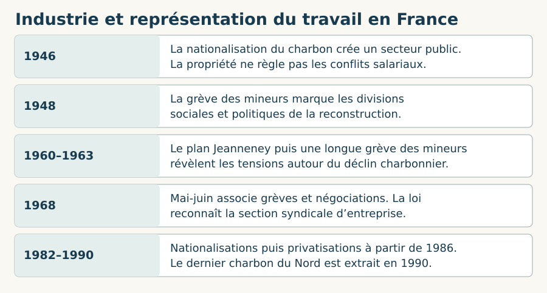
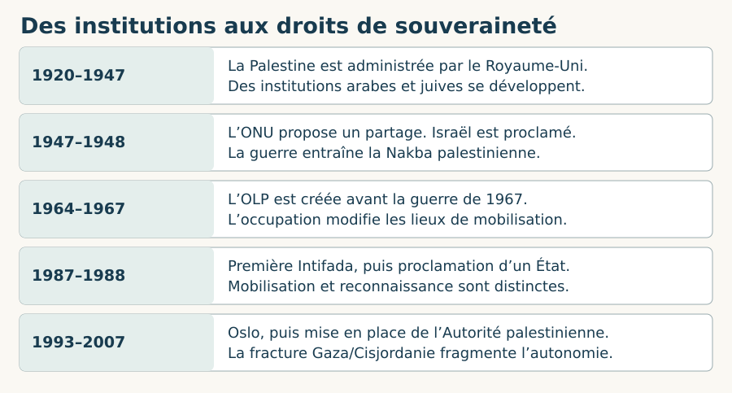

# BEL · AL — Histoire contemporaine (oral tronc commun 17 juin) 2026 · Corrigé brut

*Corrigé rédigé par IA, non officiel. Signalez toute erreur.*

**Rédaction** · GPT-6.2 Astra Ultra · vitesse non renseignée

**Autocontrôle** · GPT-6.2 Astra Ultra · vitesse non renseignée

La feuille contient 12 billets proposant chacun deux sujets au choix. Chaque sujet fait ici l’objet d’un exposé distinct.

## Billet 1

### Maintenir l’ordre en France (1939-1995)

« Maintenir l’ordre » suppose un pouvoir qui définit la légalité, des institutions qui l’appliquent et des groupes qui peuvent en contester la légitimité. Entre 1939 et 1944, la défaite, l’Occupation et Vichy rendent cette distinction particulièrement visible. La police française participe à des persécutions et à des arrestations, notamment lors de la rafle du Vél’ d’Hiv en juillet 1942. S’en tenir au vocabulaire administratif du « maintien » reviendrait à masquer la destruction de droits que ces actes accomplissent. La Libération rend urgent le rétablissement d’une autorité républicaine tout en posant la question de l’épuration des administrations et de leurs continuités. Les Compagnies républicaines de sécurité sont créées en décembre 1944.

Les grèves de 1947-1948 et les guerres coloniales soumettent ensuite la distinction entre ordre public et conflit politique à des épreuves aiguës. Le massacre du 17 octobre 1961 à Paris met en évidence le traitement discriminatoire des Algériens en métropole. La mort de manifestants à Charonne en février 1962 s’inscrit dans une autre mobilisation, contre l’OAS et pour la paix en Algérie. En 1968, les affrontements, les négociations et le recours final aux élections montrent que le gouvernement dispose de plusieurs registres de réponse. Les années suivantes voient se développer des controverses sur le contrôle démocratique de la police, le traitement des manifestations et les droits des personnes, particulièrement visibles après la mort de Malik Oussekine en décembre 1986. Dans les quartiers populaires comme dans la réponse aux violences politiques des années 1980 et 1990, l’égalité devant la loi et la protection des libertés restent des enjeux concrets. Une histoire de l’ordre doit donc suivre à la fois les agents de l’État, les victimes, les procédures judiciaires et les changements de la légitimité publique.

### Les déplacements de populations au Moyen-Orient

Le pluriel oblige à distinguer mouvements organisés par les États, exils de guerre, migrations économiques et déplacements internes. Les limites entre contrainte et choix sont graduelles. En 1923, la convention gréco-turque d’échange de populations définit principalement les personnes par la religion et prévoit des exceptions. Elle contribue à faire coïncider par la contrainte un territoire national avec une certaine idée de sa population. D’autres déplacements liés à la disparition de l’Empire ottoman ou aux persécutions, notamment ceux des survivants arméniens installés au Levant, donnent aux villes de la région une diversité nouvelle. Un déplacement transforme donc aussi les sociétés d’accueil.

L’immigration juive en Palestine mandataire, dans le cadre de projets sionistes et sous la pression des persécutions européennes, change d’échelle avant et après la Seconde Guerre mondiale. La guerre de 1948 provoque l’exode et l’expulsion de centaines de milliers de Palestiniens, la *Nakba*. Le statut des réfugiés et les conditions d’accueil diffèrent entre Liban, Jordanie et autres territoires. La guerre de 1967 ouvre de nouveaux déplacements, parfois subis par des familles déjà réfugiées. Les départs de populations juives de plusieurs pays arabes et d’Iran ont eux aussi des causes et des calendriers distincts. Ni le terme général d’exode ni une comparaison symétrique ne suffisent à rendre compte de leurs situations juridiques.

L’économie pétrolière attire enfin vers les pays du Golfe de nombreux travailleurs venus du monde arabe et d’Asie, sans que résidence signifie nécessairement accès à la citoyenneté. Les guerres du Liban, d’Irak et, à l’extrême fin du programme, le début du conflit syrien produisent des migrations internes et internationales supplémentaires. Tracer seulement les flèches sur une carte ne suffit pas. Il faut demander qui délivre les papiers, qui ouvre les écoles, qui autorise l’emploi et quelles familles peuvent rentrer. Les déplacements apparaissent alors comme des moments de fabrication ou de contestation des États eux-mêmes.

## Billet 2

### Le charbon en France (1939-1995)

Le charbon est à la fois une source d’énergie, un monde de travail et un objet de souveraineté. La guerre et l’Occupation accroissent les réquisitions et la pression sur les mineurs, tandis que les pénuries affectent les villes et l’industrie. La grève des mineurs du Nord et du Pas-de-Calais au printemps 1941 manifeste les dimensions sociales et politiques du bassin minier. Après 1944, la « bataille du charbon » fait du mineur une figure de la reconstruction. La nationalisation de 1946 crée Charbonnages de France et des houillères de bassin. La mise en avant du héros productif ne résout pas les conflits sur les salaires, la discipline et la sécurité, comme le rappelle la grande grève de 1948.

Au cours des Trente Glorieuses, la consommation totale d’énergie augmente alors que les hydrocarbures concurrencent le charbon et que certains gisements français deviennent plus coûteux à exploiter. Le plan Jeanneney de 1960 organise le recul de la production. La grève de 1963 associe revendications salariales et défense de la dignité d’une profession autrefois présentée comme indispensable. Après les chocs pétroliers, le développement de l’électricité nucléaire change de nouveau la place relative du charbon sans rendre automatiquement rentables toutes les mines. La fin de l’extraction dans le Nord-Pas-de-Calais en 1990 constitue un repère régional. Ce n’est pas la fin de toute extraction française, qui se poursuit ailleurs au-delà de 1995. Les fermetures affectent les sous-traitants, les commerces, les solidarités ouvrières et les paysages construits autour des cités minières. La patrimonialisation rend une partie de cette histoire visible, mais ne tient pas lieu de reconversion. Le charbon permet ainsi de suivre le passage d’une politique nationale de production à une politique territoriale de sortie industrielle.

### Les Palestiniens et l’État

Le terme « État » peut désigner un État palestinien revendiqué, un appareil étatique auquel les Palestiniens sont soumis ou un État voisin qui les accueille. Sous le mandat britannique, des mobilisations arabes palestiniennes demandent la représentation politique et l’indépendance dans un territoire où se développe aussi le projet sioniste. Le plan de partage adopté par l’Assemblée générale des Nations unies en 1947 envisage deux États. La guerre de 1948 aboutit à un État d’Israël et à une dispersion palestinienne, sans création de l’État arabe prévu. Les Palestiniens vivent dès lors dans des situations distinctes, citoyens d’Israël pour certains, habitants de Cisjordanie sous autorité jordanienne, de Gaza sous administration égyptienne, réfugiés ailleurs dans la région ou au-delà.

La création de l’OLP en 1964 puis son évolution après 1967 donnent à la représentation palestinienne une organisation qui ne dispose pas d’une souveraineté territoriale. L’occupation par Israël de la Cisjordanie, de Jérusalem-Est et de Gaza en 1967 intensifie les enjeux territoriaux et administratifs. La première Intifada à partir de 1987 déplace le centre de gravité vers les populations des territoires occupés. La proclamation d’un État palestinien en 1988 acquiert une portée diplomatique, distincte de la capacité à administrer effectivement un territoire. Les accords d’Oslo en 1993 et l’installation de l’Autorité palestinienne en 1994 créent des institutions d’autonomie limitée. Ils ne tranchent pas les questions du territoire définitif, des réfugiés, de Jérusalem ni du plein contrôle des frontières. La séparation politique entre Gaza et la Cisjordanie en 2007 ajoute une fracture interne. Jusqu’en 2011, il faut donc mesurer séparément la construction d’une identité nationale, la reconnaissance internationale, le gouvernement d’une population et la souveraineté effective.

## Billet 3

### La gauche et le pouvoir en France (1939-1995)

La gauche n’est pas seulement au pouvoir lorsqu’elle détient la présidence ou Matignon. Elle dispose aussi de relais municipaux, syndicaux et intellectuels qui lui permettent d’infléchir des politiques pendant de longues périodes d’opposition. En 1939, le pacte germano-soviétique fracture les rapports entre communistes et autres forces de gauche. Sous Vichy, la Résistance fait naître des coopérations sans effacer les différences. La Libération associe communistes, socialistes et démocrates-chrétiens dans le gouvernement de reconstruction. Sécurité sociale, nationalisations et planification prennent corps dans une coalition plus large que la seule gauche. L’exclusion des ministres communistes en 1947 et la guerre froide modifient durablement ses possibilités d’alliance.

La IVe République permet à des socialistes de gouverner tout en révélant les divisions suscitées par les guerres coloniales. Guy Mollet accède au pouvoir en 1956 sur des attentes de paix sans parvenir à sortir de la guerre d’Algérie. Le régime de 1958 change les règles de conquête du pouvoir national. La candidature de Mitterrand en 1965 montre le potentiel d’une candidature commune. Le congrès d’Épinay en 1971 puis le programme commun de 1972 contribuent à construire une gauche dont le PS devient la principale force électorale. La victoire de 1981 débouche sur l’abolition de la peine de mort, la décentralisation et des nationalisations. La politique économique engagée en 1983 suscite des débats sur la marge d’autonomie dans une économie ouverte et intégrée à l’Europe. Les cohabitations de 1986-1988 et 1993-1995 montrent qu’un président de gauche n’implique pas un gouvernement de gauche. En 1995, le retour d’un président de droite clôt quatorze années qui ont normalisé l’alternance, transformé les rapports de force internes à gauche et révélé plusieurs manières d’exercer ou de perdre le pouvoir.

### Construire des économies nationales au Moyen-Orient (1920-2011)

La délimitation d’une frontière ne suffit pas à créer une économie nationale. Il faut organiser une monnaie, des recettes, des infrastructures, des circuits de formation et des institutions capables de se prononcer sur les investissements. L’après-guerre ottoman divise un espace auparavant traversé par des réseaux régionaux. Sous mandat, certaines infrastructures servent autant les intérêts commerciaux ou stratégiques européens que l’intégration du territoire. Les élites locales utilisent néanmoins budgets, administrations et réseaux urbains pour poser les bases d’un marché national. Le poids de la grande propriété, l’accès inégal à l’eau et la concentration géographique des premières industries produisent de fortes disparités internes.

L’indépendance donne une portée politique nouvelle à la maîtrise des ressources. En Iran, la nationalisation pétrolière de 1951 puis la crise qui mène à la chute de Mossadegh en 1953 révèlent les limites d’une souveraineté légale sans contrôle assuré des débouchés. En Égypte, Nasser associe industrie publique, réforme agraire et nationalisation du canal de Suez en 1956. La Syrie et l’Irak développent à leur tour des secteurs publics importants. Ce développement par l’État élargit certains services et l’emploi diplômé, mais favorise également bureaucratie, endettement et dépendances technologiques. Dans les monarchies pétrolières, la répartition de la rente, les importations et l’utilisation d’une main-d’œuvre étrangère suivent une trajectoire différente.

Les ouvertures économiques engagées dans plusieurs pays à partir des années 1970 modifient la place du commerce privé et des investissements extérieurs sans dissoudre l’État. La Jordanie et le Liban dépendent d’autres ressources que les grands producteurs, notamment les services ou les transferts des expatriés. À la veille de 2011, chômage des jeunes, inégalités territoriales et dépendance à des marchés mondiaux révèlent les limites de l’assimilation entre indépendance politique et autonomie économique. Construire une économie nationale a souvent consisté à gouverner des interdépendances, plutôt qu’à les supprimer.

## Billet 4

### Les syndicats ouvriers en France (1939-1995)

Les syndicats défendent des salaires et des droits tout en proposant certaines formes de représentation collective des travailleurs. Leur histoire change selon qu’ils sont tolérés, réprimés, associés à la décision ou reconnus à l’intérieur même de l’entreprise. Vichy dissout les confédérations en 1940 et impose une organisation corporative avec la Charte du travail. Des syndicalistes participent cependant à la Résistance. La reconstitution de la CGT dans la clandestinité puis le rôle reconnu aux organisations ouvrières à la Libération renforcent leur prétention à représenter les salariés dans les entreprises nationalisées et les organismes sociaux. La guerre froide et les conflits de 1947 entraînent une scission dont naît Force ouvrière.

Il ne faut pas réduire le syndicalisme à la CGT. La tradition chrétienne se transforme avec la création de la CFDT en 1964, cependant qu’une minorité maintient la CFTC. L’implantation varie selon les branches, les entreprises et les territoires. Grèves de mineurs en 1963 et grève générale de mai-juin 1968 montrent une forte capacité de mobilisation, mais aussi l’existence de désaccords entre directions syndicales et salariés sur les suites d’une négociation. Le constat de Grenelle en 1968 n’est pas un accord unanimement accepté et immédiatement appliqué partout. La reconnaissance légale de la section syndicale d’entreprise en décembre 1968 transforme durablement les conditions d’action. Les lois Auroux de 1982 développent notamment des obligations de négocier et les droits des salariés.

Désindustrialisation, chômage et dispersion des collectifs de travail contribuent au recul de la syndicalisation. Les femmes, les salariés immigrés ou précaires mettent parfois au jour des revendications mal prises en compte par les organisations établies. Les grands mouvements de la fin de 1995 rappellent néanmoins que faible densité d’adhésion et capacité ponctuelle de mobilisation peuvent coexister. La distinction entre adhérer, voter aux élections professionnelles, se mettre en grève et bénéficier d’une convention collective évite ainsi de réduire l’histoire syndicale à une courbe unique.

### Dictature et démocratie au Moyen-Orient

Plutôt que de découper la région entre deux essences, on peut distinguer l’étendue du suffrage, la concurrence pour le pouvoir, la protection des libertés et le contrôle réel de l’exécutif. L’entre-deux-guerres connaît des assemblées, des partis, des monarchies constitutionnelles et des institutions sous tutelle. En Égypte, la Constitution de 1923 et le poids électoral du Wafd s’accompagnent d’interventions du palais et d’une souveraineté limitée par le Royaume-Uni. En Turquie, la République édifiée par Mustafa Kemal étend certains droits tout en ne permettant guère l’alternance. L’introduction du multipartisme après 1945 puis l’alternance de 1950 constituent des changements effectifs, ultérieurement limités par plusieurs interventions de l’armée.

Après les indépendances, des régimes se réclament de la souveraineté populaire tout en concentrant les ressources politiques. L’Égypte nassérienne, la Syrie et l’Irak baassistes combinent à des degrés variables parti dominant, présidence, services d’État et encadrement des mobilisations. Les monarchies du Golfe ont d’autres bases de légitimité et des institutions consultatives ou représentatives très inégales. Au Liban, le partage confessionnel autorise la compétition mais fige des appartenances et ne protège pas le pays de la guerre civile. En Israël, les élections et les alternances, dont celle de 1977, doivent être étudiées avec la situation des citoyens arabes et avec les droits très différents des populations des territoires occupés. En Iran, les institutions électives de la République islamique sont limitées par des mécanismes de sélection et de contrôle religieux. Les soulèvements de 2011 résultent de conflits réels autour des libertés et de la dignité. Ils ne produisent pas d’un coup une même démocratie dans tous les pays. Cette diversité oblige à étudier les institutions, les mobilisations et leurs frontières concrètes plutôt que de faire de la région un cas supposé d’incompatibilité avec la démocratie.

## Billet 5

### Le centrisme en France (après 1945)

Le centre est tantôt une famille politique, tantôt une position de coalition, tantôt une promesse de dépasser la division entre droite et gauche. Après la Libération, le Mouvement républicain populaire donne à la démocratie chrétienne une organisation nationale de premier plan. Son engagement européen et social ne le situe pas simplement à mi-chemin sur tous les enjeux. Le tripartisme l’associe jusqu’en 1947 aux communistes et aux socialistes. Sous la IVe République, la « Troisième Force » rassemble ensuite des partis résolus à faire fonctionner le régime face aux communistes et aux gaullistes. Il s’agit d’une coalition de gouvernement dont les participants conservent des désaccords, notamment sur l’école et la politique économique.

L’instauration de la Ve République transforme la question. La bipolarisation et l’élection du président au suffrage universel direct rendent coûteuse une stratégie qui voudrait gouverner durablement sans choisir d’allié majeur. En 1965, Jean Lecanuet cherche cependant à incarner une troisième candidature moderne, proeuropéenne et distincte à la fois de de Gaulle et de Mitterrand. La création du Centre démocrate en 1966 prolonge cette démarche. Sous Giscard d’Estaing, le regroupement de 1978 au sein de l’UDF associe démocrates-chrétiens, libéraux et autres composantes dans la majorité présidentielle. Tous les membres de l’UDF ne sont donc pas interchangeables avec la tradition centriste. La cohabitation et les stratégies d’ouverture, notamment celle de Michel Rocard après 1988, rendent parfois aux élus du centre un rôle de négociation qui ne se traduit pas forcément par une candidature nationale autonome. Jusqu’en 1995, il faut ainsi suivre séparément l’existence d’une culture politique, la construction d’organisations et l’arithmétique des alliances imposée par les institutions.

### Les minorités religieuses dans la construction des États au Moyen-Orient

Une minorité religieuse n’est pas seulement un groupe qui représente moins de la moitié des habitants. Elle peut être reconnue comme personne collective, accéder à des fonctions publiques, être protégée comme composante de la nation ou dénoncée comme étrangère à celle-ci. Les héritages ottomans ont organisé certaines communautés autour d’institutions religieuses sans leur attribuer partout des droits identiques. La disparition de l’Empire, les traités et les mandats transforment ces appartenances. La protection internationale peut prémunir contre certaines discriminations mais aussi transformer des communautés en clientèles supposées d’une puissance étrangère. Les populations ne sont pas de simples objets de ces politiques. Leurs représentants négocient des garanties, contestent les classifications et défendent des formes diverses de citoyenneté.

Au Liban, la distribution confessionnelle des responsabilités politiques, consolidée autour du pacte national de 1943, inscrit la pluralité dans la définition de l’État. Elle assure une représentation mais rend difficiles les changements d’équilibre. En Turquie républicaine, les garanties accordées aux minorités non musulmanes par le traité de Lausanne coexistent avec une politique d’homogénéisation nationale et avec les conséquences des persécutions et déplacements antérieurs. En Égypte, les coptes peuvent revendiquer leur place comme membres à part entière de la nation plutôt que la seule protection d’une communauté séparée. En Irak, les Assyriens subissent notamment les violences de 1933, peu après l’entrée du pays à la SDN. En Israël, il faut distinguer l’identité nationale, les catégories religieuses et le statut politique de groupes arabes eux-mêmes divers. Entre partage confessionnel, institution d’une citoyenneté commune et exclusion, les États contribuent à définir la minorité qu’ils prétendent simplement reconnaître. L’enjeu du sujet est donc moins d’énumérer les confessions que de montrer comment la construction institutionnelle politise ces appartenances et comment leurs membres y répondent.

## Billet 6

### Racisme et antiracisme en France (1939-1995)

Le racisme désigne ici des discours, institutions et pratiques qui hiérarchisent ou excluent des personnes d’après une origine assignée. L’antiracisme regroupe des mobilisations de victimes, d’associations, de juristes et de citoyens dont les priorités évoluent. Sous Vichy, les statuts des juifs de 1940 et 1941 font de l’exclusion antisémite une politique d’État. Les persécutions et la participation française aux déportations montrent que le racisme ne relève pas seulement de préjugés individuels. Les empires coloniaux instituent d’autres hiérarchies de droits et de statuts qu’il faut décrire sans les confondre avec les mécanismes de l’antisémitisme génocidaire. À la Libération, l’abrogation du droit d’exception et la réaffirmation de l’égalité républicaine ouvrent une rupture juridique, sans effacer les discriminations sociales ou impériales.

La guerre d’Algérie et les migrations de l’après-guerre font de l’accès au logement, au travail et à l’espace public des lieux majeurs du conflit. Les violences contre les Algériens, en particulier les crimes racistes de 1973, et les attentats antisémites des années 1980 montrent la pluralité des cibles et des acteurs. La loi Pleven de 1972 ouvre de nouveaux moyens de poursuivre certaines provocations à la discrimination, à la haine ou à la violence. Elle ne suffit pas à identifier toutes les discriminations concrètes. En 1983, la Marche pour l’égalité et contre le racisme met au premier plan de jeunes habitants des quartiers populaires, avec des mobilisations locales qui précèdent l’appropriation médiatique du mouvement. SOS Racisme donne ensuite une autre forme publique à la cause. La loi Gayssot de 1990 sanctionne notamment la contestation de crimes contre l’humanité définis par référence au tribunal de Nuremberg. La montée électorale de l’extrême droite et les controverses sur l’immigration rappellent que la visibilité de l’antiracisme n’entraîne pas mécaniquement le recul du racisme. Pour en écrire l’histoire, il faut articuler la norme, son application et l’expérience des personnes discriminées.

### La fin de l’époque coloniale au Moyen-Orient

Le premier travail est de dater le mot « fin ». La région n’a été ni conquise au même moment ni soumise à un seul statut. À la fin de la Première Guerre mondiale, la chute de l’Empire ottoman entraîne à la fois l’émergence d’une Turquie souveraine et la mise sous mandat britannique ou français d’anciennes provinces arabes. La création de nouvelles administrations ne satisfait pas les aspirations exprimées par des partis, des notables ou des mobilisations populaires. La Syrie mandataire, le Liban, l’Irak et la Palestine connaissent des contestations et des arrangements profondément différents. Une indépendance internationale reconnue peut aller de pair avec une présence militaire étrangère ou des traités inégaux.

L’Irak entre à la SDN en 1932. La proclamation de l’indépendance libanaise en 1943 et le départ des forces françaises de Syrie et du Liban en 1946 marquent d’autres seuils. La Transjordanie devient indépendante en 1946. La fin du mandat britannique sur la Palestine en 1948 débouche sur la guerre, la souveraineté israélienne et la dispersion des Palestiniens. Elle ne prend donc pas la forme d’une simple transmission des institutions mandataires à un État successeur unique. En Égypte, la déclaration britannique de 1922, le traité de 1936, l’évacuation des forces britanniques de la zone du canal et la crise de Suez en 1956 constituent des jalons successifs d’une décolonisation politique, militaire et économique. Le retrait britannique du Golfe débouche encore en 1971 sur d’autres indépendances. La Guerre froide, la place du pétrole et les alliances militaires redéfinissent alors les dépendances sans être juridiquement identiques à la tutelle coloniale. Les acteurs qui parlent de libération, comme Nasser, cherchent précisément à réunir des dimensions dont l’histoire révèle le décalage.

## Billet 7

### Boire et manger en France (1939-1995)

Une ration, un repas familial et un achat au supermarché n’informent pas sur la même réalité. Pendant la guerre, pénuries, réquisitions, tickets et marché noir font de l’approvisionnement une activité quotidienne majeure. Les relations entre ville et campagne et l’accès à un jardin, à des producteurs ou à des ressources monétaires créent des écarts considérables. Le travail souvent féminin des files d’attente et de la préparation transforme le temps domestique. La Libération ne met pas immédiatement fin au rationnement. Il faut attendre la fin des années 1940 pour que disparaissent les derniers dispositifs.

L’augmentation des revenus, la modernisation agricole, la chaîne du froid et l’équipement des cuisines déplacent ensuite pratiques et attentes. Les supermarchés puis les hypermarchés, dont celui de Sainte-Geneviève-des-Bois en 1963, offrent des volumes, des marques et des rythmes d’achat nouveaux, particulièrement adaptés à la motorisation. Les cantines, la restauration collective et l’extension du travail salarié féminin modifient le lieu, la durée et le partage de préparation des repas. Le développement des produits transformés ou surgelés coexiste avec le maintien de repas familiaux et la valorisation de terroirs qui peuvent eux-mêmes être commercialement redéfinis. Les migrations, les retours de l’empire et les voyages modifient les goûts. Il faut éviter de raconter chaque nouveauté comme une disparition du passé.

Boire suscite des transformations particulières. Le recul de certaines consommations ordinaires de vin, l’essor des eaux embouteillées et des boissons non alcoolisées, la publicité et les politiques de santé, dont la loi Évin de 1991, déplacent la frontière entre habitude alimentaire, loisir et risque. À partir des années 1980, l’action d’associations comme les Restos du Cœur, fondés en 1985, rappelle que l’abondance de l’offre ne résout pas l’insécurité alimentaire. D’une économie de pénurie à une société d’abondance inégalement distribuée, la nourriture reste à la fois un besoin, un travail et une manière de se situer dans le monde social.

### Islamisme et nationalisme au Moyen-Orient (1920-2011)

L’islamisme entend organiser politiquement la société au nom d’interprétations de l’islam. Le nationalisme fait de la nation un principe de légitimité et peut viser une nation territoriale, arabe, turque, iranienne ou palestinienne. Ces catégories ne découpent pas deux camps fixes. Dans l’Égypte sous influence britannique, les Frères musulmans, fondés en 1928, associent réforme religieuse, action sociale et affirmation de l’indépendance. Ils partagent donc avec d’autres nationalistes une critique de la tutelle étrangère tout en divergeant sur le fondement de la loi, la hiérarchie des appartenances et le rôle des organisations religieuses.

Les régimes issus de l’indépendance cherchent souvent à réserver à l’État la définition de la nation. L’Égypte de Nasser réprime les Frères musulmans et proclame le socialisme arabe. La Turquie kémaliste construit une identité nationale en limitant et en administrant les institutions religieuses, non en faisant simplement disparaître l’islam de la vie publique. Les nationalismes arabes, y compris ceux portés par des intellectuels chrétiens, ne sont pas un synonyme de politique musulmane. La défaite de 1967 et les limites sociales de plusieurs États nationalistes ouvrent des crises de légitimité, sans suffire à expliquer à elles seules la montée de mouvements islamistes qui avaient souvent des racines antérieures.

La révolution iranienne de 1979 associe émancipation nationale vis-à-vis des influences étrangères et mise en place d’une République islamique chiite qui se veut aussi porteuse d’un message au-delà des frontières. Le conflit avec l’Irak dès 1980 réactive puissamment l’identité nationale iranienne. Dans les territoires palestiniens, la naissance du Hamas en 1987 associe référence islamiste et objectif national palestinien, en concurrence avec l’OLP sans que toute la mobilisation palestinienne se réduise à cette opposition. Les politiques de souveraineté, l’occupation, les élections et les solidarités sociales modifient les formes de cette relation. Jusqu’en 2011, une question demeure déterminante dans chaque cas, celle de l’institution autorisée à définir les contours du peuple et de sa loi.

## Billet 8

### Les nationalisations en France, de la Libération aux années 1980

Nationaliser, c’est transférer à la collectivité publique la propriété d’une entreprise ou de ses actifs selon une procédure déterminée. La propriété, la planification et le service public ne sont pas interchangeables. À la Libération, le programme du Conseil national de la Résistance et les nécessités de reconstruction nourrissent les transferts de propriété de 1944-1946. Renault est nationalisée dans un contexte de sanction particulier. La Banque de France, les grandes banques de dépôt, l’électricité et le gaz ou les houillères répondent surtout à des logiques de contrôle du crédit, de reconstruction et d’organisation de secteurs jugés essentiels. La création d’EDF-GDF en 1946 illustre la mise en place de grands monopoles publics, avec des exceptions locales. Des nationalisations d’entreprises distinctes peuvent ainsi mobiliser des justifications différentes.

Sous les IVe et Ve Républiques, l’État propriétaire agit à travers des entreprises dont les dirigeants, les salariés et les usagers n’ont pas nécessairement les mêmes intérêts. L’investissement dans les réseaux et la rationalisation productive peuvent entrer en tension avec les objectifs tarifaires ou sociaux. Dans les années 1970-1980, le débat se déplace vers la capacité de l’État à orienter le crédit et les restructurations industrielles. L’arrivée de la gauche en 1981 ouvre une nouvelle vague. La loi de février 1982 fait entrer notamment de grands groupes industriels et des banques dans le secteur public. Le contrôle du Conseil constitutionnel sur l’indemnisation rappelle les garanties attachées à la propriété dans le droit français. Nationaliser ne prémunit pas contre le chômage ni contre les arbitrages de compétitivité. À partir de 1986, la première cohabitation ouvre au contraire une vague de privatisations, avec des trajectoires ensuite variables. Le sujet raconte donc moins la montée puis la disparition de l’État qu’une controverse sur ses moyens de diriger l’économie et sur les responsabilités qui accompagnent la propriété publique.

### Le passé ottoman et ses traces au Moyen-Orient

Après 1918, l’Empire ottoman cesse d’exister comme cadre politique commun, mais ses anciens territoires ne deviennent pas des pages blanches. Les dernières décennies impériales avaient formé des officiers, des fonctionnaires et des juristes dont certains passent au service des nouvelles constructions nationales. Réformes administratives du XIXe siècle, enregistrement foncier, infrastructures et hiérarchies urbaines laissent des traces qui peuvent être transformées par les mandats. Il serait toutefois erroné de faire correspondre les nouvelles frontières à un simple décalque des anciennes provinces. Les puissances mandataires et les acteurs locaux redéfinissent les découpages et les lieux de décision.

La République de Turquie se construit par rupture, avec l’abolition du sultanat en 1922 et du califat en 1924, mais aussi grâce à des compétences et à un personnel issus de l’Empire. Le changement d’alphabet de 1928 rend même matériellement différente la relation des générations suivantes à l’écrit ottoman. Dans le monde arabe, les récits nationaux peuvent représenter la domination ottomane comme une période d’oppression étrangère ou conserver le souvenir d’une appartenance plurielle. Les chemins de fer, les centres urbains et les déplacements de familles maintiennent des liens que la nouvelle frontière reclasse. Les anciennes formes de représentation religieuse sont réinterprétées plutôt que conservées sans modification, comme l’illustre l’institutionnalisation particulière des appartenances confessionnelles au Liban. Les mémoires des violences contre les Arméniens traversent, elles aussi, les frontières d’États qui n’existaient pas encore au moment des faits. Un même édifice ou le souvenir du califat peuvent enfin devenir des ressources politiques bien après la disparition de l’institution. Les traces doivent donc être classées selon qu’elles relèvent d’une continuité documentaire, d’une adaptation institutionnelle ou d’une reconstruction mémorielle.

## Billet 9

### Les intellectuels en France (1939-1995)

L’intellectuel n’est pas une profession unique. Un écrivain, un savant ou un universitaire devient ici intellectuel lorsqu’il engage publiquement l’autorité acquise dans son domaine dans une controverse collective. L’Occupation rend les choix particulièrement contraignants. Écrire sous contrôle, se taire, collaborer, publier clandestinement ou rejoindre la France libre ne signifient pas la même chose. Les Éditions de Minuit et *Le Silence de la mer* de Vercors donnent à la publication elle-même une valeur politique. À la Libération, l’épuration des écrivains et le Comité national des écrivains posent la question de la responsabilité des paroles publiques.

La guerre froide et les décolonisations déplacent le terrain de l’engagement. Le prestige communiste attire des compagnons de route, tandis que les révélations sur les régimes soviétiques et Budapest en 1956 entraînent des ruptures. Sartre fait de l’engagement une vocation de l’écrivain, mais ses oppositions à Aron ou ses désaccords avec Camus empêchent de faire d’une figure le porte-parole de toute une époque. Pendant la guerre d’Algérie, les prises de position, les enquêtes sur la torture et le Manifeste des 121 en 1960 interrogent le rapport entre conscience, droit et fidélité nationale. L’entrée en scène croissante des sciences humaines, l’expansion universitaire et Mai 68 modifient les lieux d’autorité. L’intellectuel qui met une compétence précise au service d’une cause, à l’exemple de Foucault auprès du Groupe d’information sur les prisons, ne parle pas exactement comme le grand écrivain généraliste. Les mobilisations féministes et le travail de Simone de Beauvoir révèlent aussi le caractère socialement et sexuellement situé de l’accès à la parole publique. À la fin du siècle, télévision, journaux et édition rendent plus visible une partie des interventions tout en créant leurs propres filtres. Le déclin d’un modèle unique d’intellectuel ne signifie donc pas la fin de l’intervention des producteurs de savoir dans la cité.

### Construire l’État juif (1920-1948)

L’objectif d’un État juif doit être distingué de l’expression britannique de « foyer national juif ». La déclaration Balfour de 1917, antérieure à la borne initiale, éclaire le mandat confié au Royaume-Uni. L’incertitude sur l’avenir politique de la Palestine laisse ouverts plusieurs projets. Le mouvement sioniste est lui-même traversé par des courants socialistes, révisionnistes, religieux et binationaux. Dans la communauté juive de Palestine, le Yichouv, se constituent des institutions qui rendent possible l’action collective avant la souveraineté. La Histadrout, fondée en 1920, articule représentation des travailleurs et organisation économique. L’Agence juive, l’enseignement en hébreu, les organisations municipales et les réseaux transnationaux donnent des moyens administratifs et sociaux au projet national.

Cette construction se déroule dans un pays habité par une société arabe palestinienne dont les aspirations à l’indépendance entrent en conflit avec le projet sioniste. L’immigration, les acquisitions foncières, l’organisation du travail et le statut des institutions représentatives deviennent des enjeux de coexistence et de pouvoir. La grande révolte arabe de 1936-1939 révèle la profondeur du refus d’une évolution qui priverait les Arabes palestiniens de la maîtrise de leur avenir politique. Le Livre blanc britannique de 1939 limite notamment l’immigration juive alors que les persécutions en Europe la rendent vitale. La Shoah, l’existence de survivants déplacés après 1945 et l’affaiblissement britannique changent le contexte de légitimation internationale. En novembre 1947, l’Assemblée générale de l’ONU recommande un partage. La proclamation de l’État d’Israël le 14 mai 1948 affirme une souveraineté que le conflit régional met immédiatement à l’épreuve. Le déplacement massif des Palestiniens inscrit la *Nakba* dans l’histoire même de cette fondation. Il faut donc expliquer conjointement les institutions patiemment édifiées par le Yichouv, la décision diplomatique et la violence de la rupture, sans faire de l’issue de 1948 un résultat mécaniquement écrit dès 1920.

## Billet 10

### La « révolution turque » (1920-1946)

Les guillemets invitent à discuter ce qu’une révolution peut désigner. Entre la Grande Assemblée d’Ankara de 1920 et les premières élections multipartites de 1946, il y a une refondation territoriale, juridique et symbolique, mais également des continuités administratives et des limites politiques. Le mouvement organisé autour de Mustafa Kemal conteste le démembrement prévu par le traité de Sèvres et l’autorité du gouvernement du sultan. Le sultanat est supprimé en 1922. La reconnaissance internationale à Lausanne et la proclamation de la République en 1923 substituent une souveraineté nationale en Anatolie au cadre impérial. L’échange de populations avec la Grèce révèle le coût humain de cette redéfinition des appartenances.

La réorganisation de l’État et de la société passe par une séquence de décisions rapprochées. Abolition du califat et unification de l’enseignement en 1924, adoption du Code civil en 1926, changement d’alphabet en 1928 et réforme des noms en 1934 agissent jusque dans la famille et la capacité de lire les documents du passé. La reconnaissance des droits électoraux nationaux des femmes en 1934 témoigne d’une élaboration nouvelle de la citoyenneté. L’État contrôle toutefois fermement l’expression politique et encadre la religion. Parti dominant, répression d’oppositions et politiques d’homogénéisation limitent la pluralité de la nation proclamée. Le réformisme républicain emprunte également à des personnels et expériences de la fin de l’Empire. Il ne part pas d’une société dépourvue d’administration ou de projets de modernisation.

La mort d’Atatürk en 1938 ouvre la présidence d’İsmet İnönü. La Seconde Guerre mondiale et l’environnement international d’après-guerre conduisent à des ajustements économiques et politiques. En 1946, la création du Parti démocrate et la tenue d’élections multipartites signalent un changement important dont les garanties restent imparfaites. L’alternance de 1950 est un prolongement hors de la borne, et non le résultat déjà acquis en 1946. La révolution turque peut donc être comprise comme un changement radical des formes de souveraineté et de vie publique, dont l’ouverture au pluralisme ne suit ni le même calendrier ni le même rythme.

### Les guerres d’Irak (1991-2011)

Le pluriel appelle à distinguer trois contextes liés sans les confondre, la guerre de 1991, les années de sanctions et d’encadrement international, puis l’invasion de 2003 et les conflits de l’après-Saddam Hussein. L’invasion irakienne du Koweït en août 1990 précède la borne mais explique la guerre menée en 1991 par une coalition sous direction américaine dans le cadre des résolutions du Conseil de sécurité. Le Koweït retrouve sa souveraineté, tandis que Saddam Hussein demeure au pouvoir en Irak. Le soulèvement et la répression de populations kurdes et chiites montrent que l’issue internationale ne règle pas la question de la légitimité intérieure du régime.

L’embargo imposé à l’Irak, les inspections sur les armements et le programme « pétrole contre nourriture » modifient durablement l’économie et les conditions de vie. L’affaiblissement des services publics frappe la population sans faire disparaître le pouvoir du régime. Au Kurdistan irakien, un espace d’autonomie de fait se développe dans des conditions internationales particulières. L’histoire des années 1990 est donc une séquence en propre, essentielle pour comprendre la fragilisation sociale et administrative du pays.

En 2003, les États-Unis et leurs alliés envahissent l’Irak sans nouvelle autorisation explicite du Conseil de sécurité. La justification publique liée à des stocks d’armes de destruction massive n’est pas confirmée par les recherches ultérieures. La chute du régime ouvre une occupation et une transition dont les choix, notamment la dissolution de l’armée et la débaassification, bouleversent les institutions. Les élections puis la Constitution fédérale de 2005 créent de nouveaux cadres tout en laissant de fortes tensions autour de la représentation, des ressources et de la sécurité. Les civils subissent violences, déplacements et fragmentation des villes, notamment pendant la crise confessionnelle de 2006-2007. Le retrait des principales forces américaines en 2011 clôt la période imposée sans marquer à lui seul la disparition des conflits. Mesurer successivement la souveraineté internationale, l’état de l’administration et l’expérience des habitants donne au pluriel du sujet son contenu précis.

## Billet 11

### La gauche et la décolonisation

La gauche française hérite à la fois d’une critique de l’exploitation coloniale et d’un républicanisme qui a pu justifier l’empire au nom de l’universalisme. La contradiction devient particulièrement visible après la Libération. Le droit des peuples à disposer d’eux-mêmes et l’égalité des citoyens peuvent conduire à revendiquer l’indépendance ou, au contraire, l’intégration réformée à la France. Dans l’immédiat après-guerre, l’Union française et les réformes de citoyenneté ne satisfont pas les aspirations de mouvements nationaux qui veulent la souveraineté. Les communistes, socialistes et radicaux n’adoptent ni simultanément ni unanimement les mêmes positions. Les partis colonisés et les militants anticoloniaux ont leur propre capacité d’initiative. Il serait injustifié de présenter les indépendances comme un don de la gauche métropolitaine.

La guerre d’Indochine polarise les mobilisations du PCF. Pierre Mendès France, radical, préside le gouvernement qui conclut les accords de Genève en 1954 et engage la reconnaissance de l’autonomie interne tunisienne. La guerre d’Algérie provoque une crise plus profonde. En 1956, Guy Mollet conduit un gouvernement socialiste qui obtient les pouvoirs spéciaux et intensifie la guerre. Le vote de ces pouvoirs, y compris par les députés communistes, oblige à distinguer une position à un moment précis de l’évolution ultérieure vers une opposition à la guerre. Des intellectuels, syndicalistes, réseaux de soutien et militants issus de plusieurs traditions s’engagent contre la répression ou pour l’indépendance. Le PSU, formé en 1960, participe à la recomposition de cette gauche anticoloniale. Après 1962, la coopération, les relations avec les anciennes colonies, les situations ultramarines et l’expérience des immigrés prolongent la question dans la vie politique française. L’histoire de la décolonisation divise et renouvelle donc la gauche autant que celle-ci tente d’en orienter le cours.

### L’industrie en France (1945-1995)

La reconstruction industrielle est d’abord un choix de souveraineté et d’équipement. Nationalisations et plan Monnet orientent des ressources vers le charbon, l’acier, l’électricité et les transports. Les entreprises privées conservent cependant une place majeure et l’ouverture commerciale européenne élargit progressivement les débouchés. La forte croissance de l’après-guerre favorise la production automobile, les biens d’équipement et la consommation de masse. Les usines recrutent dans les campagnes, parmi les immigrés et parmi les femmes, selon des hiérarchies professionnelles très inégales. L’industrialisation transforme le logement, les transports domicile-travail, les paysages urbains et les cultures ouvrières.

Cette phase ne bénéficie pas uniformément à tous les secteurs ou territoires. Des branches anciennes rencontrent précocement une concurrence accrue. L’État encourage implantations nouvelles, grands programmes technologiques et aménagement du territoire. À partir des années 1970, les chocs pétroliers, les mutations de la demande, la concurrence internationale et les gains de productivité se conjuguent sans avoir partout le même poids. Les crises du textile, de la sidérurgie lorraine et des chantiers navals rendent visibles les fermetures et les reconversions. Des activités comme l’aéronautique ou certaines industries de pointe poursuivent au contraire leur développement. Les nationalisations de 1982 puis les privatisations à partir de 1986 témoignent de réponses politiques opposées, mais chacune doit traiter l’investissement et la restructuration des entreprises.

La désindustrialisation demande enfin de choisir un indicateur. Le recul de la part des emplois industriels peut coexister avec une production en volume maintenue ou accrue dans certaines branches. Externaliser le nettoyage ou l’informatique fait aussi sortir des emplois du périmètre statistique de l’entreprise industrielle. À l’échelle d’un bassin touché par la fermeture de son principal site, la perte d’emploi et de services reste pourtant très réelle. L’année 1995 ne marque donc pas la disparition de l’industrie française mais la fin de sa capacité à structurer partout de la même façon les carrières salariées et l’imaginaire national de modernisation.

## Billet 12

### L’extrême gauche en France (1939-1995)

L’expression est relationnelle. Elle désigne des familles situées à gauche des partis socialiste et communiste dominants et critiques de leurs stratégies, non un parti homogène. Trotskistes, anarchistes, puis certaines organisations maoïstes n’ont ni les mêmes références ni les mêmes rapports à l’URSS ou à l’élection. Pendant la guerre, clandestinité, persécutions et isolement rendent les trajectoires discontinues. Après 1945, l’implantation du PCF dans le monde ouvrier laisse peu d’espace électoral à ses critiques, sans empêcher des groupes minoritaires d’agir dans certaines entreprises, syndicalismes ou publications. Les luttes anticoloniales et les critiques du stalinisme favorisent des recompositions dont le seul nombre d’adhérents ne permet pas de mesurer l’influence.

Mai 1968 rend visibles des organisations étudiantes et militantes qui contestent à la fois l’ordre gaulliste et la stratégie du PCF. Leurs références et leurs modes de vie politiques diffèrent. Certains militants privilégient le travail en usine, d’autres l’autonomie des mouvements sociaux ou la construction d’une organisation capable de participer aux élections. Il convient de distinguer extrême gauche et nouvelle gauche, militantisme féministe autonome et organisations partisanes, même lorsque les personnes et les réseaux se croisent. La décennie 1970 révèle en particulier des tensions sur les hiérarchies internes et les rapports de sexe. La candidature d’Arlette Laguiller pour Lutte ouvrière à partir de 1974 rend visible la persistance d’un courant électoral trotskiste, dont les objectifs diffèrent de ceux des groupes maoïstes alors en reflux. Dans les années 1980-1990, les mutations du salariat et la fin du bloc soviétique obligent ces familles à redéfinir leur audience. Jusqu’en 1995, leur présence s’évalue dans les élections, mais aussi dans les grèves, les mobilisations et les répertoires de revendication transmis à d’autres acteurs.

### La France en 1968

Un sujet en forme d’année demande de relier événement, conjoncture et structures. La France de 1968 reste celle d’une forte croissance, d’une urbanisation rapide et d’inégalités persistantes. L’expansion de l’enseignement supérieur a créé une jeunesse étudiante plus nombreuse, sans que les institutions universitaires ou les relations d’autorité se soient adaptées au même rythme. Les conflits sociaux de 1967 et du début de 1968 rappellent que le mécontentement ouvrier précède les mobilisations étudiantes de mai. Le pouvoir gaulliste paraît institutionnellement solide, mais l’usure des hiérarchies et la circulation internationale des critiques préparent un terrain de contestation.

À Nanterre puis à la Sorbonne, la mobilisation étudiante et la réponse policière donnent aux événements une audience nationale. Les protestations et les appels syndicaux rencontrent en mai une vague de grèves et d’occupations d’entreprises sans précédent par son ampleur. Ouvriers, employés et étudiants n’ont ni les mêmes revendications ni toujours les mêmes espaces d’action. La négociation de Grenelle aboutit fin mai à des avancées salariales et syndicales dont la réception dans les entreprises est différenciée. La dissolution de l’Assemblée annoncée le 30 mai puis les élections de juin donnent une large majorité à la droite. Le succès électoral du pouvoir n’annule donc pas les transformations des relations de travail, des pratiques pédagogiques ou des attentes d’autonomie. La reconnaissance de la section syndicale d’entreprise en décembre permet même d’observer une conséquence institutionnelle dans l’année.

Reste la question des héritages. Des mobilisations féministes, écologistes et antiautoritaires s’approprieront la mémoire de 1968, mais elles ont aussi leurs histoires propres. La modernisation des mœurs avait commencé avant mai et continue après le reflux des grèves. En se plaçant successivement dans une université, une entreprise, un foyer et un bureau de vote, on comprend comment la même société a pu contester ses autorités, négocier des droits nouveaux et reconduire une majorité conservatrice en quelques semaines.

[Fascicule officiel](https://www.ens.psl.eu/sites/default/files/commission_1_-_histoire_-_17_juin.pdf) · [Index des sujets du jury](https://www.ens.psl.eu/rapports-et-sujets-du-concours-2026-section-des-lettres-groupe-al)
