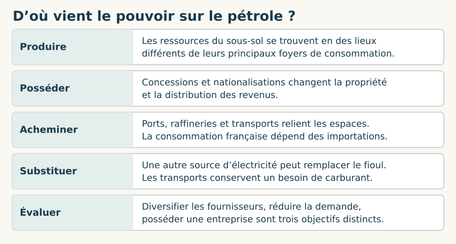
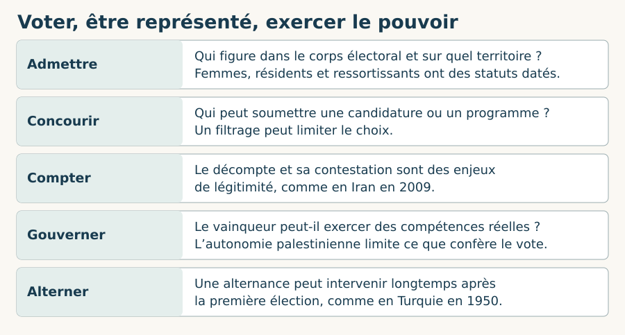

# BEL · AL — Histoire contemporaine (oral tronc commun 19 juin commission 1) 2026 · Corrigé brut

*Corrigé rédigé par IA, non officiel. Signalez toute erreur.*

**Rédaction** · GPT-6.2 Astra Ultra · vitesse non renseignée

**Autocontrôle** · GPT-6.2 Astra Ultra · vitesse non renseignée

La feuille contient 11 billets proposant chacun deux sujets au choix. Chaque sujet fait ici l’objet d’un exposé distinct.

## Billet 1

### Le commerce en France

Un rayon de supermarché des années 1980 et une épicerie ravitaillée par tickets pendant la guerre représentent deux moments d’une transformation du commerce intérieur. La question n’implique pas que le petit commerçant ait simplement disparu devant la grande distribution. Elle engage aussi l’insertion des échanges français dans un espace européen et mondial. Pendant l’Occupation, le contrôle des prix et de la distribution, les pénuries et les prélèvements allemands mettent à l’épreuve la capacité de l’État à approvisionner les ménages. Tickets et marché noir n’ont pas la même signification selon les territoires et les ressources des clients. Le lieu de vente est aussi un lieu d’accès inégal aux biens essentiels.

Après la guerre, l’augmentation des revenus, le libre-service, la réfrigération et la motorisation transforment les conditions de vente. L’hypermarché de Sainte-Geneviève-des-Bois, ouvert en 1963, associe surface importante, assortiment diversifié et accès automobile en périphérie. Les entreprises rationalisent les achats et les prix, tandis que les clients assument directement une part du travail de sélection des marchandises. La défense des petits indépendants avait déjà nourri le mouvement poujadiste dans les années 1950. La loi Royer de 1973 soumet certaines implantations à une autorisation afin d’en réguler les effets territoriaux. Les commerces de proximité se recomposent aussi par la spécialisation et le service. Au même moment, le Marché commun, la suppression des droits de douane internes en 1968 et le marché unique au début des années 1990 modifient l’échelle de production, d’approvisionnement et de concurrence. Pour juger le changement, il faut donc examiner ce que gagnent certains consommateurs en prix ou en choix, mais aussi ce que perdent en accès des quartiers ou des ménages peu motorisés.

### L’État dans l’économie au Moyen-Orient (des années 1950 à 2011)

La nationalisation de la Compagnie du canal de Suez en Égypte en 1956 ou celle du pétrole iranien en 1951 font de l’État un instrument d’indépendance économique. Mais posséder une ressource, recueillir une recette et orienter l’industrialisation sont des opérations différentes. En Égypte, la réforme agraire, l’extension du secteur public et l’accès élargi à l’enseignement donnent une assise sociale au régime de Nasser. L’État devient employeur de diplômés et organisateur d’investissements collectifs. Dans l’Irak et la Syrie des partis baassistes, l’intervention économique sert également la construction nationale et le contrôle politique. Les effets dépendent de la capacité de gestion, des compromis avec les producteurs privés et de l’accès aux financements extérieurs.

Dans le Golfe, l’augmentation des revenus pétroliers, particulièrement après 1973, permet l’extension de l’État sans une taxation directe comparable à celle d’économies plus pauvres en hydrocarbures. L’administration distribue emplois, services et marchés, tout en différenciant les droits entre citoyens et travailleurs étrangers. Les pays qui ne disposent pas de la même rente, comme la Jordanie, dépendent parfois de l’aide extérieure et des transferts de migrants employés ailleurs. Les programmes d’ouverture économique de Sadate en Égypte, puis d’autres réformes de libéralisation dans la région, ne font pas disparaître l’État. Ils lui font sélectionner les investisseurs, régler les contrats et arbitrer le recul de certaines subventions. Les contestations égyptiennes de 1977 rendent visibles les coûts politiques de ces choix. En 2011, un même mot d’ordre de justice sociale peut dénoncer aussi bien l’absence de services que la captation de la richesse par des réseaux proches du pouvoir. Il importe ainsi de comparer les fonctions publiques concrètes plutôt que d’opposer abstraitement étatisme et marché.

## Billet 2

### Le pétrole en France

La France consomme beaucoup plus de pétrole qu’elle n’en extrait sur son territoire métropolitain. Son histoire pétrolière concerne donc un système d’approvisionnement, de raffinage, de transport et de consommation autant qu’une industrie extractive. Pendant la guerre, la pénurie de carburants, les réquisitions et les substituts rendent particulièrement visible la vulnérabilité des circulations. Après la Libération, l’essor de l’automobile, des transports routiers et du chauffage au fioul accroît la place du pétrole. Les raffineries et les zones industrialo-portuaires, notamment autour de l’étang de Berre et en basse Seine, ancrent cette énergie importée dans des territoires français. L’État soutient des entreprises, des recherches de gisements et des liens d’approvisionnement dans un cadre impérial puis postcolonial.

La découverte de pétrole au Sahara algérien dans les années 1950 accompagne les dernières années de la présence coloniale. L’indépendance de 1962 puis la prise de contrôle majoritaire des intérêts pétroliers français par l’Algérie en 1971 déplacent l’équilibre des négociations. Les chocs pétroliers de 1973-1974 et de 1979 rendent les prix, la balance extérieure et le pouvoir d’achat particulièrement sensibles aux choix des producteurs. Les campagnes d’économies d’énergie et le programme électronucléaire lancé à grande échelle en 1974 répondent à cette vulnérabilité. Le nucléaire peut réduire l’emploi du fioul dans la production d’électricité, mais ne remplace pas directement l’essence ou le gazole de tous les véhicules. La motorisation des ménages et le transport routier maintiennent donc des dépendances. La comparaison entre réserves nationales limitées, entreprises pétrolières de dimension internationale et consommation intérieure éclaire la notion d’indépendance énergétique. Il s’agit d’un objectif toujours partiel, dont le sens varie selon qu’on parle de propriété, de diversification des fournisseurs ou de réduction de la demande.

### Surveiller la population au Moyen-Orient

La surveillance peut consister à identifier des habitants, à catégoriser un groupe, à contrôler les déplacements ou à recueillir des informations sur les opposants. Il faut en faire l’histoire par ses institutions et par ses effets sur les droits, sans réduire tous les pays à un appareil policier uniforme. Au sortir de l’Empire ottoman, les nouveaux États et les mandats héritent de pratiques de recensement et d’enregistrement qu’ils redéfinissent. Une carte d’identité, une inscription foncière ou une classification confessionnelle peuvent ouvrir un droit, mais aussi le limiter. La capacité de compter et de classer fait partie de la construction administrative ordinaire. Son caractère politique devient particulièrement visible lorsque l’appartenance nationale ou le droit de circuler sont contestés.

Après les indépendances, certains régimes donnent aux services de renseignement et aux forces chargées de la sûreté une place déterminante. La SAVAK dans l’Iran du shah et les appareils de sécurité de la Syrie baassiste illustrent des trajectoires différentes de surveillance des oppositions, avec des effets sur la presse, l’université et la vie quotidienne. Le renversement d’un régime, comme en Iran en 1979, ne garantit pas la disparition du contrôle politique. Les restrictions de circulation dans les territoires palestiniens occupés après 1967 s’inscrivent dans une situation juridique et politique différente de la surveillance exercée par un gouvernement sur son propre corps civique. En Égypte, le régime d’exception durable après 1981 limite les garanties de procédure. Les révoltes de 2011 révèlent à la fois le poids accumulé de ces contrôles, les griefs qui leur sont adressés et leur incapacité à produire une adhésion stable. La documentation elle-même doit être interrogée. Les catégories inscrites dans un dossier administratif informent sur ce que l’autorité prétend savoir et sur ce qu’elle juge suspect, autant que sur la conduite effective des habitants.

## Billet 3

### Les Français et le communisme (1939-1995)

Le sujet déborde l’histoire du PCF. Un salarié peut voter communiste, se syndiquer à la CGT, habiter une municipalité communiste, soutenir l’URSS ou rejeter l’ensemble de ces références. Ces comportements ne coïncident pas nécessairement. Le pacte germano-soviétique de 1939, l’interdiction du parti puis la guerre et la Résistance produisent des expériences contrastées. L’engagement de communistes dans la lutte contre l’occupant et le prestige acquis par l’URSS changent profondément leur position à la Libération. La participation des ministres communistes au gouvernement jusqu’en 1947 et la puissance des réseaux locaux font du communisme une culture politique vécue dans la cité et l’entreprise.

La guerre froide transforme cette présence en ligne de partage. Presse, fêtes, organisations de jeunesse et municipalités des banlieues ouvrières transmettent une sociabilité où la politique peut accompagner l’accès à la culture ou au logement. Des électeurs se reconnaissent dans des élus locaux sans adhérer à toute la doctrine. À l’opposé, l’anticommunisme rassemble des courants dont les motifs diffèrent, du libéralisme politique et économique au catholicisme de certains milieux, en passant par une partie de la gauche hostile à l’URSS. Budapest en 1956 et Prague en 1968 obligent militants et compagnons de route à redéfinir leur rapport au modèle soviétique. En mai 1968, les critiques de gauche adressées au PCF montrent encore que radicalité et fidélité au parti ne se confondent pas. La montée du PS, la désindustrialisation et les transformations des classes populaires érodent l’emprise nationale du PCF dans les années 1970-1990. La disparition de l’URSS en 1991 atteint un repère international sans effacer aussitôt le souvenir familial de la Résistance, l’appartenance syndicale ou la reconnaissance d’un maire. Le communisme français est donc tout ensemble un projet transnational, une expérience locale et un objet d’adhésions ou de refus différenciés.

### Le pluralisme politique au Moyen-Orient

Compter le nombre des partis ne suffit pas à mesurer le pluralisme. Il faut demander qui peut entrer dans la compétition, faire entendre une critique, obtenir des sièges et exercer effectivement une part du pouvoir. Dans l’Égypte des années 1920-1930, la Constitution et le poids du Wafd permettent une compétition électorale réelle dont l’autonomie est limitée par le palais et les Britanniques. Le Liban institue ensuite un partage confessionnel qui garantit une représentation de certains groupes tout en limitant l’égalité de la compétition et en privilégiant les notables capables de représenter leur communauté. Ces cas montrent que la tutelle étrangère ou la distribution communautaire du pouvoir ne se résument pas au contraste entre parti unique et multipartisme.

Après 1945, les régimes de parti dominant ou unique utilisent associations, syndicats et élections pour incorporer la société sans accepter une alternance libre. Dans l’Égypte de Nasser, l’institution d’un mouvement socialiste officiel restreint fortement les autres organisations. En Turquie, le passage au multipartisme et l’alternance de 1950 sont réels, puis le pouvoir politique subit plusieurs interventions de l’armée. En Israël, la succession d’alliances parlementaires et l’alternance de 1977 révèlent une vie partisane concurrentielle dont le périmètre doit être distingué de la situation des territoires occupés. Dans l’Iran postrévolutionnaire, des courants se disputent des élections mais une instance religieuse vérifie notamment les candidatures, ce qui limite la portée de l’ouverture. Des associations professionnelles, des médias et des mobilisations féministes peuvent enfin exprimer des divergences là où la compétition partisane est étroite. En 2011, les revendications de liberté montrent de nouveau que le pluralisme est un enjeu politique revendiqué par des acteurs de la région. Son histoire ne peut se déduire d’une prétendue incompatibilité culturelle avec la pluralité.

## Billet 4

### Le chômage en France

Un chômeur n’est pas simplement quelqu’un qui ne travaille pas. Les administrations et les enquêtes définissent notamment la disponibilité et la recherche d’emploi. Le nombre d’inscrits et le chômage au sens du Bureau international du travail ne mesurent donc pas exactement la même population. Dans les années de guerre, mobilisation, réquisitions, travail forcé, pénuries de main-d’œuvre et déplacements rendent toute comparaison avec l’après-guerre délicate. La croissance des décennies suivantes accroît l’emploi salarié et fait souvent qualifier la période de plein emploi. Elle ne supprime pas les difficultés locales ni le sous-emploi de femmes ou de travailleurs mal enregistrés comme demandeurs.

La création de l’Unédic en 1958 organise une assurance chômage paritaire et celle de l’ANPE en 1967 un service de placement. Ces institutions rendent le problème plus visible avant la forte hausse des années 1970. Le ralentissement consécutif aux chocs pétroliers, les gains de productivité, les changements sectoriels et la concurrence frappent différemment les territoires. Le chômage de longue durée s’installe dans des bassins industriels, tandis que jeunes entrants et salariés précaires alternent emplois courts et recherche. Il ne faut pas interpréter l’activité accrue des femmes comme une cause mécanique du chômage. Population active, demande de travail, temps de travail et qualifications évoluent ensemble. Les politiques publiques essaient successivement soutien de l’activité, préretraites, stages, emplois aidés et formation. Elles peuvent soutenir un revenu, faciliter un reclassement ou déplacer un demandeur d’une catégorie administrative à l’autre. Au début des années 1990, la récession renforce un chômage déjà structurel et nourrit les inquiétudes sur l’exclusion. En 1995, le chômage est une réalité de masse et un enjeu électoral majeur. Son histoire doit donc combiner une situation économique, une institution de protection et une expérience de trajectoires professionnelles interrompues.

### La formation des États du Golfe (1920-1971)

La carte politique de 1971 ne peut être lue comme la simple distribution de puits de pétrole entre dynasties. Au début de la période, familles marchandes, chefferies littorales, réseaux de perles et de commerce et pouvoir britannique structurent une région maritime ouverte. Des accords britanniques de protection limitent l’autonomie extérieure de plusieurs principautés sans supprimer leurs institutions locales. La crise de l’économie perlière puis la dépression des années 1930 fragilisent les anciennes ressources. Le royaume saoudien, proclamé en 1932, résulte quant à lui de l’unification d’importantes parties de la péninsule sous Ibn Saoud et d’une alliance religieuse et dynastique. Sa formation territoriale précède la pleine transformation pétrolière.

Les concessions et les exportations changent ensuite les capacités budgétaires et les intérêts internationaux. Elles soutiennent l’extension d’administrations, d’équipements et de services dans des territoires de taille et de population très différentes. Elles accroissent aussi l’importance de la délimitation de frontières terrestres et maritimes. Le Koweït devient indépendant en 1961. Le retrait britannique à l’est de Suez conduit en 1971 aux indépendances du Bahreïn et du Qatar et à la création des Émirats arabes unis par six émirats. Ras al-Khaïmah les rejoint en 1972, après la limite du billet. Ce dernier cas est décisif. La sortie de la tutelle britannique peut prendre la forme d’un État séparé ou d’une fédération où chaque maison régnante conserve des prérogatives. Oman a une histoire dynastique et internationale distincte qu’il ne faut pas fondre dans celle des États de la Trêve. L’État dans le Golfe s’est donc construit par interaction entre pouvoirs locaux, reconnaissance internationale et apparition de ressources nouvelles, selon plusieurs calendriers.

## Billet 5

### Les extrêmes droites en France

Le pluriel empêche de tracer une filiation simple entre toutes les organisations nationalistes, autoritaires ou racistes. En 1939, les ligues des années 1930 ont connu des dissolutions et des recompositions. L’Occupation ouvre des possibilités nouvelles à certains de leurs militants. Le régime de Vichy associe traditionalisme, antisémitisme d’État et rejet de la République, tandis que les partis collaborationnistes parisiens entendent parfois pousser plus loin l’alignement sur l’Allemagne nazie. Tous les droitiers ne deviennent pas collaborationnistes, et certains itinéraires conservateurs ou nationalistes conduisent à la Résistance. L’épuration et le discrédit de la collaboration rendent ensuite difficile la reconstruction d’une extrême droite politiquement légitime.

Les guerres coloniales et particulièrement la défense de l’Algérie française offrent de nouveaux lieux de mobilisation auxquels participent des acteurs de traditions diverses. L’OAS incarne une opposition violente à l’indépendance et à l’État gaulliste sans résumer tous les partisans de l’Algérie française. Le poujadisme combine défense des petits indépendants, antiparlementarisme et, chez certains de ses représentants, xénophobie. Ces recompositions alimentent ensuite des groupes nationalistes et des tentatives d’unification électorale. Fondé en 1972, le Front national reste d’abord marginal. Les élections locales du début des années 1980, dont Dreux en 1983, puis les européennes de 1984 donnent une audience nouvelle au parti de Jean-Marie Le Pen. Il associe critique de l’immigration, insécurité, discrédit des élites et préférences nationales dans un contexte de chômage et de mutation des représentations partisanes. Une partie de cette croissance est électorale et médiatique, tandis que des groupes demeurent extra-parlementaires. En 1995, l’implantation dans certaines villes dépasse l’épisode de protestation ponctuelle. Comprendre la trajectoire exige donc de suivre l’évolution des thèmes, des organisations et des publics sans supposer une continuité identique d’une génération à l’autre.

### Présence et influence des États-Unis au Moyen-Orient (1945-2011)

À la fin de la Seconde Guerre mondiale, les États-Unis disposent d’atouts industriels et diplomatiques croissants dans une région longtemps dominée par les Britanniques et les Français. Le rapprochement avec la monarchie saoudienne en 1945 et les concessions pétrolières témoignent d’intérêts énergétiques durables. La reconnaissance d’Israël en 1948 crée un lien politique majeur qui se renforce ultérieurement. Ces liens peuvent entrer en tension. L’alliance avec une monarchie arabe n’entraîne pas nécessairement un accord sur la question palestinienne ou sur les prix du pétrole.

La Guerre froide élargit les objectifs américains. Le rôle de Washington et de Londres dans le renversement de Mossadegh en Iran en 1953, puis la relation avec le shah, renforcent le dispositif anti-soviétique mais laissent une mémoire politique durable en Iran. L’opposition américaine à l’intervention franco-britannique et israélienne à Suez en 1956 montre que défendre ses propres intérêts peut conduire Washington à contraindre ses alliés. L’aide accrue à Israël après 1967 et la médiation entre Sadate et Begin à Camp David en 1978 donnent à l’influence américaine des dimensions militaires, financières et diplomatiques. La révolution iranienne de 1979 et la prise d’otages mettent en évidence les limites d’une influence fondée sur un régime allié. En 1991, les États-Unis conduisent la coalition qui rétablit la souveraineté du Koweït. Après 2001, la politique de lutte contre le terrorisme et l’invasion de l’Irak en 2003 élargissent considérablement l’intervention directe, au prix de coûts humains, politiques et financiers importants. Les mobilisations de 2011 placent Washington devant des choix divergents selon ses alliés. Mesurer la présence implique donc de distinguer capacité d’intervenir, faculté de convaincre et possibilité de produire un ordre régional durable.

## Billet 6

### Prison et enfermement en France (1939-1995)

L’enfermement déborde la prison pénale. Une détention après jugement, un internement administratif et la déportation ne relèvent ni de la même institution ni de la même finalité. En 1939, l’internement de réfugiés espagnols illustre l’utilisation d’un dispositif administratif pour contrôler des populations considérées à travers leur nationalité ou leur situation politique. Pendant l’Occupation, les camps d’internement français et les arrestations antisémites prennent place dans un système de persécution et, pour nombre de victimes, de déportation vers les centres de mise à mort nazis. La distinction entre les étapes et leurs responsables est indispensable. Elle permet de comprendre la participation française sans assimiler toute incarcération au processus génocidaire.

Après la Libération, l’épuration et la réorganisation pénitentiaire confrontent l’État républicain aux peines, à la sécurité et à l’ambition de réinsertion. La réforme Amor de 1945 affirme notamment la finalité d’amendement et de reclassement. Entre cette doctrine et les conditions matérielles de détention, l’écart demeure souvent important. La guerre d’Algérie réactive les détentions et internements politiques, en métropole comme dans un autre cadre juridique en Algérie. Les années 1970 donnent davantage de visibilité à la parole des détenus. Le Groupe d’information sur les prisons, créé en 1971, conteste les mécanismes de silence, tandis que des révoltes carcérales exposent la dureté des conditions de vie. L’abolition de la peine de mort en 1981 modifie la place relative des longues peines dans l’échelle des sanctions sans résoudre la surpopulation ni les inégalités sociales de l’incarcération. Étudier la prison signifie donc suivre les lois et les réformes, mais aussi les budgets, les surveillants, les détenus et la capacité du public à considérer leur situation comme une question politique.

### La nation kurde et les frontières

Le peuplement kurde s’étend de part et d’autre des frontières de la Turquie, de l’Irak, de l’Iran et de la Syrie. Il ne suffit pourtant pas à faire exister une nation dotée d’institutions uniformes. Différences linguistiques, sociales, religieuses et partisanes se conjuguent aux politiques distinctes des États dans lesquels vivent les Kurdes. Le traité de Sèvres de 1920 envisage une autonomie et une voie conditionnelle vers l’indépendance pour une partie des territoires concernés. Il n’entre pas en application et le traité de Lausanne de 1923 ne crée pas d’État kurde. Il faut donc distinguer projet diplomatique, aspirations collectives et souveraineté effective.

Dans la Turquie républicaine, le projet national homogénéisant et la répression des révoltes, notamment en 1925, restreignent la reconnaissance d’une identité kurde. En Iran, l’éphémère république de Mahabad en 1946 montre à la fois la possibilité d’un foyer institutionnel et sa dépendance à un contexte international très particulier. En Irak, les mobilisations autour de personnalités comme Mustafa Barzani et de partis distincts s’inscrivent dans des relations changeantes avec Bagdad et les puissances voisines. La répression des années 1980, notamment la campagne d’Anfal, marque profondément les populations. Après 1991 se développe une autonomie de fait en Irak, puis la Constitution irakienne de 2005 reconnaît l’existence d’une région du Kurdistan. Cette institution est infranationale et ne crée pas un État kurde indépendant. En Syrie, la privation de nationalité d’une partie des Kurdes après le recensement de 1962 illustre un autre mode d’exclusion. Les frontières séparent des expériences politiques, mais les partis, les réfugiés et les réseaux familiaux les traversent. À la veille de 2011, l’existence de mobilisations nationales kurdes est donc incontestable, tandis que l’unité des stratégies et la souveraineté sur un territoire commun demeurent hautement disputées.

## Billet 7

### Les ouvriers dans la société française (1939-1995)

Être ouvrier désigne une position dans les rapports de travail, mais aussi une catégorie statistique et une identité revendiquée de manière inégale. L’image de l’homme français de la métallurgie masque les femmes du textile ou de l’électronique, les travailleurs immigrés et les ouvriers des petites entreprises. La guerre et l’Occupation imposent réquisitions, pénuries, travail obligatoire et choix contrastés d’accommodement ou de résistance. À la Libération, le mineur et l’ouvrier industriel sont célébrés comme artisans de la reconstruction. Nationalisations, institutions de représentation et Sécurité sociale modifient leur place dans l’État social, sans effacer les hiérarchies du poste de travail ni les conflits sur le salaire et les cadences.

L’extension de l’industrie et de la production de masse fait des usines de grands employeurs et des lieux d’organisation collective. Les sociabilités de quartier, les municipalités communistes, les syndicats et les associations donnent à la classe ouvrière une forte présence publique. Elles n’impliquent pas un vote, un mode de vie ou une pratique religieuse uniformes. L’accès au logement moderne, à l’automobile et aux loisirs redéfinit des formes de consommation sans annuler les inégalités d’école et de santé. Mai-juin 1968 fait apparaître une puissance de grève, mais aussi des revendications spécifiques d’ouvriers spécialisés et de salariés dont la parole trouve parfois peu de place dans les structures établies. Après les années 1970, licenciements, sous-traitance et fermetures défont certains collectifs. Les ouvriers ne disparaissent pas avec la fin d’une mine ou le recul du mot « classe » dans le débat public. Leur répartition géographique et sectorielle change, de même que leurs relations à la politique et à l’emploi stable. Entre visibilité nationale de l’industrie et relative invisibilité de certains travailleurs à la fin du siècle se joue ainsi l’un des problèmes centraux du sujet.

### Voter au Moyen-Orient (1920-2011)

Le vote est un geste individuel dans une institution qui fixe l’électorat, les candidats admis, les règles de décompte et les pouvoirs du vainqueur. Pour en faire l’histoire, il faut donc se demander ce qu’il est possible de choisir. L’Égypte de la Constitution de 1923 connaît des scrutins qui permettent au Wafd de peser sur le gouvernement tout en laissant au souverain et à la puissance britannique de puissants moyens d’intervention. En Turquie, les femmes accèdent au suffrage national en 1934, avant que l’alternance ne devienne possible en 1950. Un droit électoral plus large peut donc précéder de loin une compétition pleinement ouverte.

Après 1945, certains États utilisent les élections ou les référendums pour consacrer des dirigeants déjà sélectionnés. L’Égypte de Nasser fournit un exemple de mobilisation électorale sans choix équivalent entre plusieurs programmes de gouvernement. Au Liban, le vote parlementaire participe d’une compétition véritable, mais les sièges sont distribués entre communautés selon des règles dont le principe même fait débat. En Israël, les élections à la Knesset et la formation de coalitions donnent au vote une portée effective, notamment lors de l’alternance de 1977. Il faut cependant identifier à chaque fois le territoire et le statut des personnes pour savoir qui participe à quelle élection. Dans les territoires palestiniens, le scrutin législatif de 2006 donne une victoire au Hamas sans résoudre les questions de souveraineté et de gouvernement. En Iran après 1979, les élections offrent des choix au sein d’un cadre soumis à un filtrage religieux et constitutionnel des candidatures. Le mouvement de contestation de 2009 montre que la sincérité du décompte et la confiance dans les institutions relèvent elles aussi de l’histoire du vote. À la fin de la période, on ne peut donc confondre la présence d’urnes, l’élargissement de la citoyenneté et la possibilité d’une alternance assortie d’un exercice réel du pouvoir.

## Billet 8

### Le théâtre en France

Le théâtre est une activité artistique, un lieu de travail et une institution sociale. Pendant l’Occupation, des scènes continuent à jouer sous censure. Programmer un auteur, travailler dans une salle soumise aux exclusions antisémites ou faire entendre une parole allusive n’ont pas la même portée. Les lectures rétrospectives qui rangent chaque œuvre dans la collaboration ou la résistance peuvent simplifier des réceptions contemporaines très partagées. Après 1944, une ambition de démocratisation et de décentralisation transforme le paysage. Jeanne Laurent soutient la création de centres dramatiques. Jean Vilar fonde à Avignon en 1947 une manifestation qui devient le festival et prend en 1951 la direction du Théâtre national populaire. Jouer un répertoire exigeant à des prix et selon des conditions d’accueil plus accessibles constitue un projet politique autant qu’une esthétique.

Le ministère des Affaires culturelles fondé en 1959 et les maisons de la culture poursuivent une intervention publique qui associe État et collectivités. Elle suscite pourtant une question durable. Déplacer une scène hors de Paris ou subventionner son billet ne suffit pas toujours à renouveler le public si les codes culturels et les conditions d’accès demeurent sélectifs. Les créations de l’après-guerre, du théâtre dit de l’absurde aux pratiques collectives du Théâtre du Soleil fondé en 1964, modifient aussi le rôle de la mise en scène, de la troupe et du spectateur. Les débats de 1968 portent sur les autorités culturelles et le public absent. Le secteur privé parisien, les tournées, les salles municipales et les pratiques amateurs continuent en parallèle. Le théâtre ne devient donc pas simplement un service public homogène. L’enjeu du dernier tiers du siècle est la coexistence de circuits économiques différents et la possibilité de donner aux esthétiques nouvelles, comme aux spectateurs qui n’avaient pas leurs habitudes dans les salles, une place durable.

### Être musulman en France (1939-1995)

Pratique, croyance, origine sociale et catégorie administrative ne se recouvrent pas. Un immigré d’un pays majoritairement musulman peut ne pas pratiquer, tandis qu’un citoyen français peut se définir comme musulman par filiation, conversion ou engagement religieux. En 1939, l’empire inscrit une grande partie des musulmans placés sous autorité française dans des régimes juridiques inégaux. En métropole, l’existence de la Grande Mosquée de Paris depuis 1926 donne une reconnaissance symbolique qui ne suffit pas à assurer des lieux de culte aux ouvriers des différents territoires. La guerre, le recrutement militaire et la participation de soldats venus des colonies appartiennent à cette histoire sans faire de tous ces hommes une population religieuse homogène.

La décolonisation et en particulier l’indépendance de l’Algérie en 1962 bouleversent les statuts juridiques. Les travailleurs arrivés d’Algérie, du Maroc ou de Turquie, les familles de supplétifs algériens venus en France et les Français originaires d’autres territoires n’ont pas les mêmes trajectoires. Il faut distinguer ce que les personnes font ou croient de ce qu’une société majoritaire leur attribue. Foyers de travailleurs, salles de prière, associations puis mosquées accompagnent l’installation durable. Les générations nées ou scolarisées en France posent autrement la question de l’articulation entre citoyenneté, pratique et appartenances familiales. Les discriminations de logement ou d’emploi peuvent viser une origine supposée indépendamment des convictions personnelles. L’affaire des foulards de Creil en 1989 porte au premier plan les usages de la laïcité à l’école, mais ne récapitule pas toute l’expérience sociale des musulmanes ou musulmans. Jusqu’en 1995, les réponses institutionnelles restent fragmentées. Raconter la visibilité accrue de l’islam suppose donc de restituer aussi la diversité des pratiques ordinaires et le changement du regard public porté sur elles.

## Billet 9

### La France en guerre (1939-1995)

La France n’est pas continuellement le même acteur ni le même territoire de guerre. La défaite de 1940, la coexistence de Vichy et de la France libre, l’Occupation et la reconstruction d’une armée et d’une légitimité républicaines rendent jusqu’au sujet du verbe « faire la guerre » problématique. Le conflit mondial atteint les soldats, les prisonniers, les requis du travail, les résistants et les populations persécutées selon des modalités distinctes. Les territoires de l’empire jouent un rôle majeur auprès de la France libre et dans la libération de la métropole. Une histoire nationale qui s’arrêterait aux frontières métropolitaines manquerait donc une partie de ses acteurs.

L’année 1945 n’inaugure pas pour la France une paix continue. La guerre d’Indochine jusqu’en 1954 puis la guerre d’Algérie de 1954 à 1962 affectent les finances, les choix d’alliance, la vie des conscrits et les rapports politiques en métropole. L’usage officiel d’autres mots que « guerre » pour l’Algérie tient à une qualification politique et juridique dont l’historien doit faire l’histoire. La crise de mai 1958 transforme le régime de gouvernement. Violence coloniale, indépendances et déplacements de populations laissent de longues conséquences pour les anciens colonisés et pour la France. Après 1962, la dissuasion nucléaire, le cadre atlantique et l’affirmation d’autonomie de la Ve République modifient le rapport à une guerre majeure en Europe. La France reste pourtant engagée dans des interventions extérieures, notamment en Afrique, et participe à la coalition de 1990-1991 en réponse à l’invasion du Koweït. Dans les Balkans au début des années 1990, ses engagements se situent aussi dans des cadres multilatéraux. Ces catégories de conflits, de maintien de la paix et d’intervention ne sont pas interchangeables. Les comparer aide à expliquer le passage d’une expérience de guerre de masse et d’empire à d’autres formes d’usage de la force et de débat démocratique.

### La chanson en France (1939-1995)

Une chanson est une œuvre qu’on écrit et interprète, un objet enregistré et une pratique collective. Pour comprendre son histoire, il faut donc se placer tantôt dans une salle ou dans un foyer, tantôt au studio ou sur une antenne. Sous l’Occupation, la chanson de spectacle continue à circuler sous le régime de la censure et dans des conditions qui excluent certains artistes. Les émissions de la France libre et *Le Chant des partisans* donnent à d’autres formes de chant une fonction de ralliement. Les conditions d’écoute comptent autant que le contenu des paroles. Le même air peut être commercialisé, repris collectivement ou investi d’un sens politique particulier.

Après la Libération, les cabarets, le music-hall et la radio font connaître des répertoires distincts. Chanson à texte et variété ne forment pas des univers clos. Avec le disque microsillon, le transistor, les émissions destinées aux jeunes et la télévision, la circulation d’une interprétation dépend davantage de l’enregistrement et de la programmation. L’essor du yé-yé dans les années 1960 signale l’existence d’un marché de jeunesse traversé par les influences américaines et leur adaptation en français. Les femmes chanteuses peuvent produire des représentations nouvelles du désir ou de la vie quotidienne tout en dépendant d’une industrie qui contrôle leur image. Les chansons de Ferré ou de Ferrat illustrent des rapports différents à l’engagement et ne résument pas tous les usages politiques de la musique. À partir des années 1980, radios locales, nouveaux supports et premiers succès du rap francophone élargissent les répertoires et les formes de prise de parole. Les politiques de diffusion de chansons d’expression française au milieu des années 1990 témoignent de la tension entre intervention culturelle et concurrence commerciale. Popularité, valeur artistique et capacité à représenter un public sont donc trois questions à distinguer pour expliquer la chanson dans la société française.

## Billet 10

### Les libertés en France (1939-1995)

Les libertés ont des titulaires et des garanties. Une proclamation peut étendre un droit juridique sans en assurer l’exercice égal à tous. À partir de 1939, les mesures de guerre restreignent plusieurs libertés publiques. L’État français de Vichy rompt avec l’ordre républicain, réprime les oppositions et exclut notamment les juifs par des statuts discriminatoires. La persécution, l’internement et la déportation montrent jusqu’où peut aller la destruction des garanties individuelles. La Libération rétablit la légalité républicaine et l’ordonnance d’avril 1944 consacre le droit de vote et d’éligibilité des femmes, exercé pour la première fois aux scrutins de 1945. Le Préambule constitutionnel de 1946 ajoute aux libertés classiques des droits économiques et sociaux.

Leur universalité proclamée est pourtant mise à l’épreuve par l’empire, les inégalités de statut et la guerre d’Algérie. Les dispositifs d’exception, la censure et les violences subies par les manifestants rappellent qu’une démocratie peut restreindre fortement des droits au nom de l’ordre ou de la souveraineté. Sous la Ve République, la décision du Conseil constitutionnel de 1971 sur la liberté d’association donne une portée juridictionnelle accrue aux textes du Préambule. Les mobilisations féministes, homosexuelles et syndicales contribuent ensuite à déplacer les frontières concrètes du possible, qu’il s’agisse de la contraception, de l’IVG, de la fin en 1982 d’une discrimination pénale entre relations homosexuelles et hétérosexuelles ou des droits dans l’entreprise. La liberté de communiquer connaît des transformations différentes avec la libéralisation audiovisuelle. La lutte contre le terrorisme et les débats sur les étrangers posent enfin la question des garanties de procédure et de leur application à des personnes diversement dotées en ressources. Le fil historique ne va donc pas d’une absence de libertés à leur acquisition définitive. Il faut dater les ruptures, préciser les droits en cause et examiner les institutions auprès desquelles il devient possible de les défendre.

### Les scandales politiques en France après la Seconde Guerre mondiale

Une irrégularité restée confidentielle n’est pas encore un scandale. Pour qu’une affaire le devienne, il faut une révélation, un public, un jugement moral et des acteurs capables d’imposer une réponse politique ou judiciaire. L’affaire des fuites dans les années 1950 met à l’épreuve les rapports entre ministères, services et presse dans un contexte de guerre froide et de guerre d’Indochine. Sous la Ve République, la personnalisation du pouvoir rend particulièrement sensible tout soupçon qui atteint directement les titulaires de l’exécutif. L’affaire des diamants offerts à Giscard d’Estaing par Bokassa, rendue publique en 1979, montre que la controverse porte autant sur les normes de conduite acceptables pour un président que sur la preuve d’une infraction précise.

À partir des années 1980, les affaires de financement politique, dont Urba, soulèvent la question des règles de compétition entre partis et de leurs ressources. Les lois adoptées à partir de 1988 cherchent progressivement à encadrer financement et transparence. Les nouveaux moyens du journalisme d’enquête et l’affirmation de magistrats modifient les rapports entre la temporalité des révélations, celle des procédures et celle des élections. L’affaire du sang contaminé révèle une autre dimension du scandale, autour de la décision publique face à l’incertitude et de la responsabilité à l’égard des victimes. Il serait fautif d’anticiper sur la période les jugements rendus ultérieurement ou de tenir toute mise en cause médiatique pour une condamnation. La répétition des affaires peut renforcer la défiance mais aussi transformer les exigences de reddition de comptes. Son étude historique s’appuie sur les documents disponibles au moment du dévoilement, la diversité des enquêtes et l’écart entre conséquences pénales, administratives et électorales.

## Billet 11

### Villes et modernité au Moyen-Orient

Associer la ville à la modernité n’autorise pas à opposer une vieille ville immobile à des quartiers neufs qui seraient sa seule ouverture au futur. Les ports et métropoles ottomanes connaissaient déjà transports, commerce international et sociabilités intellectuelles. Après 1920, des États cherchent dans leur capitale une image de la souveraineté nouvelle. Le choix d’Ankara comme capitale de la Turquie en 1923 déplace le centre politique loin d’Istanbul et donne aux projets urbains une valeur de refondation. Sous les mandats, plans d’extension, bâtiments administratifs et séparation de certains espaces peuvent au contraire matérialiser une hiérarchie impériale.

Après 1945, exode rural et croissance démographique alimentent l’expansion du Caire, de Téhéran ou d’Istanbul. L’habitat informel, les quartiers populaires et les réseaux familiaux participent à la fabrication concrète de la ville, y compris lorsque les plans officiels les traitent comme provisoires. Les investissements publics en voirie, logement et services élargissent les possibilités d’accès à l’emploi et à l’instruction, avec des résultats inégaux selon le revenu et le quartier. Dans les villes du Golfe, la rente pétrolière et le travail d’une population migrante rendent possible une croissance très rapide, tandis que le statut de résident ne confère pas à tous les mêmes droits. Beyrouth illustre d’autres temporalités. Les destructions de la guerre civile puis les opérations de reconstruction du centre mettent en jeu l’accès au foncier, la mémoire et le risque d’exclusion de certaines catégories de résidents. La modernité urbaine se lit aussi dans les cafés, universités, salles de cinéma, médias et places publiques. Les mobilisations de 2011 rendent particulièrement visible la dimension politique de ces derniers espaces. Il faut donc analyser plusieurs modernités urbaines, selon qui construit, qui finance et qui peut effectivement habiter les espaces produits.

### Manifester au Moyen-Orient

Manifester rend visible dans un espace commun une demande qu’une élection, un parti ou une association ne suffit pas toujours à porter. Le sujet engage des acteurs sociaux, des significations et des réponses publiques variés. Dans l’entre-deux-guerres, grèves et rassemblements en Égypte, en Palestine ou en Syrie peuvent mettre en cause la tutelle mandataire et affirmer une représentation nationale. Les femmes participent à nombre de ces mobilisations, sans que leur visibilité ponctuelle entraîne automatiquement l’égalité dans les institutions. L’étendue d’un mouvement se mesure aussi aux organisations professionnelles, réseaux d’étudiants et associations locales qui rendent possible une continuité au-delà d’une seule journée.

Après les indépendances, l’établissement d’États forts n’efface pas l’usage politique de la rue. En Égypte, les protestations de janvier 1977 autour de la hausse annoncée des prix de produits subventionnés lient une mesure économique précise à la légitimité de l’État social. Dans l’Iran de 1978-1979, les manifestations contre le shah agrègent des aspirations différentes et contribuent à ouvrir une rupture révolutionnaire. En 2009, les contestations après l’élection présidentielle iranienne placent au contraire la sincérité du vote au centre du mouvement. Dans les territoires palestiniens, la première Intifada à partir de 1987 doit être comprise dans le contexte d’occupation et des structures sociales locales. Les mobilisations de 2011 associent revendications de dignité, d’emploi, de liberté et de fin des violences policières. Leurs résultats divergent selon la réponse des autorités, la place de l’armée, les institutions et les rapports sociaux nationaux. Une manifestation favorable à un gouvernement constitue également un objet historique, même si les conditions de participation peuvent y varier. Il faut enfin distinguer visibilité médiatique de la capitale et participation moins spectaculaire d’autres villes et régions. Ce que la rue permet de montrer n’est pas à elle seule toute la société qu’elle prétend représenter.

[Fascicule officiel](https://www.ens.psl.eu/sites/default/files/sujets_commission_histoire_tc_1_19_juin.pdf) · [Index des sujets du jury](https://www.ens.psl.eu/rapports-et-sujets-du-concours-2026-section-des-lettres-groupe-al)
