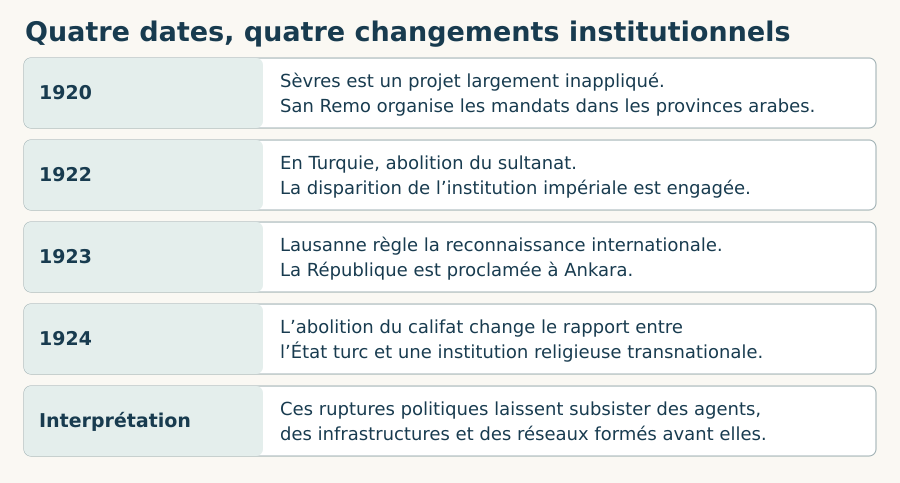
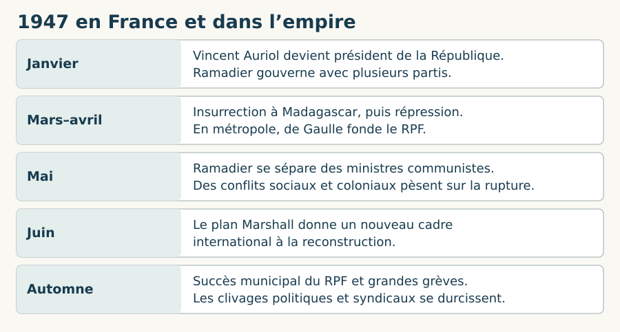

# BEL · AL — Histoire contemporaine (oral tronc commun 19 juin commission 2) 2026 · Corrigé brut

*Corrigé rédigé par IA, non officiel. Signalez toute erreur.*

**Rédaction** · GPT-6.2 Astra Ultra · vitesse non renseignée

**Autocontrôle** · GPT-6.2 Astra Ultra · vitesse non renseignée

La feuille contient 11 billets proposant chacun deux sujets au choix. Chaque sujet fait ici l’objet d’un exposé distinct.

## Billet 1

### Obtenir l’indépendance nationale au Moyen-Orient

L’infinitif « obtenir » déplace l’attention de la date inscrite dans un calendrier vers les rapports de force qui rendent la reconnaissance possible. Au lendemain de la Première Guerre mondiale, les aspirations à la souveraineté rencontrent des traités, des mandats et des occupations. L’indépendance turque s’affirme par la contestation de Sèvres et la reconnaissance à Lausanne en 1923, dans un État qui succède à l’Empire ottoman sans en conserver toutes les populations ni les frontières. Les revendications arabes suivent d’autres trajectoires. Partis, presse, pétitions, grèves et révoltes rendent coûteuse la tutelle européenne et imposent des interlocuteurs locaux, sans que les concessions obtenues effacent immédiatement la présence extérieure.

L’Irak entre à la Société des Nations en 1932 après une monarchie sous forte influence britannique. Ses traités avec Londres rappellent l’écart entre égalité juridique et capacité de maîtrise militaire et économique. Au Levant, la Seconde Guerre mondiale fragilise l’Empire français et ouvre une fenêtre de négociation. Le Liban proclame son indépendance en 1943 et le départ des forces françaises de Syrie et du Liban en 1946 fournit un autre seuil. La Transjordanie accède à l’indépendance en 1946. La fin du mandat sur la Palestine produit un État d’Israël, une guerre et la dispersion d’une grande partie de la population palestinienne. Elle ne réalise pas simultanément les deux projets nationaux. Enfin, la nationalisation de Suez en 1956 et la sortie britannique du Golfe en 1971 montrent que propriété économique, évacuation et reconnaissance internationale suivent des temporalités propres. L’indépendance devient un droit avant de devenir, parfois imparfaitement, un pouvoir de décision. C’est précisément cette discordance que les mouvements nationalistes cherchent ensuite à réduire.

### Les effets de la désindustrialisation en France

La fermeture d’une usine concentre en un lieu une transformation nationale dont les indicateurs sont plus complexes. La part de l’emploi industriel recule sous l’effet combiné des fermetures, des gains de productivité, de l’évolution de la demande et de l’externalisation de certaines fonctions. Un poste administratif ou de nettoyage transféré à une société de services peut disparaître du décompte industriel sans que la tâche ait quitté le site. Inversement, dans un bassin où la principale usine cesse son activité, le déclin produit des effets qui débordent largement le nombre des salariés directement touchés.

À partir des années 1970, la sidérurgie lorraine, le textile du Nord ou les chantiers navals deviennent des exemples majeurs de ces effets cumulatifs. Les suppressions d’emplois affectent les sous-traitants et les commerces, tandis que les collectivités perdent des ressources au moment où elles doivent réaménager des friches. Le statut d’ouvrier qualifié ne se transpose pas toujours dans un service local aux conditions et perspectives différentes. Les femmes des ménages concernés peuvent augmenter leur activité rémunérée ou se trouver elles-mêmes privées d’un poste industriel, comme dans le textile. Les départs des jeunes et les restructurations scolaires ou commerciales modifient durablement la vie collective. Grèves, manifestations et mise en patrimoine des sites expriment des demandes différentes, de la conservation de l’emploi à la reconnaissance d’une mémoire. Une politique de formation ne produit des débouchés que si de nouvelles activités ou des possibilités de mobilité existent effectivement. Dans d’autres territoires, des activités industrielles modernes continuent de croître. La désindustrialisation ne signifie donc pas absence de toute production en France. Elle déplace la géographie de la richesse et fragilise certains milieux ouvriers, avec des conséquences sociales, politiques et culturelles qui durent après la fermeture.

## Billet 2

### L’État et la pauvreté au Moyen-Orient (1920-2011)

La pauvreté est une insuffisance de ressources, mais aussi une difficulté d’accès à la terre, au soin, à l’école ou aux protections accordées par la citoyenneté. Les administrations ne définissent pas partout de la même manière qui doit être assisté. Dans l’entre-deux-guerres, les autorités mandataires et les nouveaux pouvoirs locaux héritent de réseaux de charité, de fondations pieuses et de solidarités de famille ou de quartier. Les services publics se développent de manière très inégale entre capitale, régions rurales et populations déplacées. Cette inégalité contribue à faire du contrôle de la terre, du prix du pain et de l’emploi des questions nationales.

Après les indépendances, certains régimes donnent à la redistribution une fonction centrale de légitimation. En Égypte, la réforme agraire de 1952, les subventions et l’expansion de l’enseignement et de l’emploi publics visent à limiter des inégalités anciennes et à intégrer de nouvelles couches sociales. Les travailleurs informels, les petits paysans et les femmes n’accèdent pas pour autant de manière identique à ces protections. Dans les monarchies du Golfe, les revenus pétroliers peuvent financer de larges services pour les nationaux alors que de nombreux travailleurs étrangers disposent de droits plus étroits. Les populations réfugiées, notamment palestiniennes, dépendent de combinaisons entre soutien familial, États d’accueil et institutions internationales comme l’UNRWA. Pauvreté et absence de papiers peuvent ainsi s’entretenir mutuellement.

L’ouverture économique, le chômage des jeunes et les ajustements budgétaires fragilisent certains compromis. La mobilisation égyptienne de 1977 contre la hausse annoncée de produits subventionnés montre combien une mesure de prix peut atteindre la légitimité de l’État. Les solidarités associatives, y compris religieuses, comblent parfois des lacunes tout en devenant des formes de présence politique. Les demandes de pain, de dignité et de justice sociale de 2011 condensent ces attentes sans se ramener à un niveau unique de revenu. Une comparaison historique doit donc distinguer les ressources de l’État, les bénéficiaires effectivement admis et le pouvoir des intéressés de contester les conditions de leur protection.

### Colonialistes et anticolonialistes en France (1944-1962)

En 1944, défendre la reconstruction d’une France puissante peut conduire des républicains à vouloir conserver l’empire, tandis que des militants invoquent les principes de la Libération pour contester la domination coloniale. Le désaccord porte autant sur les mots que sur le calendrier. Accorder des droits dans une Union française rénovée, reconnaître l’autonomie et accepter l’indépendance ne sont pas des positions équivalentes. Les répressions de Sétif et de Guelma en mai 1945, puis de Madagascar en 1947, mettent en évidence les limites d’un universalisme qui maintient des statuts et des contraintes inégaux. Les acteurs des territoires colonisés jouent leur propre rôle dans le débat métropolitain. Leurs revendications ne commencent pas avec le soutien d’un intellectuel parisien.

La guerre d’Indochine et plus encore la guerre d’Algérie redéfinissent les camps. Le PCF mène campagne contre la guerre d’Indochine, alors que d’autres familles politiques considèrent son issue à travers la Guerre froide. En Algérie, les partisans du maintien français vont des défenseurs d’intérêts matériels ou d’attachements familiaux aux promoteurs d’un colonialisme explicitement hiérarchique. Tous ne soutiennent pas les mêmes solutions politiques ni, à la fin du conflit, l’OAS. À gauche, le gouvernement Guy Mollet aggrave l’engagement dans la guerre après l’obtention des pouvoirs spéciaux en 1956. À l’inverse, des avocats, intellectuels, chrétiens, militants et appelés dénoncent la torture, défendent les droits des Algériens ou soutiennent l’indépendance selon des formes distinctes. Le Manifeste des 121 en 1960 cristallise une partie de ces désaccords. Le retour de de Gaulle en 1958 avait d’abord suscité des attentes contradictoires avant la reconnaissance de l’autodétermination puis les accords d’Évian en 1962. La confrontation ne recoupe donc pas exactement un axe gauche-droite. Elle transforme les partis, les institutions et les définitions mêmes de la France.

## Billet 3

### Un Moyen-Orient post-ottoman (1920-1924)

En 1920, l’Empire ottoman existe encore juridiquement, mais l’équilibre impérial a déjà été bouleversé par la défaite de 1918, les occupations et les projets nationaux. En 1924, le califat a disparu et une république turque est reconnue. Le court intervalle fait ainsi passer d’un ordre impérial contesté à plusieurs souverainetés inégalement reconnues. Le traité de Sèvres en 1920 prévoit un démembrement dont de larges dispositions ne sont pas appliquées. À Ankara, la Grande Assemblée nationale oppose une autre source de légitimité au gouvernement du sultan. L’abolition du sultanat en 1922, Lausanne et la République en 1923 puis la suppression du califat en 1924 tracent quatre seuils distincts. L’échange de populations entre Grèce et Turquie rappelle le coût humain de la consolidation des territoires nationaux.

Dans les provinces arabes, la conférence de San Remo en 1920 inscrit les intérêts français et britanniques dans la formation des mandats. Le bref royaume arabe de Damas dirigé par Fayçal prend fin la même année. La France proclame le Grand Liban et organise son autorité sur la Syrie. Les Britanniques placent Fayçal sur le trône irakien en 1921 et Abdallah à la tête de la Transjordanie. En Palestine, le mandat confirmé par la Société des Nations incorpore le projet de foyer national juif au sein d’une société où les Arabes palestiniens revendiquent eux aussi représentation et indépendance. Il ne faut donc pas lire la carte de 1924 à partir des seuls États de l’actualité. La tutelle extérieure, le poids des élites anciennement formées dans l’Empire et les résistances locales rendent encore ouverte l’évolution de plusieurs territoires. L’adjectif « post-ottoman » désigne une rupture de souveraineté, non l’effacement des circuits commerciaux, des familles, des pratiques administratives ou des souvenirs impériaux.

### Michel Rocard et la gauche française

L’intérêt d’une biographie politique de Rocard tient au fait qu’il représente une critique du socialisme dominant tout en devenant Premier ministre d’un président socialiste. Son engagement dans l’opposition à la guerre d’Algérie et son appartenance au PSU situent sa première trajectoire dans une gauche anticoloniale et critique de la SFIO. Son enquête sur les regroupements de populations en Algérie, menée comme inspecteur des finances, donne à la compétence administrative une portée critique. Dirigeant du PSU et candidat à la présidentielle de 1969, il se réclame ensuite d’une « deuxième gauche » qui valorise l’action des mouvements sociaux, l’autogestion et une transformation moins exclusivement conduite depuis le sommet de l’État.

Son entrée au Parti socialiste en 1974 change l’échelle du débat. Face à Mitterrand, Rocard défend une approche marquée par la négociation et par une confiance plus limitée dans les seules nationalisations. L’opposition ne doit pas devenir une caricature entre réalisme d’un camp et idéalisme de l’autre. Elle concerne l’équilibre entre État, syndicats, entreprises et collectivités dans le projet socialiste, ainsi que la maîtrise du parti et des candidatures. Après plusieurs responsabilités ministérielles, Rocard devient Premier ministre de 1988 à 1991, alors que le PS ne dispose pas seul d’une majorité absolue à l’Assemblée. La création du revenu minimum d’insertion en 1988, les accords de Matignon sur la Nouvelle-Calédonie et la contribution sociale généralisée au début des années 1990 illustrent une action où recherche de compromis et interventions publiques vont de pair. L’usage du 49, alinéa 3 rappelle aussi les contraintes d’un gouvernement sans majorité stable. Son passage à la tête du PS en 1993-1994 ne le conduit pas à la présidence de la République. Jusqu’en 1995, son influence se mesure donc autant à des politiques durables et à une culture de gouvernement qu’à ses succès dans les compétitions nationales.

## Billet 4

### Le développement économique des États au Moyen-Orient (1920-2011)

Le développement ne se réduit ni à l’indépendance ni au taux de croissance du PIB. Il concerne la capacité durable de produire, de diversifier l’économie et d’étendre l’accès aux services et aux revenus. Dans les années 1920-1930, plusieurs nouveaux États héritent d’économies spécialisées et d’infrastructures dessinées en partie pour les échanges impériaux. La concentration de la propriété foncière en Égypte, les débuts du pétrole en Irak et dans la péninsule ou le rôle commercial du Levant dessinent des points de départ très différents. La même frontière nationale peut réunir des espaces inégalement reliés à la capitale et aux marchés.

Les États indépendants cherchent ensuite à recouvrer le contrôle des ressources et à accélérer l’industrialisation. L’Égypte de Nasser associe réforme agraire, barrage d’Assouan, éducation et industrie publique. La construction de cet État développe des capacités humaines et techniques tout en créant des dépendances financières et de lourdes charges budgétaires. En Iran, la croissance et les réformes sous Mohammad Reza Pahlavi ne résorbent pas les inégalités ni la contestation d’un modèle fortement autoritaire. Après 1973, les producteurs du Golfe disposent de moyens considérables pour les infrastructures et le logement, mais demeurent exposés aux variations du prix du pétrole et recourent massivement à une main-d’œuvre non nationale. Les économies sans rente reçoivent parfois des capitaux et transferts de travailleurs issus de ce même système régional. Les guerres, les sanctions contre l’Irak, la reconstruction du Liban ou l’occupation des territoires palestiniens modifient brutalement les trajectoires. À la veille des soulèvements de 2011, les inégalités et le chômage de jeunes diplômés montrent pourquoi il faut confronter croissance, répartition et emploi. Une comparaison sérieuse expliquera comment les bénéfices entrent dans le budget public, puis comment ils atteignent ou non différents groupes d’habitants.

### La France dans le monde (1939-1995)

La trajectoire commence par une défaite qui rend incertaine la capacité de la France à parler d’une seule voix. La France libre, la participation de soldats issus de l’empire et le rétablissement d’un gouvernement républicain permettent à la France de siéger parmi les vainqueurs et d’obtenir en 1945 un siège permanent au Conseil de sécurité de l’ONU. Ce rang de droit ne reflète pas exactement sa puissance matérielle dans un monde dominé par les États-Unis et l’URSS. La reconstruction s’appuie notamment sur l’aide américaine et sur de nouvelles institutions de coopération européenne.

Les guerres d’Indochine puis d’Algérie montrent les coûts et les limites de la conservation d’un empire. L’échec de l’intervention à Suez en 1956, dans un contexte de pression américaine et soviétique, révèle la fragilité d’une ambition impériale autonome. La construction européenne fournit une autre échelle d’influence, de la CECA au traité de Rome puis à Maastricht en 1992. Ce choix n’efface pas les conflits sur la place des États. De Gaulle donne à l’autonomie nationale une forte expression avec la dissuasion nucléaire, la reconnaissance de la Chine populaire en 1964 et le retrait du commandement intégré de l’OTAN en 1966, sans sortie de l’Alliance atlantique. La coopération avec d’anciennes colonies, particulièrement en Afrique, prolonge des échanges et des asymétries longtemps après la fin juridique de l’empire.

L’économie, les migrations et la culture comptent aussi dans cette histoire. La francophonie institutionnelle ne se réduit pas au rayonnement unilatéral de Paris et des artistes et intellectuels venus des anciens territoires transforment la vie métropolitaine. Sous Mitterrand, le couple franco-allemand, les engagements internationaux et la difficile réponse aux crises de l’après-guerre froide témoignent d’une puissance moyenne disposant d’instruments diplomatiques importants. En 1995, « la place de la France » ne se mesure donc ni à la seule nostalgie impériale ni au seul siège de l’ONU. Il faut distinguer statut, moyens d’action et influence effectivement reconnue par les partenaires.

## Billet 5

### Mohammad Reza Pahlavi (1919-1980)

Le second shah de la dynastie Pahlavi ne se confond pas avec son père Reza Shah. Il monte sur le trône en 1941 après l’intervention britannique et soviétique en Iran et l’abdication forcée de son père. Le contexte de dépendance internationale limite d’abord son autorité. L’expérience de Mohammad Mossadegh, devenu Premier ministre en 1951, concentre la question de la souveraineté pétrolière et celle des pouvoirs respectifs du souverain et du gouvernement. La nationalisation du pétrole mobilise une importante partie de l’opinion. En 1953, le renversement de Mossadegh avec l’appui britannique et américain rétablit l’autorité du shah, tout en liant durablement son image à ces soutiens extérieurs.

À partir de 1963, la Révolution blanche associe notamment réforme foncière, développement de l’éducation et droit de vote des femmes. Les recettes pétrolières financent infrastructures, industrie et armée. Elles accélèrent l’urbanisation mais les bénéfices sont inégalement distribués et les transformations du monde rural nourrissent de nouvelles tensions. Le régime célèbre la continuité avec l’ancienne Perse et se présente comme moteur de modernité. La concentration du pouvoir, les pratiques de la police politique et la réduction des possibilités d’opposition affaiblissent cependant les médiations capables de traiter la contestation. Les clercs ne sont pas seuls à s’opposer au shah. Libéraux, étudiants, commerçants et militants de gauche donnent aux mobilisations de 1978-1979 une forte diversité. Le souverain quitte l’Iran en janvier 1979 et meurt en exil en 1980. La chute de la monarchie ne résulte pas d’un refus simple de la modernisation. Elle met en évidence le conflit entre un développement rapide piloté d’en haut, une légitimité politique contestée et une dépendance internationale que les réformes prétendaient surmonter.

### L’instabilité gouvernementale de la IVe République

La succession rapide des cabinets entre 1946 et 1958 a fait de la IVe République un contre-modèle pour les fondateurs de la Ve. Il faut toutefois distinguer durée d’un gouvernement, continuité des équipes ministérielles et capacité d’engager une politique de long terme. La Constitution de 1946 place le gouvernement sous la responsabilité de l’Assemblée nationale et tente de rationaliser l’investiture et la mise en cause de sa responsabilité. Le multipartisme et l’absence fréquente de majorité stable donnent néanmoins aux partenaires de coalition la possibilité de se retirer sur des désaccords importants. Les pratiques de l’investiture et les démissions sans vote formel de censure aggravent cette fragilité.

Après le départ des ministres communistes en 1947, la Troisième Force doit faire vivre le régime entre une forte opposition communiste et une opposition gaulliste. Les partis qui la composent divergent sur les prix, l’école, la construction européenne ou l’empire. La réforme institutionnelle de 1954 ne suffit pas à résoudre ces contradictions. Pourtant des ministres et hauts fonctionnaires durent au-delà des cabinets. La planification, les investissements de reconstruction et les débuts de la construction européenne témoignent d’une continuité qui ne se mesure pas en mois de gouvernement. Le gouvernement de Pierre Mendès France en 1954-1955 est bref mais associé à la fin de la guerre d’Indochine et à des décisions décisives en Tunisie. Le cabinet de Guy Mollet en 1956-1957 dure davantage sans régler la crise algérienne. En mai 1958, la contestation de l’autorité gouvernementale à Alger et le recours à de Gaulle conduisent à une rupture constitutionnelle. L’instabilité est donc réelle, mais l’expliquer demande de combiner règles, pratiques partisanes et guerres coloniales. Elle n’équivaut ni à une immobilité constante de l’État ni à la seule faiblesse personnelle de ses dirigeants.

## Billet 6

### Organisations et projets supranationaux au Moyen-Orient (1920-2011)

Confédération, alliance de gouvernements, marché de producteurs et État unifié ne sont pas quatre noms d’une même forme supranationale. Après l’Empire ottoman, les frontières issues des règlements de paix et des mandats sont contestées au nom d’appartenances arabes, religieuses ou territoriales plus larges. Le panarabisme fait de la langue, d’une histoire et d’intérêts communs les fondements possibles d’une unité politique. La Ligue arabe, fondée en 1945, institue une concertation entre gouvernements mais ménage leur souveraineté. Sa capacité d’imposer des décisions demeure donc différente de celle d’un pouvoir supranational doté de ressources propres.

La République arabe unie de 1958 pousse beaucoup plus loin l’union entre Égypte et Syrie. Le retrait syrien en 1961 révèle le conflit entre aspirations unitaires, répartition des postes et intérêts des élites nationales. D’autres projets cherchent plutôt une coordination spécialisée. L’OPEP, créée à Bagdad en 1960, réunit producteurs arabes et non arabes autour des conditions de valorisation du pétrole. Elle n’est ni une organisation exclusivement régionale ni un gouvernement arabe. L’Organisation de la conférence islamique, fondée en 1969, se déploie au-delà du Moyen-Orient et s’appuie sur une autre définition de la communauté. Le Conseil de coopération du Golfe, fondé en 1981 par six monarchies, organise une coopération entre voisins confrontés à des enjeux politiques et économiques communs. Il ne se confond ni avec la Ligue arabe ni avec une fédération comme les Émirats arabes unis. Les mobilisations transnationales de 2011 rappellent enfin qu’une circulation d’idées, d’images et de revendications peut dépasser les États sans créer une institution durable. Le sujet fait donc apparaître une tension récurrente. Les gouvernements cherchent à accroître leur poids par la coopération mais résistent au transfert de compétences qu’exigerait une unité politique véritable.

### S’opposer au régime du maréchal Pétain

Sous l’Occupation, s’opposer à Vichy peut signifier défendre la légalité républicaine, dénoncer les persécutions, refuser la collaboration ou rejoindre une organisation de résistance. Ces engagements ne coïncident pas dès l’été 1940. Des Français d’abord attachés à la personne de Pétain entrent plus tard en dissidence. D’autres rejettent immédiatement les actes constitutionnels de juillet, la Révolution nationale ou la politique envers l’occupant. Les quatre-vingts parlementaires qui refusent les pleins pouvoirs le 10 juillet 1940 constituent une première manifestation politique, sans que leur vote résume l’ensemble des formes d’opposition ultérieures.

Les espaces d’action sont multiples. La France libre organisée autour de de Gaulle affirme la continuité de la souveraineté française. À l’intérieur, presse clandestine, mouvements, syndicats, réseaux de secours et protestations publiques juxtaposent des motivations variées. Le témoignage chrétien contre l’antisémitisme et les lettres de protestation de certains évêques en 1942 ne se confondent pas avec la position de l’ensemble de l’épiscopat. Des personnes persécutées, notamment juives, sont elles-mêmes actrices de l’entraide et de la lutte politique. Les femmes y participent malgré leur exclusion antérieure de la citoyenneté électorale. Les divisions entre communistes, gaullistes et autres groupes, les évolutions après juin 1941 et la montée de la contrainte donnent au phénomène une chronologie indispensable. L’unification autour du Conseil national de la Résistance en 1943 rapproche mouvements, partis et syndicats dans la perspective de la Libération. Elle ne rend pas identiques toutes leurs conceptions de l’avenir. L’historien doit également distinguer opposition à Vichy, résistance à l’occupant et comportements de survie, même lorsqu’une même action peut relever de plusieurs logiques. C’est ainsi que le refus du régime se transforme progressivement en projet de rétablissement politique et social de la République.

## Billet 7

### Les mondes ruraux au Moyen-Orient (1920-2011)

Le pluriel conduit à distinguer plaines irriguées, régions sèches, montagne, sédentaires et populations mobiles. Il faut aussi éviter d’opposer des campagnes supposées immobiles à des villes modernes. Terre, eau, propriété et dépendance à l’égard des marchés ou de l’État façonnent des mondes ruraux très différents. En Égypte, l’agriculture de la vallée et du delta du Nil est étroitement liée au contrôle hydraulique et à des marchés mondiaux, notamment celui du coton. Dans d’autres régions, l’élevage mobile, de petites propriétés ou de grands domaines coexistent, tandis que les frontières étatiques compliquent parfois des circulations anciennes.

La réforme agraire égyptienne engagée en 1952 cherche à limiter la grande propriété et à donner des ressources à des familles paysannes. En Iran, la réforme foncière de la Révolution blanche dans les années 1960 transforme les rapports avec les propriétaires sans procurer partout des terres ou des revenus suffisants pour rester au village. Syrie et Irak mettent également en œuvre des redistributions liées à la construction d’États interventionnistes. L’accès au crédit, aux débouchés et à l’irrigation détermine le résultat autant que la seule répartition juridique des parcelles. Les grands barrages associent augmentation des capacités nationales et déplacements ou effets environnementaux locaux. La construction du haut barrage d’Assouan entraîne ainsi le déplacement de communautés nubiennes.

L’exode rural alimente l’expansion de villes comme Le Caire ou Téhéran, mais le départ ne rompt pas nécessairement les liens. Les revenus des migrants, les retours saisonniers et les relations familiales peuvent financer des investissements ou modifier les rapports sociaux au village. Les guerres et les déplacements forcés ont d’autres effets, particulièrement visibles dans les campagnes palestiniennes ou irakiennes. En 2011, pauvreté, accès à l’eau, emplois et prix alimentaires demeurent des enjeux politiques. Pour mener la comparaison, on suivra la manière dont une famille accède à une parcelle, à l’eau et à un marché plutôt que de faire du « paysan moyen-oriental » une figure unique.

### Mémoires et commémorations de la Seconde Guerre mondiale

Les mémoires sont portées par des groupes, des familles et des individus. La commémoration en est une mise en scène publique à une date et dans un lieu choisis. À la Libération, la Résistance et la victoire ont une valeur de refondation politique. Les discours gaullistes mettent en avant une France demeurée combattante, les communistes valorisent le sacrifice de leurs militants, tandis que d’anciens déportés, prisonniers et résistants forment des associations aux expériences diverses. Ce moment n’est pas celui d’une amnésie générale qui aurait tout confondu. Des survivants de la Shoah témoignent dès l’après-guerre, mais leur parole n’occupe pas immédiatement la même place dans les cérémonies nationales que dans les familles ou les associations.

En 1964, l’entrée de Jean Moulin au Panthéon et le discours d’André Malraux proposent une image saisissante de l’unité résistante. Dans les décennies suivantes, l’ouverture d’archives, les travaux historiques et des œuvres comme *Le Chagrin et la Pitié* contribuent à rendre visibles les accommodements et les responsabilités de Vichy. Les procès liés aux crimes contre l’humanité, particulièrement celui de Klaus Barbie en 1987, déplacent l’écoute des témoignages et les usages publics de la catégorie de victime. En 1995, lors de la commémoration de la rafle du Vél’ d’Hiv, Jacques Chirac reconnaît la responsabilité française. Il modifie la parole présidentielle, sans créer à lui seul le savoir sur la persécution. Les mémoires des travailleurs requis, des soldats coloniaux ou des populations des territoires d’outre-mer ont aussi leurs propres calendriers de reconnaissance. Une même date officielle peut donc rassembler des personnes dont les récits ne se recouvrent pas. Comprendre ces transformations suppose de distinguer recherche historique, justice, action associative et cérémonie d’État plutôt que de les fondre dans une marche univoque du « silence » au « devoir de mémoire ».

## Billet 8

### Renverser des régimes politiques au Moyen-Orient (1920-2011)

Changer de chef ne suffit pas toujours à renverser un régime. La question est de savoir si les règles de succession, la distribution du pouvoir et le fondement de la légitimité sont effectivement transformés. Les régimes mandataires et les monarchies d’après 1918 font l’objet de contestations qui n’aboutissent pas toutes à leur chute. En Iran, le passage des Qadjars aux Pahlavi en 1925 institue une autre dynastie et accompagne une centralisation de l’État, sans substituer une république à la monarchie. À l’inverse, la disparition du sultanat ottoman en 1922 puis la proclamation de la République turque en 1923 changent le principe de souveraineté.

Les transformations égyptiennes de 1952-1953 et irakiennes de 1958 mettent fin à deux monarchies, mais la pluralité des forces sociales et la trajectoire des nouvelles républiques diffèrent. Le cas de Mossadegh en Iran en 1953 oblige à une distinction inverse. Son renversement avec soutien extérieur modifie profondément le rapport des forces et réaffirme l’autorité du shah, sans changement formel de dynastie. En Iran en 1979, une révolution issue de mobilisations beaucoup plus variées renverse au contraire l’institution monarchique et ouvre une lutte pour la définition d’une République islamique. La chute du régime de Saddam Hussein en Irak en 2003 résulte d’une invasion étrangère. L’occupation et la recomposition des institutions en rendent les conséquences très différentes de celles d’un mouvement national cherchant à se libérer d’une tutelle. Enfin, en 2011, le départ de Moubarak sous la pression des mobilisations égyptiennes ne règle pas la place de l’armée. Il faut donc toujours examiner l’avant, le moment de rupture et l’après immédiat. Cette méthode permet de comparer des chutes de gouvernants, des changements de régime et des révolutions sociales sans effacer les populations qui en ont supporté les coûts.

### Pierre Mendès-France (1907-1982), dans les limites de la période du programme

Mendès France appartient à la famille radicale et à une culture politique qui veut fonder l’autorité sur une parole publique argumentée. Dans la période ouverte en 1939, son engagement pendant la guerre, son refus de Vichy et son entrée dans la France combattante ancrent sa légitimité dans la Résistance. Ministre de l’Économie nationale à la Libération, il se heurte rapidement aux choix de politique économique, notamment à la façon de maîtriser l’inflation et de financer la reconstruction. La démission rend visible une constante de sa carrière, la difficulté à transformer une doctrine exigeante de décision en majorité durable.

Son gouvernement de juin 1954 à février 1955 intervient après la défaite de Diên Biên Phu. La conclusion des accords de Genève en juillet met fin à l’engagement français dans la guerre d’Indochine sans régler durablement l’avenir du Vietnam. Le discours de Carthage du même mois ouvre la voie à l’autonomie interne de la Tunisie. Ces décisions lient l’affirmation d’une politique délibérée à la reconnaissance des limites de la domination impériale. Elles ne font pas de Mendès France le partisan immédiat de toutes les indépendances, notamment au début de la guerre d’Algérie. Ses interventions radiodiffusées visent à expliquer aux citoyens des arbitrages complexes et contribuent à l’image d’un gouvernement par le contrat de confiance. La brièveté du cabinet rappelle pourtant la fragilité parlementaire de cette expérience. Opposé à la concentration présidentielle de la Ve République, il devient une référence pour une partie de la gauche réformatrice et anticoloniale, en particulier autour du PSU, et demeure publiquement présent en 1968. Il meurt en 1982. L’écart entre le peu de temps passé à la tête du gouvernement et la longue postérité du mendésisme explique l’intérêt du sujet. Cette postérité doit être distinguée de l’action effective de 1954-1955.

## Billet 9

### La Syrie des Assad

Le pluriel renvoie à la succession familiale entre Hafez et Bachar al-Assad dans une république qui ne reconnaît pas juridiquement un principe dynastique. Avant 1970, la Syrie indépendante a connu une forte instabilité gouvernementale, l’union puis la rupture avec l’Égypte et l’arrivée du Baas au pouvoir en 1963. Hafez al-Assad prend le pouvoir en 1970 et devient président en 1971. La concentration de l’autorité présidentielle s’appuie sur le parti, l’armée, les services de sûreté et des alliances avec des milieux économiques et sociaux divers. La place de réseaux alaouites dans certaines institutions est importante, mais parler d’une domination uniforme de toute une communauté masquerait ces alliances et la diversité interne de la société.

Le régime justifie son monopole politique par l’unité nationale, l’engagement contre Israël et une promesse de promotion sociale. La perte du Golan en 1967, antérieure à l’accession de Hafez à la présidence, puis la guerre de 1973 nourrissent une légitimité revendiquée de défense du territoire. Au Liban, l’intervention syrienne à partir de 1976 élargit le poids régional de Damas et engage durablement le régime dans les conflits d’un pays voisin. Sur le plan intérieur, la répression des opposants et la violence de Hama en 1982 montrent le coût du maintien autoritaire. Après la mort de Hafez en 2000, Bachar lui succède à la faveur d’une transformation institutionnelle rapide. Les espoirs d’ouverture du « printemps de Damas » restent brefs. Les réformes économiques et l’enrichissement de réseaux proches du pouvoir accroissent les écarts, tandis que les libertés politiques demeurent étroites. En 2011, mobilisations locales, répression et extension de la crise révèlent la fragilité de ce contrat autoritaire. Le programme s’arrête à cette rupture. Il faut expliquer le régime antérieur dans ses propres conditions plutôt que de le déduire rétrospectivement des développements ultérieurs de la guerre.

### Les femmes dans la vie politique en France

Pour prendre la mesure du changement entre 1939 et 1995, il faut distinguer droit de vote, éligibilité, présence dans les exécutifs et participation aux mouvements collectifs. Avant même de pouvoir voter aux élections nationales, les Françaises militent dans des partis et des associations et prennent part à des mobilisations sociales. Pendant la guerre, leur participation à la Résistance et aux réseaux de secours contribue à la légitimation du droit de vote, sans constituer son origine unique. Les suffragistes l’avaient réclamé de longue date. L’ordonnance du 21 avril 1944 ouvre aux femmes le vote et l’éligibilité, exercés aux élections municipales et constituantes de 1945. L’accès à la qualité d’électrice est rapide, celui aux positions de direction beaucoup plus lent.

Sous les IVe et Ve Républiques, la sélection des candidatures par les partis, les réseaux locaux de notables et la répartition familiale du temps limitent la présence des femmes dans les assemblées et les gouvernements. Les organisations féminines et les mobilisations autour de la contraception ou de l’avortement déplacent aussi le champ politique. La loi portée par Simone Veil en 1974-1975 sur l’interruption volontaire de grossesse est portée par une ministre, discutée par des assemblées encore très masculines et préparée par des mobilisations hors du Parlement. En 1974, Arlette Laguiller est la première femme candidate à une élection présidentielle française. En 1991, Édith Cresson devient la première femme Première ministre. Ces premières sont des repères de franchissement et non des preuves d’égalité achevée. L’idée de parité se diffuse dans les années 1990, mais les réformes constitutionnelle et législative décisives sont postérieures à 1995. L’histoire du sujet relie ainsi présence dans les urnes, accès aux mandats et capacité de faire reconnaître comme politiques des questions reléguées à la vie privée.

## Billet 10

### Les mandats au Moyen-Orient

Un mandat est une forme de tutelle internationale confiée par la Société des Nations à une puissance définie. L’article 22 du pacte reconnaît à certaines communautés issues de l’Empire ottoman un degré de développement permettant d’envisager l’indépendance et prévoit une assistance provisoire. Cette formulation produit une différence juridique avec l’annexion. Elle n’empêche pas les puissances mandataires d’organiser l’administration et de défendre des intérêts stratégiques propres. Les décisions de San Remo en 1920 puis la mise en forme des mandats redéfinissent l’espace politique régional. Les aspirations nationales et les structures locales ont cependant leur histoire propre et ne commencent pas avec les choix européens.

La Syrie et le Liban passent sous mandat français. La proclamation du Grand Liban en 1920 fait exister un territoire plus vaste que le Mont-Liban et transforme les équilibres confessionnels. En Syrie, la division administrative et les résistances, dont la grande révolte de 1925-1927, révèlent les limites de l’acceptation du pouvoir français. Dans la sphère britannique, le cas irakien privilégie une monarchie hachémite et des relations organisées par traité plutôt qu’une autorité uniforme. L’entrée de l’Irak à la SDN en 1932 n’abolit pas l’influence britannique. Transjordanie et Palestine suivent des trajectoires divergentes. Dans la seconde, les responsabilités britanniques relatives au foyer national juif coexistent avec les aspirations des Arabes palestiniens à la représentation et à l’indépendance. La fin du mandat en 1948 débouche sur la guerre et non sur une entente institutionnelle entre les deux sociétés. En 1943-1946, le Liban et la Syrie obtiennent l’indépendance et le départ des forces françaises. L’héritage mandataire concerne donc frontières, institutions, réseaux administratifs et controverses sur la légitimité, mais il ne fournit pas une explication suffisante de toute l’histoire qui suit.

### Le mai 68 ouvrier

L’expression corrige une mémoire de Mai centrée sur les étudiants du Quartier latin. Elle ne signifie pas que les usines aient simplement reproduit une révolte universitaire. Les entreprises connaissent avant mai des conflits sur salaires, cadences, horaires, autorité des contremaîtres et dignité des travailleurs. Les mobilisations à Rhodiacéta en 1967 et les luttes du début de 1968 montrent l’existence de ces antécédents. La société industrielle rassemble ouvriers qualifiés, ouvriers spécialisés, femmes, immigrés et jeunes travailleurs placés dans des positions très différentes devant le syndicat et la hiérarchie.

À partir de la mi-mai, arrêts de travail et occupations touchent des secteurs et des territoires très variés. Sud-Aviation à Bouguenais et les usines Renault fournissent des repères, sans résumer l’ensemble des entreprises et services mobilisés. La grève modifie aussi les usages du temps, les discussions au sein des ateliers et les rapports entre militants et salariés moins syndiqués. Les rencontres avec les étudiants existent, mais les attentes et les organisations restent distinctes. À la fin de mai, les négociations de Grenelle aboutissent notamment à une forte hausse du salaire minimum et à des améliorations salariales. Le constat n’est ni une simple capitulation ni un accord approuvé partout au même moment. Dans plusieurs établissements, la reprise se décide après d’autres négociations et des conflits prolongés. Le vote législatif favorable à la droite en juin ne mesure pas l’adhésion de chaque ouvrier à l’ordre antérieur. La loi de décembre 1968 sur la section syndicale d’entreprise constitue un effet institutionnel durable. L’histoire ouvrière de Mai doit donc tenir compte des acquis, de revendications restées insatisfaites et des pouvoirs de parole nouveaux, sans transformer une mobilisation extraordinairement diverse en un acteur unique doté d’une intention uniforme.

## Billet 11

### L’année 1947 en France

En janvier 1947, la IVe République dispose enfin d’un président élu, Vincent Auriol, et d’un président du Conseil, Paul Ramadier. La Constitution adoptée en 1946 rend possible un ordre politique stabilisé en droit, mais les partenaires du gouvernement ne s’accordent plus sur la politique économique, sociale et coloniale. L’année conserve beaucoup de l’après-guerre immédiat. Pénuries, rationnement et inflation pèsent sur la vie quotidienne, tandis que la reconstruction exige des investissements de long terme. La définition des salaires et des prix oppose gouvernement, travailleurs et directions confédérales dans des entreprises dont certaines viennent d’être nationalisées.

En mai, la révocation des ministres communistes met fin au tripartisme gouvernemental. La Guerre froide internationale contribue à la polarisation, mais les désaccords intérieurs sur les salaires et sur le conflit indochinois sont également immédiats. De Gaulle fonde le RPF en avril. Ses bons résultats aux municipales d’octobre font apparaître une autre opposition au régime. La « Troisième Force » doit désormais gouverner entre les communistes et les gaullistes. Les grèves de l’automne et la rupture qui conduit à la création de Force ouvrière donnent à la fracture politique une dimension syndicale. L’annonce du plan Marshall en juin et l’acceptation française d’une coopération européenne pour l’aide américaine font de la reconstruction un enjeu de positionnement international. Dans l’empire, la guerre d’Indochine est déjà engagée et l’insurrection malgache à partir de mars, puis sa répression, révèlent la violence du maintien colonial. L’année 1947 est donc une charnière à trois échelles, celle du gouvernement, des rapports sociaux et de la position internationale. Une bonne conclusion doit préserver ce qui lui échappe encore : l’avenir de la IVe République et l’issue des conflits coloniaux ne sont pas connus de ses contemporains.

### Entrer en politique en France (1939-1995)

Entrer en politique peut signifier déposer sa première candidature, prendre une carte de parti, rejoindre un syndicat ou franchir le pas d’une mobilisation publique. Le verbe invite à suivre des trajectoires et à comparer les seuils d’entrée selon le sexe, l’origine sociale, le statut juridique et le moment historique. Pendant l’Occupation, la clandestinité et les risques pesant sur les individus modifient radicalement les formes de l’engagement. La Résistance ouvre pour certaines femmes et certains jeunes un espace de responsabilité auquel les institutions électorales ne leur donnaient pas accès. La citoyenneté politique des femmes reconnue en 1944 élargit ensuite légalement le recrutement, sans garantir l’égalité des investitures.

Les partis de masse, municipalités et syndicats offrent après 1945 des voies contrastées d’apprentissage. Dans une municipalité ouvrière, le militantisme local peut donner à un salarié une compétence administrative et une position publique. Les réseaux de notables, le droit, le journalisme et la haute fonction publique constituent d’autres voies dont l’accès dépend davantage des ressources scolaires et sociales. La Ve République renforce le rôle de l’élection présidentielle et des appareils capables de présenter des candidats sur tout le territoire, mais le mandat municipal conserve sa fonction de base politique. Les guerres coloniales, Mai 68, les mouvements féministes et la Marche pour l’égalité de 1983 suscitent des engagements qui commencent loin des structures partisanes et ne conduisent pas tous à une carrière élective. Le développement de la télévision et des métiers de la communication change les conditions de visibilité sans effacer le travail militant ordinaire. En 1995, entrer dans la vie publique est juridiquement ouvert à davantage de personnes qu’en 1939, alors que le coût matériel, le temps disponible et les mécanismes d’investiture continuent de sélectionner celles qui accèdent aux mandats. L’histoire d’une génération militante doit donc se raconter aussi à travers les engagements qui restent collectifs et sans titre électif.

[Fascicule officiel](https://www.ens.psl.eu/sites/default/files/19.06.26_sujets_histoire_2.pdf) · [Index des sujets du jury](https://www.ens.psl.eu/rapports-et-sujets-du-concours-2026-section-des-lettres-groupe-al)
